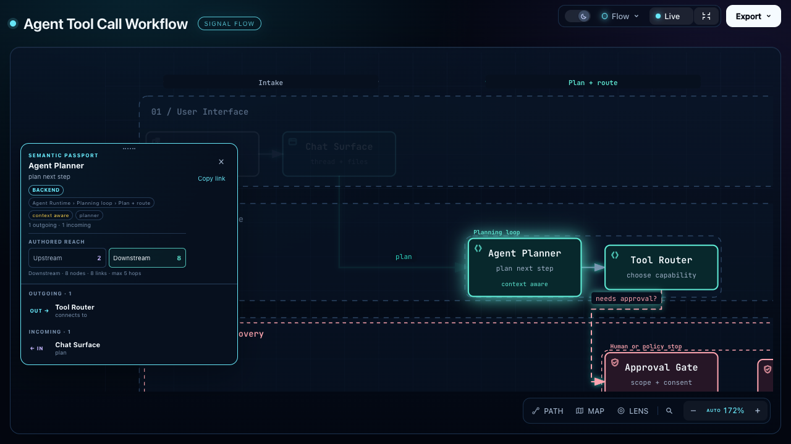
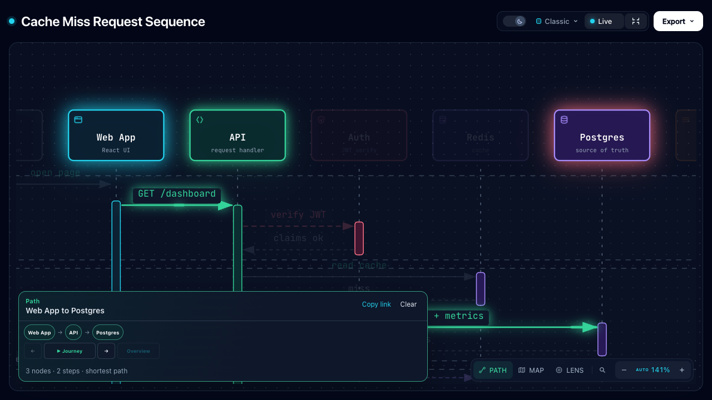
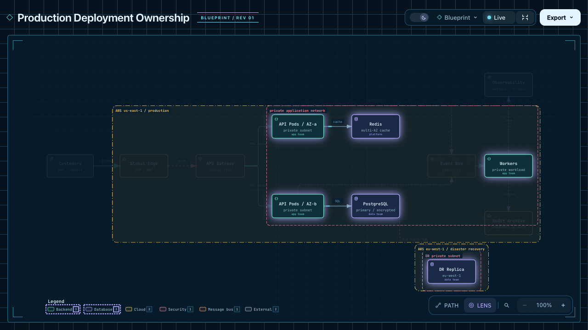
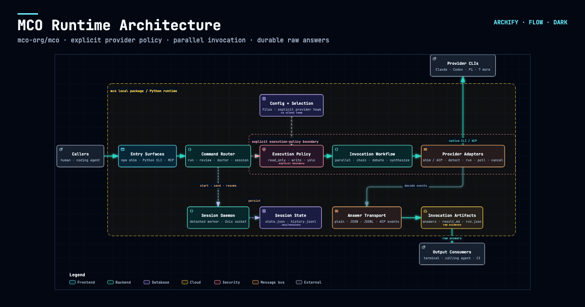
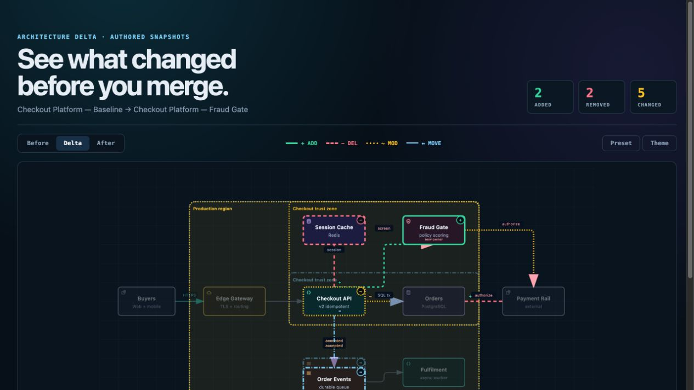
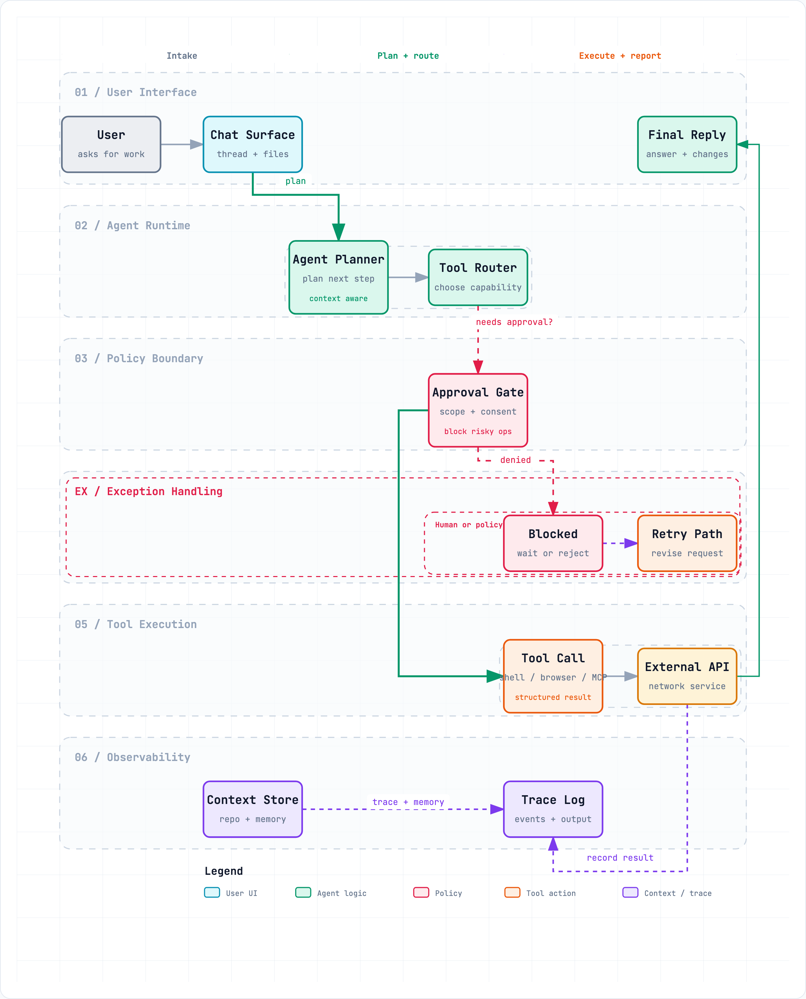
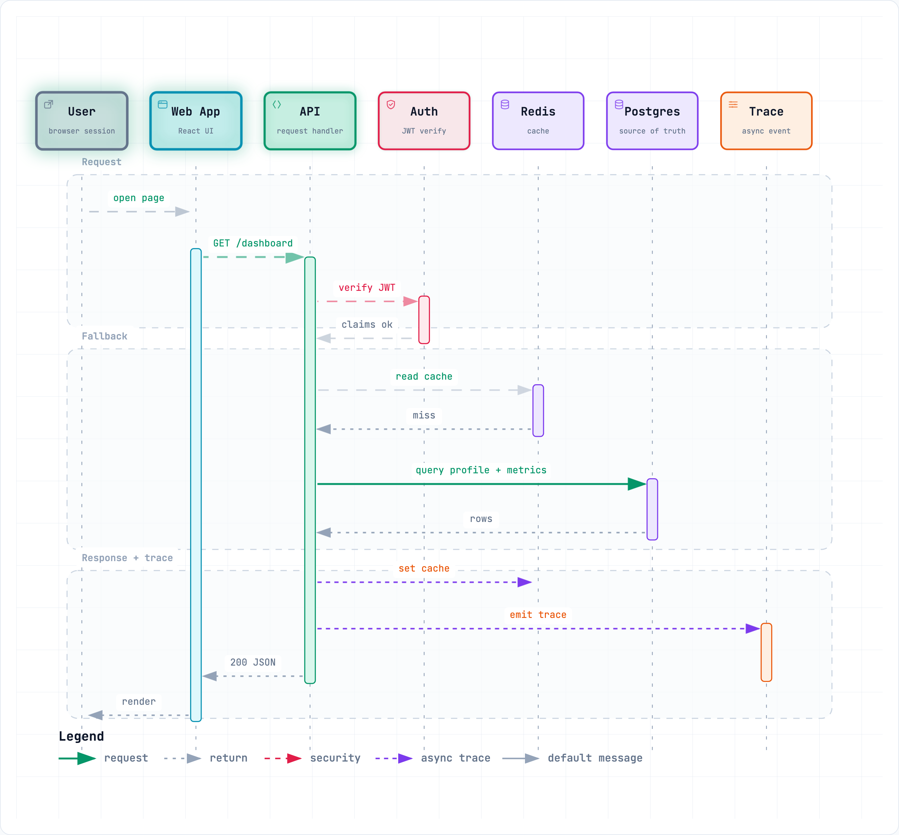
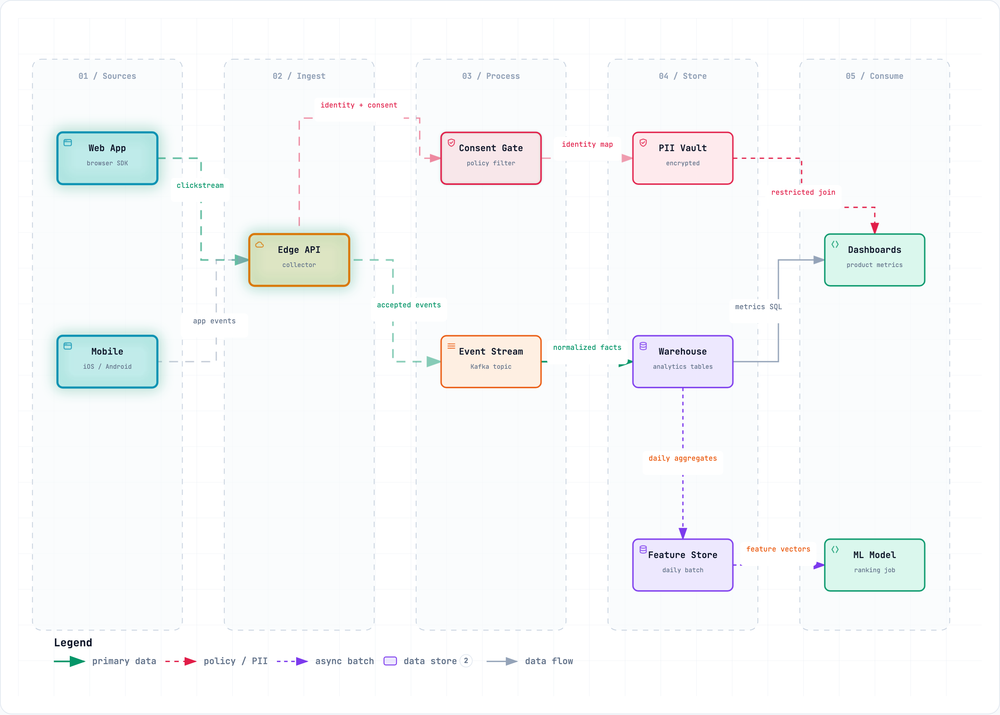
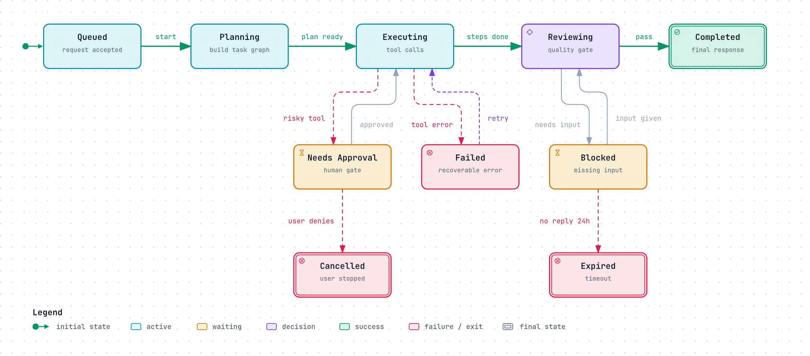

<p align="center">
  <picture>
    <source media="(prefers-color-scheme: dark)" srcset="docs/assets/archify-lockup-dark.svg" />
    
  </picture>
</p>
<h3 align="center">理解したいこと、計画したいこと、共有したいことを、触れるビジュアルに変えます。</h3>

<p align="center"></p>

<p align="center"><strong>公式リンク：</strong> <a href="https://archify.si">archify.si</a> · <a href="https://github.com/tt-a1i/archify">GitHub</a><br/>Archify は無料のオープンソースプロジェクトです。第三者のオンラインサービスや有料プランは各運営者が提供するもので、Archify の公式サービスではありません。 <a href="#official-services">詳細 →</a></p>

<p align="center">アイデア、疑問、計画のどれから始めても構いません。AI エージェントに説明すれば、Archify が探索・カスタマイズ・共有できるインタラクティブな HTML を生成します。旅行の行程や学習マップから複雑なシステムまで、あなた自身のものに作り込めます。</p>

<p align="center">
  <a href="https://archify.si/gallery.html"><strong>ライブデモ</strong></a> &nbsp;·&nbsp;
  <a href="#start"><strong>使ってみる</strong></a> &nbsp;·&nbsp;
  <a href="https://archify.si/guide.html"><strong>シナリオガイド</strong></a> &nbsp;·&nbsp;
  <a href="#コミュニティ"><strong>コミュニティ</strong></a> &nbsp;·&nbsp;
  <a href="./README.md"><strong>English</strong></a> &nbsp;·&nbsp;
  <a href="./README_ZH.md"><strong>简体中文</strong></a> &nbsp;·&nbsp;
  <a href="./README_KO.md"><strong>한국어</strong></a>
</p>

<p align="center">
  <a href="https://trendshift.io/repositories/31352?utm_source=repository-badge&amp;utm_medium=badge&amp;utm_campaign=badge-repository-31352" target="_blank" rel="noopener noreferrer"></a>
</p>

<p align="center">
  <a href="https://github.com/tt-a1i/archify/stargazers"></a>
  <a href="https://skills.sh/tt-a1i/archify/archify"></a>
  <a href="LICENSE"></a>
  <a href="#クイックスタート"></a>
  <a href="CHANGELOG.md#unreleased"></a>
</p>

<p align="center">
  <a href="https://archify.si/"></a>
  <a href="https://discord.gg/6xWMjgCeUq"></a>
  <a href="#コミュニティ"></a>
  <a href="#コミュニティ"></a>
  <a href="https://x.com/t20000622yy"></a>
</p>

<p align="center"><a href="#sponsors"><strong>❤️ パートナー & スポンサー</strong></a> · 注目のコラボ：<a href="https://www.kimi.ai/?aff=archify"><strong>Archify × Kimi Work</strong></a></p>

<table align="center">
<tr>
  <td align="center" width="140"><a href="https://supercode.sh/?utm_source=archify"></a></td>
  <td align="center" width="140"><a href="https://www.openlux.ai/register?channel=c_qdvanbpc"></a></td>
  <td align="center" width="140"><a href="https://www.packyapi.ai/register?aff=bN97"></a></td>
  <td align="center" width="140"><a href="https://www.aicodemirror.ai/register?invitecode=WC26FL"></a></td>
  <td align="center" width="140"><a href="https://zturbo.top"></a></td>
  <td align="center" width="140"><a href="https://www.infistar.cc/register?aff=9N89LEMV&amp;ref_source=link"></a></td>
</tr>
</table>

## 実際の Archify

<!-- archify-launch-video -->

https://github.com/user-attachments/assets/78570807-ba1d-4737-953f-55504a378a87

**ひと言で、リポジトリを可視化。** 約35秒の英語デモで、図の操作、ソースコードへのリンク、経路の追跡をご覧ください。[インタラクティブな作例を試す ↗](https://archify.si/gallery.html)

### 伝えたいことを見せる

| エージェントのワークフローを説明する | キャッシュミスを追う | サービス間の関係を調べる |
|---|---|---|
| [](https://archify.si/gallery/artifacts/agent-tool-call.workflow.html?theme=dark&present=1#focus=planner&reach=downstream) | [](https://archify.si/gallery/artifacts/cache-miss.sequence.html?theme=dark&present=1#route=web~db) | [](https://archify.si/gallery/artifacts/production-deployment.architecture.html?theme=dark&present=1#lens=backend~database) |
| 1 つのステップから下流をすべてたどります。 | Web アプリからデータベースまでの経路を強調します。 | 記述されたバックエンドとデータベースの接続に絞って見ます。 |

[Proof Lab](https://archify.si/gallery.html) には、チェックイン済みの 11 シナリオすべてと、その JSON ソース、検証レシートが含まれています。

<a id="start"></a>

## クイックスタート

**現在の開発版:** `v3.2.1-dev.1`。[変更履歴](CHANGELOG.md#unreleased)を参照してください。

### 1. インストール

**AI エージェントに任せる**

次の文をそのまま貼り付けてください:

```text
Install Archify for me by reading https://raw.githubusercontent.com/tt-a1i/archify/main/llms.txt
```

確認なしでインストールすることもできます。`--agent` は 1 つ、または切り替え対象ごとに繰り返します（`cursor`、`codex`、`claude-code`、`opencode`、`github-copilot`）。`--copy` はシンボリックリンクではなくファイルをコピーします:

Cursor のみにインストールする場合:

```bash
npx -y skills@latest add https://archify.si --skill archify --agent cursor --global --copy --yes
```

または、5 つすべてのエージェントが必要な場合のみ:

```bash
npx -y skills@latest add https://archify.si --skill archify --agent cursor --agent codex --agent claude-code --agent opencode --agent github-copilot --global --copy --yes
```

<details>
<summary>その他のインストール方法、連携、更新チェック</summary>

インストールせずに試す場合:

```bash
npx skills use tt-a1i/archify@archify --agent codex
```

[DSH コミュニティ版（任意）](integrations/deepseek-harness/README.md): `dsh plugin --profile web add @tt-a1i/archify-dsh@1.0.0`

[エージェント切り替え](https://archify.si/start.html?agent=cursor&type=architecture)は `cursor`、`codex`、`claude-code`、`opencode`、`github-copilot` に対応しています。

| 環境 | インストール先または方法 | 機能 |
|---|---|---|
| **Claude Code** | `~/.claude/skills/` または `.claude/skills/` | レンダラー + 検証ワークフローのフル機能 |
| **Codex CLI** | `~/.agents/skills/` または `.agents/skills/` | レンダラー + 検証ワークフローのフル機能 |
| **opencode** | `~/.config/opencode/skills/`、`.opencode/skills/`、または `.agents/skills/` | レンダラー + 検証ワークフローのフル機能 |
| **Claude.ai** | Settings → Capabilities → Skills から `archify.zip` をアップロード | サンドボックスでの Node.js 利用可否に依存 |
| **Project Knowledge** | プロジェクトに `archify.zip` をアップロード | プロンプト駆動のアーキテクチャフォールバック |
| **Hermes Agent** | 明示的に有効化: `hermes skills install skills-sh/tt-a1i/archify/archify -y` | コミュニティ版の Skill のみの統合。Node `>=18`。Nous 公式製品ではありません。テレメトリはありません。切り替え対象には含まれません。[詳細](integrations/hermes-agent/README.md)。 |
| **DeepSeek Harness** | 明示的に有効化: `dsh plugin --profile web add @tt-a1i/archify-dsh@1.0.0`。呼び出し: `Use the archify skill to map this repository's runtime architecture.` 削除: `dsh plugin --profile web remove @tt-a1i/archify-dsh` | 開発者プレビュー版 `@deepseek-ai/dsh@0.1.2-rc.1` 向けのコミュニティ統合。Node `^22.19.0 \|\| >=24.0.0`。DeepSeek 公式製品ではなく、テレメトリもありません。シェルファイルには Web Produced Files ではなく、正確なワークスペースパスが必要です。[詳細](integrations/deepseek-harness/README.md)。 |

**更新を受け取る：** このリポジトリの **Watch → Custom → Releases** を選ぶか、[リリースノート](https://github.com/tt-a1i/archify/releases)や[リリースフィード](https://github.com/tt-a1i/archify/releases.atom)をご利用ください。

Archify は固定の安定版マニフェストを GET して任意の更新リマインダーを表示することがありますが、更新をダウンロードしたりインストールしたりすることはありません。チェックに成功すると次回まで約 24 時間（±20%）待機し、失敗した場合はアクティブに使用していれば 6 時間後、その後は 24 時間後に再試行します。サーバーが受け取るのは通常の HTTP メタデータ（IP と時刻）だけで、バージョン、Agent、プロジェクトデータ、プロンプト、アカウント／デバイス ID、ETag は送信されません。更新するかどうか、いつ更新するかは常にあなたが決めます。`ARCHIFY_UPDATE_CHECK_DISABLED=1` を設定すると、ネットワーク通信とリマインダー状態の書き込みを無効化できます。

</details>

### 2. 説明から始める — リポジトリは不要

**リポジトリは不要です:** 見たいものを説明するだけで始められます。

```text
Use Archify to diagram a web request: Browser calls the API,
the API checks Redis, and a cache miss queries PostgreSQL and fills the cache.
```

ソースを根拠にしたい場合は、リポジトリを開いてこう依頼します:

```text
Analyze this repository, then use archify to create a high-level runtime architecture diagram.
Show 8–12 core components, one primary path, external dependencies, and trust boundaries.
Put supporting detail in cards instead of adding more edges.
```

### 3. チャットで調整する

`add Redis`、`move auth to the left`、`highlight the rollback path` のように、焦点を絞った依頼を続けてください。Archify は型付きソースを保持しているため、狙った箇所だけを反復できます。

<a id="sponsors"></a>

## ❤️ スポンサー

<table>
<tr>
  <td align="center" width="240"><a href="https://supercode.sh/?utm_source=archify"></a><br/><strong><a href="https://supercode.sh/?utm_source=archify">supercode.sh</a></strong></td>
<td><a href="https://supercode.sh/?utm_source=archify">Supercode</a> は Archify をスポンサーし、トークン最適化・厳選された Skills・仕様駆動開発によって Codex と Cursor を強化しています。Archify は <a href="https://supercode.sh/en/skills/tt-a1i/archify/archify">Supercode Editor’s Choice</a> スキルに選出されています。<br/><br/><a href="https://supercode.sh/en/skills/tt-a1i/archify/archify"></a></td>
</tr>
<tr>
<td align="center" width="240"><a href="https://www.openlux.ai/register?channel=c_qdvanbpc"></a><br/><strong><a href="https://www.openlux.ai/register?channel=c_qdvanbpc">OpenLux</a></strong></td>
<td>OpenLux による本プロジェクトへのスポンサー支援に感謝します！OpenLux は、世界の主要プロバイダーの AI モデルを集約した企業向けのオールインワン AI プラットフォームです。高速で安定したサービスと迅速な技術サポートを提供し、Claude、OpenAI、Gemini シリーズの基本料金は、それぞれ公式料金の 8.82%、4%、8% から利用できます。<br/><br/>Archify ユーザー限定特典：専用リンクから登録すると、クレジットのチャージが最大 7.5% 割引になります！<br/><br/><a href="https://www.openlux.ai/register?channel=c_qdvanbpc">OpenLux を試す →</a></td>
</tr>
</table>

> Archify のスポンサーをご検討ですか？ [メールでお問い合わせください。](mailto:2801884530@qq.com)

すべてのスポンサーの詳細は[英語版 README](./README.md#sponsors) を参照してください。

## その他の作例

### 質問すると、1 ページで答えが返る

答えがいつも 1 枚の図とは限りません。エージェントに「1 ページで答えて」と頼むと、Archify は **explainer** を作ります。結論を先に示し、質問ごとのパネルで、表・手順・チャート・コード・検証済みの図を使って理由を説明します。主張には番号付きの出典が付き、ページは 1 つの HTML ファイルとして、または縦長画像や PDF として書き出せます。

[](https://archify.si/cases/explainer/tls-first-visit.html)

```text
Archify で 1 ページにまとめて答えて：API の P99 が 80 ms から 600 ms に上がったが、
平均はほとんど変わらない。考えられる原因と調べ方は？
```

ライブ例：[初めての HTTPS 接続（英語）](https://archify.si/cases/explainer/tls-first-visit.html) · [P99 レイテンシ（中国語）](https://archify.si/cases/explainer/p99-tail-latency.html) · [Archify の finalize をリポジトリから読む（中国語）](https://archify.si/cases/explainer/finalize-delivery.html) · [初めての賃貸チェックリスト（中国語）](https://archify.si/cases/explainer/first-rental.html)

### 実際のリポジトリを理解する

<sub>CODE → DIAGRAM · ソースに基づくシステムマップ</sub>

[](https://archify.si/cases/mco-runtime.architecture.html?theme=dark&present=1)

Archify は [`mco-org/mco`](https://github.com/mco-org/mco) の `9f1a1cf` を解析し、この検証済みマップを生成しました。**[開く ↗](https://archify.si/cases/mco-runtime.architecture.html?theme=dark&present=1)** · [到達範囲をトレース ↗](https://archify.si/cases/mco-runtime.architecture.html?theme=dark#focus=router&reach=downstream) · [型付きソース](docs/cases/mco-runtime.architecture.json)

### 自分のものにする

<sub>COMMUNITY STORIES · ユーザーが共有してくれた事例の一部</sub>

**図ができたあとも作り続けられます。** 出力は単体で動く 1 つの HTML ファイルです。ブラウザで開くだけで使え、誰かに送れば操作性もそのまま届きます。エージェントに頼んで手を加えたり、役立つリンクをつないだり、インタラクションを足したりできます。コミュニティの作例はチームのコラボレーション、旅行の計画、法令引用のチェック、契約レビュー、インシデントの振り返りにまで広がっています。

上海 CityWalk のガイドを 4 日間の行程表に変えたユーザーもいます。日ごとに切り替え、立ち寄り先を確認し、Amap・Xiaohongshu・Dianping へ飛べます。作者は到着時のチェックインや立ち寄り先のメモも追加しました。これらの拡張は、この成果物のためにコミュニティの作者自身が加えたものです。

[](https://archify.si/cases/community/shanghai-citywalk.html)

**[▶ インタラクティブな上海 CityWalk を見る](https://archify.si/cases/community/shanghai-citywalk.html)** · **[HTML をダウンロード ↓](https://github.com/tt-a1i/archify/raw/refs/heads/main/docs/cases/community/shanghai-citywalk.html)**

<sub>コミュニティ成果物 · 時刻や場所の情報は作者の元の行程に基づきます。外部の地図リンクにはネットワーク接続が必要です。</sub>

## 適切な図を選ぶ

<details>
<summary>10 種類の図、アーキテクチャの比較、サンプル</summary>

| 種類 | 向いている対象 | プロンプトに含めるもの |
|---|---|---|
| **Architecture** | コンポーネント、サービス、ストレージ、境界 | スコープ、主要コンポーネント、主経路 |
| **Workflow** | CI/CD、承認、ツール呼び出し、ランブック | 参加者、順序、分岐、例外 |
| **Sequence** | API 呼び出し、キャッシュフォールバック、認証、非同期トレース | 呼び出し元、呼び出し先、戻り、タイミング |
| **Data Flow** | パイプライン、リネージ、PII、コンシューマ | ソース、変換、ストア、境界 |
| **Lifecycle** | 状態、リトライ、待機、終端結果 | 状態、イベント、リトライとキャンセルの経路 |
| **ERD** | データベーススキーマ: テーブル、カラム、キー、カーディナリティ | テーブル、各カラムと型、主キー・外部キー・ユニークキー、リレーションのカーディナリティ |
| **Class** | クラス、インターフェース、主要メンバー、型同士の関係 | 型、主要メンバー、継承とインターフェース実装、コンポジション、依存 |
| **Tree** | 親が 1 つの階層: リポジトリ、モジュール、機能の分解 | ルート、階層、各ブランチの中身 |
| **Timeline** | いつ何が起きたか: インシデントレビュー、リリース履歴 | タイムゾーン付きのタイムスタンプ、イベント、ソースレーン、時刻が実測か説明用か |
| **Waterfall** | 1 つのリクエストやエージェント実行の時間の内訳 | スパン、開始時刻と所要時間、ネスト、所要時間が実測か説明用か |

Architecture の任意プロファイル `deployment-ownership` は、記述されたオーナー、リージョン配置、データベースのプライベートスコープ、名前付きの境界越えが欠けている場合は fail-closed で停止します。暗黙的に有効化されることはなく、ライブのインフラを検査することもありません。[検証済みのデプロイ実証](https://archify.si/gallery.html#proof-deployment-ownership)を参照してください。

設計や PR のレビューでは、Architecture Delta が検証済みの Before / Delta / After スナップショットを機械可読なレシート付きで比較します。記述された変更を選ぶか、有限でビューア専用の Review を 1 つ再生してください。影響度・リスク・マージ安全性を推測することはありません。

`node archify/bin/archify.mjs compare architecture base.json head.json architecture-delta.html --json`

[](examples/checkout-platform-delta.html)

どれを選べばよいか分からない場合は、[インタラクティブなシナリオガイド](https://archify.si/guide.html)を使うか、依存関係ゼロの CLI に尋ねてください:

```bash
node archify/bin/archify.mjs guide "Show an API request with Redis cache miss"
node archify/bin/archify.mjs guide "Map Kafka topics, consumer groups, replay, and DLQ" --json
```

Workflow はレーンをまたいでもハッピーパスを明確に保ちます:



Sequence は 1 つのやり取りを時間軸で説明します:



Data Flow はデータの移動と機密性の境界を明示します:



Lifecycle は進行、待機、リトライ、終端結果を切り分けます:



3.1 で ERD、Class、Tree、Timeline、Waterfall が追加されました。

ERD は、テーブル、すべてのカラムとキー、リレーションのカーディナリティをまとめて示します:


Class は契約、主要メンバー、どの型がそれに依存し実装しているかを示します:


Tree は機能の分解のような、親が 1 つの包含関係を示します:


Timeline はイベントを実時間に比例した 1 本の時間軸に置き、ソースごとにレーンを分けます:


Waterfall はネストや重なりのあるスパンのどこで時間がかかったかを示します:


サンプルを開く: [`ERD`](https://archify.si/gallery/artifacts/orders.erd.html) · [`Class`](examples/class-payments-rendered.html) · [`Tree`](examples/tree-payment-platform-rendered.html) · [`Timeline`](examples/timeline-payment-incident-rendered.html) · [`Waterfall`](examples/waterfall-checkout-request-rendered.html)。Timeline と Waterfall の例は説明用のデータを使用しています。ログやトレースに基づく時刻や所要時間だけを実データとして扱ってください。

Architecture の例: [`web-app`](examples/web-app.html) · [`Archify pipeline`](examples/archify-repo.html) · [`grid placement`](examples/archify-repo-grid.html) · [`desktop agent`](examples/maka-architecture.html)

</details>

## Archify を選ぶ理由

| 構造を理解する | ストーリーをたどる |
|---|---|
| コードや説明から、コンポーネント、ワークフロー、関係を整理します。 | ノードを探索し、経路をたどり、任意のビューをリンクで共有します。 |
| **自分のやり方で拡張する** | **結果を共有する** |
| 編集可能なソースを保持したまま、オープンソースのコードや生成された HTML に独自のインタラクションやユースケースを積み上げられます。 | 単体で完結する HTML ファイルを共有するか、画像・動画・シェアカードとして書き出せます。 |

<details>
<summary>この体験を支えているエンジニアリング</summary>

- **汎用オートレイアウトではなくレイアウトの判断** — 階層、余白、経路、強調をエージェントが選択します。共有される自動接続点は決定論的に分散し、1 点に矢印が集中することはありません。
- **型付き JSON IR** — レンダラーが担うすべてのモードにスキーマと再現可能なソースがあります。
- **提供前のアトミックな検証** — スキーマ、レイアウト、HTML/SVG、経路、ラベルと経路のクリアランスのすべてのチェックに合格して初めて、ショーケース成果物が直前の正常な出力を置き換えます。
- **失敗には修復レシートが付く** — `validate --json` と `deliver --json` は、Node のスタックトレースや当てずっぽうのリトライではなく、安定したルールコード、対象、計測された根拠、サポートされている修復手段のみを返します。
- **last-good のライブプレビュー** — 任意のデスクトップループが 1 つの JSON ファイルを監視し、最新の候補がすべてのゲートを通過したときだけ更新します。保存が不完全または不正な場合は、直前の検証済み図を表示し続けます。
- **誠実なインタラクション** — フォーカス、上流/下流の到達範囲、正確な経路、ロール比較、ストーリーは、記述済みのノードと関係のみを再利用し、トポロジーを捏造したりランタイム上の影響を主張したりしません。
- **ソース根拠は要求されたときだけ** — 根拠付きの Architecture ノードは自らを `SRC n` と示し、1 つの公開コミットに固定された Git 検証済みのファイルと行範囲を開きます。通常の成果物はソース非依存のままです。
- **既定でポータブル** — 出力は 1 つの HTML ファイルです。エクスポートは常に図全体で、一時的なビューア状態を含みません。

Archify は汎用の作図エディタでも Mermaid のテーマでもありません。技術的な意図をコミュニケーションのための成果物に変えるツールです。

</details>

<details>
<summary>テーマ、エクスポート、シェアカード</summary>

同じ図を 2 つのテーマで、ワンクリック切り替え:

| ダーク | ライト |
|---|---|
|  |  |

Export メニューから PNG をクリップボードにコピーしたり、静止画・モーション形式でダウンロードできます:


ルートをトレースしたあと、**Export → Route Share Card** を選ぶと、その記述済みパスを 1200×630 の PNG としてダウンロードできます。図全体も文脈として保持されます。


記述された `Upstream` / `Downstream` の到達範囲をトレースしたあと、**Export → Reach Share Card** はランタイム上の影響を主張することなく、その読み取り結果をそのまま切り出します。


完全なビューアを試すには、[`examples/web-app.html`](examples/web-app.html) をローカルで開いてください。

</details>

## リファレンス

- [スキーマリファレンス](archify/schemas/README.md) · [Skill](archify/SKILL.md) · [サンプル](archify/examples/) · [エージェント向けクックブック](docs/authoring-cookbook.md)
- [変更履歴](CHANGELOG.md)
- [ロードマップ](ROADMAP.md)
- [生成された Proof Lab](https://archify.si/gallery.html)

Mermaid の自動パース、汎用オートレイアウト、ホスティング型の共有、WYSIWYG 編集は、現時点では意図的にスコープ外としています。

<details>
<summary>生成、検証、プレビュー、デリバリーの詳細</summary>

| ステップ | 内容 |
|---|---|
| **Generate** | エージェントが説明から型付き JSON IR を生成します。 |
| **Validate** | 同梱のバリデータとレイアウトルールがソースを検査します。失敗時は、機械可読な JSON で修復すべき箇所を正確に示します。 |
| **Preview（任意）** | ループバック限定のデスクトップセッションが 1 つのソースを監視し、検証済みのリビジョンだけを再読み込みします。失敗時は last-good の成果物を保持します。 |
| **Deliver** | 同一ディレクトリに候補をレンダリングして検査し、合格したものだけがアトミックに対象を置き換えます。その後、任意の `--open` でそのファイルを開きます。 |
| **Iterate** | 無関係な構造は安定させたまま、エージェントがソースを更新します。 |

よく使うリポジトリコマンド:

```bash
cd archify
node bin/archify.mjs doctor
node bin/archify.mjs demo /tmp/archify-demo
node bin/archify.mjs guide "Show CI/CD checks, approval, deploy, and rollback"
node bin/archify.mjs validate workflow examples/agent-tool-call.workflow.json --quality showcase --json
node bin/archify.mjs preview workflow examples/agent-tool-call.workflow.json /tmp/workflow.html --quality showcase
node bin/archify.mjs deliver workflow examples/agent-tool-call.workflow.json /tmp/workflow.html --quality showcase --open --json
```

`preview` はループバック限定の明示的なデスクトップモードです。`127.0.0.1` のランダムポートで 1 つの JSON ファイルを監視し、失敗時も直前の検証済み出力を保持し、Ctrl-C で停止し、生成 HTML にランタイムを追加しません。テスト時や URL を自分で開きたい場合は `--no-open` を使ってください。

`deliver --open` は、コミット後に一度だけ実行されるオプトインの受け渡しです。オープナーが失敗しても成功は維持され、JSON は stdout に、手動で開くための絶対パスは stderr に出力されます。

失敗時でも、`validate --json` と `deliver --json` は 1 つの JSON オブジェクトを出力します。`diagnostics[]` の各対象について、その `supportedFixes` だけを Skill が定める 2 回の修正ラウンド内で適用してください。視覚的なレビューは引き続き分離されています。

設定:

```json
{
  "meta": {
    "locale": "en",
    "animation": "trace",
    "visual_preset": "signal-flow"
  }
}
```

`meta.locale=en|zh-CN|zh-TW|es|ko|ar` はページタイトル、Legend、状態／エラー、アクセシビリティ、HTML/SVG の `lang` をローカライズします（記述された内容自体は変更しません）。該当しない場合は省略し、要求された言語の文言はそのまま維持し、英語へフォールバックした場合はその旨を明示してください。静止出力では `animation` は省略され、`classic` が既定になります。

</details>

<details>
<summary>ショートカットと共有リンク</summary>

| 操作 | ショートカット |
|---|---|
| 事実ベースの Diagram Guide を開く | <kbd>?</kbd> |
| セマンティックノードを検索してフォーカス | <kbd>/</kbd> |
| 記述された上流/下流の到達範囲をトレース | ノードをフォーカス → `Upstream` / `Downstream` |
| 有向ルートを調べて経路を確認 | <kbd>R</kbd> または `PATH` |
| 1〜2 個のセマンティックロールを比較 | <kbd>L</kbd> または `LENS` |
| ライブの全体レーダーを開く | <kbd>M</kbd> または `MAP` |
| プレゼンテーションステージに入る | <kbd>F</kbd> |
| ビジュアルスタイルを選択（`S` で循環）/ テーマ切り替え / Export を開く | <kbd>S</kbd> / <kbd>T</kbd> / <kbd>E</kbd> |
| ズーム / リセット | <kbd>+</kbd> / <kbd>-</kbd> / <kbd>0</kbd> |

安定したリンクで `#focus=<id>`、`#focus=<id>&reach=upstream|downstream`、`#relation=<id>`、`#route=<source>~<target>`、`#lens=<kind>~<kind>` を復元できます。Live は一時停止するまで接続の流れを繰り返し、意味的なプレビューは有限のままです。モーションは `prefers-reduced-motion` を尊重し、正規のエクスポートには含まれません。

</details>

## コミュニティ

👋 **Archify コミュニティへようこそ！**

他のユーザーや開発者とつながり、アイデアを共有し、機能を提案し、バグを報告し、開発について議論して、一緒に Archify をより良くしていきましょう。

-  [Discord](https://discord.gg/6xWMjgCeUq)
-  WeChat: 下の QR コードをスキャンしてください。WeChat のグループコードは定期的に失効します。失効していた場合は、Discord か QQ で最新のコードを尋ねてください。
-  QQ グループ: `1121948602`

<details>
<summary>WeChat と QQ グループの QR コード</summary>

<table>
<tr>
  <td align="center"><strong> WeChat</strong><br/></td>
  <td align="center"><strong> QQ</strong><br/></td>
</tr>
</table>

</details>

- **GitHub Trending の週間・全言語リポジトリランキングで 1 位。** [作者が 2026 年 9 月 1 日に公開したランキングのスクリーンショット](https://x.com/t20000622yy/status/2094656813576880285)（全言語・「This week」を選択した状態）。
- **QbitAI（量子位）に取り上げられ、インタビューを受けました。** [プロジェクト紹介](https://www.qbitai.com/2026/09/482469.html) · [開発者のストーリー](https://www.qbitai.com/2026/09/488519.html)。
- **開発者コミュニティで共有されました。** [midudev の投稿](https://x.com/midudev/status/2094425974406320207)。

<sub>公開された記事、コミュニティでの共有、これまでの節目から一部を挙げています。日付と出典は各リンクを参照してください。</sub>

<a id="official-services"></a>

## ライセンスと公式リンク

[Apache-2.0](LICENSE) — 自由に利用・改変・配布できます。現在のソースコードとそれから構築したパッケージにこのライセンスが適用され、過去のリリースは元の許諾を維持します。

過去の MIT 許諾は引き続き有効です。[NOTICE](NOTICE) と [LICENSE-MIT](LICENSE-MIT) を参照してください。第三者コンポーネントには各自のライセンスが適用されます。ソフトウェアの許諾はユーザー作成コンテンツの権利を変更せず、Archify の商標を一般的に使用する権利も付与しません。

公式サイト [archify.si](https://archify.si) は、プロジェクトの紹介、サンプル、インストール手順を提供しています。第三者サービスの料金、データの取り扱い、サポートは各運営者が決定します。名称やドメインが似ていても、公式の提携を意味するものではありません。

## コントリビュート

Issue、プルリクエスト、実際の図の投稿を歓迎します。まずは[コントリビューションガイド](CONTRIBUTING.md)をご覧ください。不具合は再現可能なバグ報告フォームから、検証済みの図は[コミュニティショーケースフォーム](https://github.com/tt-a1i/archify/issues/new?template=showcase.yml)から投稿できます。&nbsp;·&nbsp;[LINUX&nbsp;DO](https://linux.do)

## Archify を支援する

Archify が役に立ったら、継続的な開発をご支援いただけるとうれしいです。プロジェクトへの応援、ありがとうございます ❤️

<details>
<summary>WeChat Pay で支援する</summary>

WeChat で下の QR コードをスキャンするか、画像を保存して WeChat で読み取ってください。

<p align="center"></p>

</details>

<details>
<summary>Alipay で支援する</summary>

Alipay で下の QR コードをスキャンするか、画像を保存して Alipay で読み取ってください。

<p align="center"></p>

</details>

利用、共有、不具合の報告、改善への貢献も、プロジェクトの支えになります。

## コントリビューター

Archify の開発を支えてくれたすべての人に感謝します。[フォローしてみてください。](https://github.com/tt-a1i/archify/graphs/contributors) ❤️

<p align="center"><a href="https://github.com/tt-a1i/archify/graphs/contributors"></a></p>

## Star History

<p align="center"><picture><source media="(prefers-color-scheme: dark)" srcset="https://raw.githubusercontent.com/tt-a1i/archify/star-history/assets/star-history-dark.svg" /></picture></p>
