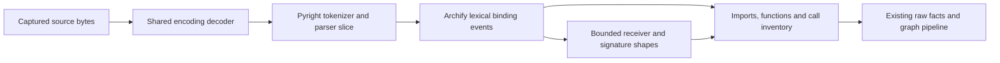

# Python source analyzer

Python extraction runs entirely in Node. The tokenizer, parser, source positions
and necessary parser diagnostics come from **Pyright 1.1.414**, commit
`a28cce4077d87b80bead12de809f79845e39c8ba`. The parser provides the syntax tree
and token positions. Archify uses these to collect imports, measure functions,
list calls and locate unique source declarations.

## Runtime and version selection

No Python executable or Python packages are required for extraction. Neither the
host interpreter version nor `BAUIFY_PYTHON` selects syntax. The default target is
Python **3.14**. Select an older grammar in the existing analysis config:

```json
{
  "python": { "targetVersion": "3.12" }
}
```

Supported targets are strings from `3.8` through `3.14`. Unsupported targets fail
explicitly rather than being silently clamped. This setting controls syntax
checks; it does not select an installed environment, load dependencies, interpret
`pyproject.toml`, supply version-specific standard-library types or establish
complete Python compilation/type-checking validity.

The syntax matrix covers assignment expressions (3.8), parenthesized `with`
(3.9), `match` (3.10), `except*` (3.11), PEP 695 classes/aliases and PEP 701 quote
reuse (3.12), type-parameter defaults (3.13), and template strings/multiple bare
exception types (3.14). All ten cases are checked against all seven targets.
The pre-3.12 f-string quote/backslash checks come from the necessary portion of
Pyright's checker; merely copying its parser would omit those checks.

## Data flow



| Capability | Current behavior |
| --- | --- |
| File selection, roles and captured bytes | Existing Archify snapshot policy |
| Package imports | Existing captured `.py` resolver, relative imports, `src`, namespace packages and implicit `__init__.py` edges |
| Import execution evidence | Eager/deferred, conditional, `TYPE_CHECKING`, literal/computed standard loaders, with lexical rebinding guards |
| Module symbols | Functions, classes, imports and assignments; first binding line preserved |
| Functions and metrics | Qualified names, exact ranges, owned decorator extent, McCabe complexity, nesting and deepest line |
| Call inventory | Every syntactic source call in a parse-valid file, including nested bodies/defaults; unresolved sites remain inventoried |
| Direct targets | Unique undecorated module functions, unique preceding function-local from-imports and one explicit reexport |
| Additional declaration targets | Captured module members, receiver annotations, `self`/`cls`, constructed receivers and declared returns. Source inheritance/C3, zero-argument `super`, properties and selected decorators. Bounded local flow includes assertions, short-circuit guards, typed comprehensions and reaching imports. |
| Type and dependency signatures | Stable `TYPE_CHECKING` imports, callable-preserving decorators, PEP 695 parameters, bound legacy TypeVars, `type[T]` factories and explicit dependency declarations. Matching simple string and boolean overloads supply return types. A declared `Callable` can type an immediate lambda argument. |
| Source correctness | One-based UTF-16/end-exclusive positions, decoded-slice hashes, BOM/PEP 263 decoding, independent entry/target freshness |
| Parse failure | File-local errors, no functions/calls attributed to that file; empty inventory cannot claim known-zero coverage |

Receiver and signature shapes identify source **declaration anchors**. A call
through a `Base` annotation can point to `Base.method` even when runtime dispatch
chooses a subclass. A class constructor expression can establish a receiver
shape without making the constructor call itself a function target. No target
code is imported, executed or built.

Stores are collected before lookup, so a later local assignment cannot fall
back to an outer function. Method bodies skip the class lexical namespace.
Callable field writes, conflicting or unknown reaching bindings, private-name
uncertainty and arbitrary decorators block unsupported targets.
Built-in property/classmethod/staticmethod and selected imported contextlib
decorators are recognized only with binding evidence.

An annotation can resolve a unique import under a recognized `typing.TYPE_CHECKING`
guard. Runtime expressions still use their own bindings. A captured decorator
can preserve a declaration's signature when its only ordinary parameter and
its return use the same type variable bounded by `Callable`. An ordinary class
argument can specialize a written `type[T]` or `typing.Type[T]` factory signature.
The substitution takes the argument's captured class identity into the return type.

Local value shapes follow assignments at the callsite. Branches join all possible
definitions; a maybe-unbound path or conflicting receiver does not become a
unique target. Loops include carried stores. Exception paths and context-manager
suppression retain uncertainty. Standard container/generator/context protocols
require recognized imports or actual builtin names, rather than spelling alone.
These rules follow declarations and signatures; they do not execute target code.

Two module-level, parameterless definitions may provide one navigation anchor
when they share a return annotation and occupy opposite branches of a verified
`sys.platform` check. The later definition follows Pyright's `All` platform
navigation for this case. A union of receivers supplies a target only when
every possible receiver leads to the same captured declaration.

Source inheritance uses C3 when the captured hierarchy is complete. A declaration
directly in the first captured base can be selected before inspecting its
external tail bases: it precedes later bases in every consistent C3 order.
Unknown bases before a possible inherited declaration, cycles and inconsistent
orders remain unknown. This is not a proof that the whole class compiles.

## Supplying dependency declarations

Pass an analysis config when a project's source depends on a factory or receiver
signature defined in another package.

```json
{
  "python": {
    "declarations": { "dependency": "types/dependency.pyi" }
  }
}
```

Each key is an import module name. Supply a `.py` or `.pyi` file or a package
directory with matching module paths. Paths can be absolute or relative to the
analyzed root. A `.pyi` takes precedence over its matching `.py`. Keep declaration
inputs outside the captured project source selection. Pass the config through
the existing `--config` option or the library's `config` parameter.

Archify parses the declared inputs in Node and records their relative file names
and byte hashes in `languageScope.declarations`. They can inform local method
navigation. Project inventories and dependency edges still describe the analyzed
tree, and navigation targets still point to captured project definitions. The
default declaration mapping is empty. Project imports with no configured or
captured signature may leave dependent receivers unresolved.

## Explicit limits

The runtime does **not** contain Pyright's Program, LSP, binder, type evaluator,
typeshed, environment resolver or CLI. Its binder and type shapes are Archify
implementations; they must not be described as Pyright's full semantic engine.
The accuracy benefit comes from the syntax implementation and concrete binding
algorithms, not from TypeScript by itself.

Unresolved areas include external/stub-only targets, arbitrary value/callback
flow, dynamic attributes/metaclasses, runtime monkey-patching, general overload
selection, ambiguous unions, general control-flow/type inference beyond the
bounded local rules, unconstrained legacy generic inference and longer reexport
chains. Complex conditional imports, arbitrary decorators, descriptors and
context proxies may still block declarations. Ambiguous sites remain unresolved.
Full Pyright provides the development reference for these gaps.

## Model and history

Revision **16** emits `python-source-v3`, with adapter identity
`pyright-parser@1.1.414/python-3.14` (or the chosen syntax target). New targets use
`python-source-declaration` and must match a captured function definition start.
Revision 11's `python-source-v1` retains its receiver/signature scope. Revision 12
adds bounded local flow and protocol shapes, property accessors, bound TypeVars,
qualified contextlib decorators and source `super` declarations. Revision 13
adds type-only annotation imports, typed decorator contracts and generic factory
returns with explicit dependency inputs. Revision 14 follows explicit `typing.cast`
annotations and `functools.cache` declarations when their import bindings can be
verified. Sequence navigation requires a scalar index. Revision 15 extends
function navigation for bounded flow, typed callback parameters, simple overload
returns, known descriptors and paired platform definitions. Revision 16 follows
successful `try` bindings into `else`, later local declarations after wildcard
imports, and verified cache and single-dispatch decorators. It keeps typed
elements across empty-list fallbacks, preserves shared return types across
distinct methods, and can navigate a property used at a callsite. A written
`Any` remains unknown until a supported type guard supplies more evidence. Existing
`same-file-function` and `imported-function` evidence retains its meaning. The
reader continues to accept historical `python-source-v1/v2`, `python-lexical-v1/v2` and
`python@...` captures without expanding their saved coverage. Changing the
engine or syntax target changes adapter identity, so comparisons report an
extractor change rather than pretending it is a source-code change.

## Source maintenance and license

`extract/py/upstream/UPSTREAM.json` records the exact upstream commit, original
file hashes, reviewed local hashes and changes. The MIT license and upstream
copyright headers are retained. The tracked Node bundle carries a license
banner; distribution notices identify the source slice.

```sh
npm run build:python
npm run check:python
npm test
```

Development uses esbuild. The package and source checkout load the same
checked-in bundle.
`check:python` rejects a stale bundle and checks the TypeScript sources; it also
runs before the module suite. Updating upstream requires reviewing the recorded
source changes, refreshing provenance and running syntax, binding, encoding,
history and fixed-project differential checks.
