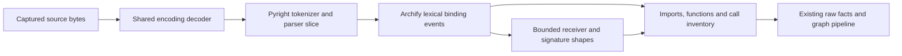

# Python source analyzer

Python extraction runs entirely in Node. The tokenizer, parser, source positions
and necessary parser diagnostics are transplanted from **Pyright 1.1.414**,
commit `a28cce4077d87b80bead12de809f79845e39c8ba`. Archify owns the binding,
import, measurement and bounded declaration analysis built on that syntax tree.
This is a source migration, not integration of the complete Pyright package.

## Runtime and version selection

No Python executable or Python packages are required for extraction. Neither the
host interpreter version nor `BAUIFY_PYTHON` selects syntax. The default target is
Python **3.14**. Select an older grammar in the existing analysis config:

```json
{
  "python": { "targetVersion": "3.12" }
}
```

Supported targets are strings from `3.8` through `3.14`. Unsupported targets fail
explicitly rather than being silently clamped. This setting controls syntax
checks; it does not select an installed environment, load dependencies, interpret
`pyproject.toml`, supply version-specific standard-library types or establish
complete Python compilation/type-checking validity.

The syntax matrix covers assignment expressions (3.8), parenthesized `with`
(3.9), `match` (3.10), `except*` (3.11), PEP 695 classes/aliases and PEP 701 quote
reuse (3.12), type-parameter defaults (3.13), and template strings/multiple bare
exception types (3.14). All ten cases are checked against all seven targets.
The pre-3.12 f-string quote/backslash checks come from the necessary portion of
Pyright's checker; merely copying its parser would omit those checks.

## Data flow



| Capability | Current behavior |
| --- | --- |
| File selection, roles and captured bytes | Existing Archify snapshot policy |
| Package imports | Existing captured `.py` resolver, relative imports, `src`, namespace packages and implicit `__init__.py` edges |
| Import execution evidence | Eager/deferred, conditional, `TYPE_CHECKING`, literal/computed standard loaders, with lexical rebinding guards |
| Module symbols | Functions, classes, imports and assignments; first binding line preserved |
| Functions and metrics | Qualified names, exact ranges, owned decorator extent, McCabe complexity, nesting and deepest line |
| Call inventory | Every syntactic source call in a parse-valid file, including nested bodies/defaults; unresolved sites remain inventoried |
| Direct targets | Unique undecorated module functions, unique preceding function-local from-imports and one explicit reexport |
| Additional declaration targets | Captured module member functions; receiver annotations, `self`/`cls`, constructed receivers and declared returns; source inheritance/C3; PEP 695 parameter substitution; annotated fields/properties; positive `isinstance` narrowing; nested functions |
| Source correctness | One-based UTF-16/end-exclusive positions, decoded-slice hashes, BOM/PEP 263 decoding, independent entry/target freshness |
| Parse failure | File-local errors, no functions/calls attributed to that file; empty inventory cannot claim known-zero coverage |

Receiver and signature shapes identify source **declaration anchors**. A call
through a `Base` annotation can point to `Base.method` even when runtime dispatch
chooses a subclass. A class constructor expression can establish a receiver
shape without making the constructor call itself a function target. No target
code is imported, executed or built.

Stores are collected before lookup, so a later local assignment cannot fall
back to an outer function. Method bodies skip the class lexical namespace.
Callable field writes, duplicate/conditional bindings, receiver rebinding,
private-name uncertainty and arbitrary decorators block unsupported targets.
Built-in property/classmethod/staticmethod and selected imported contextlib
decorators are recognized only with binding evidence.

Source inheritance uses C3 when the captured hierarchy is complete. A declaration
directly in the first captured base can be selected before inspecting its
external tail bases: it precedes later bases in every consistent C3 order.
Unknown bases before a possible inherited declaration, cycles and inconsistent
orders remain unknown. This is not a proof that the whole class compiles.

## Explicit limits

The runtime does **not** contain Pyright's Program, LSP, binder, type evaluator,
typeshed, environment resolver or CLI. Its binder and type shapes are Archify
implementations; they must not be described as Pyright's full semantic engine.
The accuracy benefit comes from the syntax implementation and concrete binding
algorithms, not from TypeScript by itself.

Unresolved areas include external/stub-only targets, arbitrary value/callback
flow, dynamic attributes/metaclasses, runtime monkey-patching, general overload
selection, ambiguous unions, general control-flow inference, legacy typing
generic inference and longer reexport chains. Written PEP 695 substitutions and
selected positive parameter narrowing are bounded features, not complete type
inference. No multi-target union candidate set is emitted. Full Pyright remains
the development reference for these gaps rather than a production dependency.

## Model and history

Revision **11** emits `python-source-v1`, with adapter identity
`pyright-parser@1.1.414/python-3.14` (or the chosen syntax target). New targets use
`python-source-declaration` and must match a captured function definition start.
Existing `same-file-function` and `imported-function` evidence retains its
meaning. The reader continues to accept historical `python-lexical-v1/v2` and
`python@...` captures without expanding their saved coverage. Changing the
engine or syntax target changes adapter identity, so comparisons report an
extractor change rather than pretending it is a source-code change.

## Fixed real-project comparison

The corpus is **Click 8.5.1**, commit
`cf19179e8e2fd54c601378cec9e0d21bb12b6fb1`: only `src/click/*.py`, 17 files,
12,706 lines. Complete Pyright 1.1.414 was queried with Python 3.14, platform
`All` and an empty third-party environment. File/config hashes and frozen source
definition points are retained alongside [the result](benchmarks/python-click-8.5.1.json).

| Measurement | Previous CPython AST adapter, revision 10 | Current source rewrite |
| --- | ---: | ---: |
| Functions | 583 | 583 |
| Imports | 402 | 402 |
| Module symbols | 637 | 637 |
| Source calls | 2,027 | 2,027 |
| Selected declaration targets | 204 | **447** |
| Previously selected targets retained unchanged | — | **204/204** |
| Source-reviewed unique declaration samples | 8/19 | **19/19** |

Function facts (including metrics/ranges/hashes), import facts, symbol facts and
call positions match the baseline exactly. The rewrite adds **243** targets.
All **447** selected targets occur in the saved full-Pyright candidate sets;
none disagrees. Full Pyright supplied captured function candidates for **598**
calls: 562 unique and 36 multiple. This leaves substantial semantic work outside
the source slice. Candidate counts are not accuracy scores or runtime edges.

The manual oracle covers 19 unique declarations within 46 reviewed sites: a
34-site per-file hash sample plus 12 self-method sites. It is small and includes
a targeted method stratum; it is not a repository-wide random accuracy estimate.
Reference agreement is not independent correctness. These checks establish
source navigation on fixed inputs, not all Python behavior or a performance
comparison with a full language server.

From this module directory, prepare a source-only Click checkout, copy
`docs/benchmarks/python-pyrightconfig.json` to its `pyrightconfig.json`, then run:

```sh
node scripts/compare-python-reference.mjs \
  --root /path/to/click-source-only \
  --reference docs/benchmarks/python-click-pyright-reference.json \
  --oracle docs/benchmarks/python-click-oracle.json
```

The source-only root must contain `src/click/` and the supplied config, with no
additional Python files. Input hash mismatches fail. The optional `--baseline`
accepts the previously saved raw facts to check exact facts and target retention.
The comparison runs the current analyzer and reads saved reference data; it
does not load Pyright or execute Click.

## Source maintenance and license

`extract/py/upstream/UPSTREAM.json` records the exact upstream commit, original
file hashes, reviewed local hashes and changes. The MIT license and upstream
copyright headers are retained. The tracked Node bundle carries a license
banner; distribution notices identify the source slice.

```sh
npm run build:python
npm run check:python
npm test
```

Only development needs esbuild. Production loads the checked-in bundle.
`check:python` rejects a stale bundle and checks the TypeScript sources; it also
runs before the module suite. Updating upstream requires reviewing the recorded
source changes, refreshing provenance and running syntax, binding, encoding,
history and fixed-project differential checks. Do not replace this process with
an npm Pyright runtime integration.

The migration's ablation removed unreferenced localization/diagnostic APIs and
environment locale loading, eliminated the parser/collector import cycle and
shared encoding with source freshness. The generated analyzer decreased from
about 649 KB to about 453 KB while retaining the same acceptance results. The
old Python subprocess helpers and launcher were removed completely.
