# Explainer authoring

An explainer turns an answer with a conclusion and some structure (an explanation, comparison, decision, diagnosis, review or plan) into one page. The page leads with the conclusion and shows the reasoning as panels: diagrams, tables, steps and short text. When to make one (the default `proactive` mode, `on-demand` and opt-in `always-on`) is in the Skill under “Choose the artifact”. A request to draw a system uses a native diagram type.

This guide is the complete draft language. Write the draft from it directly.

## Draft

Write one Markdown file, `candidate.archify.md`. The first paragraph after the title is the direct conclusion. A flat list immediately after it gives up to four reasons. Each `##` heading starts a panel.

```md
# Why does the first HTTPS visit take an extra round trip? {#tls-first-visit}

The browser and server must agree on keys before any request is sent: **one extra round trip** with TLS 1.3.

- The browser sends its key share in the first message, so one round trip is enough.[](source:rfc8446)
- The server replies with its key share, then its certificate, already encrypted.
- A returning browser can resume and send data immediately.

@answer scope="TLS 1.3 · first visit · no proxy"
@meta locale=en
@source rfc8446 title="RFC 8446: TLS 1.3" url=https://www.rfc-editor.org/rfc/rfc8446

## What is exchanged before the first request? {#handshake}

@sequence id=handshake-flow title="TLS 1.3 full handshake"
| actor browser | Browser | frontend |
| actor server | Server | backend |
| browser | server | ClientHello + key share |
| server | browser | ServerHello + key share | return |
| server | browser | Certificate + Finished (encrypted) | return |
| browser | server | Finished + GET / | emphasis |
| server | browser | 200 OK | return |

@steps id=handshake-steps
| hello | ClientHello | Offers cipher suites and a key share. | handshake-flow | browser |
| reply | ServerHello | Picks a suite and sends its key share; the certificate follows encrypted. | handshake-flow | server |
| done | Finished | Both sides confirm the keys; the request rides along. | handshake-flow | browser |

## How does TLS 1.3 compare with 1.2? {#versions}

| Criterion | TLS 1.2 | TLS 1.3 |
| --- | --- | --- |
| Round trips before data | Two {caution:Slower} | One {good:Faster} |
| Resumed connection | One | Zero {good:0-RTT} |
```

Deliver it with the command under [Delivery](#delivery).

### Rules that keep a draft valid

- IDs are unique across the whole document: panels, blocks, diagrams and steps share one namespace. Give a block an `id` only when a step, link or patch targets it; omit it on callouts, facts and lists. Name a diagram after its content (`handshake-flow`), not after its panel (`handshake`).
- Prose is plain text. Wrap file paths, globs, `<placeholders>`, operators and code in backticks: a bare `<`, `>` or `*` in prose fails as HTML or emphasis. Inline code is shown literally.
- Directive rows are pipe rows, one per line, each with the documented number of cells: `| first | second |`. Write a literal pipe inside a cell as `\|`. A blank line or the next `##` or `@` line ends the rows.
- Directive arguments are `key=value`; quote values with spaces using double quotes and JSON escaping.
- Draw native diagrams with the compact rows below. Inline JSON specs are for exceptional cases only.
- Nested lists, raw HTML and other Markdown extensions fail with a located diagnostic that names the line, component and a repair example.

## Choose the form by the shape of the information

A diagram replaces the paragraph that would describe it. When the answer involves relationships, a flow, an exchange over time, a hierarchy, a history or a data model, draw it. A typical page has the conclusion, one diagram and one or two tables or step lists.

| Shape of the information | Form |
| --- | --- |
| Messages between parties in order: protocols, request paths | `@sequence` |
| A process with steps and branches: triage, rollout, approval | `@workflow` |
| Parts of a system and how they connect | `@architecture` |
| A hierarchy: directories, modules, taxonomies | `@tree` |
| Events over time: incidents, releases | `@timeline` |
| Entities with fields and relationships | `@erd` |
| Options compared on several criteria | Markdown table with `{good:…}`, `{caution:…}`, `{bad:…}` cells |
| Ordered actions, checks or stages | `@steps` |
| Things the reader must do or verify | Task list, `- [ ] item` |
| A warning, open question or key caveat | `@callout` |
| A few labelled facts | `@facts` |
| Numbers compared across items or over time, shares of a whole, a 2×2 priority, flows of quantity | ```` ```mermaid ```` chart fence |
| One number against a limit | `@metric` |
| Code that exists in a repository | `@code` |
| A change to code | `@diff` or a ```` ```diff ```` fence |
| A command, config or code that does not exist yet | Plain fence |

Steps that walk through a diagram belong in the diagram's panel: the panel automatically receives a full-width 12-column row so the page reads them beside the sticky diagram without needing `span=12`, each step lighting its part. Title each step with the label of the node it points at, so the text and the diagram match at a glance; the detail column says what to do there.

Keep tables to two or three columns so phones and narrow windows show each row without horizontal scrolling; split wider matrices into separate focused tables. For runnable behaviour, pair a complete copyable fenced snippet with its actual observed output rather than fragments.

A small answer gets a small page: the conclusion plus one or two panels. A how-it-works, diagnosis or checklist question usually needs three to five.

## Writing

Write for a reader who will act on the page and may check it. Use the user's language.

- The conclusion is read first; every panel after it supports, qualifies or applies it. Stop once nothing is left to support.
- Cover what the reader needs to act on the answer: the mechanism behind the conclusion, how to check it, and the cases where it does not hold. The next question a careful reader would ask gets a panel, a table row or a line in scope; a fact the reader could get wrong without it is not optional.
- Lead with the concrete mechanism in plain reader terms before naming internal functions, flags or sidecars: say what happens and why it matters first, then anchor the exact identifier in backticks (`Back up the existing HTML before swapping in the staged build (\`commitDeliveryPair\`)`). Separate distinct dimensions (such as input vs. output or default vs. opt-in) instead of folding them into one blurred rule.
- Refer to panels, diagrams and examples by heading or visible label, not by layout position (`left`, `right`, `above`, `below`), because panels stack and reflow across screen widths.
- Give each layer one job: the diagram shows structure or sequence, `@steps` explains what happens or what to check at each stage, tables compare parallel cases, and prose explains why or states the boundary. Do not repeat the same sentence across prose, node labels and step details.
- Keep one term per thing across the title, panels, diagram labels and table headers, and prefer the reader's own term. Keep prose in one primary language instead of mixing half-translated fragments, while keeping exact code, CLI flags, paths and protocol names in backticks. The page links a name in the text to the node with that label, so a reader can point at it in the diagram.
- Give results with their evidence: a number with its unit, a file position, a source. Keep page-wide conditions in scope. Put a local assumption, exception or uncertainty next to the claim, chart or example it qualifies; do not move it away just to shorten the prose. Label illustrative or unmeasured values where the reader encounters them.
- Cite a `@source` for each claim the reader cannot check alone: protocol details, thresholds, benchmark figures, API behaviour. A rule of thumb without a source is labelled as one, or left out.
- Recompute every derived number before delivery and show the arithmetic once: “990 of 1000 requests at 80 ms → P99 = 80 ms; 11 slow → P99 = 600 ms.” Totals in tables add up.
- Phrase an action as an imperative with its trigger in front: “If the migration reports a schema mismatch, roll it back before retrying.”
- When the reader must act or verify, end with a checklist panel: `- [ ] item`, one concrete check per item. Readers tick items on the page.

English: short sentences (under about 25 words), common words (use, before, to, because), active voice with a named actor.

中文：短句，每句不超过约 50 字；优先写“谁做什么、结果是什么”，少用“通过……实现/进行检查/做出决定”这类空转结构；修饰语过长或双动词纠缠时果断拆句；不在中文句子里夹杂可自然表达的英文碎词（真实命令、函数名、协议名放进反引号）；数字后写清边界（超过 3 次、不超过 1 秒）；用可验证的结果代替套话。

## Compact native diagrams

Write `@<type> id=<diagram-id> title="..."` followed by pipe rows (`role <type> | <label>` for domain concepts in `@architecture`/`@workflow`/`@sequence`). Each compiles to a full native Archify diagram, with native validation and layout, and opens in the full Viewer from the page. A document holds up to four native diagrams.

Any node, actor or entity row may end with a `source:<id>` cell naming a declared `@source`; hovering that node shows the source, and for a repository file its pinned lines, so a code diagram doubles as a code tour.

To reuse an explanation already in the page, add `block:<id>` to the node row, for example `| api | API | backend | block:api-notes |`, and give its paragraph an ID with `@prose id=api-notes`. Prose, callout, list and facts blocks can be referenced. Hovering or focusing the node shows that block's current text; editing or patching the paragraph updates the explanation without changing the diagram. A row may end with both `block:<id>` and `source:<id>`.

Node and participant types: `frontend`, `backend`, `database`, `cloud`, `security`, `messagebus`, `external` (default `backend`). Edge and message variants: `default`, `emphasis`, `security`, `dashed`; sequences also accept `return`. IDs start with a letter and use letters, digits, `-` and `_`.

In `@architecture`, `@workflow` and `@sequence`, rename domain roles with `role <type> | <label>` rows (for example `role frontend | Draft state`). Use `role` rows whenever nodes represent domain concepts, workflow stages, state categories or everyday actions rather than literal servers and databases: declared roles rename the diagram legend and Viewer lens, and drop infrastructure corner icons from nodes of those types while keeping `?` decision marks in workflows. Role labels are plain text (up to 80 characters, without `{...}` braces).

**`@sequence`**: declare actors, then messages in order.

```md
@sequence id=cache-read title="Cache miss"
| actor api | Order API | backend |
| actor redis | Redis | database |
| api | redis | GET order:42 |
| redis | api | nil | return |
```

Actor rows: `actor <id> | label | type`. Message rows: `from | to | label | variant?`, where `from` and `to` are actor IDs or labels. A `phase | label` row opens a labelled band over the messages after it, up to the next phase: `phase | TCP handshake (1 RTT)`.

**`@workflow`** and **`@architecture`**: nodes, then edges. Placement follows the edges from left to right, starting with nodes that have no incoming edge.

```md
@workflow id=triage title="Latency triage"
| alert | Alert fires | external |
| split | Check percentiles | backend |
| trace | Compare slow traces | backend |
| fix | Fix the cause | backend |
| alert > split | |
| split > trace | tail only |
| trace > fix | cause found | emphasis |
```

Node rows: `id | label | type?`. Edge rows: `from > to | label? | variant?`. Nodes widen to fit their labels, so write each node label as a natural, scannable phrase (up to about 10 Chinese characters or 4 English words, avoiding `lock+journal+render` keyword pileups) and let `@steps` carry the detail and code identifiers. Omit edge labels when the step or transition is already clear from its node labels, or keep them to one or two words. A node label ending in `?` is drawn as a decision; label its outgoing edges with the answers (`yes`, `no`, `是`, `否`).

Group the steps of a process into phases: declare `lane <id> | label` rows, then give each workflow node its phase as a fourth cell. Up to six nodes draw as one row with the phase labels above it; a longer process wraps into one row per phase.

```md
@workflow id=p99-flow title="P99 triage"
| lane confirm | Confirm the symptom |
| lane locate | Locate the cause |
| alert | P99 up, mean flat | external | confirm |
| window | Align window and percentiles | backend | confirm |
| sample | Sample slow requests | backend | locate |
| fix | Fix and verify | backend | locate |
| alert > window | |
| window > sample | tail grew |
| sample > fix | cause | emphasis |
```

Architecture allows twelve columns. Use `@architecture` for components that talk to each other and `@workflow` for steps a reader follows.

**`@tree`**: one row per node, `id | label | parent`; the root's parent is `-`.

```md
@tree id=package-layout title="Package layout"
| root | archify | - |
| bin | bin | root |
| explainer | explainer | root |
```

**`@timeline`**: optional lane rows, then events, `id | ISO time with offset | title | lane? | kind?`. Kinds: `default`, `change`, `alert`, `action`, `recovery`.

```md
@timeline id=incident title="Checkout incident"
| lane ops | Operations |
| deploy | 2026-10-01T10:00:00+08:00 | Deploy v2 | ops | change |
| alarm | 2026-10-01T10:12:00+08:00 | Error rate alarm | ops | alert |
```

Shorthand timelines are labelled illustrative and display their times in UTC.

**`@erd`**: entities, fields, then relationships.

```md
@erd id=order-model title="Orders"
| entity user | User |
| entity order | Order |
| user.id | bigint | pk |
| order.id | bigint | pk |
| order.user_id | bigint | fk | user.id |
| order > user | many:one | placed by |
```

Field rows: `entity.field | type | keys? | references?`, keys `pk`, `fk`, `uk` comma-separated. Relationship rows: `from > to | one:one|one:many|many:one|many:many | label?`.

Other native types (`dataflow`, `lifecycle`, `class`, `waterfall`) and diagrams that need explicit geometry use a same-directory spec file: `@diagram dataflow source=events.dataflow.json`, written with the Skill's native authoring workflow.

## Charts

A ```` ```mermaid ```` fence draws a chart from numbers: `pie`, `xychart-beta` (bar and line), `quadrantChart`, `sankey-beta`, `radar-beta` or `venn-beta`. The page renders it to static SVG in the page theme. An optional `title="..."` becomes the caption.

````md

```mermaid title="Latency before and after the release (ms)"
xychart-beta
  x-axis ["Mean", "P50", "P99"]
  y-axis "ms" 0 --> 700
  bar "Before" [80, 75, 80]
  bar "After" [88, 76, 600]
```

````

Name each series (`bar "Before" [...]`) so the chart gets a legend. Bars show their values, and a pie legend shows each value with its share. Use `xychart-beta horizontal` for ranked items or long category names. Keep axis ticks, series counts and annotations readable at phone width (~390px) without wrapping into cramped rows or clipped legends; split overloaded multi-series comparisons when labels compete for space. When numbers carry the point, such as one value jumping while others stay flat, a before/after or a share, chart them so the contrast is seen at a glance; a table under the chart adds only the words each number needs. Put the contrast in one chart, such as mean, P50 and P99 before and after.

When data lives in a CSV or JSON file inside the draft directory, use `@chart type=bar|line|pie data=latency.csv x=day y=p50,p99 unit=ms title="..."`. `x` names the category column and `y` names one or more numeric series columns (pie charts use the first). CSV files need a header row; JSON files hold an array of objects. Files are read and frozen at delivery, up to 60 records for bar or line charts and 12 for pie charts. Empty numeric cells fail instead of turning into zero: supply the missing value, or remove the row and note the omission in the caption.

Double quotes and backslashes in category labels, series names and units display literally. Quote CSV fields that contain commas or line breaks, escaping literal double quotes as `""`; CRLF, CR or LF inside quotes stays a multi-line label rather than splitting the record. Unclosed quotes, trailing text after closing quotes, duplicate selected columns, mismatched column counts, control characters, Unicode line/paragraph separators (`U+2028`/`U+2029`; use LF), lone surrogates or whitespace-only labels fail delivery with a located diagnostic and preserve the previous output rather than silently altering labels. Ordinary leading/trailing whitespace on each label line is trimmed and tabs or repeated spaces collapse to single spaces for display without modifying the frozen source file.

A chart states where its numbers come from the same way text does: measured, from a source, estimated or illustrative, in its caption or in scope. Quote every label that contains spaces or non-ASCII text. Flowcharts, sequences, class, ER, state, timeline and mind-map Mermaid use the native shorthand above, which Archify validates and lets readers explore.

## Directive reference

Inline diagrams inherit the page locale unless they set their own. The Explainer reader controls use Chinese for Chinese locales and English for other locales.

| Directive | Header arguments | Rows |
| --- | --- | --- |
| `@answer` | `scope="..."`, optional `span=1..12` (exact desktop columns, like panel spans) | none |
| `@meta` | `locale` (bundled diagram Viewer catalogs include `en`, `zh-CN`, `zh-TW`, `es`, `ko`, `ar`, `ru`), `quality_profile`, `style` (`clean`, `editorial`, `product`, `swiss`; readers can switch), `repo_url`, `repo_revision` | none |
| `@source <id>` | `title`, `url`, or `path` with `lines=start:end` | none |
| `@steps` | `id` | `id | title | detail? | diagram-id? | node? | from~to? | edge-ids?` (node and route are exclusive) |
| `@callout` | `id`, `level=note|warning|open-question`, `title` | one cell per row; rows join into paragraphs |
| `@facts` | `id` | `label | value` |
| `@metric` | `id`, `label`, `value`, `limit`, `unit`, `note`, `typical=true` | none; `value` or `limit` required |
| `@comparison` | `id`, `columns="A,B"`, `label` | `criterion | cell per option` |
| `@prose` | `id`, `text` | one cell per row |
| `@list` | `id`, `ordered=true` | one cell per row |
| `@code` | `id`, `source=<source-id>`, `language` | none |
| `@diff` | `id`, `caption` | a following ```` ```diff ```` fence |
| `@image` | `id`, `path`, `alt`, `caption` | none |
| `@chart` | `type` (`bar`, `line`, `pie`), `data` (`.csv` or `.json`), `x`, `y`, `unit`, `title`, `id` | none |
| `@<diagram type>` | `id`, `title`, `changes` | compact rows above |
| `@diagram <type>` | `id`, `source`, `title` | none |

Plain paragraphs, flat lists and Markdown tables need no directive. A table's first header cell labels the row column; comparison cells may end with `{good:Label}`, `{caution:Label}` or `{bad:Label}`, and row labels with `{#row-id}`. Mark only the cells that decide the comparison, usually one or two per row; a badge in every cell reads as noise.

A plain fence (```` ```bash title="Run the tests" ````) is a literal snippet with a copy button. `@code` obtains a real excerpt from the source's Git commit and line range; it accepts no authored code text. `@image` embeds a contained local PNG, JPEG, GIF or WebP.

## Inline links and sources

`**bold**`, inline code and safe HTTP(S) links are supported. `[Redis](node:cache-read.redis)` and `[path](route:cache-read.api~redis)` open the native Viewer at existing targets. `[details](block:next)` jumps within the page.

`[reference text](source:docs)` renders the text followed by a numbered superscript; `[](source:docs)` renders only the superscript. Numbers follow first appearance; uncited sources follow in declaration order. The footer lists titles with URLs or repository positions.

```md
@source router title="Request handler" path=src/router.js lines=10:30
@code source=router language=js
```

Pass `--repo-root /path/to/repository` for code excerpts. With it, every cited repository source with a line range also shows its pinned lines when the reader hovers the citation; a source that cannot be verified stays a plain reference. The tool resolves origin and HEAD, or accepts `@meta repo_url=... repo_revision=<full-commit>`. The commit, path and line range must exist; working-tree edits cannot replace committed bytes.

`[5 ms](typical:Description of the value)` becomes a static footnote, including in print.

## Panels and layout

Prefer a specific question as each panel title. `{#id}` gives a stable ID for links and panel replacement; `{#id span=7}` fixes a width of 1–12 columns. Omit spans: the page measures each panel and plans the board, keeping source order with the conclusion top-left, giving each diagram enough width for readable labels, and keeping tables and code from clipping. Without JavaScript, static widths apply; narrow screens and print stack panels.

When two examples need to start side by side below the conclusion, use `@answer span=12` with `span=6` on each example panel. The optional answer span uses the same 1–12 column range as panels; phone layouts still stack at full width. Leave it out for automatic placement.

## Scenarios and calculators

Use one `@scenarios` block, one `@calc` block, or both. Each has an explicit ID distinct from its panel ID. Bindings can point to another panel or to a declaration later in the draft. A scenario-only page can highlight different paths in one native diagram. A calculator-only page can change conclusions, metrics and charts.

```md
# When does the connection pool fill up? {#pool-explainer}

The pool is at {{metric:pool-load}} and has {{value:free}} free connections.

@answer live=capacity scope="Illustrative steady-state model"

## Which path does the request take? {#path}

@scenarios id=traffic default=warm
| case warm | Warm cache | busy=4 |
| case loaded | Pool under load | busy=30 |

@architecture id=requests title="Request path" scenarios=traffic
| api | API | backend |
| cache | Cache | database |
| pool | Connection pool | backend |
| api > cache |
| api > pool |
| active warm | | api~cache |
| active loaded | | api~pool |
| badge node:pool | pool-load |

## How many slots are free? {#model}

@calc id=capacity
| range busy | Busy connections | 0 | 32 | 1 | 4 |
| let used | 100 * busy / 32 |
| let free | 32 - busy |
| preset half | Half full | busy=16 |

@metric id=pool-load label="Pool use" calc=capacity bind=used digits=1 unit="%"
| {good} | < 70 | Headroom |
| {caution} | < 100 | Little headroom |
| {bad} | else | Full |

@chart id=connections calc=capacity type=bar title="Connection slots" unit=connections ymin=0 ymax=32
| labels | Busy | Free |
| bar | Connections | busy | free |
```

### Controls and state

- `@scenarios id=S default=C` takes 1–8 `| case C | Label | input=value | ... |` rows. A case can omit assignments. The default must name a declared case.
- `@calc id=M` takes up to six inputs, 64 `let` rows and eight presets. Use `| range key | Label | min | max | step | default | unit |` with an optional unit, `| toggle key | Label | true |` with a `true` or `false` default, or `| choice key | Label | defaultKey | key=Option label | key=Other label |` with 2–8 options. Use `| let key | expression |` for a derived scalar and `| preset key | Label | input=value | ... |` for a preset with at least one assignment.
- Keep each assignment or option in its own cell. The first `=` separates the key from its value. Assignments name calculator inputs and use valid range ticks, booleans, or choice keys. Each input may occur only once per row.
- Use plain text for case, input, option, preset, threshold, and computed chart labels.
- The page starts with the input defaults and applies the default case’s assignments. When you choose a case or preset, it changes only the inputs it assigns. A preset or manual edit keeps the selected case. Reload restores the authored default. The visible input summary records the settings used for the displayed result.
- Model keys start with an ASCII letter and use at most 32 ASCII letters, digits or underscores. Input and derived keys are unique across the calculator. Case keys, preset keys and choice options are unique within their lists. The function names, `true`, `false`, `t`, `scenario`, `constructor`, `prototype` and `__proto__` are reserved as input and derived names. Block IDs can still contain hyphens.

### Expressions and displayed values

Expressions use finite decimal literals such as `.1` and `1e-3`, booleans, and single-quoted keys such as `'loaded'`. Use parentheses, unary `+` and `-`, then `*` and `/`, then `+` and `-`, then one comparison (`==`, `!=`, `<`, `<=`, `>`, `>=`). Arithmetic associates left. Quote a directive attribute that contains whitespace. In `a-b`, the hyphen is subtraction.

Functions are `min(a,b)`, `max(a,b)`, `pow(base,exponent)`, `abs(x)`, `round(x)`, `floor(x)`, `ceil(x)`, `clamp(x,lo,hi)` and `if(condition,yes,no)`. Arithmetic and ordered comparisons take numbers. Equality requires compatible values. Compare a choice or `scenario` with a declared key from that same domain. A conditional requires a boolean test and branches of the same type. Validation checks both branches and evaluates only the selected branch. Derived values can refer forward and must be acyclic. Sampled charts alone can use `t`.

Arithmetic uses binary64. Division by zero fails. Each evaluated numeric result must be finite and at most `1e15` in magnitude. Displayed results are limited to `1e12`. `round` rounds half ties toward positive infinity. `pow` accepts integer exponents between −1200 and 1200, including zero. A negative exponent requires a nonzero base. `clamp` requires `lo <= hi`. Each expression may use at most 512 characters, 128 syntax nodes and 24 levels.

- `@metric id=… label=… calc=M bind=expression [digits=0..6] [unit=…]` displays a numeric result. The default precision is zero decimal places. Group thousands with commas. A percent sign is appended directly. Other units follow a nonbreaking space. Write `100 * ratio` to convert a fraction to percent. Use `note` and `typical` as for static metrics. A live metric uses `bind` in place of `value` and `limit`.
- A live metric can have three threshold rows. Use `{good}`, `{caution}` and `{bad}` once each in any order. Use `< expression` or `<= expression` for the first two rows, then `else`. Cutoffs must increase in every checked state. The first matching row supplies the status label and color. The comparison uses the unrounded value.
- Put `live=M` on `@answer` or `@prose id=…` to enable up to 32 slots in that field. `{{value:key}}` displays an input or derived value. Ranges show the selected tick with at least the step’s decimal precision. Derived numbers use up to six decimal places, toggles show localized on/off text, and choices show their labels. `{{metric:block-id}}` displays the metric with its unit and precision. `{{scenario}}` displays the selected case’s label and requires `@scenarios`. Slots work in ordinary text and emphasis. Inline code, link labels, link destinations and text without `live=` keep literal braces.

### Bound diagrams and computed charts

Add `scenarios=S` to a native diagram directive with shorthand geometry, `source=` or `spec=`. Provide one `| active caseKey | nodeIds | edgeSelectors |` for each case. The last two cells hold comma-separated lists. One list may be empty if the other selects a target. Use `from~to` for one unambiguous directed hop and `edge:ID` for an explicit native edge. An active edge also activates its endpoints. Use `| badge node:ID | metricBlockId |` or `| badge edge:ID | metricBlockId |` to add a live badge. The edge badge also accepts `edge:from~to`. A badge stays on its target as the case changes. Its fixed slot preserves the native drawing, and the full Viewer opens from the preview.

For a categorical chart use `@chart id=… calc=M type=bar|line title=… ymin=N ymax=N [unit=…]`. Supply one `| labels | Category | ... |` row and up to four `| bar | Series label | expression | ... |` or `| line | Series label | expression | ... |` rows. Use 1–12 categories and one expression per category in each series. The first series matches the chart type. A line on a bar chart can show a reference level.

For a sampled chart use `@chart id=… calc=M type=line from=A to=B step=D ymin=N ymax=N`. Each series uses one `| line | Series label | expression |` row. The reserved `t` is the numeric coordinate of each sample. Include both endpoints and use 2–241 aligned coordinates. Axes must increase and include every evaluated series value. If the chart has bars, the vertical axis must include zero. Chart data is available in a disclosure below the plot.

### Validation and offline reading

A range or sample domain uses literal decimals with up to six places, a positive step and aligned inclusive endpoints. Each range has up to 10,001 ticks. Every tick must retain its exact grid position in binary64. The validator checks the default, scenario assignments and presets on the same decimal grid used by the controls.

Validation checks every tuple when a scenario has at most 256 possible input combinations. For a larger domain it checks 256 distinct states per scenario, including its default, presets, midpoint, joint corners, and one-input excursions from the midpoint. It fills the remaining slots uniformly over the other ordered grid ranks. Every checked state evaluates all formulas and chart points, including the last sample. The total budget is 32 million estimated evaluation operations. Increase a chart’s sample step or simplify formulas if the estimate exceeds the budget. The detailed JSON receipt reports the number checked and the number possible.

A sampled check covers the visited states. If a reader reaches a failing setting, the page reports the error and restores the last valid settings and results. Validation errors identify the expression and, when available, the scenario and input tuple.

The delivered HTML opens offline. With JavaScript disabled it shows the default case, inputs, numbers, chart and diagram. Print, PDF and long-image export use the current valid reading and omit operating controls. **View source** opens the original draft and the grid receipt in the reader. Interactive documents use the same finalization and optional browser check as other explainers.


## Delivery

```sh
node archify/bin/archify.mjs finalize explainer candidate.archify.md answer.html --json
```

After a pass, keep the reply readable on its own: the conclusion in one to three lines, then, as the last line, a Markdown link to the page with a descriptive title in the user's language, such as `[查看测试报告](/abs/path/test-report.html)`. Do not list gates, and do not replace the link with a directory, a log or `--open`. The same reply shape applies whether the page was requested or made by the proactive or always-on mode in the Skill's Choose the artifact section. When finalize does not pass and repair stops, answer in text, say the page was not produced, and give no page link.

Link form: use the absolute local path as the Markdown link target, wrapped in `<...>` when it contains spaces, not `file://`. Hosts differ. A desktop or IDE chat that renders local Markdown links can open the page on click; a terminal interface may show it as styled text that does not open on click; for example, Codex CLI hyperlinks web URLs but not local files (openai/codex#25934, openai/codex#22585). Keep the absolute path so the page can still be opened by hand, and do not tell the user a link is clickable or was opened in a host where you have not seen that happen.

Add `--repo-root <path>` when the draft uses `@code`. Finalize validates, atomically delivers and checks the HTML; it does not launch a browser, and its receipt records the browser gate as not run. A failure names the line, component, reason and a repair example; fix the draft and rerun to the same output path.

Writing warnings apply the [Writing](#writing) rules: sentences over 50 Chinese units or 28 English words, paragraphs over four sentences or 120 units, light verbs, set phrases, openers and sign-offs, unbounded quantities, “以上/以下/以内” after a number, long English words with a common equivalent, a mostly bold conclusion and a scope over 50 units. Each warning names the matched text and a repair; fix it when the repair keeps the meaning. `--writing warn|strict|off` sets the severity.

## Panel replacement

```sh
node archify/bin/archify.mjs patch explainer answer.html next replacement.md revised.html --json
```

The replacement holds one `##` panel with the same stable ID; untouched content and frozen assets are preserved. Rerun finalize on the full draft when changing shared sources, the conclusion or document-wide structure.
