# Explainer authoring

An explainer turns an answer with a conclusion and some structure (an explanation, comparison, decision, diagnosis, review or plan) into one page. The page leads with the conclusion and shows the reasoning as panels: diagrams, tables, steps and short text. When to make one, and the opt-in modes, are in the Skill under “Choose the artifact”. A request to draw a system uses a native diagram type.

This guide is the complete draft language. Write the draft from it directly.

## Draft

Write one Markdown file, `candidate.archify.md`. The first paragraph after the title is the direct conclusion. A flat list immediately after it gives up to four reasons. Each `##` heading starts a panel.

```md
# Why does the first HTTPS visit take an extra round trip? {#tls-first-visit}

The browser and server must agree on keys before any request is sent: **one extra round trip** with TLS 1.3.

- The browser sends its key share in the first message, so one round trip is enough.[](source:rfc8446)
- The server replies with its key share, then its certificate, already encrypted.
- A returning browser can resume and send data immediately.

@answer scope="TLS 1.3 · first visit · no proxy"
@meta locale=en
@source rfc8446 title="RFC 8446: TLS 1.3" url=https://www.rfc-editor.org/rfc/rfc8446

## What is exchanged before the first request? {#handshake}

@sequence id=handshake-flow title="TLS 1.3 full handshake"
| actor browser | Browser | frontend |
| actor server | Server | backend |
| browser | server | ClientHello + key share |
| server | browser | ServerHello + key share | return |
| server | browser | Certificate + Finished (encrypted) | return |
| browser | server | Finished + GET / | emphasis |
| server | browser | 200 OK | return |

@steps id=handshake-steps
| hello | ClientHello | Offers cipher suites and a key share. | handshake-flow | browser |
| reply | ServerHello | Picks a suite and sends its key share; the certificate follows encrypted. | handshake-flow | server |
| done | Finished | Both sides confirm the keys; the request rides along. | handshake-flow | browser |

## How does TLS 1.3 compare with 1.2? {#versions}

| Criterion | TLS 1.2 | TLS 1.3 |
| --- | --- | --- |
| Round trips before data | Two {caution:Slower} | One {good:Faster} |
| Resumed connection | One | Zero {good:0-RTT} |
```

Deliver it with the command under [Delivery](#delivery).

### Rules that keep a draft valid

- IDs are unique across the whole document: panels, blocks, diagrams and steps share one namespace. Give a block an `id` only when a step, link or patch targets it; omit it on callouts, facts and lists. Name a diagram after its content (`handshake-flow`), not after its panel (`handshake`).
- Prose is plain text. Wrap file paths, globs, `<placeholders>`, operators and code in backticks: a bare `<`, `>` or `*` in prose fails as HTML or emphasis. Inline code is shown literally.
- Directive rows are pipe rows, one per line, each with the documented number of cells: `| first | second |`. Write a literal pipe inside a cell as `\|`. A blank line or the next `##` or `@` line ends the rows.
- Directive arguments are `key=value`; quote values with spaces using double quotes and JSON escaping.
- Draw native diagrams with the compact rows below. Inline JSON specs are for exceptional cases only.
- Nested lists, raw HTML and other Markdown extensions fail with a located diagnostic that names the line, component and a repair example.

## Choose the form by the shape of the information

A diagram replaces the paragraph that would describe it. When the answer involves relationships, a flow, an exchange over time, a hierarchy, a history or a data model, draw it. A typical page has the conclusion, one diagram and one or two tables or step lists.

| Shape of the information | Form |
| --- | --- |
| Messages between parties in order: protocols, request paths | `@sequence` |
| A process with steps and branches: triage, rollout, approval | `@workflow` |
| Parts of a system and how they connect | `@architecture` |
| A hierarchy: directories, modules, taxonomies | `@tree` |
| Events over time: incidents, releases | `@timeline` |
| Entities with fields and relationships | `@erd` |
| Options compared on several criteria | Markdown table with `{good:…}`, `{caution:…}`, `{bad:…}` cells |
| Ordered actions, checks or stages | `@steps` |
| Things the reader must do or verify | Task list, `- [ ] item` |
| A warning, open question or key caveat | `@callout` |
| A few labelled facts | `@facts` |
| Numbers compared across items or over time, shares of a whole, a 2×2 priority, flows of quantity | ```` ```mermaid ```` chart fence |
| One number against a limit | `@metric` |
| Code that exists in a repository | `@code` |
| A change to code | `@diff` or a ```` ```diff ```` fence |
| A command, config or code that does not exist yet | Plain fence |

Steps that walk through a diagram belong in the diagram's panel: the page reads them beside it, each step lighting its part, and the reader can step through them. Title each step with the label of the node it points at, so the text and the diagram match at a glance; the detail column says what to do there.

A small answer gets a small page: the conclusion plus one or two panels. A how-it-works, diagnosis or checklist question usually needs three to five.

## Writing

Write for a reader who will act on the page and may check it. Use the user's language.

- The conclusion is read first; every panel after it supports, qualifies or applies it. Stop once nothing is left to support.
- Cover what the reader needs to act on the answer: the mechanism behind the conclusion, how to check it, and the cases where it does not hold. The next question a careful reader would ask gets a panel, a table row or a line in scope; a fact the reader could get wrong without it is not optional.
- Each panel takes one question and each sentence makes one claim. A claim a table or diagram already shows is not restated; the text adds its reason or exception.
- Keep one term per thing across the title, panels, diagram labels and table headers, and prefer the reader's own term. The page links a name in the text to the node with that label, so a reader can point at it in the diagram.
- Give results with their evidence: a number with its unit, a file position, a source. Keep page-wide conditions in scope. Put a local assumption, exception or uncertainty next to the claim, chart or example it qualifies; do not move it away just to shorten the prose. Label illustrative or unmeasured values where the reader encounters them.
- Cite a `@source` for each claim the reader cannot check alone: protocol details, thresholds, benchmark figures, API behaviour. A rule of thumb without a source is labelled as one, or left out.
- Recompute every derived number before delivery and show the arithmetic once: “990 of 1000 requests at 80 ms → P99 = 80 ms; 11 slow → P99 = 600 ms.” Totals in tables add up.
- Phrase an action as an imperative with its trigger in front: “If the migration reports a schema mismatch, roll it back before retrying.”
- When the reader must act or verify, end with a checklist panel: `- [ ] item`, one concrete check per item. Readers tick items on the page.

English: short sentences (under about 25 words), common words (use, before, to, because), active voice with a named actor.

中文：短句，每句不超过约 50 字；动词直接用（检查、决定，而不是进行检查、做出决定）；修饰语层层嵌套、中心词不清楚时拆句；数字后写清边界（超过 3 次、不超过 1 秒）；用具体结果代替套话（赋能、全方位、至关重要）。

## Compact native diagrams

Write `@<type> id=<diagram-id> title="..."` followed by pipe rows. Each compiles to a full native Archify diagram, with native validation and layout, and opens in the full Viewer from the page. A document holds up to four native diagrams.

Any node, actor or entity row may end with a `source:<id>` cell naming a declared `@source`; hovering that node shows the source, and for a repository file its pinned lines, so a code diagram doubles as a code tour.

To reuse an explanation already in the page, add `block:<id>` to the node row, for example `| api | API | backend | block:api-notes |`, and give its paragraph an ID with `@prose id=api-notes`. Prose, callout, list and facts blocks can be referenced. Hovering or focusing the node shows that block's current text; editing or patching the paragraph updates the explanation without changing the diagram. A row may end with both `block:<id>` and `source:<id>`.

Node and participant types: `frontend`, `backend`, `database`, `cloud`, `security`, `messagebus`, `external` (default `backend`). Edge and message variants: `default`, `emphasis`, `security`, `dashed`; sequences also accept `return`. IDs start with a letter and use letters, digits, `-` and `_`.

**`@sequence`**: declare actors, then messages in order.

```md
@sequence id=cache-read title="Cache miss"
| actor api | Order API | backend |
| actor redis | Redis | database |
| api | redis | GET order:42 |
| redis | api | nil | return |
```

Actor rows: `actor <id> | label | type`. Message rows: `from | to | label | variant?`, where `from` and `to` are actor IDs or labels. A `phase | label` row opens a labelled band over the messages after it, up to the next phase: `phase | TCP handshake (1 RTT)`.

**`@workflow`** and **`@architecture`**: nodes, then edges. Placement follows the edges from left to right, starting with nodes that have no incoming edge.

```md
@workflow id=triage title="Latency triage"
| alert | Alert fires | external |
| split | Check percentiles | backend |
| trace | Compare slow traces | backend |
| fix | Fix the cause | backend |
| alert > split | |
| split > trace | tail only |
| trace > fix | cause found | emphasis |
```

Node rows: `id | label | type?`. Edge rows: `from > to | label? | variant?`. Nodes widen to fit their labels, so a node label names the step in a few words (up to about 10 Chinese characters or 4 English words) and `@steps` carries the detail. Keep edge labels to one or two words. A node label ending in `?` is drawn as a decision; label its outgoing edges with the answers (`yes`, `no`, `是`, `否`).

Group the steps of a process into phases: declare `lane <id> | label` rows, then give each workflow node its phase as a fourth cell. Up to six nodes draw as one row with the phase labels above it; a longer process wraps into one row per phase.

```md
@workflow id=p99-flow title="P99 triage"
| lane confirm | Confirm the symptom |
| lane locate | Locate the cause |
| alert | P99 up, mean flat | external | confirm |
| window | Align window and percentiles | backend | confirm |
| sample | Sample slow requests | backend | locate |
| fix | Fix and verify | backend | locate |
| alert > window | |
| window > sample | tail grew |
| sample > fix | cause | emphasis |
```

Architecture allows twelve columns. Use `@architecture` for components that talk to each other and `@workflow` for steps a reader follows.

**`@tree`**: one row per node, `id | label | parent`; the root's parent is `-`.

```md
@tree id=package-layout title="Package layout"
| root | archify | - |
| bin | bin | root |
| explainer | explainer | root |
```

**`@timeline`**: optional lane rows, then events, `id | ISO time with offset | title | lane? | kind?`. Kinds: `default`, `change`, `alert`, `action`, `recovery`.

```md
@timeline id=incident title="Checkout incident"
| lane ops | Operations |
| deploy | 2026-10-01T10:00:00+08:00 | Deploy v2 | ops | change |
| alarm | 2026-10-01T10:12:00+08:00 | Error rate alarm | ops | alert |
```

Shorthand timelines are labelled illustrative and display their times in UTC.

**`@erd`**: entities, fields, then relationships.

```md
@erd id=order-model title="Orders"
| entity user | User |
| entity order | Order |
| user.id | bigint | pk |
| order.id | bigint | pk |
| order.user_id | bigint | fk | user.id |
| order > user | many:one | placed by |
```

Field rows: `entity.field | type | keys? | references?`, keys `pk`, `fk`, `uk` comma-separated. Relationship rows: `from > to | one:one|one:many|many:one|many:many | label?`.

Other native types (`dataflow`, `lifecycle`, `class`, `waterfall`) and diagrams that need explicit geometry use a same-directory spec file: `@diagram dataflow source=events.dataflow.json`, written with the Skill's native authoring workflow.

## Charts

A ```` ```mermaid ```` fence draws a chart from numbers: `pie`, `xychart-beta` (bar and line), `quadrantChart`, `sankey-beta`, `radar-beta` or `venn-beta`. The page renders it to static SVG in the page theme. An optional `title="..."` becomes the caption.

````md

```mermaid title="Latency before and after the release (ms)"
xychart-beta
  x-axis ["Mean", "P50", "P99"]
  y-axis "ms" 0 --> 700
  bar "Before" [80, 75, 80]
  bar "After" [88, 76, 600]
```

````

Name each series (`bar "Before" [...]`) so the chart gets a legend. Bars show their values, and a pie legend shows each value with its share. Use `xychart-beta horizontal` for ranked items or long category names. When numbers carry the point, such as one value jumping while others stay flat, a before/after or a share, chart them so the contrast is seen at a glance; a table under the chart adds only the words each number needs. Put the contrast in one chart, such as mean, P50 and P99 before and after.

数据来自草稿目录内的 CSV 或 JSON 文件时，直接使用 `@chart type=bar|line|pie data=latency.csv x=day y=p50,p99 unit=ms title="..."`。`x` 指定分类标签列，`y` 为每个系列指定数值列（饼图使用第一列）。CSV 需要表头；JSON 为对象数组。文件在交付时读取并冻结，柱状图和折线图最多 60 条记录，饼图最多 12 条。空数值仍是错误，不会变成零：补齐数值，或移除该记录并在图注中说明。

分类标签、系列名称和单位中的双引号与反斜线按原文显示。CSV 中含逗号或换行的字段须用双引号包围，字段内的字面双引号写成 `""`；引号内的 CRLF、CR 或 LF 作为字段内换行处理，不拆成新记录。未闭合引号、引号后多余内容、重复的选中列名或列数不匹配会报错，并提供行、字段或列名等定位信息和修复提示。

解析后的标签含无法忠实显示的控制字符、Unicode 行／段落分隔符（U+2028／U+2029，请改用 LF）、孤立 Unicode 代理项，或标签仅含空白时，交付报错并保留旧产物，不会静默删改标签；普通标签的每行首尾空白会去除，Tab 和连续空格按单个空格显示，保留换行；这属于显示排版，不修改原始数据文件，也不阻断交付。CSV 标签字段无论是否加引号都适用。表头仍去掉列名两侧的空白。现有图表类型、数值规则、文件范围检查、依赖冻结和原子交付机制保持不变。

A chart states where its numbers come from the same way text does: measured, from a source, estimated or illustrative, in its caption or in scope. Quote every label that contains spaces or non-ASCII text. Flowcharts, sequences, class, ER, state, timeline and mind-map Mermaid use the native shorthand above, which Archify validates and lets readers explore.

## Directive reference

| Directive | Header arguments | Rows |
| --- | --- | --- |
| `@answer` | `scope="..."` | none |
| `@meta` | `locale` (`en`, `zh-CN`, `zh-TW`, `es`, `ko`, `ar`), `quality_profile`, `style` (`clean`, `editorial`, `product`, `swiss`; readers can switch), `repo_url`, `repo_revision` | none |
| `@source <id>` | `title`, `url`, or `path` with `lines=start:end` | none |
| `@steps` | `id` | `id | title | detail? | diagram-id? | node? | from~to? | edge-ids?` (node and route are exclusive) |
| `@callout` | `id`, `level=note|warning|open-question`, `title` | one cell per row; rows join into paragraphs |
| `@facts` | `id` | `label | value` |
| `@metric` | `id`, `label`, `value`, `limit`, `unit`, `note`, `typical=true` | none; `value` or `limit` required |
| `@comparison` | `id`, `columns="A,B"`, `label` | `criterion | cell per option` |
| `@prose` | `id`, `text` | one cell per row |
| `@list` | `id`, `ordered=true` | one cell per row |
| `@code` | `id`, `source=<source-id>`, `language` | none |
| `@diff` | `id`, `caption` | a following ```` ```diff ```` fence |
| `@image` | `id`, `path`, `alt`, `caption` | none |
| `@chart` | `type` (`bar`, `line`, `pie`), `data` (`.csv` or `.json`), `x`, `y`, `unit`, `title`, `id` | none |
| `@<diagram type>` | `id`, `title`, `changes` | compact rows above |
| `@diagram <type>` | `id`, `source`, `title` | none |

Plain paragraphs, flat lists and Markdown tables need no directive. A table's first header cell labels the row column; comparison cells may end with `{good:Label}`, `{caution:Label}` or `{bad:Label}`, and row labels with `{#row-id}`. Mark only the cells that decide the comparison, usually one or two per row; a badge in every cell reads as noise.

A plain fence (```` ```bash title="Run the tests" ````) is a literal snippet with a copy button. `@code` obtains a real excerpt from the source's Git commit and line range; it accepts no authored code text. `@image` embeds a contained local PNG, JPEG, GIF or WebP.

## Inline links and sources

`**bold**`, inline code and safe HTTP(S) links are supported. `[Redis](node:cache-read.redis)` and `[path](route:cache-read.api~redis)` open the native Viewer at existing targets. `[details](block:next)` jumps within the page.

`[reference text](source:docs)` renders the text followed by a numbered superscript; `[](source:docs)` renders only the superscript. Numbers follow first appearance; uncited sources follow in declaration order. The footer lists titles with URLs or repository positions.

```md
@source router title="Request handler" path=src/router.js lines=10:30
@code source=router language=js
```

Pass `--repo-root /path/to/repository` for code excerpts. With it, every cited repository source with a line range also shows its pinned lines when the reader hovers the citation; a source that cannot be verified stays a plain reference. The tool resolves origin and HEAD, or accepts `@meta repo_url=... repo_revision=<full-commit>`. The commit, path and line range must exist; working-tree edits cannot replace committed bytes.

`[5 ms](typical:Description of the value)` becomes a static footnote, including in print.

## Panels and layout

Prefer a specific question as each panel title. `{#id}` gives a stable ID for links and panel replacement; `{#id span=7}` fixes a width of 1–12 columns. Omit spans: the page measures each panel and plans the board, keeping source order with the conclusion top-left, giving each diagram enough width for readable labels, and keeping tables and code from clipping. Without JavaScript, below 1100 px and in print, static widths apply.

## Delivery

```sh
node archify/bin/archify.mjs finalize explainer candidate.archify.md answer.html --json
```

After a pass, reply in two or three lines: the conclusion, then a Markdown link to the page with a descriptive title. Do not list gates. When the user asked for this page and no `[archify explainer: ...]` rules line is in context, end with the one-line mode offer from the Skill's Output section.

Add `--repo-root <path>` when the draft uses `@code`. Finalize validates, atomically delivers and checks the HTML; it does not launch a browser, and its receipt records the browser gate as not run. A failure names the line, component, reason and a repair example; fix the draft and rerun to the same output path.

Writing warnings apply the [Writing](#writing) rules: sentences over 50 Chinese units or 28 English words, paragraphs over four sentences or 120 units, light verbs, set phrases, openers and sign-offs, unbounded quantities, “以上/以下/以内” after a number, long English words with a common equivalent, a mostly bold conclusion and a scope over 50 units. Each warning names the matched text and a repair; fix it when the repair keeps the meaning. `--writing warn|strict|off` sets the severity.

## Panel replacement

```sh
node archify/bin/archify.mjs patch explainer answer.html next replacement.md revised.html --json
```

The replacement holds one `##` panel with the same stable ID; untouched content and frozen assets are preserved. Rerun finalize on the full draft when changing shared sources, the conclusion or document-wide structure.
