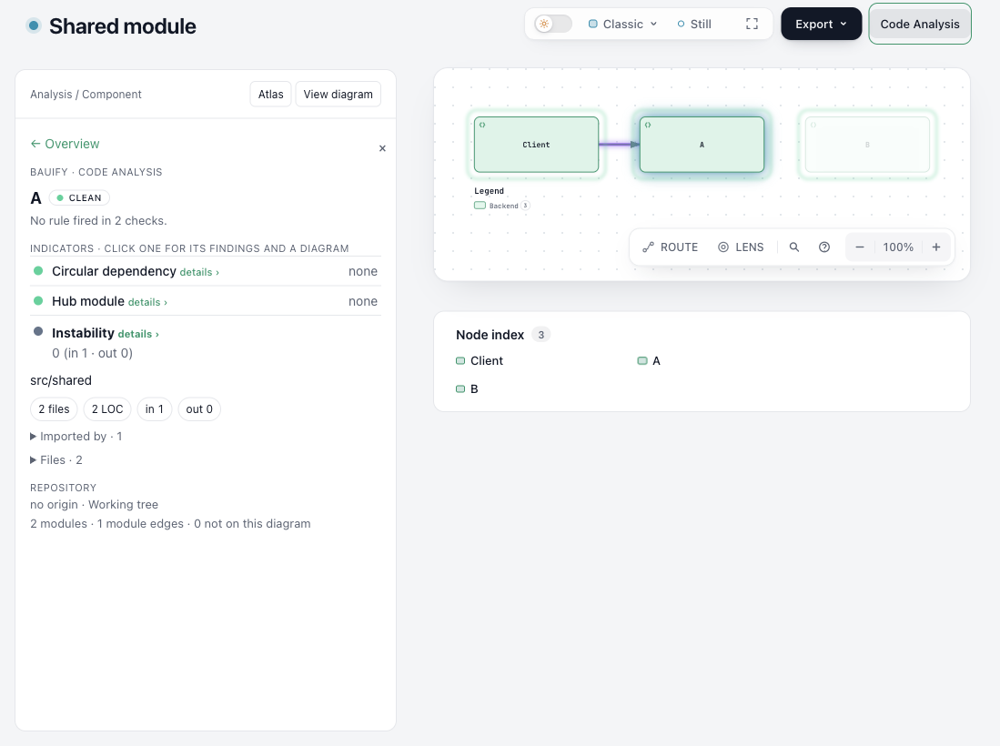
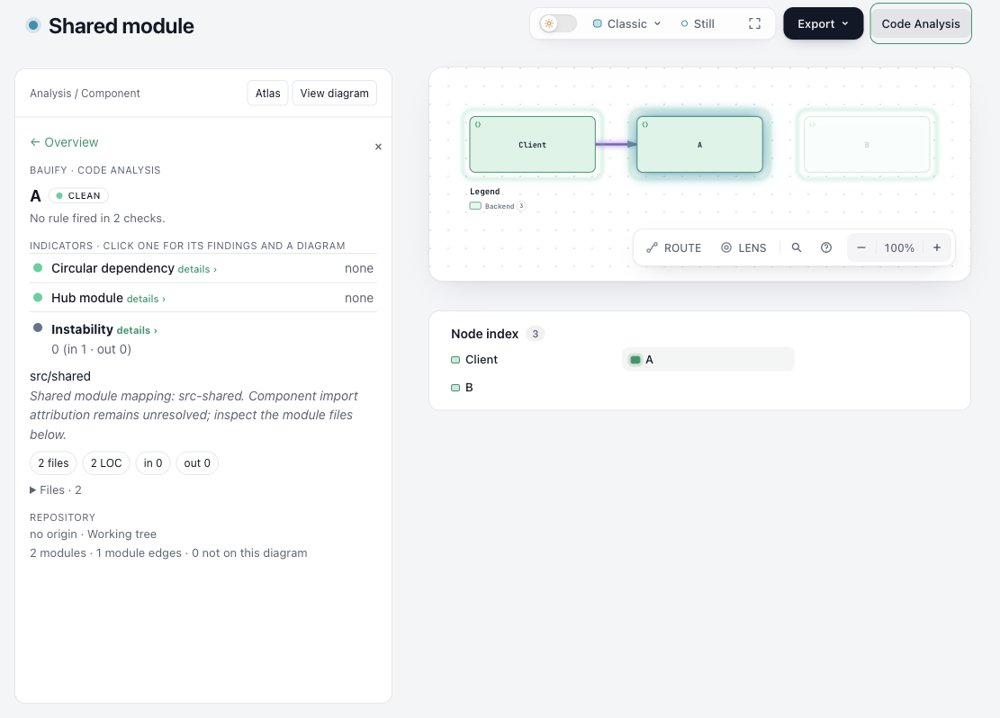
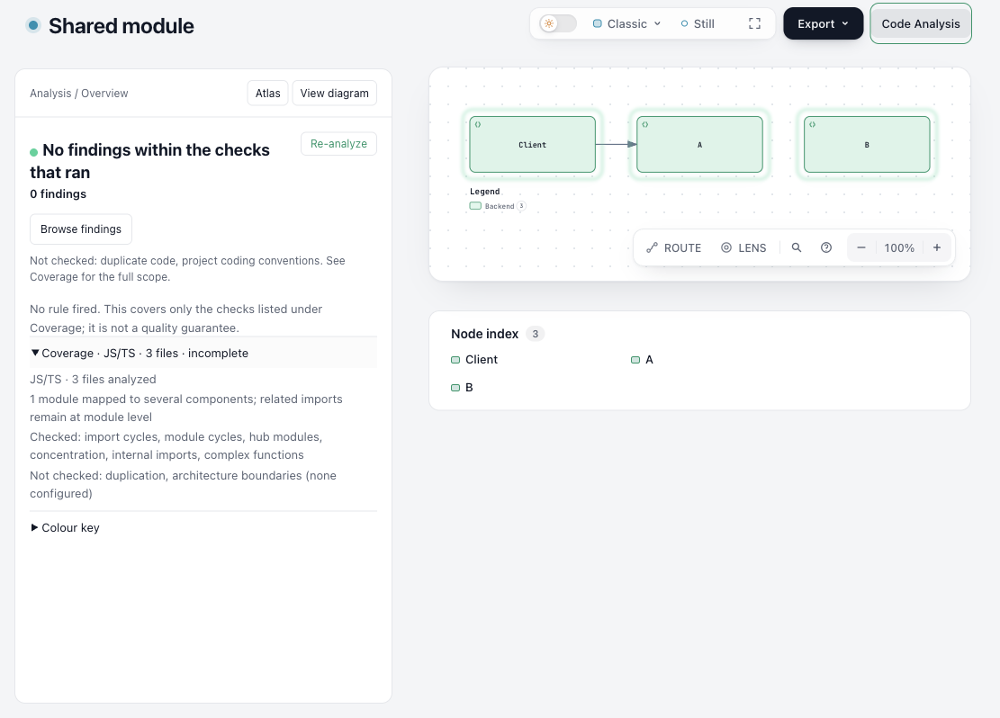

# Code Analysis investigation and diagram mapping

The candidate started at Labs `9202eaf48bafb072ed847982201f95bfdca249b5`.
The original four local commits ended at `790f09ade805999600dd13aa3af678e0bf443bed`.
The follow-up preserves that history and corrects two mapping failures found in review.

## Observed behavior

| Fixed input | Original `790f09ade` | Follow-up |
| --- | --- | --- |
| Go `cmd/app/` and `pkg/core/` directory anchors | 0/2 components mapped | 2/2 |
| Rust `src/` directory anchor | 0/1 | 1/1 |
| JS/TS analyzed-root anchor `.` | 0/1 | 1/1 |
| Client imports A; A and B share a folded module | Reports an undeclared client -> B edge in one component order | Lists the shared module's ambiguous ownership; keeps the import at module level |
| Swap A and B without changing source or declared connections | The reported missing edge disappears | Identical alignment result |

These are synthetic review cases with source answers established during inspection.
They exercise the ordinary `code-analysis check` command. They are regression
evidence, with no claim of blind evaluation or general accuracy.

Directory anchors use `fileModules`, which records filesystem paths even when a
module's `path` is a Go import path, Rust crate identity or configured group name.
More specific directories claim their files first. If a folded module spans
several component directories, all owners remain visible. Exact file anchors and
explicit maps retain their whole-module association. Historical graphs retain
their directory fallback when exact file ownership is absent.

`diagram.ambiguousModules` identifies modules with several component owners.
Component edges require unique ownership at both ends. A zero-length
`undeclaredEdges` list must be read alongside unmapped and ambiguous modules.
This checks captured import attribution; the diagram's runtime responsibilities
and the health of a module boundary still require source review.

## Repeat the normal CLI verification

From a checkout with Node, Go and Rust installed, run this at repository root.
Parser dependencies use the normal Code Analysis first-use setup.

```sh
node benchmarks/code-analysis-closed-loop-20261113/verify.mjs --out /tmp/archify-closed-loop-evidence
```

To compare the original local candidate, create a separate checkout at
`790f09ade805999600dd13aa3af678e0bf443bed` and pass its CLI.

```sh
node benchmarks/code-analysis-closed-loop-20261113/verify.mjs \
  --baseline-cli /path/to/original/archify/bin/archify.mjs \
  --out /tmp/archify-closed-loop-paired
```

Use `--cli /path/to/unpacked/archify/bin/archify.mjs` to exercise the distribution.
Use `--root /path/to/the/same/archify` so source and ZIP analyze identical source.
The runner saves fixture source, IR, commands, exit codes, receipts, stderr and a
summary. The Go case disables standard-library typing and uses only local source.
The Rust fixture has no dependencies. Neither analyzed fixture is built by the
analyzer. The runner's source answers and expected mappings are fixed in its code.

The [self architecture input](archify-self.architecture.json) is an unpinned
working-tree association input for headless `check --ir`. It is deliberately
incomplete, so captured imports absent from its single declared connection are
available to inspect. Rendering a source-linked, committed architecture artifact
has a separate repository-evidence contract.

## Real repository maintenance decision

On the same Archify renderer package, the new brief exposes 20 modules, 27 edges
and `renderers/shared` with fan-in 17. The `coupling/internal-leak` task reports
17 modules importing 24 of its 26 files directly. The generated task passes
working-tree evidence verification.

The source review decision is to **retain focused imports from shared leaf
modules**. `renderers/architecture/labels.mjs` re-exports the focused automatic
label helper. `renderers/sequence/render-sequence.mjs` selects functions from
geometry, diagnostics, text fit, legend and other helpers. These are different
responsibilities used across renderer families. A missing directory-level entry
file alone provides insufficient reason to change those imports. This decision
preserves the existing dependencies; the signal remains available for later
investigation of individual helpers.

The verification runner follows the lead through `task --require-valid`, then
reanalyzes the same tree and requires zero new or no-longer-detected findings.
The core product and Code Analysis regression commands check existing behavior.
This is an evidence-backed maintenance decision by the implementation/review
session. It supplies no independent-reader result, measured AI cost saving or
maintainer adoption claim.

## Browser check

The delivered three-component diagram uses an explicit map to the same folded
modules as the CLI case. Both pages use Classic, light theme and 100% zoom. The
original viewport was 1100 x 820 and the follow-up viewport 1111 x 798; the captures
support text and state inspection, with no pixel/layout equivalence claim.

Ego Browser opened Code Analysis, selected A and inspected Coverage. The shared
module warning is visible in the component panel; Coverage identifies the shared
module and marks attribution incomplete. The module-level import remains
inspectable from the uniquely owned Client component. The reviewer visually
inspected the saved images for readable text. The first attempt to deliver the
unpinned source-linked CLI fixture hit the existing repository-evidence guard;
the browser fixture uses the explicit map instead. Browser wait selectors were
corrected after hidden-script and multi-match waits failed.

| Original component panel | Follow-up component panel |
| --- | --- |
|  |  |



## Evidence

- [Paired normal CLI summary](evidence/source-summary.json).
- [Regression failures before the fix](evidence/regression-before.txt).
- [Focused tests](evidence/focused-tests.txt).
- [Full module gate through the repository entrypoint](evidence/module-gate.txt).
- [Final module suite](evidence/module-tests.txt).
- [Core, Skill and package checks](evidence/contracts.txt).
- [Source/ZIP parity summary](evidence/zip-summary.json) and [archive receipt](evidence/zip.json).

The repository module wrapper passed its two outer tests. On `4b95e64e5`, after the legacy-graph
compatibility addition, the direct module run used Node 22.23.3 and local
`--test-concurrency=2`, with 595 passing and 16 skipped cases. Those skips require
an explicitly configured native jscpd executable; the skipped duplication tests
were outside this mapping change. The core/Skill/package selection on that revision passed 70
cases and skipped two environment-specific archive checks (a noncanonical
toolchain probe and a Windows-only path). Generated-output checks passed.

The ZIP contains 455 files and was built with official Node 22.23.3 and bundled
zlib 1.3.1-e00f703. A second build under Pacific/Honolulu produced identical bytes.
Its SHA256 is `b88b5c0a136494f3dd6c864411d173117aa453b9d5f9647ef4371bcb1b9a3b59`.
Unpacked normal CLI replay produced identical fixture and self-analysis summaries.
That replay reused the source checkout's parser dependencies. Remote CI results
belong to the final submitted head and are recorded on the PR.

## Labs integration follow-up

Labs advanced to `960da7477` during the original head CI. Its #1349 Java class-cycle severity change merged cleanly in source; the sole ZIP conflict was rebuilt from the combined tree using the repository helper. Both histories remain in the merge commit. Java extraction, mapping, coverage and review checks then passed 65/65 with zero skips. Source and unpacked ZIP replay still match, and the combined archive was rebuilt byte-identically across timezones. The earlier broad local logs retain their original revision and scope. Final-head remote CI is recorded on the PR.
