# P99 从 80 ms 涨到 600 ms，为什么平均值几乎没变？ {#p99-tail}

因为**只有最慢的 1%–2% 请求恶化到了 600 ms**，其余 98% 仍保持 80 ms，大量正常请求把平均值摊平了。问题通常不在接口整体退化，而在排队争用、个别坏实例、下游偶发抖动或少数慢路径。排查时直接抓慢请求 trace，不要盯着全局平均值看。

- 平均值对长尾极不敏感：1000 个请求里有 15 个涨到 600 ms，平均值只涨 7.8 ms。
- 尾部尖刺说明慢请求有局部共性，往往集中在特定节点、下游或请求参数上。
- 排查顺序：先核对口径并抓慢请求 trace，再按维度切分，最后查变更与资源。

@answer scope="数值为示意 · 常见 Web 与微服务接口 · P99 按第 990/1000 个值计"
@meta locale=zh-CN

## 为什么平均值看不出长尾变慢？ {#why-mean-flat}

```mermaid title="接口延迟前后对比（ms）"
xychart-beta
  x-axis ["平均值", "P50", "P99"]
  y-axis "ms" 0 --> 700
  bar "之前" [80, 80, 80]
  bar "之后" [88, 80, 600]
```

1000 个请求里，985 个耗时 80 ms、15 个耗时 600 ms：平均值 `(985×80 + 15×600) / 1000 = 87.8` ms，只多出 7.8 ms。

但按耗时从快到慢排，第 990 个请求（P99）正好落进最后那 15 个慢请求里，直接跳到 600 ms。平均值会把少数卡顿摊平，所以线上告警必须盯住 P95 和 P99。

## 按什么顺序排查最快？ {#triage-order}

@workflow id=p99-triage title="P99 飙升排查顺序"
| role frontend | 核实与抓样本 |
| role backend | 切分收敛范围 |
| role security | 对照变更与资源 |
| lane locate | 先看慢在哪 |
| lane split | 再切分范围 |
| lane fix | 最后查根因 |
| confirm | 核对指标口径 | frontend | locate |
| trace | 抽样慢请求 trace | frontend | locate |
| dim | 按实例与参数切分 | backend | split |
| change | 对照发布与配置变更 | security | fix |
| res | 检查资源与锁争用 | security | fix |
| confirm > trace | |
| trace > dim | |
| dim > change | |
| change > res | |

@steps id=triage-steps
| s1 | 核对指标口径 | 先看 P50 和 P95 是否同步上涨，排除监控聚合窗口或采样规则变动。 | p99-triage | confirm |
| s2 | 抽样慢请求 trace | 抓至少 10 条耗时不少于 500 ms 的慢 trace，看时间花在排队、下游调用还是本机逻辑。 | p99-triage | trace |
| s3 | 按实例与参数切分 | 看慢请求是集中在某台机器、某个下游，还是带有相同接口参数或大请求体。 | p99-triage | dim |
| s4 | 对照发布与配置变更 | 把尖刺起点对齐部署记录、配置推送、特性开关和依赖升级时间点。 | p99-triage | change |
| s5 | 检查资源与锁争用 | 排查连接池等待、线程池队列积压、GC 停顿、容器 CPU 限流和热点锁竞争。 | p99-triage | res |

## 常见根因怎么快速区分？ {#causes}

| 候选根因 | 典型迹象 | 确认方法 |
| --- | --- | --- |
| 排队与资源争用 | 慢 trace 里等待时间占大头，延迟随流量起伏 | 查连接池、线程池等待时长与队列深度 {caution:最常见} |
| 个别异常实例 | 慢请求集中在少数一两个节点 | 按实例分组看 P99，揪出离群机器 |
| 下游长尾变慢 | 慢 trace 中单个下游 span 耗时占八成以上 | 查数据库慢查询、行锁等待或缓存穿透 |
| 慢路径或大请求 | 慢请求共享特定参数、租户或超大载荷 | 对慢样本按路由、参数与响应大小聚类 |
| GC 或运行时停顿 | 尖刺呈周期性出现，且与 GC 日志时刻重合 | 对齐 STW 暂停时长与接口延迟尖刺时刻 |
| 超时重试放大 | 下游偶发超时后请求量突然成倍抬升 | 对照下游入站 QPS 与重试计数曲线 |

## 现在先查哪几件事？ {#checklist}

- [ ] 拉取最近 1 小时耗时不少于 500 ms 的慢请求 trace，至少看 10 条
- [ ] 按实例、下游服务、关键请求参数切分慢请求占比
- [ ] 将延迟尖刺起点对齐发布、配置变更和开关记录
- [ ] 检查连接池等待、线程池队列、GC 停顿和容器 CPU 限流指标
- [ ] 对照 P50 与 P95 曲线，确认是局部长尾恶化而非统计口径调整
