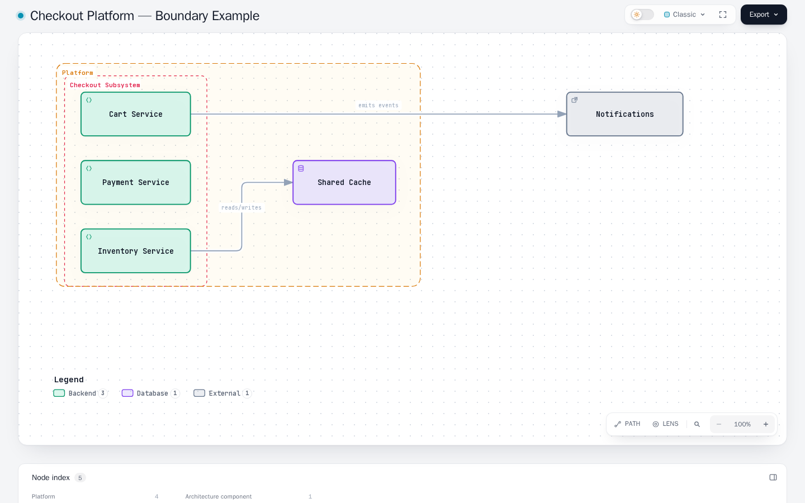
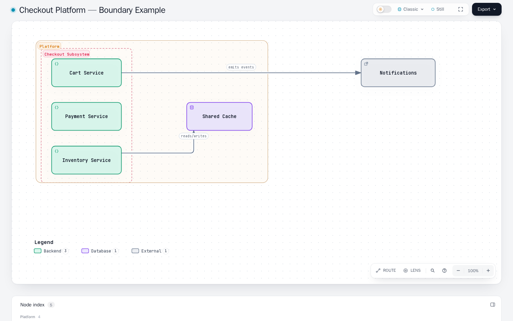
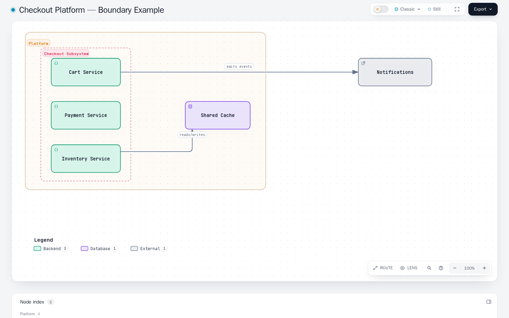

# Nested architecture boundaries: fixed-input comparison

This is a constructed example for PR #1400 / #539, not a natural user task or a real-system claim. It isolates the boundary contract with one identical set of components, relationships, positions, sizes, title, viewport and quality profile. It is a fixed-input renderer comparison, **not** the real-repository Agent-generation benchmark.

## What changed

- **v3.0.1 and current `dev`:** `boundaries[].id` is not in the schema. The same nested-reference input is rejected as an additional property. The closest supported representation uses two independent flat boundaries: both `Checkout Subsystem` and `Platform` directly list Cart, Payment and Inventory; Platform additionally lists Shared Cache. It can draw a similar picture, but it duplicates membership and does not declare a parent/child relation.
- **PR candidate:** the inner boundary has ID `checkout-subsystem`; Platform's `wraps` references that ID plus `shared-cache`. The outer frame is computed from the inner frame and Shared Cache, so its own padding surrounds the entire inner frame. Notifications stays outside Platform. The input no longer repeats the three service IDs in Platform.

In all three views the components and edges are the same: Cart Service emits events to Notifications; Inventory Service reads/writes Shared Cache. The readable difference is the additional outer padding around the inner frame in the candidate; the contract difference is explicit boundary containment rather than overlapping flat memberships.

## Labeled screenshots and artifacts

The first two are the closest flat representation available in those versions. The third is the explicit nested-boundary candidate.

### Before — stable Archify v3.0.1, flat approximation

- [Standalone output](./v3.0.1-flat.html)
- [Exact flat input](./v3.0.1-flat.architecture.json)

### Current base — `dev` at `c3b29e45234985512e70ccd49446a80f8208c60b`, flat approximation

- [Standalone output](./dev-flat.html)
- [Exact flat input](./dev-flat.architecture.json)

### After — PR implementation at code revision `5883759dc52e755d8cad4d71e95a62421f318b53`, explicit nesting

- [Standalone nested-boundary example](./nested.html)
- [Exact nested input](./nested.architecture.json)

## Controlled conditions and revisions

- Stable release: `v3.0.1`, peeled commit `2ab3cae7ac2c2a55d7386ca789d03c4fcd31816c`.
- Current PR base: `dev` at `c3b29e45234985512e70ccd49446a80f8208c60b`.
- Renderer candidate: `5883759dc52e755d8cad4d71e95a62421f318b53`. The evidence files added after that commit do not change renderer, schema or model code; reusing this visual evidence is limited to those unchanged bytes.
- All inputs use `standard`, `classic`, English, still animation and a `1100 × 540` diagram viewBox. Components use the same positions and sizes, and the same two labeled relationships.
- Browser captures used Chrome for Testing `159.0.8154.6` on Debian 12, 1440 × 900 CSS pixels, device scale 1, 100% browser zoom, light theme. Archify's `visual-check` also passed its light/dark captures at 1440 × 900 and 2048 × 1320 for each artifact. The linked images are the light 1440 × 900 captures.

## Validation and visual findings

- All three renders had 9/9 standard composition checks, zero errors and zero warnings. Strict `check --require-provenance`, automated `browser-check`, and `visual-check` passed for each delivered artifact.
- The candidate `finalize` passed validation, delivery, strict check and browser-check. The nested input fails schema validation on both v3.0.1 and current `dev` because those schemas do not admit boundary IDs.
- Agent visual inspection of the linked images found the intended ownership placement intact: Cart, Payment and Inventory are inside Checkout Subsystem; Shared Cache is inside Platform but outside Checkout Subsystem; Notifications is outside Platform. Both labels and both routes are visible without overlap or clipping. This is not a human acceptance claim; human review remains pending.
- HTML SHA-256: v3.0.1 `8de8155540f47f84dfa3fba52ee44cb26298f783467d2f0a5e1bf83cc1751892`; current `dev` `0cfc39bfe23c6cb5db7d4571ee4d07deb375f50c5fe902b5e9605f43523aaa23`; nested candidate `70ce76ca73c960573d731fd05508a1a2f90cbc0d774fa2caf2c91a86bada68e4`.

The comparison demonstrates the added schema/rendering contract and its visual result. It does not establish that Agents make fewer errors or require less rework. The broader real-repository generation benchmark, full-suite result, and final human review remain outstanding; this PR stays draft until the remaining review evidence is settled.
