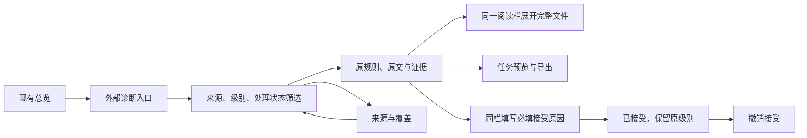

# C7 交互设计 v3

状态：用户已接受 v3，并授权接入、实际试用和后续修复。相关浏览、筛选、证据、任务及接受/撤销控件已接入本地分析页面。本文区分当时的原型设计与后来的真实页面验证；PR 仍按草稿准备，最终版本验证由提交者记录。后端契约见 [C7 contract](code-analysis-c7-contract.md)，实际配置和命令见 [External diagnostics](../../archify/modules/code-analysis/docs/EXTERNAL-DIAGNOSTICS.md)。

## 与现有界面匹配

以 labs `10a608a7` 实际页面为基础：沿用架构画布、现有工具栏、420px 单阅读栏和总览入口。标题和说明使用现有阅读栏的比例字体；文件、规则和源码沿用等宽字体。完整文件阅读时才加宽原阅读栏。

设计阶段的原型通过真实 facts/graph 与 C7 导入器合并三个明确标注的示例报告；告警内容为交互样例，状态切换在内存演示，不能当作真实 lint 结果或基线持久化证据。后续本地服务使用实际工具报告和持久化基线，见下方“真实页面接入”。

## 主流程

## 页面契约

| 位置 | 显示内容与操作 |
|---|---|
| 总览入口 | 外部诊断数、工具摘要与未核实来源提示；打开后保留原有画布 |
| 外部诊断列表 | 搜索、来源、级别、接受状态；计数行可勾选只看未核实报告；每行显示工具、原规则、摘要和位置 |
| 诊断详情 | 原工具/规则/级别、原文、源码快照、报告绑定状态、代码片段；任务预览为主要操作，接受为次操作 |
| 完整源码 | 在原阅读栏加宽展示行列；没有可信当前位置时标明开头预览，不伪造高亮 |
| 接受原因 | 临时收起代码片段和主操作，保留诊断摘要、原级别和证据状态；原因必填，取消恢复详情 |
| 已接受 | 展示原因，支持撤销；原 error 仍保留严重标识；源码或来源主张变化后重新待复核 |
| 来源与覆盖 | 逐来源分别说明报告导入、报告与源码绑定、声明的覆盖范围及完整性 |

有效空报告显示“报告中没有诊断”，覆盖另列；来源缺失、未知或 partial 不能作为已修复证据。重新导入失败保留上次成功结果，显示来源和恢复动作。源码变化时要求重新生成来源报告，并禁止直接接受旧诊断。图外文件保留位置与任务，不推断不存在的图关系。

## 真实页面接入

实现继续使用 Archify 的单阅读栏、画布和 Classic/Atlas 切换。问题列表支持搜索、来源、类别、级别、处理状态及未核实报告筛选；来源页单独展示导入结果、文件内容绑定和覆盖范围。外部诊断通过已经分析的文件归属关联组件及 Atlas；补充证据不创建依赖节点或边。

本地服务的接受操作要求非空原因、当前页面的诊断摘要与当前证据均匹配。已接受的 error 仍保留原级别；待复核项可以撤销旧决定。保存后由现有页面构建器从同一份 facts/graph/findings 和捕获的视图上下文重建页面，不重新执行提取器、重复检测或来源工具，也不推进前后比较快照。静态 HTML 可以阅读、筛选和导出捕获的任务，写基线、当前源验证及重新分析需要本地服务。

实际浏览器试用使用 Trail of Bits 的真实 Ruff `0.17.1` 兼容性报告（77 条）和独立的 canonical Ruff `0.14.13` 空报告。已记录中文原因持久化、源码改变时拒绝接受、待复核后撤销及恢复后的结果；混合的 107 条原生诊断与 77 条外部诊断目前只有 HTTP/数据验证，不能算混合类别筛选的浏览器验收。原型检查和这些真实页面检查不能互相替代；固定来源、证据路径、版本和未验证事项见 [真实项目验证记录](../validation/code-analysis-c7-real-repos.md)。

## 参考界面

| 参考 | 采用的交互 |
|---|---|
| [Microsoft SARIF Viewer](https://github.com/microsoft/sarif-vscode-extension) | 工具、规则与位置对应，诊断筛选与代码上下文 |
| [GitHub code scanning](https://docs.github.com/en/code-security/how-tos/manage-security-alerts/manage-code-scanning-alerts/assess-alerts) | 紧凑搜索/筛选，平面诊断列表，靠近代码的证据 |
| [GitHub alert resolution](https://docs.github.com/en/code-security/how-tos/manage-security-alerts/manage-code-scanning-alerts/resolve-alerts) | 带原因处理、保留记录、允许重新打开 |
| [SonarQube issue management](https://docs.sonarsource.com/sonarqube-server/user-guide/issues/managing) | 接受状态与原因输入保留在诊断上下文 |
| [GitLab Code Quality](https://docs.gitlab.com/ci/testing/code_quality/) | 已有工具报告统一呈现，与基线结果比较 |

这些是交互参考，不是新增运行时依赖。仍使用 Archify 的现有主题、图元和导航。

## 原型阶段的消融与验证

- 从 v2 中移除独立“全部 / 待核实”标签栏，保留计数行勾选。搜索、工具、级别、处理状态、未核实筛选均保留，减少顶部占位。
- 同一 1280×720 视口、同为 420px 阅读栏：v2 完整可见 2 条样例诊断，v3 完整可见 3 条；v3 同时把技术元数据提升至 12px。
- 从接受原因状态中临时移除代码片段和主操作。诊断摘要与确认按钮能同时保持在 720px 高窗口内，取消后恢复原详情。
- 没有增加常驻侧栏、路由框架或前端依赖。
- 当时的原型浏览器检查覆盖深浅色、390px 窄屏、来源页、任务预览、原因必填、接受/撤销、源码变化、空报告与失败恢复。这些记录只证明对应原型；真实服务的结果另列，不把原型的视口或交互覆盖扩大成当前版本的完整验收。
