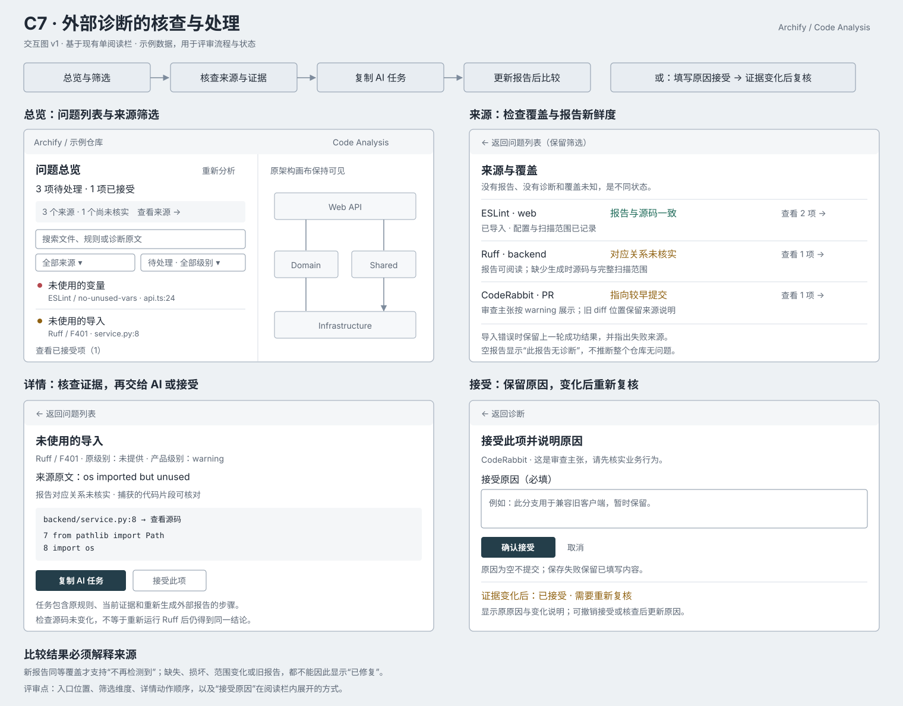
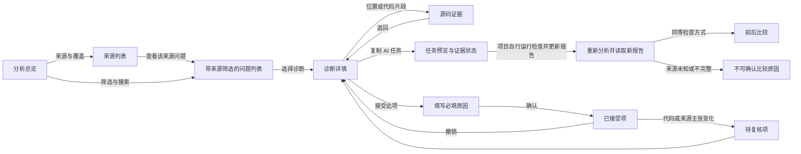

# C7 交互图 v1

状态：历史方案，已撤回。用户指出它与当前界面不匹配、观感不佳；后续在实际页面上迭代并接受了 [v3 交互设计](code-analysis-c7-interaction-v3.md)，相关控件现已接入本地分析页面。本页与 SVG 只保留当时的流程参考，不代表当前页面布局或验证结果。2026-11-11，最初基于 labs `10a608a7` 的单阅读栏。当前行为见 [使用指南](../../archify/modules/code-analysis/docs/EXTERNAL-DIAGNOSTICS.md) 和 [C7 contract](code-analysis-c7-contract.md)。

读者：在已有分析页面核查代码、审查外部告警并交给编码 AI 的开发者。主要任务是确认一条诊断适用、核对证据，然后导出任务或填写原因接受。保留原来的架构画布与阅读栏；增加来源覆盖、筛选和处理操作。图里的仓库名、代码和计数均为示例数据。

## 主流程

## 页面与操作契约

| 页面 | 显示内容 | 主要操作 | 返回状态 |
|---|---|---|---|
| 总览/问题列表 | 未接受项、前三个优先位置；来源覆盖；类别、来源、级别、接受状态筛选及搜索 | 选择一项；打开来源；重新分析 | 保留筛选、搜索和滚动位置 |
| 来源与覆盖 | 每个来源的工具、报告状态、问题数、报告/源码一致性、覆盖是否完整 | 查看该来源问题；查看来源详情 | 回到原问题列表 |
| 诊断详情 | 原工具/原规则/原级别、原文、主要与关联位置、来源主张、源码证据状态、建议 | 查看源码；复制/下载任务；接受此项 | 回列表后保留选择 |
| 源码证据 | 捕获的行列与代码片段；当前源码是否变化；图外文件标识 | 切换关联位置；返回诊断 | 不新开常驻面板 |
| 任务预览 | 原规则和事实、修改范围、代码证据、报告绑定状态、重新生成报告的验证要求 | 复制；下载；重新检查源码证据 | 回到同一诊断 |
| 接受原因 | 诊断摘要、必填原因、提示仍然保留来源与证据 | 确认接受；取消 | 保存成功后才进入已接受；失败保留输入 |
| 已接受/待复核 | 接受原因；本轮源码/来源主张变化说明 | 撤销接受；重新核查；更新接受原因 | 变化项重新计入待处理 |
| 比较 | 新增、不再检测到、证据变化；按来源说明可比性 | 查看原因；跳转相关项 | 不把未提供报告当已修复 |

## 重要状态

- 未导入：提示该来源未检查；不要出现“0 问题，因此正常”。
- 裸报告：可以查看和导出审查任务，但显示“报告与当前源码的对应关系未核实”。
- 有效空报告：显示“此报告无诊断”，扫描覆盖是否完整另列。
- 报告失败：保留上一轮成功页面，显示失败的来源和恢复方法。
- 报告与源码不符：保留来源诊断，提示重新生成报告；不能导出宣称证据已验证的任务。
- 图外文件：保留在问题列表，位置和任务可用；不画出没有分析依据的依赖。
- AI 审查：统一 warning，明确为来源主张；旧提交和 LEFT diff 位置不能当当前工作树位置。
- 接受原因为空：确认按钮不可提交；请求失败时原因仍在；取消不产生基线更改。
- 已接受的 error：仍保持严重问题标识，说明基线只影响检查门槛。

## 评审重点

1. 来源入口是否放在总览覆盖区；筛选是否直接置于问题列表上方。
2. 诊断详情的主动作顺序：核查证据 → 复制任务；接受作为次动作。
3. 接受原因是在同一阅读栏内展开，避免新常驻侧栏或多层弹窗。
4. 来源新鲜度与源码证据分开显示，避免一个绿色“已验证”掩盖不同事实。

以上内容是 v1 设计时的操作目标；后续实现、取舍和真实页面验证见 v3、使用指南及 [验证记录](../validation/code-analysis-c7-real-repos.md)。不再依据本页要求重新审批已获授权的实现。
