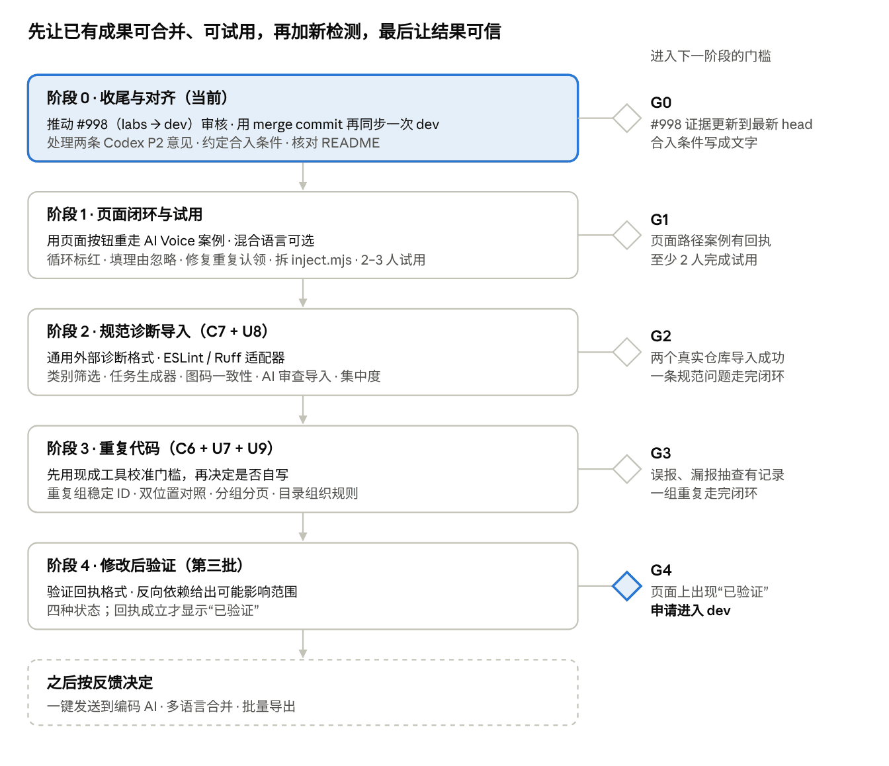

# Archify Code Analysis 路线图

日期：2026-11-04（初版 2026-10-20）

**结论：第一批（现有发现 → AI 任务）已完成，并在两个真实仓库上用 CLI 跑通了闭环；原计划总体可行，但要做八处调整后再进第二批。** 最大的风险在于 #998（`labs/code-analysis` → dev）能否通过作者审核：目前没有人工 review，描述里的测试证据对应旧 head，两条 Codex 机器人的 P2 意见尚未核对是否已处理；11/04 与 dev 出现 14 处冲突，#1208 解决了冲突内容但以 squash 合入，dev 的历史没有进入 labs，#998 仍显示冲突，需要再用 merge commit 同步一次。

建议的顺序：阶段 0 收尾并和作者对齐 → 阶段 1 补齐页面路径的闭环并做用户试用 → 阶段 2 规范诊断导入 → 阶段 3 重复代码 → 阶段 4 修改后验证。一键发送给 AI 的适配器后置。

依据：本机仓库 `codex/code-analysis-module`（最新提交 709fd3b5，2026-10-18），以及 `docs/specs/` 下的 code-analysis 产品计划、执行计划、第一批提交准备、AI 交接设计和两份真实项目验收记录，以及上游 PR #979、#1007、#998 的状态（10/20 核对）。文中没有给日期，因为排期取决于你的可用时间。

11/04 更新：对照 `labs/code-analysis`（`34c99b6f`）和仓库内产品计划第 0 节（检查优先级与严重级别，#1205），补了第 7、8 两处调整、新实现的能力和 #998 的冲突状态；其余内容仍是 10/20 的判断。

## 本次调整与原因

相对 10/17 的执行计划，本路线图改了八处，并补上两个计划低估的工程问题。

| # | 计划原样 | 问题 | 调整 |
| --- | --- | --- | --- |
| 1 | 没有写功能如何从 labs 进入 dev 和发布 | `labs/code-analysis` → dev 的 PR #998 已开，但计划里没有约定合入条件；dev 一个月变动上千个提交，拖得越久，合并成本越高。作者在 PR #352 上曾倾向把分析拆成独立工具，现在却做在 `archify/modules/` 里，毕业条件未约定 | 加一个阶段 0：推动 #998 审核并约定进入 dev 的条件；之后每批结束都同步一次 dev |
| 2 | “完成一个真实交接案例后再进第二批” | CLI 闭环其实已在 AI Voice（`split_stream` 复杂度 19 → 10，12810 组行为对照一致）和 CodeBoarding 完成；缺的是从页面按钮出发的同一路径 | 把门槛收窄为“页面路径跑一遍 + 两三位用户试用”，工作量小，不该长期阻塞 |
| 3 | 独立用户试用放在最后的完成标准里 | 试用结果会改变第二批的 UI（筛选、对照视图），放在最后只能返工 | 提前到阶段 1 |
| 4 | C6 重复检测先于 C7 规范导入，且自己写 token 级检测器 | C7 更便宜、更确定，而且它定义的“外部诊断格式”可以直接被重复检测复用。自写检测器的阈值和误报率要靠真实仓库校准，是整个路线里最不确定的一项 | 先做 C7；C6 先用现成工具（如 jscpd）在真实仓库上校准，再决定是否自写 |
| 5 | 一键发送到编码 AI 的适配器紧跟第一批 | 设计里有 7 个状态、幂等回执、进程管理和宿主 CLI 兼容，成本高；相对“一键复制”，用户只省一次粘贴 | 后置到验证闭环之后，按试用反馈决定是否做 |
| 6 | 没有考虑架构图与代码分析之间的一致性 | 组件来自 AI 画图时标的 sources，模块来自目录/包划分，两者不强制对齐。同一模块可能被两个组件认领，导致 finding 重复、指标重算；图上连线与真实 import 的差异也不可见 | 阶段 1 修复重复认领（试用前必须）；阶段 2 加图与代码一致性提示，只作提示级，因为运行时依赖静态分析看不到 |
| 7 | 没有统一的严重级别：规则各自定级，循环依赖最高只到 warning | 产品计划第 0 节（11/04）把循环依赖标红（error）定为第一优先；冗余、集中度、目录组织和 AI 审查误报标黄，审查后可填理由忽略。路线图里没有这一项 | 循环标红和页面上填理由忽略放进阶段 1（只改规则级别、版本和文案，试用者看到的就是新颜色）；集中度进阶段 2；目录组织规则进阶段 3，和重复代码一起校准误报 |
| 8 | C7 只导入 ESLint / Ruff 等 lint 结果 | CodeRabbit 等 AI 审查会把有意为之的业务逻辑报成错误；产品计划要求导入后统一为 warning，并允许审查后填理由保留 | 阶段 2 的通用外部诊断格式同时覆盖 AI 审查结果；CodeRabbit 先确认能否通过 GitHub API 读取 review comments |

### 计划里低估的两个工程问题

- **`overlay/inject.mjs` 已有 1372 行**，把 CSS、浏览器 JS、布局和数据接缝都放在一起，又是 Claude 和 Codex 共享的文件。第二批还要加 U7–U9，建议先拆分，否则两边会在同一个文件上反复冲突。
- **混合语言仓库会直接失败**（`extract/adapter-ambiguous`），除非显式传 `--language`。让非开发者拿自己的仓库试用时，这很可能是第一个障碍，所以语言选择要在试用前做好。

## 一、计划可行性审视

原计划的核心判断成立：先把已有发现交给 AI，再增加新的检测类别，最后做修改后验证。这样每一批都能独立交付价值。问题出在几个计划没有覆盖的地方，以及两处顺序，具体调整见文首“本次调整与原因”。

### 成立、应保留的部分

- **“不再检测到”不等于“已修复”**。关闭规则、缩小扫描范围、函数改名都会让 finding 消失。计划把可比性（配置、规则版本、覆盖范围）放进对比结果，这是整个产品可信度的基础。
- **事实不交给 LLM 生成**。任务里的位置、指标、证据哈希都由分析器确定，AI 只负责修改。如果事实本身可能幻觉，后面的验证就没有意义。
- **规范诊断导入已有工具的结果，不自己定义“好代码”**。ESLint、Ruff 已经是项目自己认可的规则；重新发明一套，用户不会信任。
- **暂缓清单**。综合质量分、自动批量重构、模糊语义重复都有很高的误导风险，继续暂缓。

## 二、现状盘点

分析主线是：源码提取 → 模块依赖图 → 规则评估 → 叠加到 Archify 架构图。代码在 `archify/modules/code-analysis/`，有三个入口：`serve`（页面）、`check`（无架构图的 CLI / CI 检查）、`task`（导出和校验 AI 任务）。

### 已实现

| 能力 | 含义 | 证据 |
| --- | --- | --- |
| 依赖类规则 | 文件和模块循环、高耦合枢纽（hub） | `evaluate/rules/coupling` |
| 函数复杂度 | Python（10/14）、JS/TS（10/15）的圈复杂度和嵌套深度 | `evaluate/rules/complexity` |
| 架构边界检查 | 按配置的分层规则检查跨层引用，需要用户开启 | 浏览器回归 `code-analysis-boundary-browser` |
| 稳定 ID 与证据哈希 | 同一问题在多次运行间 ID 不变；代码一变就能察觉 | `lib/evidence.mjs` |
| 基线、对比、重新分析 | 接受已知问题；前后对比输出是否可比及理由；重跑失败保留上一轮 | `lib/review.mjs` |
| 配置深合并 | 对象逐键合并，数组整体替换，`ignore` 关规则 | `lib/analysis.mjs` `mergeConfig` |
| 统一阅读栏 | 总览和前三优先项 → 问题 → 最小代码证据 → 建议 | U1–U6，5 项 Chrome 回归 |
| AI 任务交接 | “Copy task for AI”一键复制事实、证据、允许修改的文件和验收要求；JSON 和 Markdown 出自同一生成器 | `lib/task.mjs`，PR #996、#1007 已合入 labs |
| 真实项目闭环（CLI） | 导出 → AI 修改 → 证据失效 → 同配置重分析 | AI Voice：findings 58 → 57，`comparable: true`；CodeBoarding 同样完成 |
| 入口与内部引用 | 其他模块绕过入口文件直接引用内部文件；没有声明入口约定时报 info，声明后报 warning | coupling/internal-leak，#1206 已合入 labs |
| Atlas 视图 | 整个仓库一张环形总览：模块、文件、函数、文件依赖和 finding，任何人可看 | overlay/atlas.mjs，#1206 |
| Atlas 3D 原型 | 同一份数据画成依赖树，定位未定，未接入产品界面 | experiments/atlas-3d，#1207 |
| 检查优先级与严重级别（决定） | 红 / 黄 / 蓝三级的含义，三类视图的读者；已实现项在文中逐项标出 | 产品计划第 0 节，#1205 |

### 尚未实现

- **第二批**：C6 重复代码、C7 规范诊断导入、U7 重复对照、U8 类别筛选、U9 规模控制。
- **严重级别**：循环依赖标红（error）、单一模块集中度、目录组织规则（organization/\*）、AI 审查结果导入、页面上填理由忽略（见产品计划第 0 节）。
- **第三批**：验证回执格式、基于反向依赖的影响范围、页面上的验证状态。
- **交接**：发送适配器（`/handoff` 接口），目前只能复制。
- **页面路径的真实案例**和**独立用户试用**。
- **混合语言**分析。
- **架构图与代码的一致性**：同一模块被多个组件认领时，finding 会重复、指标会重算，目前没有去重也没有提示（`overlay/inject.mjs` 的 `resolveMapping`）；图上连线与真实 import 不做比对。已有的只是“不在图上的模块”和“没有代码的组件”两种提示。
- **合并就绪**：#998（labs → dev）处于 open，等 tt-a1i 审核；11/04 与 dev 有 14 处冲突，#1208 已解决冲突内容但以 squash 合入，#998 仍显示冲突，需再用 merge commit 同步一次 dev。#1007 的 CI 全仓 3206 通过、0 失败，但 #998 描述里的测试证据对应旧 head afe300c6，需要更新。还有两条 Codex P2 意见未处理：Python match 分支里的 import、受控制流保护的 CommonJS require() 都被当成立即加载，可能把本应是 info 的循环报成 warning。

上游状态（10/20）：`codex/code-analysis-module` 的 PR #979 已于 10/19 通过 #1007 合入 `labs/code-analysis`；`labs/code-analysis` → dev 的 PR #998 处于 open。本机工作区另有未跟踪的 `Claude outputs/` 和一个 MCO receipt。

11/04：#1205（产品计划第 0 节）、#1206（Atlas 与入口检查）、#1207（Atlas 3D 原型）已合入 `labs/code-analysis`；#1208（同步 dev）已以 squash 合入，内容已同步，但 #998 仍显示冲突。

## 三、路线图

五个阶段按“先让已有的东西可用、可合并，再加新检测，最后让结果可信”排列。每个阶段末尾有一个门槛，过了再进下一阶段。

阶段自上而下执行，右侧是进入下一阶段的门槛。底部虚线框里的事项不排期，等试用反馈再定。

| 阶段 | 做什么 | 为什么 |
| --- | --- | --- |
| 0 收尾与对齐 | 推动 #998 审核：更新 PR 描述里的测试证据，处理两条 Codex P2 意见；和 tt-a1i 约定进入 dev 的条件；核对 README；用 merge commit 再同步一次 dev，清掉 #998 的冲突 | #979 已合入 labs、CI 已绿，剩下的是让 #998 被接受；留在 labs 用户拿不到 |
| 1 页面闭环与试用 | 用页面按钮重走 AI Voice 案例；混合语言让用户选；拆分 `inject.mjs`；修复模块被多个组件重复认领；循环依赖改为红色（error）、页面上填理由忽略 warning；2–3 人试用 | CLI 只证明了引擎；试用反馈要在做第二批界面前拿到；同一问题挂两个组件会让试用者不信任报告 |
| 2 规范诊断导入 | 通用外部诊断格式；ESLint / Ruff 只导入已有结果；接入任务生成器；类别筛选与搜索；图与代码一致性提示（重复认领、图上漏画或多画的依赖、不在图上的模块）；CodeRabbit 等 AI 审查结果走同一格式、默认 warning；单一模块集中度（用现有模块图和函数度量） | 最便宜、最确定；格式可给重复检测复用；lint 数量大，必须同时有筛选；一致性检查只用现有数据，补上“AI 画图”和“代码事实”之间的接缝 |
| 3 重复代码 | 先用 jscpd 在 3 个以上仓库校准门槛，再决定是否自写；重复组稳定 ID；双位置对照与分页；目录组织规则（organization/\*）同批在真实仓库校准误报。自写原型（7 行窗口，在 Archify 上找到 369 对）可作对照 | 误报率和阈值是最大的不确定项，先拿数据 |
| 4 修改后验证 | 验证回执（不只看退出码）；反向依赖给出可能影响；回执成立才显示“已验证” | 区分“不再检测到”和“已修复”；大部分基础第一批已做好 |
| 之后 | 一键发送到编码 AI、多语言合并、批量导出 | 按试用反馈决定是否值得做 |

## 四、风险与取舍

| 风险 | 可能的后果 | 应对 |
| --- | --- | --- |
| 长期停在 labs，dev 快速变化 | 每次同步都要解冲突、重建 `archify.zip`，精力花在合并上 | G0 约定毕业条件；每个阶段结束都同步一次 dev（11/04 的一次同步就有 14 处冲突，含 archify.zip 重建） |
| 重复检测误报多 | 用户很快不再信任整个报告 | 先用现成工具校准门槛；不用告警数量衡量效果 |
| lint 结果数量淹没优先项 | 前三优先项被几百条风格告警挤掉 | U8 筛选与 C7 同时交付；优先项排序中给规范类单独权重 |
| Claude / Codex 分工的交接成本 | 你作为整合者，每批要处理两份交接材料和共享文件冲突 | 拆分 `inject.mjs` 后减少共享接缝；保留契约 + fixture 先行的做法 |
| 全仓测试本地不绿 | 无法证明本功能未引入回归，阻碍进入 dev | #1007 的 CI 已全绿（3206 通过、0 失败）；#998 要在最新 head 上重新给出证据 |
| 过早做一键发送 | 状态机和宿主兼容吃掉一整个阶段，换来的只是少一次粘贴 | 后置，按试用反馈决定 |

有意接受的取舍：短期不支持混合语言合并，不自动运行项目命令，不做综合质量分。代价是用户要自己提供 lint 结果、自己选语言；好处是每一条结论都能追溯到具体证据。

## 五、待决问题与下一步

需要你或作者拍板的问题：

- \#998 的合入条件：作者是否接受以默认关闭的内置模块进入 dev（PR #352 曾讨论做成独立工具）？
- C6 是否接受引入 jscpd 一类的第三方依赖？这会影响 `archify.zip` 的体积和许可证清单（`THIRD_PARTY_NOTICES.md`）。
- 试用者从哪里找：核心群里没参与开发的成员，还是同事？
- 第二批起是否继续 Claude / Codex 分工？
- 循环依赖改为 error 后，原本只报 info 的模块循环和 Java 循环会让 CI 开始失败：是否要求已有项目先写基线再升级？其余严重级别的待决事项见产品计划 0.6。

本周可以做的事：

- [ ] 用 merge commit 再同步一次 dev（#1208 是 squash 合入的），确认 #998 不再冲突
- [ ] 更新 #998 描述里的测试证据，指向最新 head
- [ ] 在 #998 上请 tt-a1i 说明进入 dev 的条件
- [ ] 处理 #998 上两条 Codex P2 意见（Python match、CommonJS require 的条件导入判定）
- [ ] 用页面按钮重走一遍 AI Voice 案例
