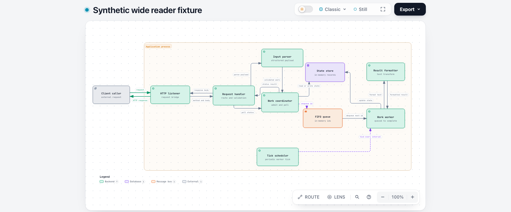
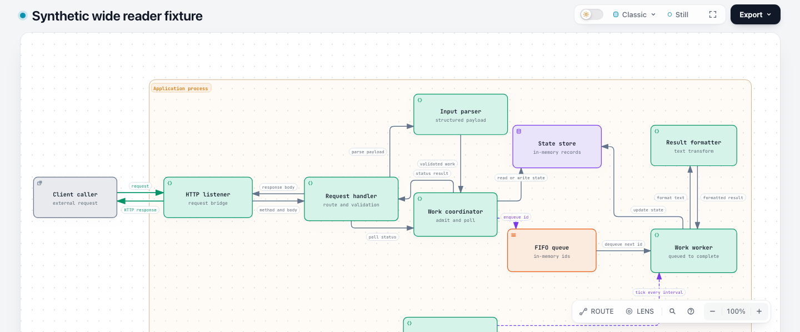
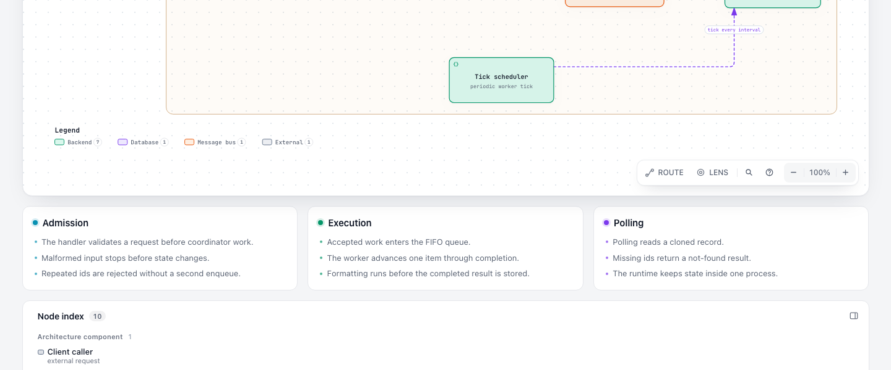
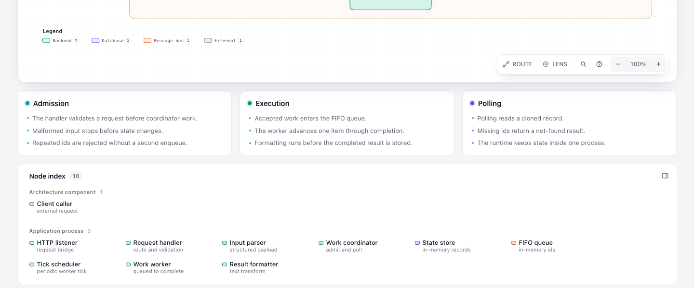

# Authored wide Architecture reading: evidence for #618

Base: `63c9263e84bd3993cab8e09b3d69888857858635` (`dev`). Tested product commit: `f8d5875f1d1e8dd5a1985476ee7f5ddd44325d66`. The following commit only publishes this evidence. Captured 2026-11-02 on macOS arm64, official Node 22.23.2 and Chrome 156.0.8078.74. The fetched base remained unchanged when preparing the PR on 2026-11-03.

This is fixed-JSON renderer/Viewer replay of public examples, a maintained synthetic fixture, and a two-node probe. It does not reproduce the reporter's private 143-diagram atlas or establish Agent authoring speed or human reading comfort. The [maintainer's invitation](https://github.com/tt-a1i/archify/issues/618#issuecomment-5905456761) asks for actual quality improvements and representative browser evidence; this draft proposes a bounded implementation for that discussion.

## Defect and implementation

The maintained wide fixture renders a `1428×706` automatic canvas. Writing exactly those dimensions into `meta.viewBox` preserves the SVG body, but the explicit canvas loses its declared reading target. At 1440×900 the pixels match while static delivery rejects the explicit canvas. At 1440×600 its actual minimum semantic text shrinks from the automatic path's 7.50px to 5.21px. Relaxing the static check alone would leave that browser defect.

The renderer now declares the existing 7.5px target for explicit wide canvases at the existing ratio threshold, 1.55. Shared Reader applies that valid declaration independently of automatic sizing, retaining `authored-height`. Static checking recognizes the same supported contract. The old 930px budget for undeclared artifacts and the 6px hard floor remain unchanged. Automatic enlargement/primary-label policy, authored geometry, routing, content, and Sequence/width-first contracts are preserved.

## Matched results and cost

The primary input has 10 nodes, 15 relationships and 3 note cards. Same input, viewport, theme, Classic preset, Still motion, Read detail and 100% camera; fonts and layout settled before capture. Text size is transformed CSS em px, not glyph height.

| State | Before minimum | After minimum | Document height | First-screen result |
| --- | ---: | ---: | --- | --- |
| Wide explicit, 1440×600 light/dark | 5.21px | **7.50px** | 1131 → 1226, +95px | Larger readable canvas; scroll to remaining content |
| Wide explicit, 1440×900 | 7.54px | 7.54px | 1229 → 1229 | PNG bytes identical |
| Wide explicit, 1920×1080 | 9.74px | 9.74px | 1490 → 1490 | PNG bytes identical |
| Two-node probe, 1440×600 | 5.21px | **7.50px** | 728 → 930, +202px | Scroll cost differs by content |

| Before: 1440×600 | After: same viewport |
| --- | --- |
|  |  |

Full reading path: the same 1440×600 viewport at scroll positions **0, 480 and 626px**. Overlap exposes the intermediate content; the window was not made taller to manufacture a full-page fit.

| Middle, scroll 480px | Bottom, scroll 626px |
| --- | --- |
|  |  |

[Before HTML](before/wide-pinned.html) and [after HTML](after/wide-pinned.html) are the original standalone browser inputs. Download and open them locally to inspect. Their original generated bytes, including whitespace-only lines, are preserved for hash verification. The failed baseline was separately rendered for observation; it is not described as a successful delivery.

## Compatibility and limits

The matrix contains 14 cases: 5 Architecture cases plus Workflow, Sequence, Dataflow, Lifecycle, ERD, Class, Tree, Timeline and Waterfall. Four viewport states per case, plus a dark short-window primary case, produce 57 pairs. All 14 SVG bodies retain identical hashes. **54/57 paired first-screen PNGs are byte-identical**. Only the explicit wide short-window light/dark cases and the short-window minimal probe change. Ordinary, automatic-wide and tall Architecture, and the other nine types, preserve all their sampled first-screen pixels. All 14 candidate deliveries pass; the five Architecture cases explicitly use showcase, while the others retain input/default quality.

| Additional explicit-wide boundary | Before | After | Interpretation |
| --- | ---: | ---: | --- |
| 1280×720 | 6.41px | 6.64px | Uses available width, still below the preferred target |
| 1024×768 | 5.21px | 5.21px | Existing narrow-width limitation remains |
| 390×844 | 4.03px | 4.03px | Desktop Reader is inactive; existing horizontal content clipping remains |

[Normal-height result](after/wide-pinned-1440x900-light.png), [dark short-window result](after/wide-pinned-1440x600-dark.png), and [mobile limitation](after/wide-pinned-390x844-light.png) show those boundaries. Static budget remains a fixed ordinary-desktop estimate, not a guarantee for every viewport, presentation, print or export size. Tall-case edge text remains 6.67px. No new typography option or universal 7.5px policy is introduced.

Complete overlapping scroll captures were measured for the explicit-wide, minimal and tall desktop cases: 20 before/after states, zero visible semantic-text boxes missing from the capture coverage. Only the selected primary scroll screenshots are published here. Coverage assertions and pixel equality are separate from visual acceptance. Codex inspected the primary first/middle/bottom, dark, normal-height and mobile captures; no new desktop overlap or clipping was found. No human visual acceptance or Safari/Firefox/screen-reader claim is made.

## Ablation and test value

| Remove from the candidate | Static outcome | Actual short-window text |
| --- | --- | ---: |
| Nothing | Pass | 7.50px |
| Renderer target declaration | Fail | 5.21px |
| Reader handling of the declaration | **Pass** | **5.21px** |
| Static recognition of authored-height | Fail | 7.50px |

The three pieces are necessary. A redundant four-way minimum-width branch was simplified to one equivalent cap calculation; final validation uses that simplified version. Existing fixture/test ownership is reused. Negative tests preserve missing/duplicate contract, malformed/nonpositive target, non-wide canvas, and physical-width-cap failures. Two existing diagnostic tests now use genuinely too-wide canvases rather than rejecting inputs made readable by this fix.

## Validation

Runs below preceded the product commit but used its exact file bytes, recorded in [manifest.json](manifest.json). Evidence-only additions do not change those results; remote CI is separately reported on the PR.

| Command / check | Result |
| --- | --- |
| `npm run test:full` | 3,540 pass, 0 fail, 135 environment-dependent skips; generated/golden checks pass |
| `npm run test:browser` | 338 pass, 0 fail, 0 skip |
| Five Architecture ordinary-mode `visual-check` runs | All pass |
| `npm run test:webm` | Export and three Story tests pass; subsequent legacy-site language test has a remote-font load timeout, also reproduced on untouched dev. Separate local-font PR addresses it; this command is **not** reported fully green here |
| Exact extracted ZIP | Dependency-free macOS package smoke and primary-case showcase delivery pass |
| Canonical ZIP reproducibility | Second build byte-identical; official Node 22 / bundled zlib |
| Input/geometry and evidence identity | 14 input hashes, 28 artifact hashes, unchanged baseline archive and selected image hashes verified |

Shared template, packaged/development examples, compare artifact/receipt, Gallery, README motion proof and canonical ZIP were regenerated. The underlying dev README motion receipt was already stale (tracked separately in #1174); this PR's shared-template change requires a fresh capture anyway. No live installation or deployment was performed. Windows/Linux and final-head remote checks are not inferred from local macOS evidence.

## Reproduction and data

From the repository root, with Node 22.23.2 and `ARCHIFY_CHROME` set to a supported executable:

```sh
node archify/bin/archify.mjs deliver architecture docs/evidence/authored-wide-readability/inputs/wide-pinned.architecture.json /tmp/archify-wide.html --quality showcase --json
npm run test:focus -- test/render-output-checks.test.mjs test/repair-receipt.test.mjs
npm run test:browser -- test/reader-readability-maintained-browser.test.mjs
```

Use the same JSON on a separate checkout of the recorded base; baseline deliver fails, while `render` permits observation. Inspect at 1440×600 and 1440×900 without changing zoom, and scroll through the notes. [comparison.json](comparison.json) contains all 57 paired summaries; [measurements.json](measurements.json) records the 114 observations; [boundaries.json](boundaries.json) contains the eight extra narrow observations; [ablation.json](ablation.json) records the removal experiments. Inputs are in [inputs/](inputs/).

AI assistance: Codex (GPT-6) performed investigation, implementation, tests, evidence preparation and review under @testikun's direction. Human accountability confirmation remains for the contributor; this report does not supply it.
