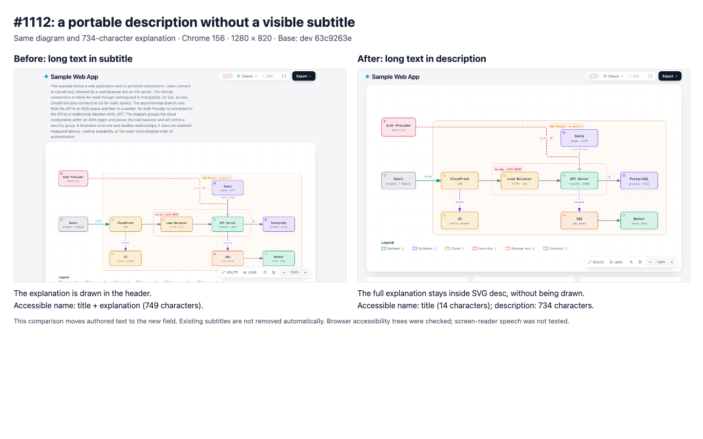
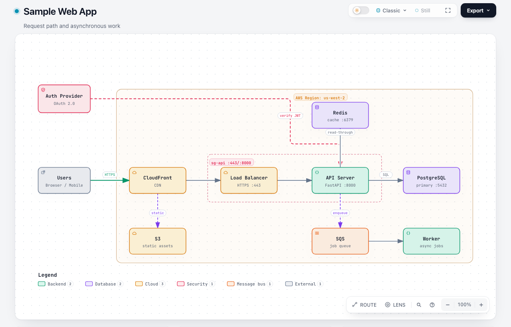
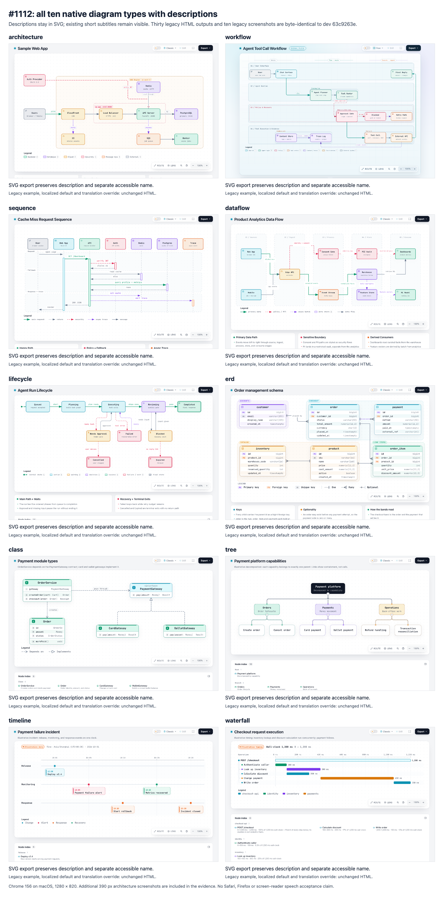

# Authored SVG descriptions (#1112)

Authors can provide `meta.description` without drawing that text in the page
header or raster title band. This implements the [agreed scope](https://github.com/tt-a1i/archify/issues/1112#issuecomment-6430166515).

## Comparison

Base: `dev@63c9263e84bd3993cab8e09b3d69888857858635`.
Candidate implementation: `21807732c94496512c4bb1dd76d377a43e8d751d`.
This evidence-only follow-up does not change product or test code.



The comparison uses the same diagram and the same 734-character explanation.
The author moves the text from `subtitle` to `description`; existing subtitles
are not removed automatically. The explanation is retained in SVG `<desc>` and
is not drawn. The labels below the screenshots are report annotations, not new
viewer UI. [Source input](description.architecture.json) · [Actual exported SVG](description.svg).

| Case | Accessible name | Accessible description | Visible result |
| --- | --- | --- | --- |
| Before: long subtitle | Title + explanation, 749 characters | 734 characters | Long explanation in header |
| After: long description | Title, 14 characters | 734 characters | Title only |
| Before: short subtitle | Title + subtitle, 49 characters | 34 characters | Short subtitle |
| After: short subtitle + description | Title, 14 characters | 734 characters | Identical short subtitle |



## Compatibility



- All ten native types accept and render the field through the public CLI.
- Thirty legacy HTML outputs (original example, Chinese default, translation
  override for each type) are byte-identical to the base.
- Ten legacy screenshots and both short-subtitle screenshots (1280 and 390 px)
  are byte-identical. [Screenshot comparison receipt](screenshot-compatibility.json).
- Each type's actual SVG export retains text, valid title/description references,
  and the same browser accessibility semantics when reopened independently.
- XML and HTML parsing preserve special characters as text; no injected script
  or XML parse error is produced. SVG retains newlines; the browser accessibility
  tree normalizes whitespace.
- PNG exports with and without a short subtitle remain byte-identical when a
  description is added. The explanation is not drawn into the raster image.
- Empty/whitespace descriptions preserve the old fallback; nonblank descriptions
  retain their original spacing. The limit is 2,000 Unicode code points.
  Invalid types and 2,001 code points are rejected; translations remain limited
  to 400 characters.

[Before browser observations](before.json) · [After browser observations](after.json)
· [390 px screenshot](mobile-short-subtitle.png).

## Validation

Executed on macOS with Chrome 156.0.8078.74. Viewports were 1280 × 820 and 390 × 820,
device scale factor 1, reduced motion, default light theme and each example's preset.

| Command/check | Result |
| --- | --- |
| `npm run test:focus -- test/diagram-description.test.mjs test/i18n.test.mjs test/animation.test.mjs test/drilldown-navigation.test.mjs` | 65 passed, none skipped |
| `npm test` | 19 passed, including frozen v1 inputs |
| `npm run test:generated` | Passed |
| `npm run test:browser -- test/export-browser.test.mjs '--test-name-pattern=authored descriptions'` | New description/export test passed; unrelated export test filtered out |
| `scripts/build-zip.sh` and independent rebuild/byte comparison | Passed, official Node 22.23.2 / bundled zlib 1.3.1-e00f703 |
| `node scripts/package-smoke.mjs /path/to/extracted/archify` | Passed without installing package dependencies |
| `git diff --check` | Passed |

Tests protect input boundaries, preserved authored text, browser semantics and
portable exports. Shared length rules are checked at the schema layer; each
native entrypoint also renders through the public CLI. No new runtime dependency,
description parser, panel or per-type resolution logic was introduced. The
conditional ARIA branch preserves legacy bytes while preventing a new long
description from also becoming the short image name. During the earlier main-based
implementation, removing this branch failed the new-description regression;
restoring it passed. The current dev-based tests verify the same contract and
also cover the merged parent-navigation behavior.

This is a scoped authoring/output change, not an Agent-generation or layout
benchmark. Full regression/browser suites and remote CI are not claimed by these
local checks. Screenshots were visually inspected by Codex; human review and real
VoiceOver/NVDA speech tests remain unperformed. Safari, Firefox, Windows, Linux,
and host-document `img` embedding are not claimed as tested. Hosts using `img`
still need their own `alt` and long-description strategy.

## Reproduce

Use separate checkouts for the recorded base and candidate and the same installed
Chrome, Node runtime and output directory. The script renders inputs, captures
screenshots, invokes the actual SVG exporter and reads browser accessibility trees.

```sh
node docs/evidence/diagram-description/reproduce.mjs /path/to/base before /tmp/description-evidence
node docs/evidence/diagram-description/reproduce.mjs /path/to/candidate after /tmp/description-evidence
```

Set `ARCHIFY_CHROME` if Chrome is not found automatically. The ten-type overview
and before/after comparison arrange the individual screenshots for review; they
do not alter the product captures.
