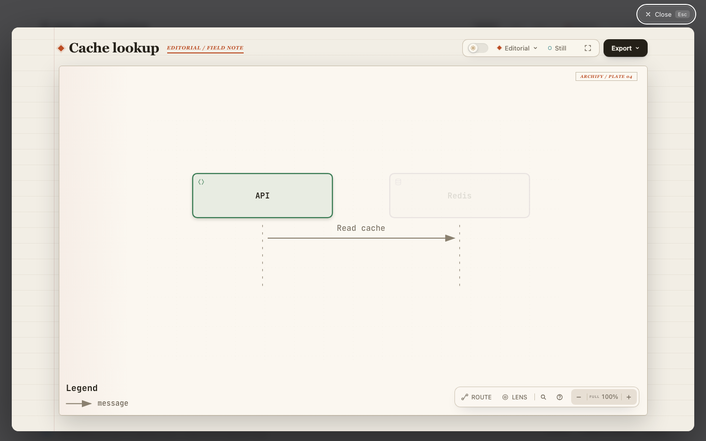
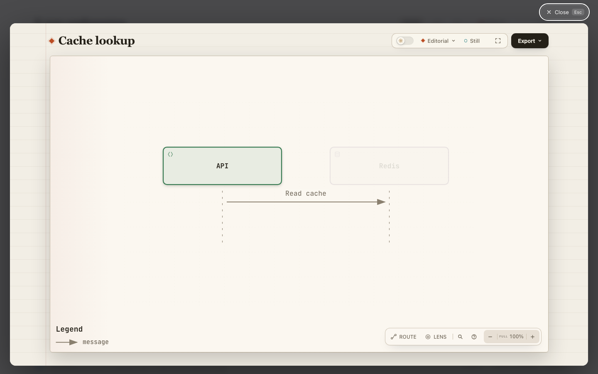

# Hosted Viewer badges (#1195, #1196)

An editorial explainer should retain its preset and Viewer tools without the standalone field-note and plate badges. The standalone Viewer remains unchanged.

Comparison base: `63c9263e84bd3993cab8e09b3d69888857858635`.
Candidate source: `bd5b9f321056c79d7adc27540592bc72afd3d81c`.
Both use the same [explainer input](explainer.json), Chrome, Node.js 22.23.3, 1440 × 900 viewport, light theme, editorial preset, and open “Read cache” step. Captures wait 800 ms after the editorial preset has applied.

| Before                                             | After                                            |
| -------------------------------------------------- | ------------------------------------------------ |
|  |  |

The [receipt](evidence.json) records input and image hashes, browser observations, and the pixel comparison. Exactly 3,271 of 1,296,000 pixels change, within the two badge regions. The title, toolbar, diagram, legend, and controls are pixel-identical. The browser reports both badges as `block` on the base and `none` on the candidate; the preset remains `editorial`.

The Agent inspected both captures. @HengYangDS personally reviewed the submitted changes and explanation and confirmed understanding on 6 November 2026. Maintainer scope agreement remains pending in #1195. The capture receipt retains the review state observed when the images were taken. This fixed-input presentation comparison makes no claim about Agent generation speed or first-draft quality.

The related behavioral regression can be run from the repository root with Chrome available:

```sh
ARCHIFY_EXPLAINER_BROWSER_TESTS=1 node --test test/explainer-browser.test.mjs
```

Source checks and CI from candidate `bd5b9f32` remain applicable because this evidence-only addition does not change runtime, test, generated-artifact, or build inputs. Required CI at the publication head remains separate.
