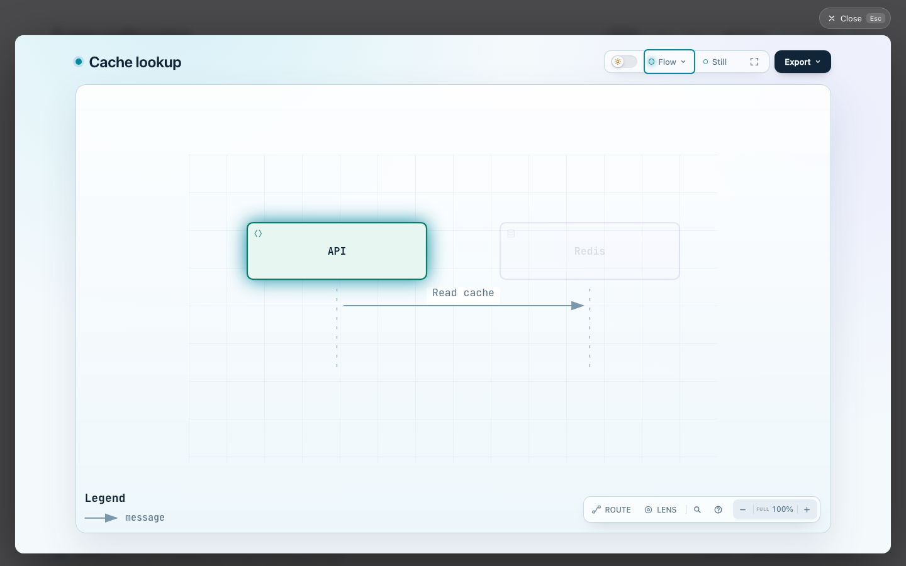
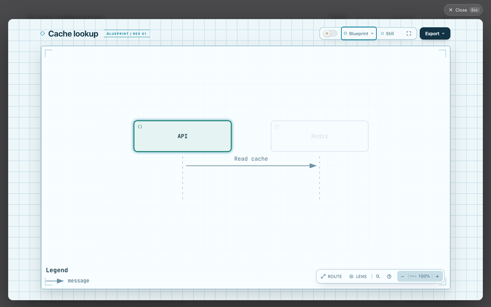
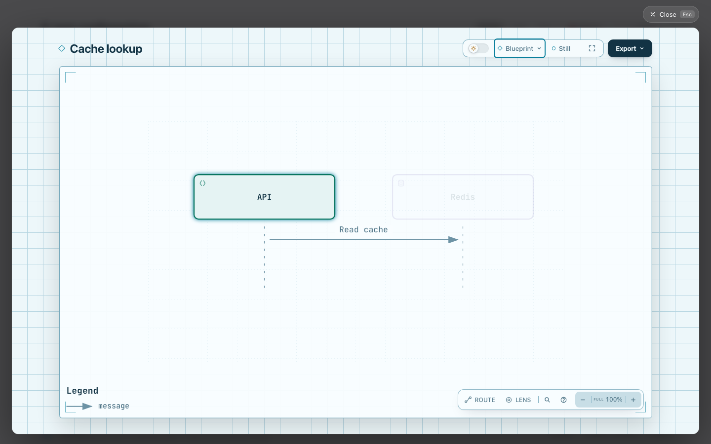

# Hosted Viewer preset comparisons

These pairs complete the signal-flow and blueprint evidence requested in [#1195](https://github.com/tt-a1i/archify/issues/1195#issuecomment-6690778603). The existing editorial comparison remains in the parent directory.

Both revisions render the same [input](explainer.json). The editorial page opens its Viewer, then the actual preset menu selects signal-flow or blueprint. Viewport 1440 × 900, light theme, API focus, 100% zoom and Still motion are matched. This tests hosted presets without adding new page styles.

| Preset      | Base                                             | Candidate                                      |
| ----------- | ------------------------------------------------ | ---------------------------------------------- |
| Signal flow |  |  |
| Blueprint   |    |    |

The title badges disappear. Blueprint corner lines remain. Browser measurements retain the same title, diagram text, controls and layout geometry. An Agent inspected all four images and found no other visible change. The focus state dims Redis equally in each pair; it is not introduced by this patch. Human visual review is not claimed.

[Evidence and revision identities](evidence.json) record the exact base and candidate. The expanded existing browser regression selects all four presets and checks the hosted header, editorial plate and blueprint decoration. It fails on the unchanged base and passes on the candidate. Standalone presentation is unchanged.
