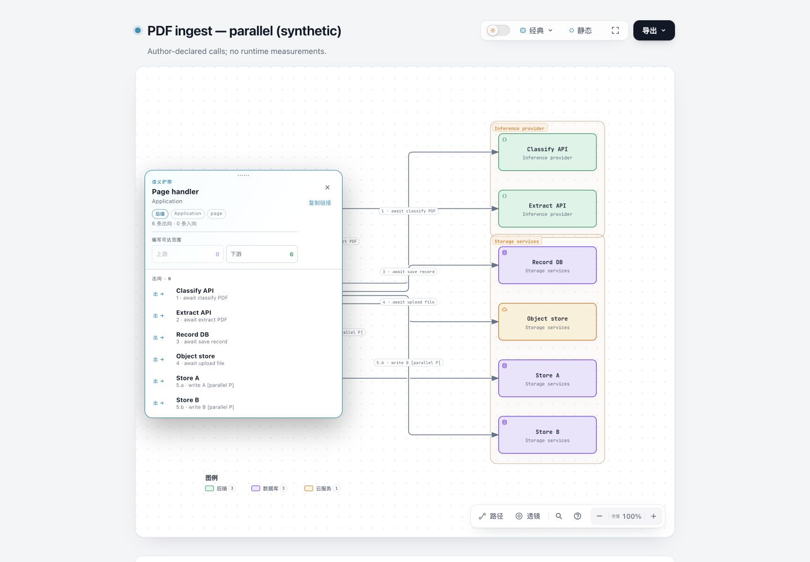
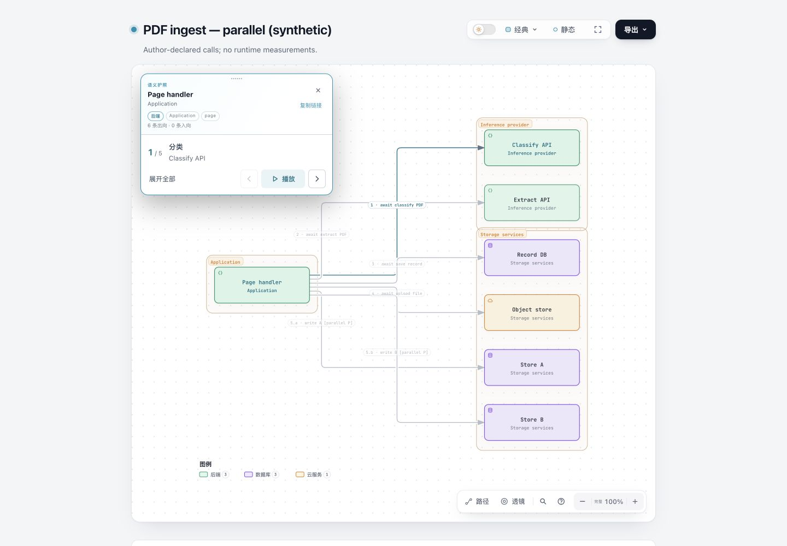
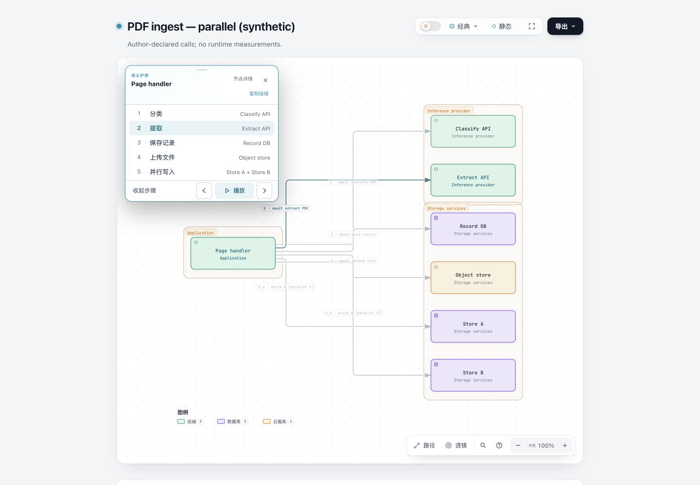
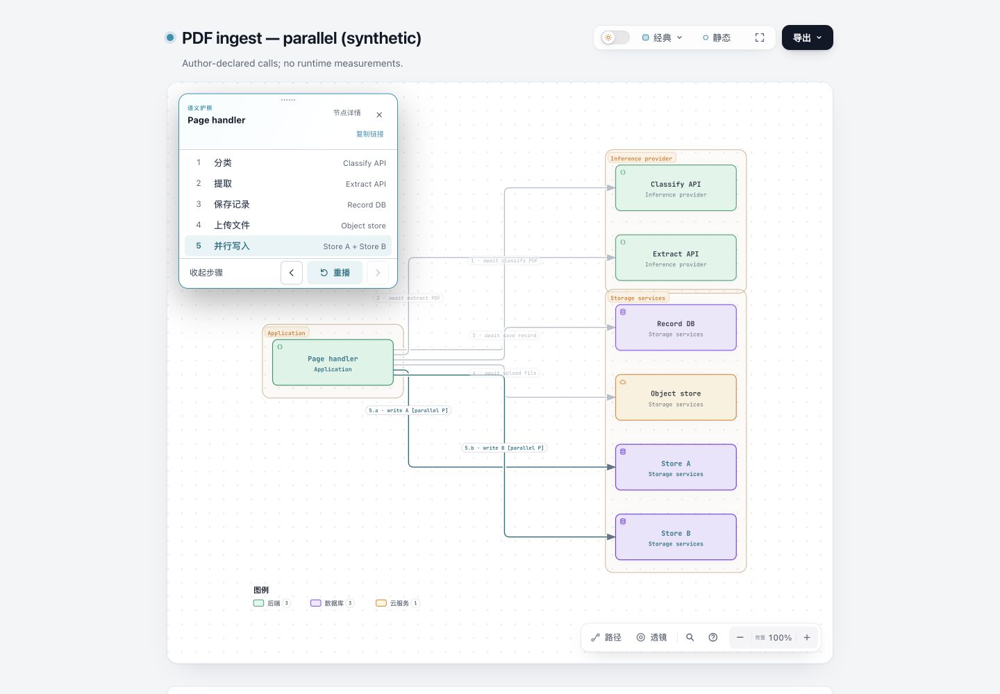
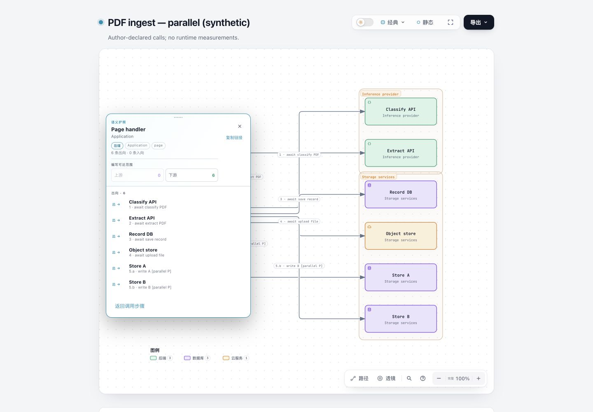
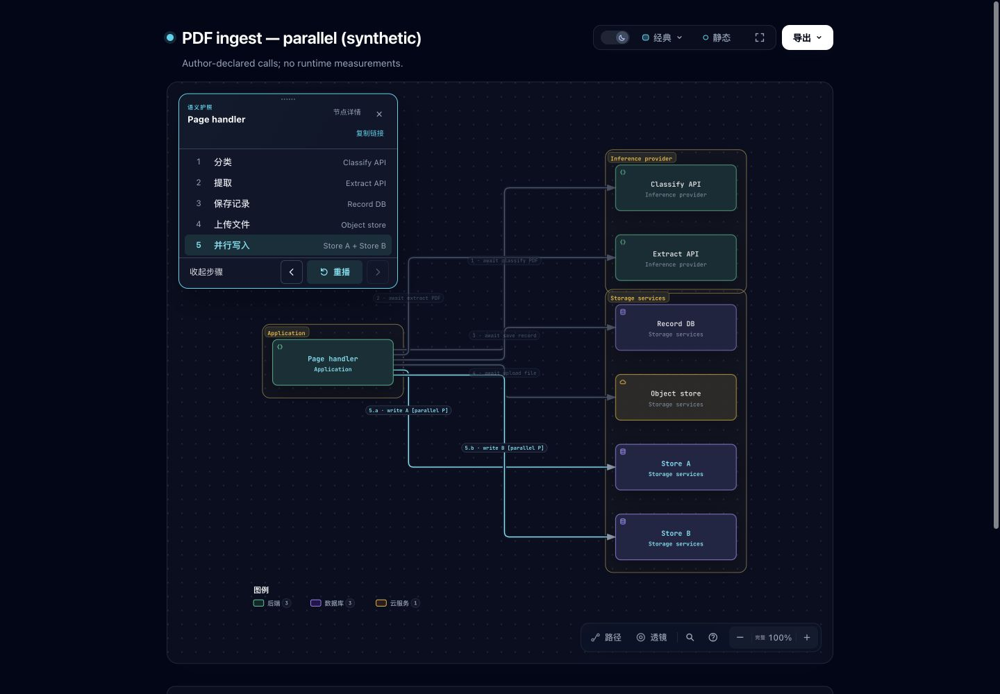

# Native Passport call stages — #452

This implements an in-place reading option for [#452](https://github.com/tt-a1i/archify/issues/452): retain the architecture components and boundaries while a reader selects or plays one caller's explicitly authored outgoing stages. The example is synthetic, inspired by the issue; it is not a runtime trace or the original application's input.

Base: `dev@63c9263e84bd3993cab8e09b3d69888857858635`, fetched again before submission on 2026-11-03. Product commit: `a8e7b7dcde937936718a4ead0c0aaa18ad472f6f`. The subsequent evidence commit changes only this directory. [Verification receipt](verification.json) binds the product source, canonical ZIP, and before/after SVG hashes.

This is an implementation proposal for maintainer discussion. It uses existing Story v2 authoring instead of introducing the issue's proposed `connections[].order` syntax. It does not claim that the upstream interaction scope is already approved or that #452 should be closed.

## Behavior and tradeoffs

Focus Page handler to open the existing Semantic Passport, initially collapsed and paused. Expand to select a stage, or play once through **Classify → Extract → Save record → Upload file → parallel A/B**. Both final writes are highlighted together, with no relative completion order implied. Playback stops at the end and offers replay; its 2.4-second cadence is reading time, not application execution time. Hover does not start playback.

The native shell, title, theme styling, close/copy controls and desktop move handle remain. Expanded stage mode exposes **Node details**, which restores the original metadata, reachability and six relationship rows in the same card. A node without an eligible authored scene keeps the original Passport. The stage list has five rows because A/B form one parallel stage; native details still have six relationships.

The collapsed stage card is 352px wide and the expanded card 316px at the default root font size. At widths up to 800px it enters document flow and hides the move handle; selecting a stage or starting playback folds the list. Desktop placement reserves space for the entire scenario, reducing movement between stages. This cannot guarantee zero occlusion for arbitrary dense diagrams; the native manual move control remains available. No permanent sidebar is added.

## Before and after

Matched desktop captures use the same synthetic diagram, Chinese locale, Classic/light theme, 1440×1000 viewport, 100% diagram zoom and focused Page handler. The only intended state difference is the new collapsed stage face. English and Chinese before/after canonical SVGs are each byte-identical; nodes, routes and boundaries were not rearranged.

| Before: all outgoing relationships | After: current stage and playback |
| --- | --- |
|  |  |

| Expanded stages | Parallel A/B stage |
| --- | --- |
|  |  |

| Native details remain available | Dark theme |
| --- | --- |
|  |  |

Other original captures: [playing](screenshots/after-playing.jpg), [parallel collapsed](screenshots/after-parallel-collapsed.jpg), [node without stages](screenshots/after-unordered-node.jpg), [390×844](screenshots/after-390.jpg), [615×792](screenshots/after-615.jpg), [615px full page](screenshots/after-615-full.jpg), [768×1024](screenshots/after-768.jpg), [native-details keyboard focus](screenshots/after-details-keyboard.jpg).

These earlier appearance captures are reused after two JS-only integration corrections; CSS and the shown layouts are unchanged. Fresh final-product captures at the in-app browser's normal 1280×720 viewport show [stage selection and keyboard focus together](screenshots/after-parity-keyboard.jpg) and [a downstream deep link opening native details](screenshots/after-reach-link.jpg). They are interaction evidence, not a matched desktop before/after pair.

## Authoring and reproduction

Use the existing [diagram fixture](../../../test/fixtures/story-node-steps/diagram.json) and [Story v2 brief](../../../test/fixtures/story-node-steps/brief.json), or the Chinese screenshot inputs in [inputs](inputs). From the repository root:

```sh
node archify/bin/archify.mjs render architecture test/fixtures/story-node-steps/diagram.json /tmp/452-native.html
node archify/bin/archify.mjs story attach /tmp/452-native.html test/fixtures/story-node-steps/brief.json /tmp/452-steps.html
```

Open the output and select Page handler. For the screenshot locale, substitute `docs/evidence/passport-steps/inputs/diagram.zh-CN.json` and `docs/evidence/passport-steps/inputs/brief.zh-CN.json`. To reproduce the original, run the same inputs and commands in a checkout of the recorded base; qualifying Story scenes did not previously add Passport stages.

An eligible complete scene uses one caller as every point's `anchor`, explicit outgoing relation IDs in `via`, and `trace` or `parallel` actions. A trace's multiple IDs become ordered stages; parallel IDs remain one unordered group. At least two stages are required. Multiple eligible scenes remain separate choices. Mixed callers, incoming relations, missing `via`, relation-only scenes and legacy v1 shot plans do not acquire inferred call order. No order is inferred from labels, geometry or graph-array position.

## Compatibility and review corrections

- Native close/copy, keyboard movement, Home reset and Esc dismissal retain their owner in `viewer/focus.js`. Esc returns focus to the node and stops playback. Native reach deep links open original details; returning to stages clears reach state and its URL parameter.
- Review reproduced a keyboard defect: ArrowDown selected stage 2 but left focus on stage 1, so Enter returned to stage 1. List-local navigation now moves focus and selection together, supports Home/End, and leaves modified keys and other controls alone.
- Review reproduced a reach-link defect: `#focus=page&reach=downstream` displayed stage mode while retaining hidden downstream state. The runtime now observes reach changes and displays native details. Returning clears reach before restoring stages; copied focus links no longer retain the stale reach parameter.
- Playback uses the existing motion governor; manual stage choice, closing, changing node, entering Story and hiding the document pause it. Reduced motion uses static highlights without running diagram animations. The top motion control can pause the reader.
- Old native HTML without the capability marker retains its original Passport and Story. Re-render before attaching Story to enable the new controls. Existing schema-v1 inputs and legacy v1 shot plans remain accepted.
- Temporary stage attributes are removed from canonical export clones. Active-stage SVG export is byte-identical to the unhighlighted canonical SVG in the browser regression. Existing export-cleanup tests also pass; no new end-to-end stage-specific video recording is claimed.
- All six existing locale dictionaries have the new messages. Actual checks cover Chinese captures, English interactions and Spanish long titles/multiple scenes; the other locales were not individually visually accepted.

## Evidence and limits

All runs below are Agent-operated on macOS. The final product bytes match the receipt; no product changes were made during publication. Logs normalize local user/workspace/temp paths for publication, preserving results and diagnostics.

| Check | Result and scope |
| --- | --- |
| Latest native-card parity + Focus + stage browser suite | [19 passed, 0 failed/skipped](logs/parity-final-tests.log). Chrome; both-theme shell styles, keyboard, reach/copy, movement/dismissal, finite playback, parallel group, export, old HTML, narrow layouts and reduced motion |
| Regression discrimination | [Before-fix log](logs/parity-before-tests.log): keyboard and reach subtests fail, shell styling and movement pass. The parent failure is also counted by Node |
| Story and stage compilation/attachment | [22 passed, 0 failed/skipped](logs/story-final-tests.log). Public CLI/package path, ten diagram types, eligibility, scene boundaries, parallel groups and script-closing text. Reused: later edits were only in the separately browser-tested stage runtime |
| Core smoke, generated Viewer, browser gate and stage unit checks | [348 passed](logs/core-tests.log), reused from the earlier implementation stage. Later Story metadata deduplication is covered by the 22-test run; later runtime changes by the final 19-test run |
| Existing export cleanup, manual Passport movement and Story browser checks | These groups pass in the [original compatibility log](logs/compatibility-tests.log). That run also records an obsolete Focus API inventory expectation; the expected new capability was added and Focus passes in the final run |
| Generated files | [`npm run test:generated` passes](logs/generated-final-tests.log), reused because later stage-runtime changes do not alter native template output; attachment review pages and ZIP were rebuilt |
| Canonical ZIP and SVGs | [Receipt](verification.json), [build/geometry log](logs/package-and-geometry.log). Official Node 22.23.2, byte-identical ZIP rebuild, external extracted-package render + attach, matching English and Chinese before/after SVG hashes |

Relevant commands:

```sh
npm run test:focus -- test/story-node-steps.test.mjs test/story.test.mjs
ARCHIFY_CHROME="/path/to/chrome" node scripts/run-browser-tests.mjs test/story-node-steps-browser.test.mjs test/focus-browser.test.mjs
npm run test:generated
```

Counts include nested tests and overlap; do not add them into a unique test total. Remote CI is reported separately on the PR. No complete local `test:full`, Safari/Firefox, actual touch hardware, all-preset visual matrix, screen-reader speech or Windows/Linux package run is claimed. The full graph's small phone overview text remains a limitation; native zoom is available. The 38px narrow controls and 40px stage rows remain below DESIGN.md's 44px guidance. Screenshot review is not a claim of complete accessibility compliance.

Agent perceptual inspection found no material defect in the supplied screenshot scope, and the contributor accepted the direction before submission. This is not a controlled comprehension study, proof of faster Agent authoring or first-draft generation quality. The evidence route is fixed-input Viewer presentation/export replay; diagram layout generation is unchanged.

## Maintenance and ablation

Scoped `test-value` review retains behavior tests for distinct risks: incorrect grouping, hidden native state, keyboard regression, uncontrolled motion, corrupted export, and packaged availability. Style checks compare inherited shell properties without freezing placement or the intentionally changed body width. The existing Focus suite is reused rather than duplicated. No new tests were added merely for publication.

Scoped `simplify-codebase` review traced compiler → attachment → native reader and the separate Story iframe. The unused duplicate `nodeSequences` copy was removed from the iframe plan; only the native attachment carries it. Existing details and motion ownership are reused instead of creating parallel implementations. The broad card key listener was removed in favor of list-local navigation. Bounded route sampling remains because a bounding-box-only ablation treated empty corridor space as occupied and worsened placement. No additional safe cut was identified in the publication check.

AI assistance: Codex (GPT-6) performed investigation, design, implementation, tests, review, screenshots and documentation under @testikun's direction. @testikun is the accountable contributor. This report does not supply the PR template's personal code-review confirmation.
