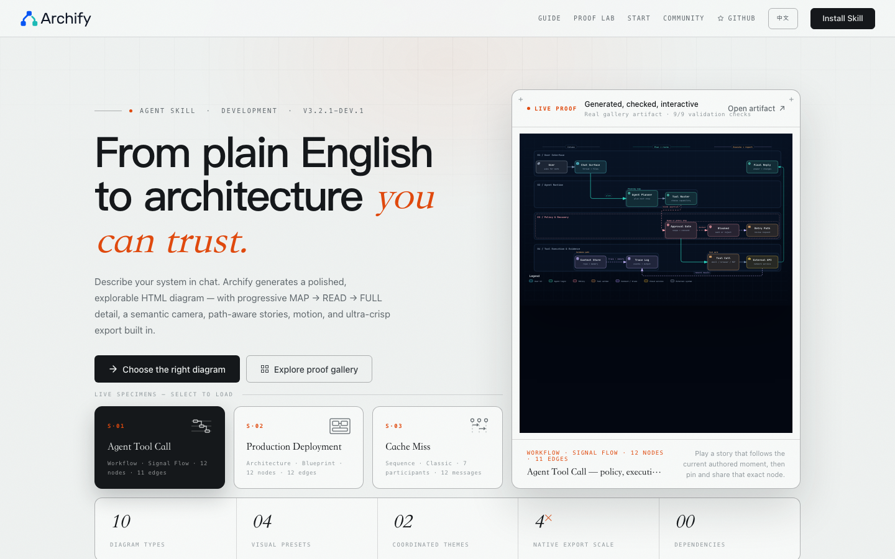
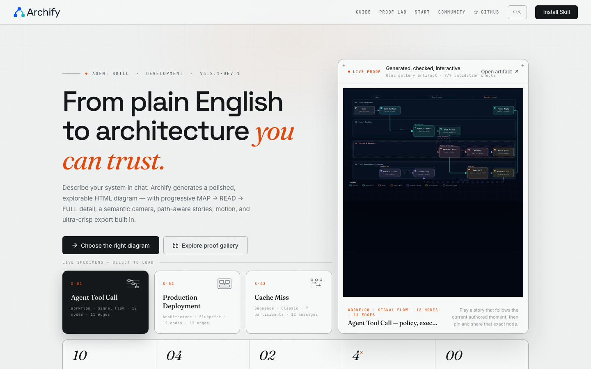
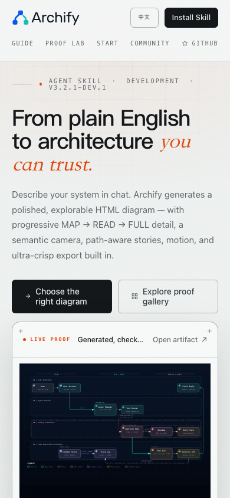
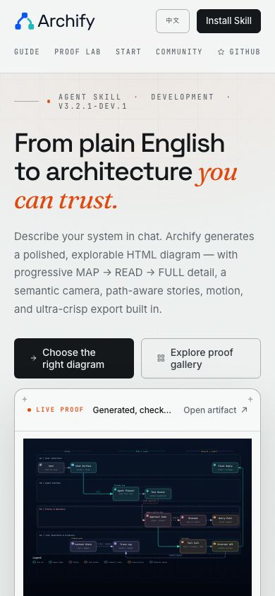

# Legacy site local-font follow-up

Base: `63c9263e84bd3993cab8e09b3d69888857858635` (`dev`). Tested product commit: `b7eb6c089480660ceafbe9241beb84e7a4677a45`. Evidence captured 2026-11-02 on macOS arm64, Node 22.23.2 and Chrome 156.0.8078.74. The base was fetched again unchanged on 2026-11-03. This is an independent follow-up found during #618 validation, not a renderer or typography change.

## Failure and fix

The Astro website already serves reviewed local fonts, but legacy `docs/index.html` and the Start, Guide and Gallery templates still requested Google Fonts CSS. Native site-language integration timed out waiting 15 seconds for `Page.loadEventFired`; the same failure reproduced on untouched dev. An isolated diagnostic that immediately blocked remote font requests made the existing seven tests pass, narrowing the failure to the remote dependency.

The pages now reference `assets/fonts.css`. Existing `copySiteAssets` publishes the website's CSS, five unchanged WOFF2 files, four unchanged OFL notices and source/hash manifest beside the ordinary site assets. All three standalone builders, including custom output directories, use that same existing atomic publication path. Its preflight, inode identity, rollback and claimant protections are unchanged. No retry, longer timeout, proxy, runtime font downloader or test-only network override was introduced.

The font family/style/weight definitions remain Fraunces, Inter, JetBrains Mono and Space Grotesk; Chinese uses the existing system fallbacks. Canonical source remains `website/public/fonts/`, and all 11 emitted resources match it byte-for-byte. Diagram artifacts, Gallery diagram manifest and `archify.zip` are unchanged.

## Visible offline-font behavior

Screenshot pairs use the same browser, page, language and viewport, with Google Fonts made immediately unavailable in the **capture harness only**. Before therefore shows system fallback fonts; after shows the locally loaded intended fonts. This records a deterministic unavailable-font state, not a measured network latency improvement. Native test results below do not use the capture override.

| Before, 1440×900 | After, 1440×900 |
| --- | --- |
|  |  |

| Before, 390×844 | After, 390×844 |
| --- | --- |
|  |  |

[Chinese mobile](after/index-zh-390x844.png) and [Gallery desktop](after/gallery-en-1440x900.png) retain content and navigation. Glyphs and wrapping differ from the unavailable-font baseline; these pairs are not pixel-identical and are not a redesign. Codex inspected desktop/mobile English, mobile Chinese and Gallery captures without finding new overlap or overflow. No human visual acceptance is claimed.

Four pages at 1440×900 and 390×844, plus Chinese homepage at both sizes, give ten candidate states. All five tested font faces load in every state, with **zero remote font resource requests**. [Before measurements](before-measurements.json) and [after measurements](after-measurements.json) retain the resource observations; ephemeral localhost origins are normalized to `<local-origin>`.

## Tests and scope

| Check | Result on exact product contents |
| --- | --- |
| New expectations on unmodified implementation | Two failures: missing local-font publication and missing local stylesheet |
| `npm run test:webm` | **Exit 0**; export, Story and site-language integration complete successfully; language suite 7/7, no skips, with normal Chrome and no diagnostic preload |
| Focused publication/site suites | 29 pass, 0 fail, 2 tests deferred by their existing flags to serialized integration above |
| Existing `website/test/local-fonts.test.mjs` | 2 pass, authentic bytes/licenses and existing family/style/weight declarations preserved |
| `npm run test:full` | 3,538 pass, 134 environment-dependent skips, **one independently confirmed baseline failure**: README motion receipt records `7f68d730…`, while unchanged Sequence artifact hashes to `ca273484…` |
| Whitespace / scope | `git diff --check` passes; install ZIP and diagram manifest unchanged |

The README motion failure is also present on untouched dev and is tracked by existing #1174. It is not suppressed or repaired by this font-only PR. The separate #618 shared-template candidate regenerates its motion proof as part of its own required output refresh. Local evidence does not establish remote CI, Windows/Linux, Safari/Firefox, deployment or a user installation.

Test-value review extended the existing asset publication success test to compare CSS, font and license bytes with the independent canonical manifest, and extended the existing page contract to reject remote font references. Existing failure/rollback tests remain. The normal real-browser language gate is reused without relaxing its waits.

## Ablation and reproduction

Removing font entries from a temporary copy of the publisher leaves the four existing assets but omits the stylesheet/fonts from a custom destination. Removing the local link from candidate homepage bytes exactly restores the observed failing baseline. Both integration points are needed; no additional publication abstraction or network machinery is necessary. See [ablation.json](ablation.json).

```sh
node scripts/build-start.mjs /tmp/archify-start-site/start.html
node scripts/build-guide.mjs /tmp/archify-guide-site/guide.html
node scripts/build-gallery.mjs /tmp/archify-gallery-site
npm run test:focus -- test/copy-site-assets.test.mjs test/site-language-continuity.test.mjs test/gallery.test.mjs test/start-page.test.mjs test/guide-page.test.mjs
node --test website/test/local-fonts.test.mjs
npm run test:webm
```

Set `ARCHIFY_CHROME`, and provide working ffmpeg/ffprobe for WebM. Runs preceded the product commit but used its exact contents, bound in [manifest.json](manifest.json); only evidence is added afterward. AI assistance: Codex (GPT-6), investigation, implementation, tests, screenshots and writing for accountable contributor @testikun. Contributor personal review confirmation remains unchecked.
