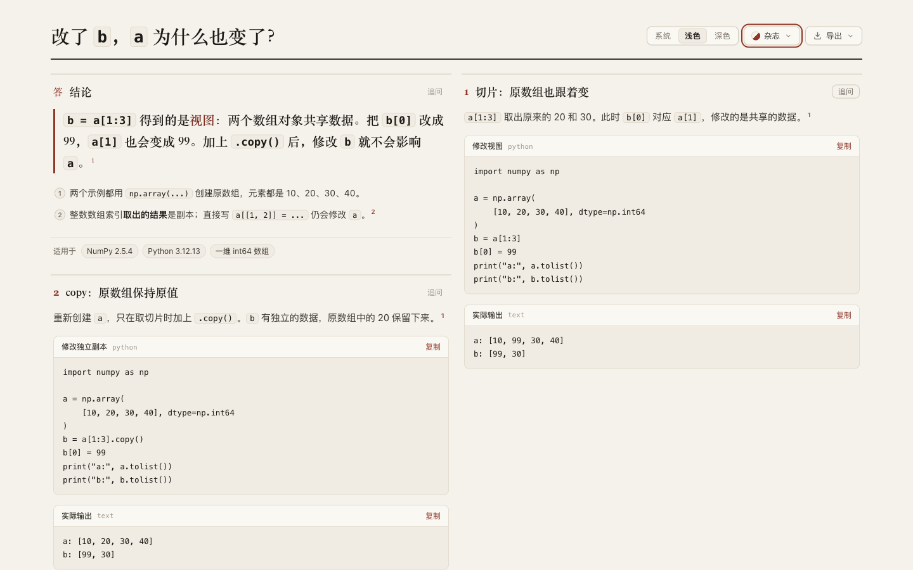
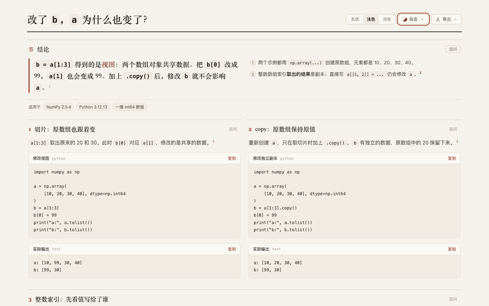

# Keep paired examples together below the conclusion

Round 37 adds an optional answer width after the [NumPy discovery](../numpy-views/README.md) exposed staggered desktop examples. [Retained page](candidate.html) uses `@answer span=12` above two `span=6` panels. The conclusion, programs, outputs, values and sources are unchanged; the two examples now start at the same height. [Previous page](../numpy-views/candidate.html), [new source](candidate.archify.md), [actual desktop PNG](candidate-1440.png).

## Contract and scope

Base: `cdbf9d50b2ae520c6b1b1c844c0e71ee8abf97e9`. Product source: `66880ba8f034700d4dcbd6be60271202280ff3a8`. Target `origin/dev`: `5ecbd1bfdbf83ea747072112493c940e707569cb`. [Plan](evidence/plan.md), [identities](evidence/identity.json).

Formal JSON accepts optional `answer.span`, an integer from 1 to 12, matching panel spans. The Markdown parser accepts `@answer span=...` alongside `scope`. Static packing and rendered fixed-width metadata reuse existing panel behavior; the reader's layout algorithm and CSS are unchanged. Omitting the field preserves automatic placement. Phone and print layouts continue stacking. Authoring guidance gives one concrete paired-example use and corrects the prior statement about static layout below 1100 px and in print to match the actual reader/CSS behavior.

This is a fixed-input renderer/contract experiment under the [real repository benchmark convention](../../../../benchmarks/real-repo-generation/README.md). A fresh generation matrix was not run: the changed path only honors an explicit explainer width, and the original NumPy content is frozen. The narrower evidence does not establish independent author benefit, generation speed or human comprehension. No new diagram topology, grouping algorithm, default or live installation was introduced.

## Observed reading and export

| Editorial style | Base | Candidate |
| --- | --- | --- |
| Desktop, 1440 px | View starts at 116.5 px; copy at 433.5 px; page 1,503 px tall | Both examples start at 351.5 px; page 1,421 px tall |
| Phone, 390 px | Page 2,478 px tall | Page 2,466 px tall; same reading order and example positions |
| Desktop PNG | 2,880 × 3,104 px | 2,880 × 2,940 px |
| Phone PNG | 780 × 5,052 px | 780 × 5,028 px |

[Fourteen browser states](evidence/browser.json) cover base/candidate editorial at two widths and both themes, plus candidate clean/product/swiss at both widths in light mode. All checked states retain the exact program/output text and have no horizontal page/code/table overflow. All five candidate desktop states align the examples. These are measured page dimensions, not reading-speed scores. The phone loses one 12 px gap because the new static rows require no empty spacer after the copy panel; its answer/view/copy positions remain unchanged. Only the assignment section and later content move upward.

[Semantic comparison](evidence/semantic-check.json) verifies that the parsed document differs only by `answer.span`. The NumPy runtime/source audit and actual copied-program execution are reused from [round 36](../numpy-views/README.md); this round checks their bytes are unchanged, without claiming a new NumPy run. [Phone dark continuation](screenshots/candidate-390-dark-bottom.png) remains legible. Actual UI export dimensions are in [export checks](evidence/exports.json); inspected [desktop top](screenshots/export-1440-top.png), [desktop bottom](screenshots/export-1440-bottom.png), and [phone bottom](screenshots/export-390-bottom.png) retain the full code, outputs and table.

## Compatibility, tests and package

- [Replay](evidence/replay.json), [harness](evidence/replay.mjs): all 41 previously indexed artifacts render byte-identical HTML on base and candidate from their frozen prepared bundles. The new field is absent in this cohort. This does not promise old runtimes accept the new option.
- [Base CLI rejection](evidence/base-unsupported.json): the frozen base rejects `@answer span=12` as unsupported. [Two new regression checks](evidence/base-regression.tap) both fail on base. Candidate [parser/layout/renderer tests](evidence/focused.tap): 45 pass, covering valid/invalid spans, source location and static output. [Browser suite](evidence/browser.tap): 16 pass, including an extension of the existing exact-span test through style, theme and resize. [Core](evidence/core.tap): 19 pass. [Generated checks](evidence/generated.log): pass.
- [Strict canonical finalize](evidence/canonical-finalize.json) and [current-path provenance check](evidence/canonical-check.json): pass. Canonical HTML SHA-256: `e4b7ae353a516960749a543ec5f13ea6a2e703e4666819974877c93703a600c3`. The initial `check explainer ...` invocation used the wrong CLI shape and exited 2; [record](evidence/check-usage-error.json). The corrected command is `check <artifact> --require-provenance`.
- The first visual artifacts were finalized in the default `warn` writing mode. Switching to `strict` invalidated an overly broad byte-identity assertion. [Deterministic replay](evidence/strict-metadata-comparison.json) reproduces the original warn SHA and shows that only prepared `writingMode` and its digest differ; the rest of the HTML is identical. Strict canonical and extracted-package pages were then checked in the actual browser. This is a validation-metadata difference, not an unexplained visual change.
- [Package check](evidence/package-check.json), [toolchain](evidence/toolchain.json): two canonical Node 22.23.3 / zlib `1.3.1-e00f703` builds are byte-identical. ZIP SHA-256 `cb47c870caa24e8e9cecb9f187817abfd3033fe2d5613f8a5ea166fcee291b9a`, 6,996,967 bytes. Six changed package files match the source. Outside-repository [strict finalize](evidence/extracted-finalize.json) and [provenance check](evidence/extracted-check.json) pass. [Canonical/extracted browser and index checks](evidence/canonical-index-browser.json) confirm aligned desktop examples and all four NumPy variants at two widths; index now has 17 questions, 15 projects and 42 variants.

Scoped test-value review extends existing browser coverage rather than adding another browser matrix to the suite; the new cheap tests protect accepted/rejected author input and preserved explicit widths. Automatic positions are not frozen by a new regression. Existing fixed-span handling is reused, so no new abstraction or reader state needs consolidation. Generated validators and the ZIP are refreshed; unrelated Viewer/gallery outputs are unchanged and their freshness checks pass.

[Archive hashes](manifest.json) cover the review bundle. Two whitespace-only lines in the archived failed TAP output were trimmed for repository whitespace checks; the raw output remains outside the repository and the failure details are unchanged. Full transient replays, package builds and unselected screenshots remain in the local tuning round outside the source tree; the committed harness and indexed source artifacts reproduce the comparison. No final-head CI, full browser acceptance runner, Windows/Safari, accessibility-assistive-technology review or human study is claimed. AI disclosure: Codex implemented, compared, tested and inspected this candidate. Nothing was merged, released or installed; the continuous goal remains active.
