# How did the six batches compare? {#six-batches}

The before/after differences are small in this constructed example. Keep each batch label visible so a reader can match both bars to the same batch.

@answer scope="Illustrative values · six batches · no production observation"
@meta locale=en

## Six batches side by side {#batches}

```mermaid title="Constructed processing times in milliseconds."
xychart-beta
  x-axis ["MonAM", "MonPM", "TueAM", "TuePM", "WedAM", "WedPM"]
  y-axis "ms" 0 --> 70
  bar "Before" [30, 40, 35, 50, 45, 60]
  bar "After" [32, 38, 36, 48, 47, 58]
```

These values only exercise a denser category layout. They do not describe a measured workload.
