# Why did P99 rise while the average barely moved? {#latency-chart}

In this illustrative batch, 985 requests take 80 ms and 15 take 600 ms. The mean is 87.8 ms, while the 990th sorted value is 600 ms. The chart rounds the mean to 88 ms.

@answer scope="Illustrative values · 1000 requests · P99 as the 990th sorted value"
@meta locale=en

## How did the two series change? {#latency}

```mermaid title="Illustrative request times, in ms; the mean is rounded."
xychart-beta
  x-axis ["Mean", "P50", "P99"]
  y-axis "ms" 0 --> 700
  bar "Before" [80, 80, 80]
  bar "After" [88, 80, 600]
```

These numbers are an illustrative reading fixture adapted from the repository's P99 example, not a production observation or a diagnosis of any service.
