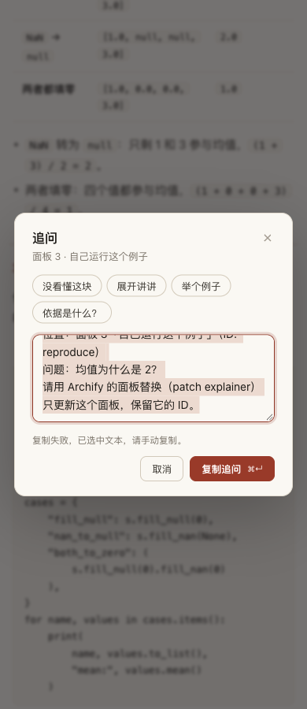

# Clipboard feedback that matches the result

Round 47 fixes an observed source defect: when the Clipboard API was absent, snippet Copy could say “Copied” and the question dialog could close without writing anything. Failed question copies now stay open with the complete text selected and a visible manual-copy instruction inside the dialog. Successful copies retain their original payload and confirmation timing.

Try [Polars in Chinese](polars-candidate.html) or [TaskGroup in English](taskgroup-candidate.html). These canonical pages retain their previous authored content: [Polars probes and reading decisions](../polars-null-nan/README.md), [TaskGroup language](../taskgroup-language/README.md), and [adopted mobile tools](../mobile-tools-adopted/README.md). Their underlying content evidence is reused, not rerun here. [Polars source](polars.archify.md), [TaskGroup source](taskgroup.archify.md).

## Scope and decision

Content base `955c6badb0195961864478f9e47e48d6c58f09ca`, previous runtime `e16dbcfb8916cb621efb0806e7f23d0b1497ac10`, fetched dev `5ecbd1bfdbf83ea747072112493c940e707569cb`. Source fix **`d300979c84b2e049101ff4d6035f19425dec7225`**. The source experiment used its planned two candidates within 20 minutes; packaging and archiving followed. [Plan](evidence/plan.md), [source decision](evidence/source-review.md), [final diff](evidence/candidate-2.patch).

Both reader controls previously passed `navigator.clipboard?.writeText(text)` to `Promise.resolve`. Missing API therefore became successful resolution; a synchronous throw bypassed the rejection handler. A small shared async function calls `writeText` immediately during activation and routes both failures to each control's existing UI. No dependencies, permissions workaround or new clipboard state machine.

Candidate 1 passed the regression but put the question failure in the page toast. Its [Chinese](evidence/candidate-1/polars-question-failure.png) and [English](evidence/candidate-1/taskgroup-question-failure.png) screenshots show that the modal backdrop blurred the explanation. Candidate 2 puts it in the existing dialog note, marks that note as a status, and restores the normal instruction when reopened. [Decision](evidence/candidate-2-decision.md), [candidate 1 diff](evidence/candidate-1.patch).

[English failure](evidence/screenshots-2/taskgroup-question-failure.png) also fits the 390 × 900 viewport. Actual assistive-technology announcements were not tested.

## Reproduction and regression

The [base regression](evidence/base-regression.log) fails with expected Copy, actual Copied. The final test covers Chinese and English, delayed successful writes, absent API, rejected promises and synchronous throws. It checks complete literal code bytes, success only after fulfillment, preserved question payload, focus/selection and reset on reopening. [34 passing focused browser/renderer tests](evidence/candidate-2-focused.log), [19 core tests](evidence/candidate-2-core.log), [generated-output checks](evidence/candidate-2-generated.log).

A real Chrome data URL has no Clipboard API: base reports false success, candidate reports failure and retains the question. [Observation](evidence/clipboard-browser-2.json), [browser script](evidence/browser-09.mjs). Its long page URL enters the copied question, so this case establishes API/outcome behavior, not ordinary question usability. File-page tests inject capability failures and capture successful writes; they do not test OS permissions or estimate how often users encounter failure.

The attempted opaque sandbox did **not** reproduce absent API: it exposed Clipboard and rejected writes. An earlier sandbox harness corrupted embedded JavaScript by inserting before the first literal closing-body string. The corrected harness and the later file-origin iframe inspection limitation are retained in [probe failures](evidence/probe-failures.md), [sandbox observation](evidence/sandbox-base-v2-observation.json). Neither is presented as a product defect.

## Reading and export evidence

All **58 frozen indexed variants** differ only in the embedded reader script. [Replay metadata](evidence/full-replay-2.json), [replay script](evidence/full-replay-2.mjs). Prepared resources and content are fixed; this is an interaction comparison, not a full-generation benchmark or human reading study. Only two selected replay pairs are archived here; all 58 generated pairs remain in the external round directory. Replayed historical paths are not renewed provenance receipts.

For complete Chinese Polars/editorial and English TaskGroup/clean pages at **390 and 1440 px**, all four base/candidate pairs have identical geometry, normal screenshot bytes and actual UI-exported PNG bytes. [Matrix](evidence/browser-matrix-2.json), [browser export script](evidence/browser-08.mjs). Selected actual exports were inspected at readable scale, including the full Python code, bottom of both pages and English desktop comparison. [Export inspection](evidence/export-inspection.json), [Polars phone PNG](evidence/exports-2/polars-390-candidate.png), [TaskGroup desktop PNG](evidence/exports-2/taskgroup-1440-candidate.png).

Actual Copy bytes from the final Polars page are identical to the round46 verified program and execute again in its pinned environment with the same three results. [Verification](evidence/copy-verification.json), [program](evidence/candidate-2-copied.py), [stdout](evidence/candidate-2-copy-stdout.txt). English real pages in the frozen set have no snippets; the formal browser regression covers English snippet behavior.

Both canonical pages pass strict showcase finalization and current provenance checks: [Polars](evidence/polars-check.json), [TaskGroup](evidence/taskgroup-check.json). [Canonical browser observations](evidence/canonical-browser.json) check both widths and the four new index selections. The index has 24 questions across 22 projects and 60 retained variants. Existing versions remain unchanged.

## Package and remaining limits

Official Node **22.23.3**, bundled zlib **1.3.1-e00f703**, produces two byte-identical ZIPs: **`339de058edeb07109a792be5dc0c3a9e35044a557041f9334f1d66eaced5d970`**, **6,997,242 bytes**. [Package identity](evidence/package-identity.json). Extracted reader bytes match source; the extracted CLI strictly finalizes and checks Polars outside the repository, producing the same canonical HTML bytes. [Package check](evidence/package-check.json). An actual browser smoke against that extracted artifact confirms missing-API feedback and selected question text. No live installation was changed.

Scoped test-value review added an observable failure regression; focused simplification consolidated just the two affected clipboard boundaries. [Open-PR search](evidence/open-pr-search.json) is bounded discovery, not an exhaustive ownership audit. Existing Viewer/native-diagram clipboard behavior is outside this change. Browser permission grants, Safari, Firefox, Windows, real screen readers, final-head remote CI and human comprehension remain unverified. This branch has not been merged or released.

AI assistance: Codex investigated, implemented, tested, inspected screenshots and wrote this record under maintainer `@tt-a1i`'s exploration request. No human acceptance is claimed. [File manifest](evidence/manifest.json) hashes archived files other than itself; raw working evidence is under `/Users/tsk/.local/share/archify-tuning/rounds/2026-10-30-reading-round47/`.

Archive note: two whitespace-only lines in the retained failing TAP log have their indentation removed for repository whitespace checks. Raw stdout remains unchanged in the external round directory; no diagnostic text or result was changed.
