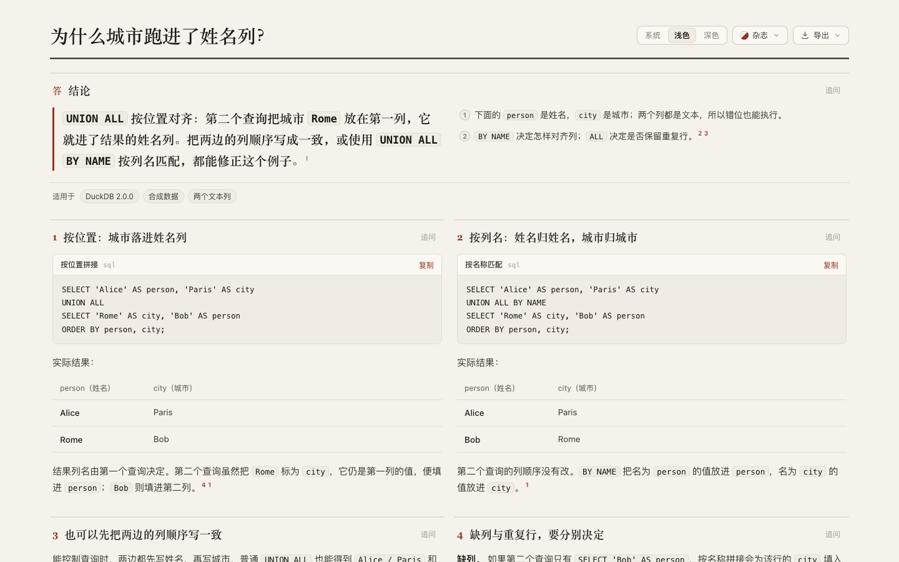

# DuckDB: show which value lands in which column

Round 38 explores positional versus name-based column alignment in DuckDB. [Retained page](candidate.html), [source](candidate.archify.md), [author draft](author/answer.html). The retained page places complete SQL beside actual two-column result tables, so the misplaced city can be identified under the visible header. It keeps explicit column ordering as another valid correction and separates missing-column behavior from duplicate retention.

## Sources and real queries

Archify baseline: `c7d8b1717b3ae7d20e9c98e544e93bdc30f7cf34`; product source: `66880ba8f034700d4dcbd6be60271202280ff3a8`. Target dev: `5ecbd1bfdbf83ea747072112493c940e707569cb`.

DuckDB Python package **2.0.0** runs in an isolated Python **3.12.13** venv. Upstream tag `v2.0.0` resolves to **`d54cbbe3df17e8e5ce68312f483b4155836112aa`**. The wheel reports revision prefix `d54cbbe3df`, matching that commit; this is not source-to-binary reproducibility verification. [Source identity](source/identity.json), [brief](source/brief.md).

Primary references: [official set-operation documentation](https://duckdb.org/docs/current/sql/query_syntax/setops), pinned [UNION ALL BY NAME tests](https://github.com/duckdb/duckdb/blob/d54cbbe3df17e8e5ce68312f483b4155836112aa/test/sql/setops/test_union_all_by_name.test), [UNION BY NAME tests](https://github.com/duckdb/duckdb/blob/d54cbbe3df17e8e5ce68312f483b4155836112aa/test/sql/setops/test_union_by_name.test), and [set-operation binder](https://github.com/duckdb/duckdb/blob/d54cbbe3df17e8e5ce68312f483b4155836112aa/src/planner/binder/query_node/bind_setop_node.cpp#L119). The binder constructs the name map, reorders columns and supplies NULL for missing columns; its positional path at lines 343–356 takes names from the first input and checks column counts. The versioned documentation URL was inaccessible through the web tool; the pinned upstream files were fetched successfully. Raw third-party source and the venv remain outside this repository.

[Probe harness](source/probe.py), [run 1](source/probe-1.json), [run 2](source/probe-2.json). Each case uses a fresh in-memory database; both runs produce identical JSON. All values are synthetic strings. Successful queries include `ORDER BY person, city` for stable displayed order.

| Case | Observed result |
| --- | --- |
| Positional UNION ALL, second query lists city first | Headers person/city; rows Alice/Paris and Rome/Bob |
| UNION ALL BY NAME, same swapped second query | Alice/Paris and Bob/Rome |
| Positional UNION ALL with explicitly aligned SELECT columns | Alice/Paris and Bob/Rome |
| BY NAME with Bob/person only in the second query | Bob remains; city is SQL NULL |
| Positional UNION ALL with that missing column | BinderException: differing result-column counts |
| Same Alice/Paris row twice with UNION BY NAME | One row |
| Same Alice/Paris row twice with UNION ALL BY NAME | Two rows |

The scope is these small standalone queries, two text columns and one deliberately missing column. It does not cover file ingestion, extensions, performance, migrations, arbitrary type conversions or cross-database compatibility.

## Author and parent revisions

[Plan](evidence/plan.md), [assignment](evidence/author-prompt.txt), [first draft](author/first-draft.archify.md), [author trace](author/trace.txt). The independent Terra/medium author passed one strict showcase finalize with no diagnostics; it did not use the browser or rerun the supplied queries. Its first timestamp, 22:57:14Z, was recorded after source reads; first-draft save and attempt start are 22:57:25Z, attempt end 22:57:26Z and handoff 22:57:27Z. Work start before the initial read is unknown, so complete elapsed time and the total budget cannot be verified. No authoring-speed claim follows from these timestamps.

The original results appear as slash-separated prose. Two three-column tables require 2 px and 8 px of horizontal scrolling at 390 px; the screenshots do not suggest a large hidden region. [Original phone](screenshots/author-390-light-middle.png), [desktop](screenshots/author-1440-light-top.png). Its inline `Bob AS person` lacks the quoted string literal needed for that example. Revision 1 presents actual result columns, translates person/city in the headers, pairs the two queries below the conclusion, removes a constant table column and repeated checklist, and writes `SELECT 'Bob' AS person` correctly. It uses the already-implemented optional answer width; this is parent use, not independent author-benefit evidence for round 37.

| Editorial style | 390 px page height | 1440 px page height |
| --- | ---: | ---: |
| Author | 2,844 px | 1,443 px |
| Revision 1 | 2,819 px | 1,498 px |
| Revision 2 / retained | 2,845 px | 1,498 px |

[Original metrics](evidence/author-browser.json), [revision 1](attempts/candidate-1-browser.json), [revision 2](attempts/candidate-2-browser.json), [canonical](evidence/canonical-browser.json). Both revisions have no horizontal page/table/code overflow at 390/1440 px in light/dark. Revision 2 replaces the layout-dependent phrase “右上方的结果” with the actual result values, so it still makes sense after mobile stacking. This costs 26 px on the phone versus revision 1. The final page is 1 px longer on the phone and 55 px longer on desktop than the original; the benefit being inspected is explicit column/result association, not a smaller page or measured comprehension gain. [Revision decisions](evidence/parent-revisions.md), [retained phone continuation](screenshots/candidate-2-390-dark-bottom.png).

## Delivery and boundaries

[Strict canonical finalize](evidence/canonical-finalize.json) and [current-path provenance check](evidence/canonical-check.json) pass. Canonical HTML SHA-256: `84c86f94079af838a21ff22e41c07d2d7aa873bae62503a7c43de317d50da350`. Historical author/attempt receipts keep their original paths; copied answer.html is an unchanged attempt artifact, not a new path certification.

All three actual Copy controls return the exact visible SQL. Each copied query executes in a fresh DuckDB in-memory database and matches its probe's rows and column names; both visible result tables match the actual query output. [Captured bytes and tables](evidence/copies.json), [execution harness](evidence/copy-run.py), [execution results](evidence/copy-run.json). The archived harness accepts the capture and probe paths as its two arguments; it was rerun against these committed inputs with identical JSON output. Clipboard API interception does not establish OS clipboard permissions.

The actual UI-exported [PNG](candidate-390-light.png) is 780 × 5,788 px. Inspected [top](screenshots/export-top.png), [middle](screenshots/export-middle.png) and [bottom](screenshots/export-bottom.png) retain the queries, results and qualifications. [Export/index checks](evidence/export-index-check.json) verify two DuckDB variants at two widths. The index now has 18 questions, 16 projects and 44 variants. [Archive hashes](manifest.json) bind the retained review bundle; remaining screenshots and raw source files stay in the external tuning round.

This content-only discovery reuses the runtime/package checks at `66880ba8f034700d4dcbd6be60271202280ff3a8` / `c7d8b1717b3ae7d20e9c98e544e93bdc30f7cf34`. Runtime suites and ZIP builds were not repeated. Under the [real repository benchmark convention](../../../../benchmarks/real-repo-generation/README.md), this is one independent new-project draft with parent revisions, not a full-generation comparison. No final-head CI, full browser acceptance runner, Windows/Safari, assistive-technology check or human-comprehension study is claimed. AI disclosure: Codex researched, drafted, revised, executed and inspected this page. Nothing was merged, released or installed; the continuous goal remains active.
