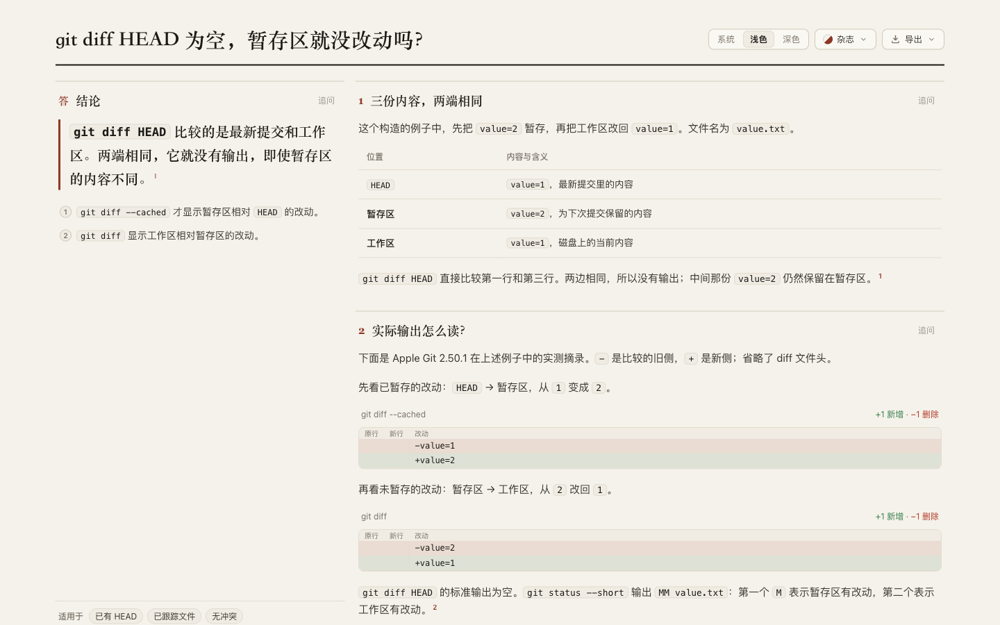
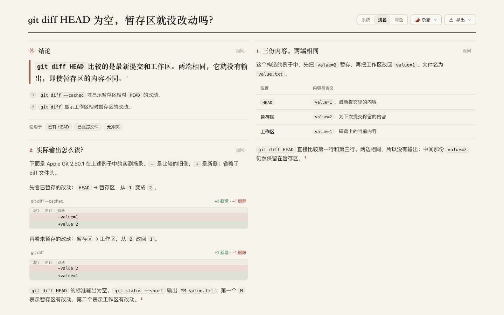
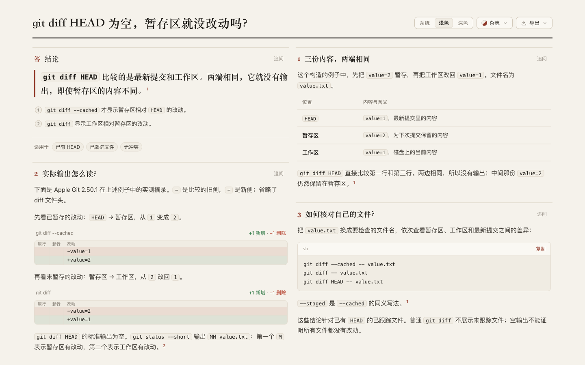

# Keep authored panel widths in the reader

Round 28, 2026-10-30. Disposition: verified local contract repair and a Git reading candidate. [Open the candidate](../git-diff-endpoints/candidate.html), [authored source](../git-diff-endpoints/candidate.archify.md), [original exploration](../git-diff-endpoints/README.md).

The preceding Git experiment requested six-column panels, but browser measurement widened them to eight. The authoring reference supports explicit widths from 1 to 12; static layout already preserves them. Widening the panels also left an unnecessarily tall conclusion beside the examples.

Base: `7e836b98525a5bcbc2d8e5c1ce2b2d962b077130`. Latest fetched `dev`: `5ecbd1bfdbf83ea747072112493c940e707569cb`, an ancestor. [Source and regression commit](https://github.com/tt-a1i/archify/commit/62eb5ee983d08682c23fcff4114d60fe484977d4).

## Repair and reading result

The reader now measures an explicitly sized panel at that width and retains it through both template placement and fallback. Automatic panels keep their previous choices. A solitary fixed panel is no longer expanded to full width. Narrow code and tables retain their existing local scrolling. Mobile layouts still stack panels at the available width. No new layout templates, schema, writing rule or automatic whitespace heuristic were introduced.

The Git candidate also changes its last panel from 12 to 6 columns, retaining the preceding attempt's words, actual diff excerpts and commands. Its desktop page height changes from 1,452 px in that attempt to 1,093 px; phone height is 2,221 px versus 2,233 px. These describe this composition, not comprehension or speed. The source evidence remains Git v2.50.1 documentation and five constructed Apple Git states, each run twice in round 27.

| Same viewport, light theme | Preview |
| --- | --- |
| Frozen input, old reader |  |
| Frozen input, repaired reader |  |
| Final authored arrangement |  |

The final arrangement was inspected at 390/1440 px in light/dark themes, including [desktop bottom](screenshots/balanced-1440-light-bottom.png), [phone top](screenshots/balanced-390-dark-top.png) and [phone bottom](screenshots/balanced-390-dark-bottom.png). [Metrics](evidence/balanced-metrics.json) show no clipped panels or overflowing code/table regions in those states. These screenshots precede a source-comment-only edit; executable layout behavior is unchanged.

The canonical repository artifact passes [strict finalize](evidence/candidate-finalize.json) and [current-path provenance checking](evidence/candidate-check.json); SHA-256 `49f25205b836e03edf71959b947f09f1b91dc5633d85e02031601b50ced3aac0`. The actual Copy button's [captured payload](evidence/copy-check.json) was [executed in a temporary repository](evidence/copy-run.json): all three outputs exactly match the earlier probe, with HEAD, index and worktree preserved. The Clipboard API was intercepted; operating-system clipboard permissions were not exercised.

The actual reader export is a [780 × 4,540 PNG](candidate-390-light.png). The parent inspected its image pixels at [top](screenshots/export-top.png), [middle](screenshots/export-middle.png) and [bottom](screenshots/export-bottom.png), including the complete commands, diff directions and source list. The [index check](evidence/export-index-check.json) switches both Git variants at both preview widths and verifies the independent-open link. The index now has thirteen questions across eleven projects and thirty variants.

## Regression and compatibility evidence

- The final regression [fails on frozen base](evidence/final-base-regression.log): 0 pass, 1 fail, 0 skipped. It covers widths 1–12, a long literal command and an isolated six-column panel. It checks actual panel width, complete text and source order through style/theme changes and 1440 → 900 → 390 → 1440 resizing.
- The complete affected [explainer browser file](evidence/browser-suite.log) passes 14 tests; [layout/renderer](evidence/layout-renderer.log) pass 18; [core](evidence/core.log) passes 19. All have zero failures or skips. [Generated checks](evidence/generated.log) pass. Tests preceded a comment-only source edit; no behavioral evidence was invalidated.
- [Frozen replay](evidence/replay-identity.json) covers seven existing documents with identical authored input and prepared resources across base/candidate. [Browser comparison](evidence/browser-comparison.json) checks 56 states: seven cases, two runtimes, two widths and two themes. Five automatic controls retain all panel geometry in their 20 paired states; ten light-theme PNG pairs are byte-identical. All seven cases retain phone panel geometry. This is compatibility replay, not new generation or renewed provenance acceptance.
- The explicitly sized thread page retains desktop geometry. Initial screenshot comparisons differed by small color values during theme transitions; the [original pixel analysis](evidence/thread-pixel-analysis.json) remains. Waiting for actual animations to finish yields [byte-identical light and dark captures](evidence/settled-native-check.json). This wait corrects the capture condition, not product behavior.

### Explicit width can expose insufficient diagram space

A derived singleflight control fixes its native sequence panel at six columns. Base silently expands it to twelve. Candidate honors six: the graph requires 849 px inside a 624 px area, so the existing insufficient-fit notice and interactive-view entry remain visible. [Base](screenshots/settled-base-native-explicit-light.png), [candidate](screenshots/settled-candidate-native-explicit-light.png), [measurements](evidence/settled-native-check.json).

This constrained graph is **not accepted as readable**. The author can select a wider panel or omit the constraint. The unchanged automatic singleflight control retains its layout. Widths outside the automatic templates can occupy their own row at the exact authored width; this repair makes no claim of optimal packing.

## Package, ownership and limits

Two canonical Node 22.23.3 / zlib 1.3.1-e00f703 builds are byte-identical: 6,996,443 bytes, SHA-256 `3023903db12f46c391f1b6baacedb2713be2021c8bb3d35b53e04967b49df015`. The extracted reader matches source. Its CLI passes [strict finalize](evidence/package-cli.json), [provenance checking](evidence/package-check.json) and the [final authored-width browser regression](evidence/package-browser.log), 1 pass, 0 fail, 0 skipped. [Package identity](evidence/package-identity.json). This executes an extracted archive; it does not install it.

The [bounded ownership search](evidence/ownership-search.json) and [comparison](evidence/related-reader-comparison.json) covered #998, #1142 and #1015. At the inspected heads, the first two do not change the reader. #1015 changes computed-font handling and whitespace scoring but retains the old fixed-width logic. No patch was borrowed, and no external message was sent. This is not an exhaustive ownership search.

Scoped review: static layout and the authoring reference already promise exact spans; browser measurement, placement fallback and solitary-panel expansion were the conflicting paths. One real-browser regression covers those observable behaviors without duplicating the planner algorithm. No concrete duplicate state or unnecessary abstraction warrants a broader simplification.

Under the [benchmark convention](../../../../benchmarks/real-repo-generation/README.md), this is a narrow replay of an observed explainer problem. It does not establish fresh-author repair time, general generation quality or human comprehension. Full generation matrix, full repository/browser runner, Windows, final-head CI and human acceptance remain unperformed. Archived scripts retain original absolute paths; copied text logs trim trailing whitespace. Round 27 originals and failure receipts remain intact.

Reproduce the relevant checks from the repository root:

```sh
npm run test:focus -- test/explainer-browser.test.mjs
node archify/bin/archify.mjs finalize explainer \
  docs/experiments/explainer-reading/git-diff-endpoints/candidate.archify.md \
  /tmp/git-diff-endpoints.html --writing strict --json
```

AI disclosure: Codex investigated, implemented, tested and documented the repair. The triggering independent author is recorded in round 27. No merge, release, live installation or human acceptance is claimed. This checkpoint does not end the ongoing exploration goal.
