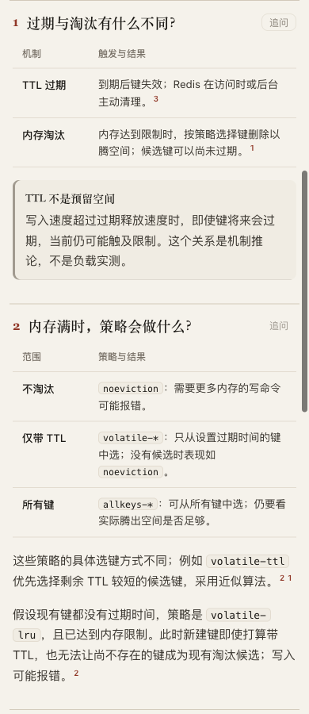
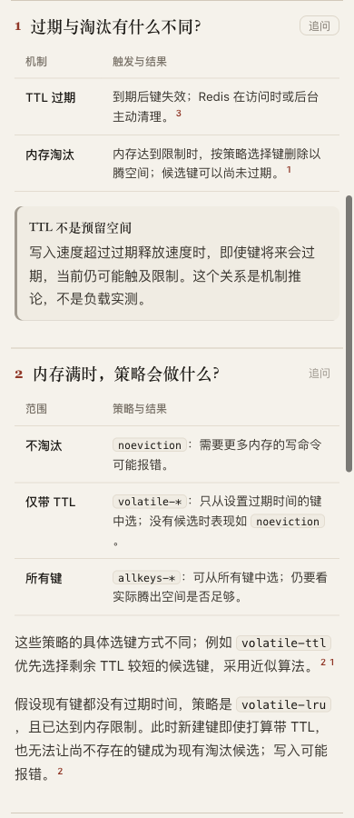

# Inline command wrapping — rejected presentation experiment

Round 5, based on `30abc073e` (dev remains `5ecbd1b`). **The patch is not adopted.** The runtime and test files were restored after this experiment; the pages here deliberately contain the experimental renderer.

## Observed problem and bounded hypothesis

The previous Git restore repair fits on a phone, but its long inline command splits the standalone `--` separator across two lines. The desktop conclusion also splits `--staged` after the hyphens. Keeping each whitespace-delimited code word together could make parameters recognizable, while allowing an oversized path to wrap within its container.

The candidate adds escaped inline spans and one CSS rule. It preserves the original text and falls back to wrapping when a word exceeds the frame. No parser, schema, reader JavaScript, dependency or authoring instruction changes. [Exact experimental patch](experimental.patch). The fixed inputs remain the previous [Git restore](../restore-pair/purpose-table.archify.md), [Redis](../redis/candidate.archify.md), and [TaskGroup](../taskgroup/candidate.archify.md) drafts.

## What passed

- A new real-browser regression reproduces the split `--` on base: [base failure](base-test.log).
- The candidate keeps every short command word on one line, preserves DOM and selected text, bounds a long path, keeps escaped HTML inert and leaves fenced code text unchanged. It passes at 390/1440 px, without JavaScript and in print media: [targeted result](candidate-test-1.log).
- Related inline, renderer, browser and layout suites pass **33 tests, 0 failures, 0 skips**: [actual output](focused-tests.log).
- All three fixed-input pages pass strict finalize; their receipts are retained. This does not establish visual acceptance or the full browser gate.
- In the current browser comparison, the Git table fits 358/358 px and is 327 px high versus 348 px before. Redis and TaskGroup table widths/heights are unchanged. TaskGroup retains the existing English-toolbar overflow (400 px page width at a 390 px viewport in this run). [Measured comparison](comparison.json).

## Why it was rejected

Parent screenshot inspection found a typography regression that the tests missed: the atomic code word can fit at the end of a line while a following Chinese full stop moves to a line by itself. Redis's `noeviction` row demonstrates this. Changing `overflow-wrap` on code alone or its containing blocks did not remove it; both prototype captures are retained. Adding punctuation-aware restructuring or resize-dependent word measurements would substantially complicate this small presentation change, so this round ends without adopting it.

| Existing Redis page | Experimental renderer |
| --- | --- |
|  |  |

[Git before](git-restore-base-390.png), [Git candidate](git-restore-candidate-390.png), [desktop](git-restore-1440-light.png), [dark phone](git-restore-390-dark.png). The intact flags are a local improvement; the whole page must also read well. Passing tests were insufficient here.

This is a fixed-input rendering experiment, not fresh generation, a speed benchmark or a human reading study. The inspected candidate covers light phone tables on all three pages, plus Git desktop/light and phone/dark. No Safari/Firefox or final-head CI acceptance is claimed. No archive rebuild is needed because the product source was restored. A later attempt should first demonstrate punctuation-safe wrapping on these exact inputs, or use existing fenced code for long actionable commands at the content layer.

AI disclosure: Codex designed the reproduction, implemented and tested the candidate, inspected captures and rejected it. No human acceptance, merge, release or live installation occurred.

Whitespace: generated HTML and the raw base failure log retain their original whitespace; the latter has two trailing-space lines in Node’s assertion output. The scoped authored-file whitespace check excludes these preserved outputs and the exact experimental patch.
