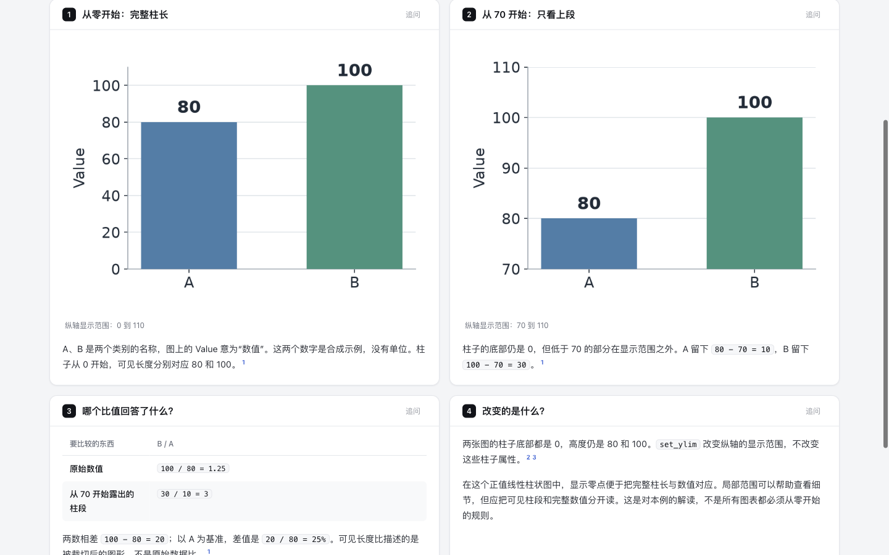

# Matplotlib: keep the data ratio separate from the visible bars

Round 39 uses two actual Matplotlib plots of **A = 80, B = 100**. The lower y-axis view limit changes from 0 to 70 while the bar objects retain their original heights and zero bottoms. [Retained page](candidate.html), [source](candidate.archify.md), [independent draft](author/answer.html). The revised page aligns the figures and makes the original-value ratio **1.25** and cropped-segment ratio **3** separately readable on a phone.

## Source and plot identity

Archify baseline: `35c64f3ea5306c3bbc5bdedab9838ae91720ce29`; runtime source: `66880ba8f034700d4dcbd6be60271202280ff3a8`; target dev: `5ecbd1bfdbf83ea747072112493c940e707569cb`. [Round identity](evidence/identity.json).

Matplotlib **3.11.2**, Python **3.12.13**, Agg backend. Upstream `v3.11.2`: **`d3ca9172e392048ec242b90e8423e88d1a3000b2`**. Installed `_base.py` and `_axes.py` match the pinned upstream bytes; this audits those Python modules, not the entire wheel or compiled renderer. [Source identity](source/identity.json), [module comparison](source/installed-source.json), [environment and font hash](source/plot-environment.json), [dependency versions](source/requirements.txt).

Primary references: [`set_ylim`](https://github.com/matplotlib/matplotlib/blob/d3ca9172e392048ec242b90e8423e88d1a3000b2/lib/matplotlib/axes/_base.py#L4165) changes y-axis view limits; [`bar`](https://github.com/matplotlib/matplotlib/blob/d3ca9172e392048ec242b90e8423e88d1a3000b2/lib/matplotlib/axes/_axes.py#L2307) uses the provided heights and a default zero bottom. [Versioned bar documentation](https://matplotlib.org/3.11.2/api/_as_gen/matplotlib.axes.Axes.bar.html). The versioned set_ylim documentation URL was inaccessible through the web tool, so its pinned function was read directly. Raw upstream files and the venv remain outside this repository.

[Plot/probe script](source/probe.py), [run 1](source/probe-1.json), [run 2](source/probe-2.json). The script takes an output directory as its argument; use the recorded dependencies and an isolated `MPLCONFIGDIR` to repeat it. Both local runs produce identical JSON and PNG bytes. Initial source inspection triggered Matplotlib's default font-cache creation; the actual plotting runs use the round's isolated config/cache directory. The first probe attempt failed at Python parse time because `else3` lacked whitespace; [failed source](evidence/probe-attempt-1.py), [failure record](evidence/probe-attempt-1.failure.json). No plot ran in that failed attempt. The corrected script also casts computed lengths to ordinary floats for JSON output.

| Observation | View 0–110 | View 70–110 |
| --- | --- | --- |
| Original values and bar heights | 80, 100 | 80, 100 |
| Bar bottoms | 0, 0 | 0, 0 |
| Visible segments in data units | 80, 100 | 10, 30 |
| Visible pixel heights after clipping | 309.992727, 387.490909 | 106.56, 319.68 |
| Visible length ratio B/A | 1.25 | 3 |
| Data ratio / difference / relative increase | 1.25 / 20 / 25% | 1.25 / 20 / 25% |

These are renderer geometry observations: each bar's display bounding box is intersected with the axes clipping window after drawing. They do not measure human perception. The same dimensions, colors, values and upper limit are used; automatic tick locations respond to the changed view. Both images are 768 × 576 px: [zero-based](images/zero.png), SHA-256 `6f6c6c05f945493b71adbcd240007a0564927076abe93f051abaa53f40ab9368`; [cropped](images/cropped.png), `106c76bae36655dc5b596f472bdd6626afc62318928c93adeb34ac85cbc0dba0`. Values are synthetic and unitless. No time-series change, performance or causal result is implied. Negative values, log axes, stacked bars and general rules for other plot types are outside this case.

## Independent author and revisions

[Plan](evidence/plan.md), [assignment](evidence/author-prompt.txt), [earliest draft](author/first-draft.archify.md), [trace](author/trace.txt). The independent Terra/medium author records work start at 23:06:25Z, first draft and attempt start at 23:06:40Z, strict finalize completion at 23:06:41Z and handoff at 23:06:44Z. Its only attempt passes with zero diagnostics. It inspected the supplied PNGs but did not inspect the delivered page in a browser or rerun the plotting script. The 19-second recorded interval is one supplied-evidence author run, not a source-to-plot generation or speed comparison.

The first browser inspection inherited remembered **editorial** style. [Initial measurements](evidence/author-browser.json) are retained and excluded from the clean-style height comparison below. The controlled comparison explicitly selects **clean** using the real Style control in both arms, matching the author's default style. [Controlled author metrics](evidence/author-clean-browser.json).

The author's four-column table is 432 px wide inside a 332 px phone region; its final ratio column is outside the initial view. [Original phone continuation](screenshots/author-clean-390-light-bottom.png). Its figures also start on different desktop rows, and “上半段” is imprecise: the retained segments are 10/80 and 30/100 of the original heights, not halves. [Original desktop](screenshots/author-clean-1440-light-top.png).

Revision 1 keeps both PNGs unchanged, places the conclusion above the two figures, replaces the four-column table with two ratios, names the numbers in the title and uses “上面一截”. It removes the duplicate zero-view table row because that result remains beside the first image and in the summary. Its strict finalize fails on the ambiguous phrase “70 以下”; [diagnostic](attempts/candidate-1-finalize.json). There is no candidate-1 HTML or browser result. Revision 2 says “低于 70 的部分”, which matches the clipping condition, and passes. The validator was not changed or bypassed. [Revision decisions](evidence/parent-revisions.md).

| Clean style | Author | Retained revision 2 |
| --- | ---: | ---: |
| 390 px page height | 2,507 px | 2,441 px |
| 1440 px page height | 1,831 px | 1,511 px |
| Phone image dimensions | 332 × 249 px each | 332 × 249 px each |
| Desktop image dimensions | 590 × 442.5 px each | 590 × 442.5 px each |

[Candidate measurements](attempts/candidate-2-browser.json), [canonical measurements](evidence/canonical-browser.json) cover 390/1440 px in light/dark. All checked candidate states retain the exact embedded PNG hashes, aspect ratios and complete table content without horizontal page/table overflow. Desktop image tops align. [Retained desktop](screenshots/candidate-2-1440-light-top.png), [phone dark figure and ratios](screenshots/candidate-2-390-dark-image-1.png). These dimensions describe a local layout result, not improved human comprehension.

## Delivery and limits

[Strict current-path finalize](evidence/canonical-finalize.json) and [provenance check](evidence/canonical-check.json) pass. Canonical HTML SHA-256: `5291f350b860e783f5acfb2265a0f0a6c0ae4f8917f56cadff8974b0034daf7f`. Historical author/attempt receipts keep their original paths. The page has no runnable code blocks or Copy controls; the full plotting script remains linked in this report, so no copied-program execution is claimed.

Actual UI-exported [PNG](candidate-390-light.png): **780 × 4,980 px**. Inspected [top](screenshots/export-top.png), [middle](screenshots/export-middle.png) and [bottom](screenshots/export-bottom.png) retain both plotted images, their axis labels and the ratios. [Export/index checks](evidence/export-index-check.json) verify both Matplotlib versions at two widths. The index now has **19 questions, 17 projects and 46 variants**. [Archive hashes](manifest.json) bind this review bundle; full unselected screenshots and raw source remain outside the repository.

Runtime suites and ZIP builds are reused from source `66880ba8f034700d4dcbd6be60271202280ff3a8` / package evidence `c7d8b1717b3ae7d20e9c98e544e93bdc30f7cf34`; this round changes only experiment content. Under the [real repository benchmark convention](../../../../benchmarks/real-repo-generation/README.md), it is a new-project discovery using supplied actual plots, not a full-generation comparison. No final-head CI, full browser acceptance runner, Windows/Safari, assistive-technology or human study is claimed. AI disclosure: Codex researched, generated plots, authored, revised, measured and inspected this case. Nothing was merged, released or installed; the continuous goal remains active.
