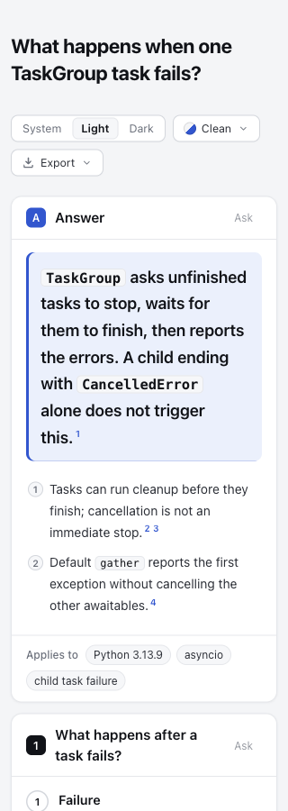

# Keep narrow-screen tools and menus reachable

Round 40 adopts the existing [PR #1076 proposal by BlueboxC](https://github.com/tt-a1i/archify/pull/1076) on this experimental branch. At 320 px, the complete English reading page previously extended to 400 px and clipped the Export control. The retained rule wraps tools and anchors menus below their container. The original PR remains the integration path; its branch and review status were not changed.

| Complete reading case | Before | Current branch |
| --- | --- | --- |
| TaskGroup, English | [Page](taskgroup-base.html) | [Page](taskgroup-candidate.html), [source](taskgroup.archify.md) |
| curl, Chinese | [Page](curl-base.html) | [Page](curl-candidate.html), [source](curl.archify.md) |

## Attribution and controlled scope

Base: `6828a8678b55dd698798ca7b0e8107eafeb7a946`; source commit: `e16dbcfb8916cb621efb0806e7f23d0b1497ac10`; latest fetched dev: `5ecbd1bfdbf83ea747072112493c940e707569cb`. [Identity](evidence/identity.json), [upstream metadata and exact patches](evidence/proposal.json). The refreshed upstream head is still `cd50794b794fc9f6ec4c9914dee78df0b7fddde3`, an open Draft PR. This uses its exact CSS rule and existing-file browser regression. No JavaScript, dependency, schema or authored content changed.

[Round 10](../mobile-tools/README.md) was an unadopted replay at its recorded source. This round qualifies the same rule against current source and retains it in the experimental branch. The original content/source audits remain [TaskGroup](../taskgroup-language/README.md) and [curl](../curl-headers/README.md); neither project's runtime probe was repeated here.

[Fixed-input replay](evidence/replay.json) renders **46 existing indexed artifacts** with their unchanged prepared documents and resources. All non-reader-CSS HTML bytes match. The [script](evidence/replay.mjs) uses a [frozen base index](evidence/index.frozen.html); a confirmation replay produces the same result hashes. These are renderer replays, not fresh author generation. [Current-path identity](evidence/canonical-identity.json) also proves the two new before/after pages differ only in embedded reader CSS. All four strict showcase finalize receipts pass; [TaskGroup check](evidence/taskgroup-candidate-check.json) and [curl check](evidence/curl-candidate-check.json) confirm current provenance.

## Actual reading and keyboard results

[Browser matrix](evidence/browser-matrix.json), [summary](evidence/summary.json): two complete documents × 320/390/1440 px × four styles × light/dark, **48 states per arm**. The baseline fits in **24/48**; the candidate fits in **48/48**. All checked candidate controls and popups stay within the viewport; keyboard opening focuses a menu item, and Escape closes it and returns focus. These are programmatically focused keyboard checks, not a complete natural Tab-order or assistive-technology audit.

The 320 px clean English answer moves down **38 px** to accommodate a second tool row. The full answer-position table is in the summary. Both checked clean/light desktop screenshots are byte-identical between arms. Parent inspection covered the [clipped baseline](screenshots/base-taskgroup-0-320-light-top.png), retained phone page above, [English Export menu](screenshots/candidate-taskgroup-0-320-light-export.png), [Chinese dark Export menu](screenshots/candidate-curl-0-320-dark-export.png), and [desktop](screenshots/candidate-taskgroup-0-1440-light-top.png). Menu overlap with the reading content is temporary and closes normally. This repairs access to the controls; it does not establish complete phone readability of every table or diagram.

## Real image exports and package

[Eight actual UI PNG exports and print states](evidence/export-print.json) cover both documents and arms at 320/1440 px. Export leaves the live document text, code and dimensions unchanged. Print media hides the tools and uses a white body in all eight checks; this is not printed-PDF acceptance. [Pixel comparisons](evidence/export-pixel-comparison.json), [comparison script](evidence/pixel-compare.py).

The TaskGroup PNGs are byte-identical at both widths (756 × 5,750 px and 2,880 × 2,618 px), as are the desktop curl PNGs (2,880 × 2,634 px). The 320 px curl export grows from **640 × 5,872** to **640 × 5,948 px**: its additional 76 image pixels are uniform background, corresponding to the extra 38 CSS px in the live toolbar row. In the shared area, only two pixels at the first panel number badge differ by one color-channel level; the text and geometry remain visually intact. [Detailed pixel evidence](evidence/export-difference-detail.json), [before badge area](screenshots/curl-export-difference-base.png), [after](screenshots/curl-export-difference-candidate.png). This retained export-height overhead is a limitation, not byte-equality evidence.

Retained actual phone exports: [TaskGroup before](taskgroup-base-320.png), [after](taskgroup-candidate-320.png), [curl before](curl-base-320.png), [after](curl-candidate-320.png). Parent inspected the actual exported [TaskGroup top](screenshots/export-taskgroup-top.png), [TaskGroup bottom](screenshots/export-taskgroup-bottom.png) and [curl bottom](screenshots/export-curl-bottom.png). Full raw exports and unselected screenshots remain outside the checkout in the round directory.

Canonical ZIP: **`fc84f97f50585000ddd675306ce79dc6de47a5bec073d0bfba4a6bf09840596e`**, **6,997,023 bytes**, built twice from source `e16dbcfb8916cb621efb0806e7f23d0b1497ac10` with official Node 22.23.3 / bundled zlib 1.3.1-e00f703. [Package identity](evidence/package-check.json). The extracted CSS matches source, strict [finalize](evidence/extracted-local-finalize.json) and [provenance check](evidence/extracted-local-check.json) pass, and the [extracted 320 px menu](evidence/extracted-browser.json) is visible and keyboard focused. No live installation was changed.

The first extracted-HTML byte-equality assertion failed because the source file was at a different relative path from the output. [Original failure](evidence/extracted-byte-identity-failure.json) is retained. [Structured comparison](evidence/package-path-comparison.json) limits the difference to prepared `sourcePath`, `baseDir` and their digest; everything outside that payload is identical. With the same relative source placement, extracted and canonical HTML are byte-identical. This corrects comparison setup, not product behavior.

## Verification and limits

- [Unchanged CSS regression](evidence/base-regression.tap): fails at en/clean/320, `scrollWidth=401`. [Candidate real-Chrome suite](evidence/browser.tap): **17 pass, zero skips**, including the reused 24-combination toolbar regression.
- [Renderer/layout](evidence/renderer-layout.tap): **20 pass**; [core CLI](evidence/core.tap): **19 pass**; [generated checks](evidence/generated.log): pass. Existing generated Viewer/gallery inputs did not change; no unrelated refresh was needed.
- [Scoped review](evidence/review-notes.md) applies test-value: retain observable containment/focus/print protection, without freezing automatic positions or adding another test framework. No concrete duplication/state concern warranted a broader simplification audit.
- Adding the fifth version initially made the review index 392 px wide at a 390 px viewport. Its existing button group now wraps. [Failure/recheck record](evidence/index-failure-notes.md), [before](screenshots/index-before-wrap.png), [after](screenshots/index-after-wrap.png). One immediate post-edit check also failed without a captured measurement; no additional edit preceded the instrumented fresh-navigation pass, so its exact cause remains unconfirmed. Final [index checks](evidence/index-check.json) cover the new default TaskGroup/curl variants at both preview widths. The index contains **19 questions, 17 projects and 48 variants**. Older artifacts remain historical.

[Plan](evidence/plan.md), [archive hashes](manifest.json). Whitespace-only TAP blank lines are trimmed in archived copies; original logs remain outside the repository. Under the [real repository benchmark convention](../../../../benchmarks/real-repo-generation/README.md), this is a fixed-input shared-CSS comparison with real reading cases, not a full-generation or speed benchmark. No final-head CI, full browser acceptance runner, Windows/Safari, assistive-technology or human acceptance is claimed. AI disclosure: Codex adapted, tested, inspected and documented the proposal; original implementation/test attribution belongs to BlueboxC. No merge, release or installation; the continuous goal remains active.
