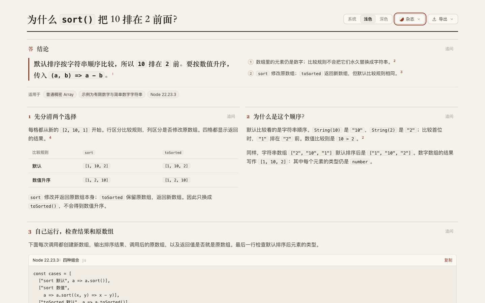

# Node.js: comparison rule and mutation are separate choices

Default array sorting puts numeric `10` before `2` because it follows string order. The numbers remain numbers. A numeric comparator changes the order; choosing `toSorted` instead of `sort` changes whether the original array is modified. [Retained page](candidate.html), [source](candidate.archify.md), [author after self-inspection](author/answer.html).

## Source and repeated probe

Tested **Node v22.23.3 / V8 12.4.254.21-node.57**, darwin/arm64. Node tag `v22.23.3` resolves to **`80dc632040e6bada37aac1220dde9c79581c9c22`**; its version header agrees with the tested executable's reported version. [Identity](source/identity.json), [source brief](source/brief.md), [parent audit](evidence/source-audit.json). Source/version matching and the executable SHA identify the run; this is not a reproducible build or binary/source-byte-equivalence claim. Raw upstream source remains outside the repository.

Pinned primary implementation: [default comparison](https://github.com/nodejs/node/blob/80dc632040e6bada37aac1220dde9c79581c9c22/deps/v8/third_party/v8/builtins/array-sort.tq#L358-L380), [user comparison](https://github.com/nodejs/node/blob/80dc632040e6bada37aac1220dde9c79581c9c22/deps/v8/third_party/v8/builtins/array-sort.tq#L382-L394), [writing back to the original array](https://github.com/nodejs/node/blob/80dc632040e6bada37aac1220dde9c79581c9c22/deps/v8/third_party/v8/builtins/array-sort.tq#L1364-L1415), [sort returns its receiver](https://github.com/nodejs/node/blob/80dc632040e6bada37aac1220dde9c79581c9c22/deps/v8/third_party/v8/builtins/array-sort.tq#L1419-L1440), [toSorted creates a copy](https://github.com/nodejs/node/blob/80dc632040e6bada37aac1220dde9c79581c9c22/deps/v8/src/builtins/array-to-sorted.tq#L88-L130). The page also cites the live ECMAScript specification; the implementation links are immutable. V8 has a small-integer lexicographic fast path, so the explanation describes string-order semantics without claiming a string allocation for each integer comparison.

The [probe](source/probe.mjs) uses a fresh input for each of five cases, records before/result/after, array identity and element types, and asserts expected results. [Run 1](source/probe-1.json) and [run 2](source/probe-2.json) come from separate Node processes and are byte-identical. [Probe summary](evidence/probe-summary.json). Reproduce with Node 22.23.3: `node source/probe.mjs`.

| Fresh input | Operation | Returned result | Original after call | Same array? |
| --- | --- | --- | --- | --- |
| `[2,10,1]` | `sort()` | `[1,10,2]` | `[1,10,2]` | true |
| `[2,10,1]` | `sort((a,b)=>a-b)` | `[1,2,10]` | `[1,2,10]` | true |
| `[2,10,1]` | `toSorted()` | `[1,10,2]` | `[2,10,1]` | false |
| `[2,10,1]` | `toSorted((a,b)=>a-b)` | `[1,2,10]` | `[2,10,1]` | false |
| `["2","10","1"]` | `sort()` | `["1","10","2"]` | `["1","10","2"]` | true |

All four numeric cases retain `number` elements. The probe separately checks `10 < 2` is false and `String(10) < String(2)` is true. Scope: ordinary dense arrays and these finite primitive values. No TypedArray, sparse entry, undefined/NaN, BigInt, locale collation, object, comparator-side-effect, deep-copy or performance result is claimed.

## Author self-inspection and parent revision

Frozen Archify: **`358846e881b35c19a3cc7b15b89db274574c2610`**, unchanged product source **`e16dbcfb8916cb621efb0806e7f23d0b1497ac10`**. Latest fetched `dev` remained **`5ecbd1bfdbf83ea747072112493c940e707569cb`**, an ancestor. [Plan](evidence/plan.md), [assignment](evidence/author-prompt.txt). Independent Terra/medium author had exclusive use of the existing browser page for its own inspection; parent waited for handoff.

The [first draft](author/first-draft.archify.md) passes strict showcase with zero diagnostics. Actual phone inspection reveals clipped table headers. The author shortens labels and moves mutation wording immediately below the table. Its second version also passes, and the phone table fits **358/358 px**. [Original screenshot](author/mobile.png), [self-reviewed screenshot](author/final-mobile.png), [trace](author/trace.txt). All two finalize and four browser script exits are zero; Ego emits normal observations on stderr, which are not failures. The first HTML was overwritten by version 2, so only the original source, screenshots and historical receipts are retained for version 1. Historical receipt paths/hashes must not be mistaken for current-path provenance.

The author records 00:15:10Z after reading the assignment, and last visual inspection at 00:15:56Z. Exact task-receipt/prompt-read time and trace-writing completion are unrecorded. That 46-second interval is partial observation, not complete generation time or a speed comparison. It inspected 1440×900 and 390×844 full-page screenshots with editorial/light explicitly selected. It also executed its displayed program. It honestly reports remaining code scrolling; no dark theme was checked by the author.

Parent makes one revision: shorten the repeated opening; put the conclusion above the two explanatory panels; state table axes and returned results explicitly; link actual probe output; reflow the same JavaScript expressions. [Decision](evidence/parent-revisions.md), [parent source](attempts/candidate-1.archify.md), [strict receipt](attempts/candidate-1-finalize.json). The initial plan mentioned parsed JavaScript comparison; verification instead uses a manually reviewed formatting diff, whitespace-normalized equality, syntax checks and actual execution. No AST-equivalence claim is made.

| Editorial/light, parent 900 px-high viewport | Author after self-inspection | Retained parent revision |
| --- | ---: | ---: |
| 390 px page height | 2,447 px | 2,678 px |
| 1440 px page height | 1,576 px | 1,898 px |
| Phone table client/scroll width | 358/358 px | 358/358 px |
| Phone program client/scroll width | 356/713 px | 356/356 px |

The longer page is a deliberate tradeoff for readable complete code. [Comparison measurements](evidence/parent-browser.json), [phone program](screenshots/canonical-390-light-run.png). The [canonical four-state check](evidence/canonical-browser.json) covers 390/1440, light/dark. Tables, code and page fit horizontally; the two conceptual panels align on desktop, and the full-width code follows without overlap. Parent inspected phone sections, dark top and [desktop bottom](screenshots/canonical-1440-light-bottom.png). One supplied-evidence author who repairs one table does not establish a general self-inspection benefit or human comprehension improvement.

## Actual Copy, export and delivery

Parent captured actual Copy-control bytes for the author's second version and the parent revision, executed both with the recorded Node, and matched all four numeric probe results, array identity and the type check. Their displayed output agrees, ignoring only the terminal newline of the output fence. [Copy verification](evidence/copy-verification.json), [checker](evidence/check-copy.py), [copied program](evidence/candidate-1-copied.mjs). Whitespace-normalized code equality is a limited formatting check, not AST analysis. Clipboard API calls were instrumented; OS clipboard permissions were not tested.

The canonical Copy program has identical bytes to the executed parent version and was executed again. Its four table results match probe data in all four browser states. [Canonical verification](evidence/canonical-verification.json), [checker](evidence/check-canonical.py). [Current-path strict finalize](evidence/canonical-finalize.json) and [provenance check](evidence/canonical-check.json) pass. HTML SHA-256: **`f49fa8ef064a1dee4bf3f9c1ad2c9ebacc151be030a46085ab81ff7dcc468367`**.

Actual UI-exported [PNG](candidate-390-light.png): **780 × 5,494 px**. Inspected [top](screenshots/export-top.png), [middle](screenshots/export-middle.png), [code ending](screenshots/export-code-end.png) and [bottom](screenshots/export-bottom.png) retain complete code, four outputs, number types, scope and source links. [Export/index evidence](evidence/export-index-check.json) checks both variants at both preview widths. The index now has **23 reading questions, 21 projects and 56 variants**. [Archive hashes](manifest.json). [Log normalization](evidence/archive-normalization.md) records the four terminal blank lines removed from archived browser logs after the initial whitespace check; raw logs remain outside the repository.

Only experiment content and its index change. Product tests and canonical ZIP evidence are reused from source `e16dbcfb8916cb621efb0806e7f23d0b1497ac10` / evidence `a4a57f42587de1c79e103ffe250f138295956b87`. This is supplied-evidence discovery under the [real repository benchmark convention](../../../../benchmarks/real-repo-generation/README.md), not paired full generation. No final-head CI, full browser acceptance runner, Windows/Safari, assistive-technology or human acceptance is claimed. AI disclosure: Codex researched, authored, revised, executed and inspected the case. No merge, release or installation occurred; the continuous goal remains active.
