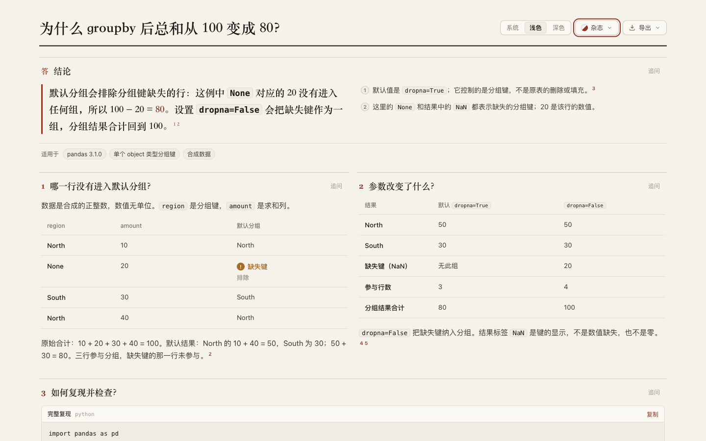

# pandas: show which row is absent from the grouped total

Four synthetic rows sum to **100**. Default grouping returns **80** because the missing grouping key's row contributes **20** and is excluded from those groups. With `dropna=False`, its group is included and the sum is **100**. The original DataFrame remains unchanged. [Retained page](candidate.html), [source](candidate.archify.md), [independent draft](author/answer.html).

## Source and executable evidence

Pandas **3.1.0**, Python **3.12.13** in an isolated venv. Upstream `v3.1.0`: **`c6f46769b808eb60218189d089dd67841b44f1b9`**. The installed package reports that Git version, and installed `pandas/core/frame.py` bytes match the pinned upstream file: SHA-256 `9c28cd65d029a64091efd2d23e8281f2de4d8dae1179ff92b0eaee8712a847b9`. This checks one Python source file, not reproducibility of the complete compiled wheel. [Identity](source/identity.json), [PyPI metadata](source/pypi.json), [dependencies](source/requirements.txt).

Primary references: [grouping guide](https://github.com/pandas-dev/pandas/blob/c6f46769b808eb60218189d089dd67841b44f1b9/doc/source/user_guide/groupby.rst#L211-L233), [default signature](https://github.com/pandas-dev/pandas/blob/c6f46769b808eb60218189d089dd67841b44f1b9/pandas/core/frame.py#L13566-L13575), [`dropna` description](https://github.com/pandas-dev/pandas/blob/c6f46769b808eb60218189d089dd67841b44f1b9/pandas/core/frame.py#L13647-L13650), [upstream test](https://github.com/pandas-dev/pandas/blob/c6f46769b808eb60218189d089dd67841b44f1b9/pandas/tests/groupby/test_groupby_dropna.py#L116-L130). Raw upstream files and the venv remain outside the repository. The [source brief](source/brief.md) distinguishes these references from this case's own numbers.

[Probe](source/probe.py), [run 1](source/probe-1.json), [run 2](source/probe-2.json): both local runs produce identical JSON. The main fixture uses one object-dtype `region` key and integer `amount` values. Its four rows are North/10, missing/20, South/30, North/40. Default groups are North/50 and South/30, with three participating rows; including the missing key adds a group of 20 and the fourth row. Frame-equality assertions verify that grouping does not mutate the input. A control with no missing key totals 100 under the default. A separate missing-numeric-value fixture shows that `dropna=False` does not fill that numeric value; `size` and nonmissing-value `count` differ there.

Values are synthetic, positive and unitless. `None` in the input and `NaN` in the printed group index denote the missing key in this fixture, not a zero or a missing amount. No categorical, multiple-key, other-aggregation, performance or universal reconciliation claim is made.

## Author and retained revision

Frozen Archify source: `e16dbcfb8916cb621efb0806e7f23d0b1497ac10`; source research overlapped round 40's browser work. [Plan](evidence/plan.md), [assignment](evidence/author-prompt.txt), [first draft](author/first-draft.archify.md), [trace](author/trace.txt). The independent Terra/medium author records work start at 23:21:18Z, first draft at 23:21:34Z and handoff at 23:21:44Z. It used the supplied probe evidence without rerunning it and did no page-browser review.

The author's one CLI attempt has a successful strict showcase JSON receipt and zero diagnostics. Its shell wrapper subsequently assigned zsh's read-only `status` variable and exited 1, so the CLI process exit code and exact completion time were not captured. The trace also retains a preliminary tool JavaScript syntax failure before reads. These limits preclude a complete delivery-time or speed claim; this is supplied-evidence authoring, not full generation.

Both original three-column tables already fit on a phone: **358/358 px**. The original code region is **356/577 px**, leaving the right part of expressions outside the initial view. [Original measurements](evidence/author-browser.json), [phone code](screenshots/author-390-light-reproduce.png), [desktop](screenshots/author-1440-light-top.png).

The retained page keeps both tables, places them side by side below the conclusion on desktop, and formats the same Python operations with ordinary newlines and parentheses. It calls the unitless values 数值 rather than 金额, simplifies the missing-key result cell, and links the actual probe next to this case's numeric claims. [Revision decisions](evidence/parent-revisions.md).

Parent revision 1 failed on three unsupported `@panel` directives; revision 2 used documented heading spans but failed because a relative local probe was declared as an HTTP(S) `url`. Neither produced HTML. After the declared two-revision allocation, a recorded one-repair/five-minute extension allowed only changing that declaration to documented `path=source/probe-1.json`. Revision 3 passes strict showcase with zero diagnostics. [Failure 1](attempts/candidate-1-finalize.json), [failure 2](attempts/candidate-2-finalize.json), [successful attempt](attempts/candidate-3-finalize.json). The validator was not changed or bypassed.

| Editorial style | Author | Retained revision 3 |
| --- | ---: | ---: |
| 390 px page height | 2,427 px | 2,600 px |
| 1440 px page height | 1,644 px | 1,681 px |
| Phone code client/scroll width | 356/577 px | 356/356 px |
| Phone tables client/scroll width | 358/358 px | 358/358 px |

[Candidate metrics](evidence/candidate-3-browser.json) and [canonical metrics](evidence/canonical-browser.json) cover both widths in light/dark. All candidate page, table and code regions fit horizontally; desktop input/result panel tops align. The extra vertical space retains complete expressions. Parent inspected the paired desktop, [phone code](screenshots/candidate-3-390-light-reproduce.png), [comparison](screenshots/candidate-3-390-light-comparison.png) and dark page. Some long table labels wrap; no human-comprehension improvement is measured.

## Copy, export and delivery

Actual Copy-control text from the [author](evidence/author-copied.py) and [candidate](evidence/candidate-3-copied.py) runs successfully in separate Python invocations. Both reproduce the verified input, original-frame equality and totals 100/80/100. Their Python ASTs and stdout are identical: [identity](evidence/code-identity.json), [author execution](evidence/author-copy-check.json), [candidate execution](evidence/candidate-3-copy-check.json), [reproduction checker](evidence/check-copy.py). Clipboard calls were instrumented to capture the actual written bytes; OS clipboard permissions were not tested. The canonical page copies identical executed code, and all rendered table values match the probe in all four states. [Canonical verification](evidence/canonical-verification.json).

[Current-path strict finalize](evidence/canonical-finalize.json) and [provenance check](evidence/canonical-check.json) pass. Canonical HTML SHA-256: `84ef3cf25f61009bd7e9637f4ed692c888ae2d47e1d1fc82bfbed403343e57a8`. Historical author/attempt receipts retain their original paths.

Actual UI-exported [PNG](candidate-390-light.png): **780 × 5,298 px**. Inspected [top](screenshots/export-top.png), [middle](screenshots/export-middle.png) and [bottom](screenshots/export-bottom.png) retain the tables, complete code and sources. [Export/index checks](evidence/export-index-check.json) cover both added variants at both preview widths. The first index update missed an array-separating comma and could not create the version buttons; [failure and repair](evidence/index-failure.json) are retained. The corrected array parses, and the browser recheck passes. The index now has **20 questions, 18 projects and 50 variants**.

[Archive hashes](manifest.json). Runtime suites and canonical ZIP evidence are reused from source `e16dbcfb8916cb621efb0806e7f23d0b1497ac10` / evidence commit `a4a57f42587de1c79e103ffe250f138295956b87`: this round changes only experiment content and its index. Under the [real repository benchmark convention](../../../../benchmarks/real-repo-generation/README.md), it is a new-project discovery, not a paired full-generation benchmark. No final-head CI, full browser acceptance runner, Windows/Safari, assistive-technology or human acceptance is claimed. AI disclosure: Codex researched, authored, revised, executed and inspected this case. Nothing was merged, released or installed; the continuous goal remains active.
