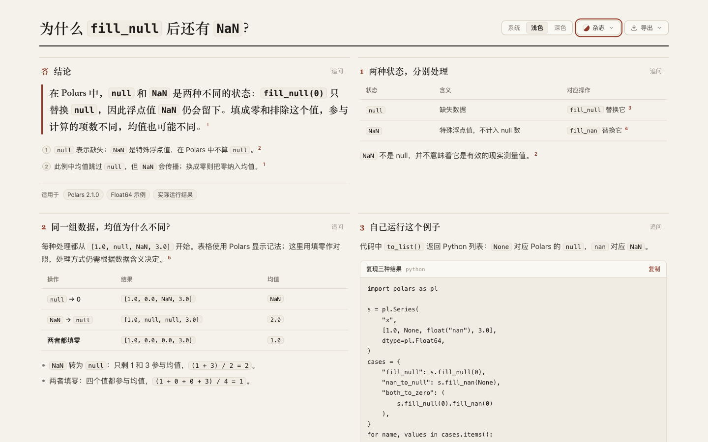

# Polars: null, NaN and the mean's denominator

`fill_null(0)` leaves `NaN`. Converting `NaN` to `null` gives mean **2** in the fixture; replacing both with zero gives **1** because four values participate instead of two. [Retained page](candidate.html), [source](candidate.archify.md), [author's scrolling variant](author/answer.html).

## Verified source and probe

**Polars 2.1.0**, **polars-runtime-32 2.1.0**, **Python 3.12.13** in an isolated external venv. Tag `py-2.1.0` resolves to **`7f902bd3ffd27ff82d14278a09a295ff2f7aed92`**. Installed Python `series.py` bytes match the pinned module (SHA **`8fff4b04a1afe96e31cb19bf7fe6854ac2660d2dec157ee8fdc7ad17675bcdb4`**). This verifies one Python wrapper, not the Rust binary or complete distribution build. [Identity](source/identity.json), [PyPI metadata](source/pypi.json), [requirements](source/requirements.txt), [source brief](source/brief.md).

Primary references: [null/NaN definitions](https://github.com/pola-rs/polars/blob/7f902bd3ffd27ff82d14278a09a295ff2f7aed92/docs/source/user-guide/expressions/missing-data.md#L5-L12), [counts, fill operations and aggregation](https://github.com/pola-rs/polars/blob/7f902bd3ffd27ff82d14278a09a295ff2f7aed92/docs/source/user-guide/expressions/missing-data.md#L166-L180), [fill_nan](https://github.com/pola-rs/polars/blob/7f902bd3ffd27ff82d14278a09a295ff2f7aed92/py-polars/src/polars/series/series.py#L5705-L5735), [fill_null](https://github.com/pola-rs/polars/blob/7f902bd3ffd27ff82d14278a09a295ff2f7aed92/py-polars/src/polars/series/series.py#L5737-L5767), [drop operations](https://github.com/pola-rs/polars/blob/7f902bd3ffd27ff82d14278a09a295ff2f7aed92/py-polars/src/polars/series/series.py#L1953-L2008). Raw upstream files remain outside the repository. An initial lookup used the old Python directory and returned 404; the pinned project configuration and directory listing identified the `src/polars` layout. [Setup note](evidence/setup-notes.md), [environment log](evidence/environment.log).

The [probe](source/probe.py) runs seven cases with a fresh explicit Float64 Series `[1.0, None, float('nan'), 3.0]`. [Run 1](source/probe-1.json) and [run 2](source/probe-2.json) are separate processes with byte-identical strict JSON; [summary](evidence/probe-summary.json). `kind: null/nan/number` tags preserve the observed distinction without nonstandard JSON NaN tokens. They are encoding labels, not string values in the Series. Reproduce with the recorded requirements and `python source/probe.py`.

| Operation | Result in Polars notation | null count | NaN count | Mean |
| --- | --- | ---: | ---: | --- |
| Original | `[1.0, null, NaN, 3.0]` | 1 | 1 | NaN |
| `fill_null(0)` | `[1.0, 0.0, NaN, 3.0]` | 0 | 1 | NaN |
| `fill_nan(0)` | `[1.0, null, 0.0, 3.0]` | 1 | 0 | 1.3333333333333333 |
| `fill_nan(None)` | `[1.0, null, null, 3.0]` | 2 | 0 | 2.0 |
| `fill_nan(None).fill_null(0)` | `[1.0, 0.0, 0.0, 3.0]` | 0 | 0 | 1.0 |
| `drop_nulls()` | `[1.0, NaN, 3.0]` | 0 | 1 | NaN |
| `drop_nans()` | `[1.0, null, 3.0]` | 1 | 0 | 2.0 |

All results remain Float64 and original values remain unchanged. The original `is_nan` mask is `[false, null, true, false]`; NaN count uses its sum. This evidence concerns eager Series from a Python list. No pandas/Arrow conversion, lazy/streaming, all-null input, other type, statistical-policy validation or performance result is claimed. In Polars, NaN is not a null; that does not establish a useful real-world measurement. Zero replacement is an experimental contrast, not a universal recommendation.

## Author and parent inspection

Frozen Archify **`2131cd2c0d16f39ea8e727576fa1f32da8e4b880`**, product source **`e16dbcfb8916cb621efb0806e7f23d0b1497ac10`**. Latest fetched `dev` remained **`5ecbd1bfdbf83ea747072112493c940e707569cb`**, an ancestor. [Plan](evidence/plan.md), [assignment](evidence/author-prompt.txt), [trace](author/trace.txt).

The independent Terra/medium author had exclusive browser control, inspected editorial/light at 390/1440, and delivered one complete version. [First source](author/first-draft.archify.md), [preserved first HTML](author/version1.html), [strict result](author/version1.stdout). Strict showcase passes with no diagnostics. Its first process could not start because the designated work directory did not yet exist; the trace records that failure and subsequent directory creation. There is no separate process-output file for that pre-start failure. Recorded start is 00:23:16Z before reading, final trace 00:24:04Z; intermediate phase times are unknown. This is supplied-evidence discovery, not a controlled timing comparison.

The author executes the displayed Python successfully and views complete screenshots. Tables fit at **358/358 px** on the phone; code is **356/540 px**. It verifies code can scroll to **184 px** and preserves a [scrolled screenshot](author/screen-390-code-scrolled.png). Its trace references measurement stdout files, but Ego's actual measurement text is on [inspect-03.stderr](author/inspect-03.stderr) and [inspect-04.stderr](author/inspect-04.stderr). Those successful browser observations are not error reports.

Parent makes one revision: format the same Python expressions, shorten split table operation labels, separate the two arithmetic explanations, name Polars in the opening, apply code formatting to the title, link actual probes and correct text that referred to a displayed output block when only runnable code was present. [Decision](evidence/parent-revisions.md), [source](attempts/candidate-1.archify.md), [strict result](attempts/candidate-1-finalize.json). Automatic panel layout remains unchanged.

| Editorial/light, 900 px-high parent viewport | Author | Retained revision |
| --- | ---: | ---: |
| 390 px page height | 2,400 px | 2,716 px |
| 1440 px page height | 1,225 px | 1,465 px |
| Phone tables client/scroll width | 358/358 px | 358/358 px |
| Phone code client/scroll width | 356/540 px | 356/356 px |

[Comparison measurements](evidence/parent-browser.json) preserve the longer-page tradeoff. Numeric table arrays still wrap across lines on the phone; every value remains visible. [Phone result table](screenshots/canonical-390-light-mean.png), [complete program](screenshots/canonical-390-light-reproduce.png). Author self-inspection documented scrolling but did not remove it. This case does not demonstrate a general authoring or human-comprehension gain.

## Copy, export and delivery

Actual Copy-control programs from both versions execute in the pinned venv. Their Python ASTs are identical and stdout matches the three selected probe results and means. The copied program uses `fill_null(0).fill_nan(0)` for the third case; actual execution verifies the same fixture result as the probe's `fill_nan(None).fill_null(0)`. [Copy verification](evidence/copy-verification.json), [checker](evidence/check-copy.py), [copied program](evidence/candidate-1-copied.py). Clipboard API was instrumented; OS clipboard permissions were not tested.

Canonical checks cover 390/1440 light/dark, verify three displayed result rows/means against the probe, fit tables/code/page horizontally and check panels do not overlap. Canonical Copy bytes match the AST-verified parent and run again successfully. [Measurements](evidence/canonical-browser.json), [verification](evidence/canonical-verification.json), [checker](evidence/check-canonical.py). Parent inspected phone sections, dark top and [desktop bottom](screenshots/canonical-1440-light-bottom.png).

[Current-path strict finalize](evidence/canonical-finalize.json) and [provenance check](evidence/canonical-check.json) pass. HTML SHA **`b42d690f914312884a5215d89d0b3f079f5307287236b200a1572535928dae18`**. Historical receipts keep original paths. Actual UI [PNG](candidate-390-light.png) is **780 × 5,530 px**; inspected [top](screenshots/export-top.png), [middle](screenshots/export-middle.png), [code ending](screenshots/export-code-end.png) and [bottom](screenshots/export-bottom.png) preserve all three results, formulas, code and sources. [Export/index checks](evidence/export-index-check.json) verify both variants at both widths. The index contains **24 questions, 22 projects and 58 variants**. [Archive hashes](manifest.json). [Normalization note](evidence/archive-normalization.md) records the terminal blank lines removed from four archived browser logs after the initial whitespace check; raw files are retained externally.

Only case content and index change. Reused runtime/package evidence: source `e16dbcfb8916cb621efb0806e7f23d0b1497ac10`, evidence `a4a57f42587de1c79e103ffe250f138295956b87`. Under the [real repository benchmark convention](../../../../benchmarks/real-repo-generation/README.md), this is supplied-evidence discovery, not paired full generation. No final-head CI, full browser acceptance runner, Windows/Safari, assistive technology or human acceptance is claimed. AI disclosure: Codex researched, authored, revised, executed and inspected the case. No merge, release or live installation; continuous goal remains active.
