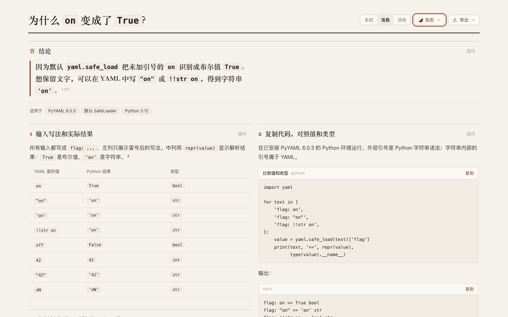

# PyYAML: distinguish input spelling, value and type

Default `yaml.safe_load` reads plain `on` as Python **`True` / `bool`**. Quoted `"on"` and explicit `!!str on` produce **`'on'` / `str`**. The page keeps those three representations distinct and shows a complete runnable comparison. [Retained page](candidate.html), [source](candidate.archify.md), [independent draft](author/answer.html).

## Source and repeated probe

PyYAML **6.0.3**, tag `6.0.3` at **`49790e73684bebad1df05ef8d828fa12f685bffb`**, isolated Python **3.12.13**. Installed `resolver.py`, `constructor.py`, `loader.py` and `__init__.py` bytes match pinned upstream files. This checks four modules, not complete wheel-build reproduction. [Identity and hashes](source/identity.json), [PyPI metadata](source/pypi.json), [dependencies](source/requirements.txt), [source brief](source/brief.md).

Primary references: [safe_load entrypoint](https://github.com/yaml/pyyaml/blob/49790e73684bebad1df05ef8d828fa12f685bffb/lib/yaml/__init__.py#L117-L125), [SafeLoader composition](https://github.com/yaml/pyyaml/blob/49790e73684bebad1df05ef8d828fa12f685bffb/lib/yaml/loader.py#L31-L40), [scalar resolution and boolean spellings](https://github.com/yaml/pyyaml/blob/49790e73684bebad1df05ef8d828fa12f685bffb/lib/yaml/resolver.py#L143-L176), [boolean construction](https://github.com/yaml/pyyaml/blob/49790e73684bebad1df05ef8d828fa12f685bffb/lib/yaml/constructor.py#L224-L235), [mapping-key construction](https://github.com/yaml/pyyaml/blob/49790e73684bebad1df05ef8d828fa12f685bffb/lib/yaml/constructor.py#L132-L145). Raw upstream source and the venv remain outside the repository.

The [probe](source/probe.py) runs eight scalar cases and two mapping controls in each of two separate processes. [Run 1](source/probe-1.json) and [run 2](source/probe-2.json) are byte-identical; [summary](evidence/probe-summary.json) records source/output hashes. All cases use default, unmodified Python `SafeLoader`. Reproduce with the recorded dependency and `python source/probe.py`.

| YAML value after `flag:` | Python repr | Type |
| --- | --- | --- |
| `on` | `True` | `bool` |
| `"on"` | `'on'` | `str` |
| `'on'` | `'on'` | `str` |
| `!!str on` | `'on'` | `str` |
| `off` | `False` | `bool` |
| `42` | `42` | `int` |
| `"42"` | `'42'` | `str` |
| `oN` | `'oN'` | `str` |

Plain mapping keys `on` and `yes` both become the bool key `True`; the two-line fixture returns `{True: 'second'}`. Quoting those keys preserves two string keys and both values. Probe JSON records key repr/type separately, so JSON object-key conversion cannot hide this distinction. No custom resolver, constructor, C loader, other YAML implementation, performance or security audit is claimed. The spelling pattern includes specific capitalization variants, not arbitrary case-insensitive matching.

The initial Python metadata fetch failed with a TLS EOF after both successful probe runs and source identity verification. A curl fetch of the same PyPI JSON then succeeded without disabling certificate checks. The probe was not rerun or changed for this metadata failure. [Setup note](evidence/setup-notes.md).

## Author and parent revisions

Frozen Archify source: **`1e42e6acd7d6963bb06bf8cfecbb8dbc7346e828`**, product source **`e16dbcfb8916cb621efb0806e7f23d0b1497ac10`**. [Plan](evidence/plan.md), [assignment](evidence/author-prompt.txt), [first draft](author/first-draft.archify.md), [trace](author/trace.txt). The independent Terra/medium author records start at 00:03:00Z and last observation at 00:03:20Z. One strict showcase attempt passes with zero diagnostics. It also executes the page snippet successfully; visual review remains pending at handoff. These observations are supplied-evidence authoring, not complete generation or a speed comparison.

The original table fits **358/358 px** on a phone, but five first-column inputs wrap because each repeats `flag:`. The original Python region is **356/457 px**: the iteration list and print expression extend outside the initial view. [Original metrics](evidence/author-browser.json), [table](screenshots/author-390-light-results.png), [code](screenshots/author-390-light-reproduce.png).

Revision 1 states the common YAML prefix once, keeps all eight rows, registers local probe sources, simplifies the mechanism wording and formats the same Python expressions. Its mixed fixed spans leave a large empty desktop column: page height rises to **2,091 px**, so that composition is rejected. [Revision 1 screenshot](screenshots/candidate-1-1440-light-top.png), [source](attempts/candidate-1.archify.md), [receipt](attempts/candidate-1-finalize.json).

Revision 2 uses consistent six-column panels below a full-width conclusion, puts results beside runnable code, and clarifies YAML spelling versus Python repr. It also shortens the print formatting without changing operations. Both parent revisions pass strict showcase with zero diagnostics. [Decisions](evidence/parent-revisions.md), [revision 2 receipt](attempts/candidate-2-finalize.json).

| Editorial style | Author | Retained revision 2 |
| --- | ---: | ---: |
| 390 px page height | 2,721 px | 2,756 px |
| 1440 px page height | 1,571 px | 1,558 px |
| Phone table client/scroll width | 358/358 px | 358/358 px |
| Phone Python client/scroll width | 356/457 px | 356/356 px |

[Canonical measurements](evidence/canonical-browser.json) cover 390/1440 light/dark. Table and code fit horizontally in all four states. The desktop table/code tops align; the lower panels stack independently in the two columns. Parent inspected phone table/code, dark top and [complete desktop bottom](screenshots/canonical-1440-light-bottom.png). A first verification incorrectly required the two lower tops to align too; its [failed expectation and actual geometry](evidence/verification-attempt-1.json) are retained. Corrected verification checks the intended top comparison, complete data and absence of overlap without changing the page. This is a presentation judgment, not measured human comprehension.

## Actual Copy, export and delivery

The actual Copy-control program and output text were captured for the author and both parent revisions. Each program executes successfully in the pinned venv, matches the three relevant probe results and the displayed output, and has the same Python AST. [Copy verification](evidence/copy-verification.json), [checker](evidence/check-copy.py), [retained copied program](evidence/candidate-2-copied.py). Clipboard API calls were instrumented; OS clipboard permissions were not tested. Code-fence terminal-newline differences are excluded only when comparing the displayed output, not the executed program bytes.

The canonical page copies the same retained program, executes it successfully and matches all eight table records to actual parsed values/types in all four states. [Canonical copy](evidence/canonical-copy-verification.json), [table/layout verification](evidence/canonical-verification.json), [checker](evidence/check-canonical.py). [Current-path strict finalize](evidence/canonical-finalize.json) and [provenance check](evidence/canonical-check.json) pass. HTML SHA-256: **`83b7b14eb8afd608ada32fac7b4d8173ea9b702626f287ea3f2fb16034a4b178`**. Historical receipts keep their original paths.

Actual UI-exported [PNG](candidate-390-light.png): **780 × 5,608 px**. Inspected [top](screenshots/export-top.png), [middle](screenshots/export-middle.png) and [bottom](screenshots/export-bottom.png) retain quoted inputs, complete code/output, key qualification and sources. [Export/index checks](evidence/export-index-check.json) cover both variants at both preview widths. The index has **22 questions, 20 projects and 54 variants**. [Archive hashes](manifest.json). The original author source and first-draft copy each retain one trailing space on line 15; the scoped whitespace check excludes only those two preserved originals, and all other staged files pass.

Only experiment content and its index change. Runtime suites and canonical ZIP evidence are reused from source `e16dbcfb8916cb621efb0806e7f23d0b1497ac10` / evidence commit `a4a57f42587de1c79e103ffe250f138295956b87`. Under the [real repository benchmark convention](../../../../benchmarks/real-repo-generation/README.md), this is supplied-evidence new-project discovery, not paired full generation. No final-head CI, full browser acceptance runner, Windows/Safari, assistive-technology or human acceptance is claimed. AI disclosure: Codex researched, authored, revised, executed and inspected this case. No merge, release or installation occurred; the continuous goal remains active.
