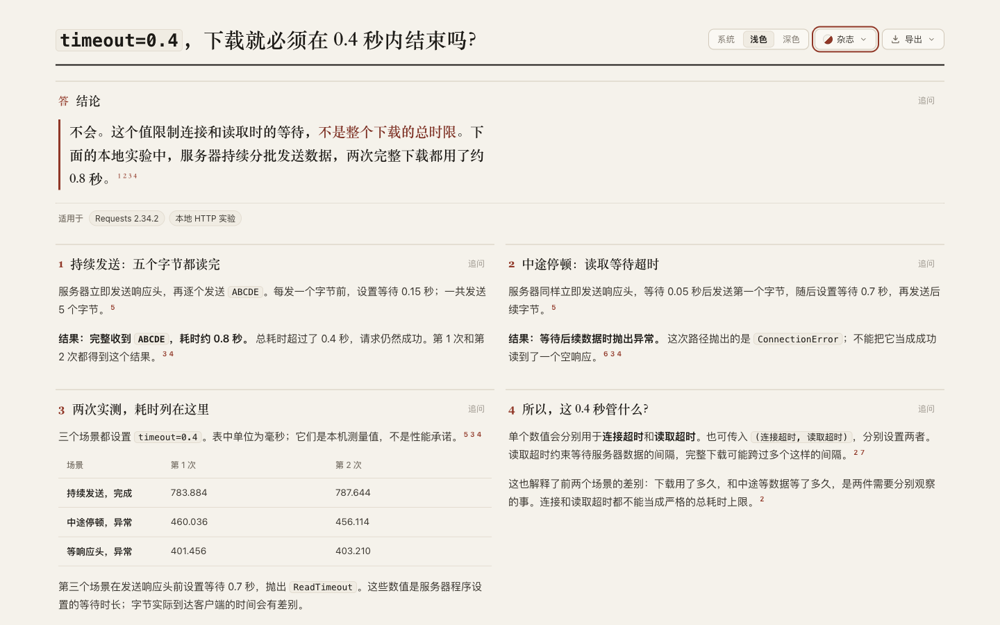

# Requests: separate waiting for data from finishing the download

With `timeout=0.4`, the local five-byte response completes in **783.884 / 787.644 ms** when the server keeps sending. A long pause during the body raises `ConnectionError`; delaying the headers raises `ReadTimeout`. These are observed local outcomes, not an overall deadline or performance promise. [Retained page](candidate.html), [source](candidate.archify.md), [independent draft](author/answer.html).

## Source and executable evidence

Requests **2.34.2**, upstream tag `v2.34.2` at **`6e83187b8feb273ed4c6cdab5efd8d54901dfab3`**; isolated Python **3.12.13**, urllib3 **2.8.0**. Installed `adapters.py` and `models.py` bytes match the pinned upstream files. This checks two Python modules, not reproducibility of the entire wheel. [Identity and hashes](source/identity.json), [PyPI metadata](source/pypi.json), [dependencies](source/requirements.txt), [source brief](source/brief.md).

Primary references: [whole-download distinction](https://github.com/psf/requests/blob/6e83187b8feb273ed4c6cdab5efd8d54901dfab3/docs/user/quickstart.rst#L543-L550), [connect/read timeouts](https://github.com/psf/requests/blob/6e83187b8feb273ed4c6cdab5efd8d54901dfab3/docs/user/advanced.rst#L1094-L1133), [single value applied to both](https://github.com/psf/requests/blob/6e83187b8feb273ed4c6cdab5efd8d54901dfab3/src/requests/adapters.py#L681-L693), [body-timeout exception mapping](https://github.com/psf/requests/blob/6e83187b8feb273ed4c6cdab5efd8d54901dfab3/src/requests/models.py#L933-L943), [header-wait exception mapping](https://github.com/psf/requests/blob/6e83187b8feb273ed4c6cdab5efd8d54901dfab3/src/requests/adapters.py#L737-L742), [Response.elapsed](https://github.com/psf/requests/blob/6e83187b8feb273ed4c6cdab5efd8d54901dfab3/src/requests/models.py#L797-L804). Raw upstream files and the venv remain outside the repository.

The self-contained [probe](source/probe.py) binds an ephemeral `127.0.0.1` HTTP/1.1 server, sends the finite body `ABCDE`, and closes its server and threads. It calls `Session.get(timeout=0.4)` with default `stream=False`, disables environment proxies and redirects, and measures from call start through body consumption or exception with `perf_counter`. It makes no external request. Reproduce with the recorded dependencies and `python source/probe.py`; timing and ports will vary.

| Server's requested sleep schedule | Run 1 | Run 2 |
| --- | --- | --- |
| Headers immediately; 0.15 s before each of five body writes | Complete, 783.884 ms | Complete, 787.644 ms |
| Headers immediately; first byte after 0.05 s, then 0.7 s gap | ConnectionError, 460.036 ms | ConnectionError, 456.114 ms |
| 0.7 s before headers | ReadTimeout, 401.456 ms | ReadTimeout, 403.210 ms |

[Run 1](source/probe-1.json), [run 2](source/probe-2.json), [probe summary](evidence/probe-summary.json). Qualitative outcomes agree; timing JSON is not byte-identical. Sleep settings are requested waits, and server event logs record write calls returning, not client reception. `Response.elapsed` is 1.239 / 1.115 ms on the successful runs and excludes body consumption. The body-gap exception is not a completed empty response. Its `ConnectionError` is not a `Timeout` subclass; the header-gap `ReadTimeout` is. DNS, TLS, proxies, redirects, retries, other transports and strict wall-clock deadlines are outside this probe.

## Author and retained revision

Frozen Archify source: **`04ef10be26191bca95d34d63525c479eff416d22`**, product source **`e16dbcfb8916cb621efb0806e7f23d0b1497ac10`**. [Plan](evidence/plan.md), [assignment](evidence/author-prompt.txt), [first draft](author/first-draft.archify.md), [trace](author/trace.txt). The independent Terra/medium author worked from 23:46:46Z to 23:47:09Z, used supplied results without rerunning the probe, and passed one strict showcase finalize attempt with zero diagnostics. It did no browser review. That interval is supplied-evidence authoring, not complete generation or a speed comparison.

The original four-column table has phone client/scroll widths **358/432 px**: the second run is initially outside the visible area. The generic sequence depicts a successful exchange, but does not show a timeout boundary; its right actor is also initially outside the phone view. [Original metrics](evidence/author-browser.json), [phone table](screenshots/author-390-light-cases.png), [phone sequence](screenshots/author-390-light-top.png).

The candidate replaces that generic sequence with the two actual body scenarios, places them side by side on desktop, and separates precise timing values from the exception explanation. The final three-column table retains all six elapsed values. Both parent content revisions pass strict showcase with zero diagnostics; revision 2 rounds the narrative to approximately 0.8 seconds, shortens a row label, and simplifies the sleep-versus-receive-time wording. [Decisions and timing](evidence/parent-revisions.md), [revision 1](attempts/candidate-1.archify.md), [revision 1 receipt](attempts/candidate-1-finalize.json), [revision 2 receipt](attempts/candidate-2-finalize.json). No failed finalize attempts occurred in this round.

| Editorial style | Author | Retained revision 2 |
| --- | ---: | ---: |
| 390 px page height | 2,478 px | 2,604 px |
| 1440 px page height | 1,593 px | 1,483 px |
| Phone table client/scroll width | 358/432 px | 358/358 px |

The phone page is longer while its table is fully visible. [Canonical measurements](evidence/canonical-browser.json) cover 390/1440 px light/dark; page and table fit horizontally in all four states, and paired desktop panel tops align. Parent inspected desktop, phone results and dark first panels. [Verification](evidence/canonical-verification.json) matches each displayed timing to both probe JSON files and checks the actual exception classes. This is an editorial/layout judgment, not measured human-comprehension improvement.

## Delivery and scope

[Current-path strict finalize](evidence/canonical-finalize.json) and [provenance check](evidence/canonical-check.json) pass. Canonical HTML SHA-256: **`5b136f178339b6f50685f2b6f1112c1a00feee5baedf6ab3de01543a2a77fc77`**. Historical author/attempt receipts retain their original paths. The page links the full probe; it has no runnable code block and makes no Copy-control execution claim.

Actual UI-exported [PNG](candidate-390-light.png): **780 × 5,306 px**. Inspected [top](screenshots/export-top.png), [middle](screenshots/export-middle.png) and [bottom](screenshots/export-bottom.png) retain both scenarios, the complete timing table, qualifications and sources. [Export/index checks](evidence/export-index-check.json) verify both added variants at both preview widths. The index has **21 questions, 19 projects and 52 variants**. [Archive hashes](manifest.json). The [scoped whitespace check](evidence/diff-check.md) preserves the original generated diagram HTML bytes; all other staged files pass.

Only experiment content and its index changed. Runtime suites and canonical ZIP evidence are reused from source `e16dbcfb8916cb621efb0806e7f23d0b1497ac10` / evidence commit `a4a57f42587de1c79e103ffe250f138295956b87`; no product suite or ZIP rebuild is needed for these content changes. Under the [real repository benchmark convention](../../../../benchmarks/real-repo-generation/README.md), this is a new-project discovery, not a paired full-generation benchmark. No final-head CI, full browser acceptance runner, Windows/Safari, assistive-technology or human acceptance is claimed. AI disclosure: Codex researched, authored, revised, executed and inspected this case. Nothing was merged, released or installed; the continuous goal remains active.
