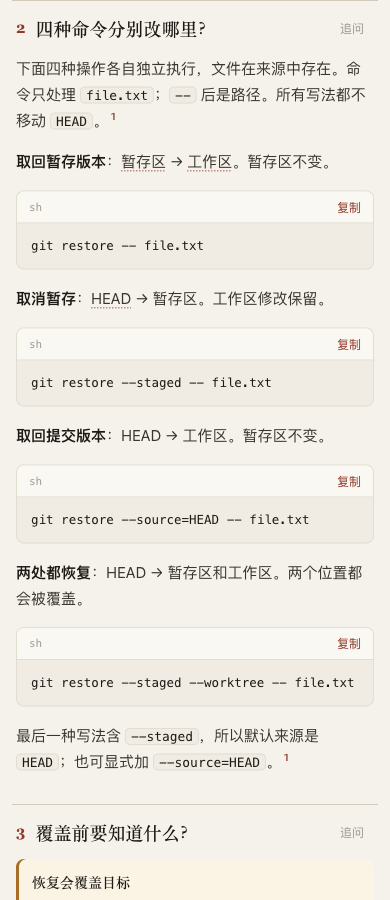

# Four restore actions as copyable commands

Round 6 uses the adopted runtime, after rejecting the inline-word experiment. [Page](candidate.html), [source](candidate.archify.md). The only content change from [the two-column version](../restore-pair/purpose-table.archify.md) is to present each operation as a short purpose/result paragraph followed by a fenced command. The same pinned Git manual and round 4 behavior probe support the statements; no new general authoring rule or runtime code is adopted.

At 390 px, all four commands are readable on one line with separate copy controls. At 320 px, the two longer snippets use their existing local scroll container; the page also retains the unrelated toolbar overflow (352 px document at a 320 px viewport). At 1440 px, the full command panel is 823 px high: the additional space makes the actions distinct but costs density compared with the table. [Actual dimensions and copy dispatch](visual-and-copy.json).

The parent inspected the 390 px and 1440 px captures and prefers this variant when the reader intends to execute one of the commands. The table remains useful for comparing sources/destinations at a glance. This is an author choice for this case, not evidence that every comparison should become snippets. The 320 px capture is retained with its known overflow; no complete small-phone acceptance is claimed.

Each of the four real copy buttons dispatched its exact displayed command. The clipboard API was intercepted before writing the system clipboard; this proves the button's payload, not OS clipboard integration. No restore command was executed against the user's checkout. Strict finalize and provenance check pass ([finalize](finalize.json), [check](check.json)); no full browser gate, human study, runtime regression suite or new package build is claimed for this content-only alternative. Generated HTML whitespace is preserved.

The next paired task will ask independent authors to explain ripgrep filtering. It will compare the existing guide with a clarification of its existing plain-fence row, rather than appending another broad table rule. The continuous goal remains active.
