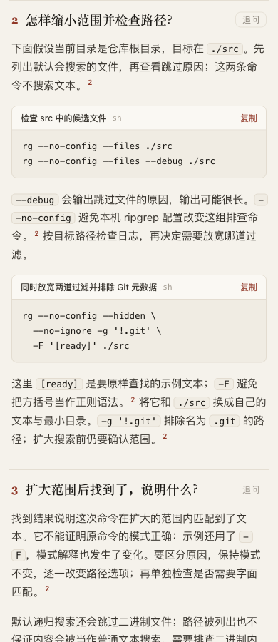

# Ripgrep: separate path filtering from pattern matching

Round 7 started on 2026-10-29 and was reviewed on 2026-10-30. Runtime: `3b1755acf98f2199e07058c7d7e76f5a3f8c1f7d`. Refreshed dev remains `5ecbd1bfdbf83ea747072112493c940e707569cb`.

## Independent author comparison

Two fresh gpt-6.1-terra / medium authors used the same ripgrep 15.2.0 source, frozen runtime, question and 15-minute budget. The candidate guide changed only one existing form-selection row:

- Base: “A command, config or code that does not exist yet” → plain fence.
- Candidate: “A command the reader should run, or a proposed config or code snippet” → plain fence.

[Base prompt](base-prompt.txt), [candidate prompt](candidate-prompt.txt), [identities](pair.json). Both arms ran concurrently; this is not a speed comparison. Both passed strict finalize on their first draft with zero diagnostics and no repair. Their original drafts, HTML and receipts remain in the respective directories.

**No improvement in command formatting was demonstrated.** Both authors already used two fenced snippets. Both long search commands measured 517 px inside a 356 px phone code frame. Their tables fit at 358/358 px. The candidate's shorter prose and different order are author variation; they cannot be attributed to the one changed row from this pair. The guide wording remains unadopted. This is one case observation, not the real-repository generation benchmark.

[Base phone](base/commands-390.png), [candidate phone](candidate/commands-390.png), [base desktop](base/top-1440.png), [candidate desktop](candidate/top-1440.png), [measurements](visual-metrics.json).

## Source and local behavior audit

The official 15.2.0 tag and the installed binary both identify commit `e89fff89ac9af12e8d4ce9d5fd07beb408ca730f`. The parent checked the [pinned guide](https://github.com/BurntSushi/ripgrep/blob/e89fff89ac9af12e8d4ce9d5fd07beb408ca730f/GUIDE.md) and [flag definitions](https://github.com/BurntSushi/ripgrep/blob/e89fff89ac9af12e8d4ce9d5fd07beb408ca730f/crates/core/flags/defs.rs): hidden and ignore filtering, explicit-path/allowlist exceptions, explicit `--ignore-file`, literal matching, glob exclusion, file listing and debug output. The base source named “--files and --debug” links to the Debug definition only; its separate Files citation supports the listing statement.

[probe.py](probe.py) ran against a disposable Git repository using installed ripgrep 15.2.0. Configuration, global ignore and parent ignore controls isolate the fixture; they are listed in the [raw result](probe-output.json). Each fixture line is authored test content, not a real-project observation.

| Search | Matching fixture paths |
| --- | --- |
| Literal, ordinary recursive search | visible |
| Literal + hidden | visible, hidden |
| Literal + no-ignore | visible, ignored |
| Literal + both | visible, hidden, ignored, hidden-and-ignored |
| Regex, default or both path flags | decoy containing `needle1`, not the literal `needle[1]` |
| Explicit hidden file, no hidden flag | the named hidden file |

Eight assertions passed; a debug run also reported the two checked skip reasons. This demonstrates the intended distinctions on one fixture. It does not cover every ignore precedence rule, binary behavior, operating system or real repository.

## Parent repair: show the complete command

[Reviewed page](readable-commands.html), [source](readable-commands.archify.md). The parent kept the candidate's explanation and added three local changes: POSIX-shell scope, an explicit note that the diagram is a conceptual checklist rather than the implementation's internal order, and shell line continuations in the long command.

At 390 px, both snippets now fit **356/356 px** without horizontal scrolling. They also fit the final desktop panel at **406/406 px**. The authoring change affects the page's automatic placement, so this is not a same-layout renderer comparison. [Phone](readable-390.png), [desktop](readable-1440.png), [geometry and copy](readable-visual.json).

The exact multiline command was executed with `sh` in another disposable fixture. It found all four intended paths, excluded a `.git` sentinel, and rejected the unbracketed decoy: [script](command-probe.py), [raw result](command-probe-output.json). The real copy button dispatched exactly the command executed by that probe. The browser clipboard API was intercepted; OS clipboard integration is not claimed and the system clipboard was not changed.

Strict finalize and provenance check pass for the repaired page: [finalize](readable-finalize.json), [check](readable-check.json). The independent arm copies retain receipts for their original author directories; their relocated provenance checks fail as expected ([base](base/relocation-check.json), [candidate](candidate/relocation-check.json)). Regenerate either source into a new path for current delivery receipts. The full browser gate was not run. Existing phone diagram scrolling and broken inline flags remain visible; this round claims only the command-content repair.

No runtime change, archive rebuild, human comprehension study, full generation benchmark, final-head CI acceptance, merge or installation is claimed. Generated HTML whitespace is preserved. AI disclosure: two independent Terra medium authors produced the arms; the parent agent audited sources, executed local probes, inspected screenshots and made the content repair. The continuous goal remains active.
