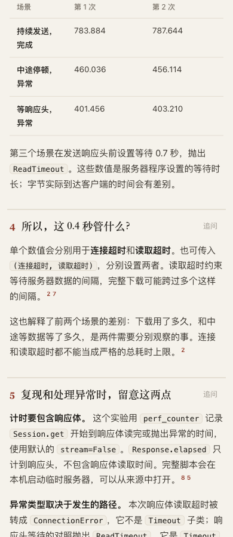
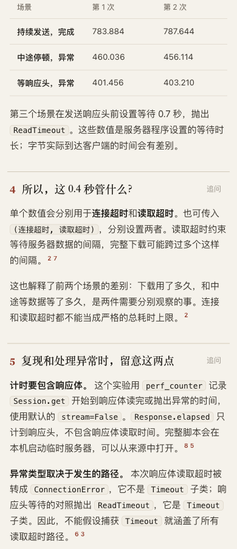
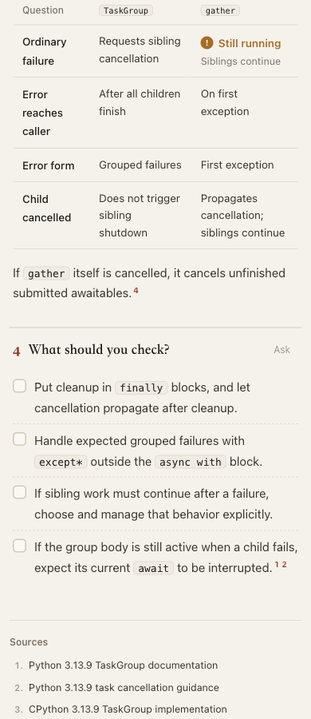
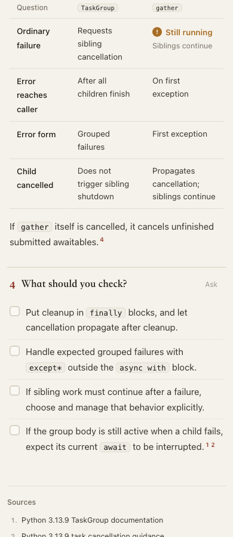

# Automatic row-label width: useful locally, rejected as a universal default

Replacing the fixed **24%** row-label width with `auto` makes several Chinese numeric tables easier to scan. It also adds unnecessary wrapping in the English TaskGroup comparison. **The runtime change is not adopted.** Product CSS is restored; these pages retain the experimental renderer for comparison.

| Same Requests content, 390 px editorial/light | Preview |
| --- | --- |
| Current row-label width |  |
| Automatic row-label width |  |

## Scope and positive cases

Base **`fd6e099c4b82b5da0200cb330ae7bbe8c670afa4`**; product source **`e16dbcfb8916cb621efb0806e7f23d0b1497ac10`**. Latest fetched `dev` remains `5ecbd1bfdbf83ea747072112493c940e707569cb`, an ancestor. [Plan](evidence/plan.md), [exact one-property patch](evidence/prototype.patch), [disposition](evidence/disposition.md).

The prototype keeps cell minimum widths, font sizes, text, values, schema and layout JavaScript unchanged. Initial comparison covers eight complete documents at 390/1440 px in matched light/style states. [Input identities](evidence/replay.json), [measurements](evidence/browser-comparison.json), [runner](evidence/browser-01.mjs).

| Phone table | Current height | Candidate height | Visible effect |
| --- | ---: | ---: | --- |
| Requests, editorial | 227.95 px | 158.29 px | All three scenario labels fit on one line; six values remain complete. |
| pandas grouped results, editorial | 289.16 px | 242.73 px | Missing-key and total labels fit on one line. |
| Matplotlib ratios, clean | 137.29 px | 114.07 px | The cropped-bar-segment label fits beside its ratio. |
| DuckDB exception table, editorial | 162.51 px | 116.07 px | The two UNION forms remain intact on one line. |

[Requests candidate](candidate/requests.html), [pandas candidate](candidate/pandas.html), [Matplotlib candidate](candidate/matplotlib.html), [DuckDB candidate](candidate/duckdb.html). Parent inspected all eight initial phone candidate tables, including Redis prose, Git commands, English assessments and gzip numbers. These observations establish local presentation changes, not measured human-comprehension gains.

## The counterexample

The additional four-style comparison covers Requests, Matplotlib, TaskGroup and a five-column gzip table: **64 states / 32 matched pairs**, light theme at 390/1440 px. All table text remains identical and no table gains horizontal scroll width. Ten page pairs get shorter, nineteen keep their height and three get taller; these counts are diagnostic, not a quality score. [Measurements](evidence/style-comparison.json), [summary](evidence/style-summary.json).

At **390 px editorial**, TaskGroup's label column grows from **96 to 101.71 px** without reducing its label wrapping. The TaskGroup value column shrinks from **127.66 to 125.31 px**. “Requests sibling cancellation” gains a third line, and “Grouped failures” changes from one line to two. The table grows **311.73 → 350.04 px**; the page grows **2,750 → 2,788 px**. The desktop editorial and Swiss tables also gain a row of wrapping, although their full-page heights stay unchanged.

| Current English comparison | Automatic row-label width |
| --- | --- |
|  |  |

[Current page](base/taskgroup.html), [candidate page](candidate/taskgroup.html), [counterexample recheck](evidence/counterexamples.json). The supported style changes expose a tradeoff the initial clean-style comparison did not. A general change would need a more selective basis; no numeric/language heuristic, resize measurement or new authoring option is added to rescue this trial.

The wide gzip desktop control also changes automatic panel arrangement when its table becomes shorter, with page height +1 px in clean and +9 px in product. Parent inspected [base](screenshots/counter-wide-gzip-base-1440.png) and [candidate](screenshots/counter-wide-gzip-candidate-1440.png). That different composition is **not** classified as a defect merely because of its height. The English phrase-wrapping regression is the concrete reason to reject the universal default.

## Replay, exports and tests

The [52-document replay](evidence/full-replay.json) uses identical frozen authored documents and prepared resources across the previous product runtime and the prototype. Every rendered output is byte-identical outside the embedded reader CSS. [Replay script](evidence/full-replay.mjs). Archived HTML is a rendering comparison, not renewed finalize/provenance acceptance; historical relative source links should be followed through the original case reports. The prepared source content and embedded visual assets remain unchanged.

Six actual UI-exported PNGs cover three matched pairs:

| Export | Current | Candidate |
| --- | --- | --- |
| Requests, 390 editorial | [780 × 5,306](exports/requests-base-390.png) | [780 × 5,166](exports/requests-candidate-390.png) |
| Matplotlib, 1440 clean | [2,880 × 3,120](exports/matplotlib-base-1440.png) | [2,880 × 3,074](exports/matplotlib-candidate-1440.png) |
| Five-column gzip, 390 editorial | [1,152 × 3,738](exports/wide-gzip-base-390.png) | [1,152 × 3,738](exports/wide-gzip-candidate-390.png), byte-identical |

[Export actions](evidence/export-comparison.json), [hashes](evidence/export-identities.json), [pixel-view setup](evidence/export-pixel-views.json). Parent inspected the candidate Requests timing table and source/footer, Matplotlib ratios and complete gzip columns including `-995`. Requests dark phone table was also inspected. These exports support content preservation in the selected states; they do not change the rejection decision.

On the experimental CSS, existing [browser tests](evidence/browser-suite.log) pass **17**, [renderer/layout tests](evidence/layout-renderer.log) pass **20**, [core tests](evidence/core.log) pass **19**, and [generated checks](evidence/generated.log) pass, all with zero test failures or skips. Existing browser coverage protects complete table/code/diff exports and other reader behavior. No test is added to force a subjective column proportion. The [first focused command](evidence/layout-renderer-attempt-1.log) named a nonexistent test file; the runner refused it before running tests. The corrected inventory selection succeeds. Copied text logs trim trailing whitespace; raw originals remain outside the repository.

The [bounded ownership check](evidence/ownership.json) refreshes open draft [#1015](https://github.com/tt-a1i/archify/pull/1015), head `fe4f80d2195e0a7b49b7cfe6d3dba7ffd31a7ac8`. Its table polish retains `width:24%`; no patch was reused. Search is not exhaustive review, and no external message was sent.

Only this experimental archive and its index/record links are committed. No product or ZIP change remains. The main review index stays at **21 questions, 19 projects and 52 variants**. [Archive hashes](manifest.json). Original generated HTML and the exact patch retain their whitespace; the scoped authored-file check excludes only those preserved files.

Under the [real repository benchmark convention](../../../../benchmarks/real-repo-generation/README.md), this is fixed-input presentation replay, not fresh generation, delivery-speed or human acceptance evidence. No full browser runner, Windows/Safari, assistive-technology or final-head CI acceptance is claimed. AI disclosure: Codex designed, tested, visually inspected and rejected the prototype. No merge, release or installation occurred; the ongoing goal continues.
