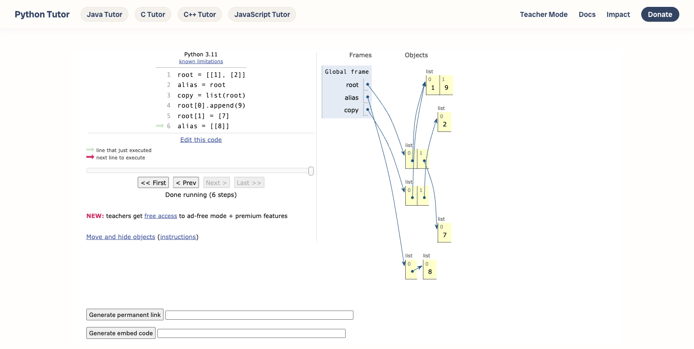

# Python Tutor：原生逐步展示浅拷贝与修改

2026-10-30；Round 67。结论：暂不推进新的 Archify 方向。本轮原创六行合成程序在 Python Tutor 原生界面逐步展示共享内部列表修改、外层元素替换和变量重新绑定；最终 root `[[1, 9], [7]]`、copy `[[1, 9], [2]]`、alias `[[8]]`。四个阶段分别显示 4、4、5、7 个列表框，最终 3 个变量、8 条引用。

这是单个已知答案的能力观察，没有读者、人类、速度或产品优势研究。Python 3.11 是 UI 和 permalink 标签，并未确定后端身份；本地 Python 3.15 对四个独立前缀的运行也不是连续轨迹或后端等价证明。第一张截图的粉色箭头视觉位置与步骤记录不一致，原因未知。输入过程一次点击被拦截，之后粘贴成功并冗余重输；原始记录保留。

[证据包](../audit/round67-python-tutor/README.md)包含原生截图、DOM、脚本、失败与恢复、来源和哈希。页面快照因许可边界从公开 stderr 整块省略，外部原件及其哈希保留。此前 copy identity 图是静态结构，不是此 mutation trajectory；远端分支和有限查询也不构成无重叠证明。

