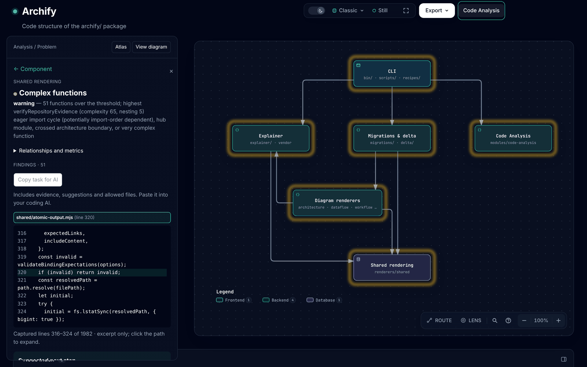
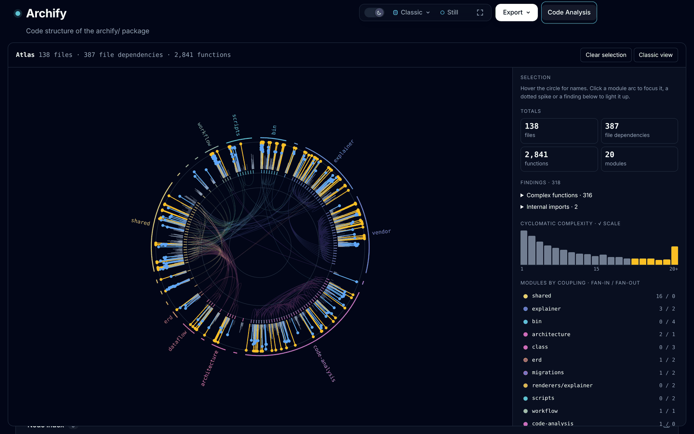
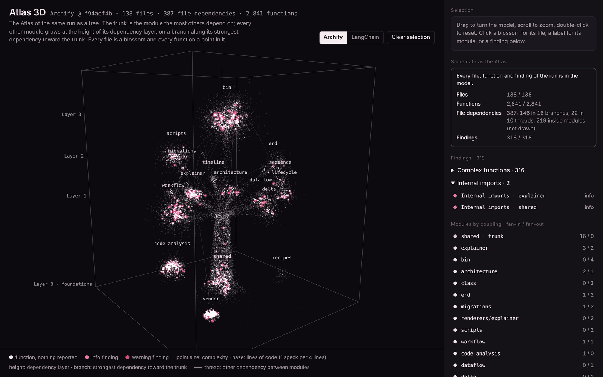

# Code Analysis 产品讨论与设计方案

日期：2026-10-14

最新复核：2026-10-17，`codex/code-analysis-module` / `3c4c4766200fa959ca5cd399d1d7bcb37820af8e`。当前完成状态和下一步建议以第 13 节为准；第 2–8 节保留最初讨论背景，其中单语言限制、重复检测缺失仍成立，但“需重启才能重新分析”“JS/TS 未测量函数”等描述已被后续实现取代。

2026-11-04：第 0 节是当前的产品决定摘要（检查优先级与严重级别，以及 0.7 的三类视图），优先于第 13 节的交付顺序；其余各节为讨论背景与实现记录。

后续实施分工见 [Code Analysis 协作实施计划](code-analysis-execution-plan.md)：Codex负责 UI 与前端验收，Claude负责分析引擎、数据接口与 AI 任务逻辑。

讨论基线：`codex/code-analysis-module`，提交 `1a55ac68`（与本地 `upstream/labs/code-analysis` 引用一致）。

本文整理本次讨论，供后续选择方案和实施使用。新增分析能力与阶段安排仍是建议；界面已按第 9 节的决策实现统一阅读栏，其余方案不代表已实现的产品契约。

## 0. 摘要：检查优先级与严重级别（2026-11-04）

产品决定：分析首先回答“代码有没有必须处理的问题”，再回答“哪里人维护起来吃力”。颜色只按这两类区分，不再按规则各自定级。下述目标级别与新增规则均为待实现，现状一栏以 `labs/code-analysis`（`34c99b6f`）为准。

### 0.1 级别的含义

| 颜色 | 级别 | 含义 | 处理方式 |
|---|---|---|---|
| 红 | error | 结构性的恶性问题，例如循环依赖。代码能跑，但模块无法独立理解、测试和修改，且会随时间扩散。 | 应当修复。可写入基线并说明原因，但界面与报告持续标红，不随基线变绿。 |
| 黄 | warning | 运行和 AI 阅读都没有问题，但人阅读、维护吃力：冗余、集中度过高、可读性差、目录不分类，以及 AI 审查工具报出但属于业务逻辑的问题。 | 用户审查后可以忽略，必须填写原因；证据变化后重新提示复核。 |
| 蓝 | info | 信号，供阅读时参考，不要求处理。 | 不计入结论与 CI 失败。 |

红色的含义是“必须处理的结构问题”，不是“已证明运行时会失败”。第 2 节的边界仍然成立：导入循环反映静态结构与潜在初始化风险，不证明运行时必然失败，文案保持这一口径。

### 0.2 第一优先：严重问题标红（error）

现状：目前没有任何规则产出 error，循环依赖全部低于红色。

| 规则 | 现状级别 | 目标级别 |
|---|---|---|
| `coupling/import-cycle`，模块顶层导入构成的文件循环 | warning | error |
| `coupling/import-cycle`，仅由延迟、条件或动态导入构成的循环 | info | warning（结构耦合存在，但不在加载时触发） |
| `coupling/import-cycle`，Java 结构循环 | info | error |
| `coupling/cycle`，模块级循环 | info | error |

改动范围与影响：

- 规则级别改动需要提升规则版本（`ruleVersions`），否则前后对比会把级别变化误读为新增或修复问题。
- 总览结论、优先项排序、组件着色（overlay 的 red / amber / blue）、图例文案和 AI 任务的影响说明随之调整；当前 red 的图例文案是“an error was reported”，需改为循环依赖的说明。
- CI：`check` 默认 `--fail-on warning`，循环原本是 warning 的仓库不受影响，原本为 info 的模块循环和 Java 循环会开始导致失败。需要在变更说明中写明，并建议已有项目先用 `--update-baseline` 记录现状。
- 实测参考：LangChain `libs/core`（`2775506`）有一个 17 个模块的模块循环和两个文件循环（其中一个 41 个文件），目前全部是 info，改后为 error。

### 0.3 第二优先：维护负担标黄（warning）

以下各项共同的规则：级别为 warning，用户审查后可以忽略（见 0.4），所有判断附 `file:line` 证据。依赖命名、文本模式等启发式判断的规则，`confidence` 设为 0.7 并在说明中写明判断方法。

**代码冗余（`redundancy/duplicate-block`，新增）**

运行没有问题，AI 读也没有问题，但同一段逻辑改一处漏一处，人维护吃力。按第 13 节 B 的方案，先做有最小长度门槛的 token 级完全重复，忽略格式与注释，默认排除测试、生成代码和第三方代码；展示全部位置、两处对照和重复行数。相似但业务不同的代码不自动合并，由人或 AI 判断。

原型参考：`claude/atlas-showcase-demos` 分支的 `experiments/atlas-showcase/pro/build-signals.mjs`，以 7 行归一化窗口在 Archify 上找到 369 对重复块，约占非第三方代码的 2.1%；最大的一处是 `bin/preview.mjs` 与 `renderers/shared/cli.mjs` 之间 18 行相同的文件打开逻辑。原型只做实验，阈值和误报尚未在真实项目上标定。

**单一模块集中度过高（`coupling/concentration`，新增）**

现有 `coupling/hub` 只覆盖“被很多模块依赖、同时依赖很多模块”的情况（默认 fan-in 与 fan-out 都 ≥ 5），覆盖不到只进不出的核心模块和体量过大的模块。新规则在以下任一条件成立时报告，阈值可配置并在证据中回显：

- 传递依赖者占全部模块的比例过高（对应 `analyzers-architecture.md` 中的 static reach / `impact/high-reach`，建议默认 50%）；
- 单个模块占仓库代码行数或函数数的比例过高；
- 单个文件过大（建议默认 1,500 行）。

只报告事实与原值，不推断“应当拆分”，是否拆分取决于业务职责。Archify 自身的参考：其余 19 个模块中有 16 个直接或间接依赖 `renderers/shared`；`bin/archify.mjs` 一个文件 7,323 行。

**AI 审查误报：业务逻辑不应更改（外部结果导入 + 审查后忽略）**

CodeRabbit 等 AI 审查工具可能把有意为之的业务或工作流逻辑报成错误。这类结果不应当触发修改，但需要可见、可追溯：

- 导入外部审查结果作为 finding，代码为 `external/<工具>`，保留原工具的规则、原文和位置；级别统一为 warning，不直接标红。格式优先支持 SARIF；CodeRabbit 没有标准导出格式，候选做法是通过 GitHub API 读取它在 PR 上的 review comments，需先确认可行性与权限。
- 用户审查后选择“这是业务逻辑，保留”，必须填写原因，写入基线；之后该项不计入结论与 CI 失败，但仍列在已接受中。
- 证据（`evidenceDigest`）变化时重新提示复核，避免业务逻辑被修改后旧的忽略理由继续生效。
- 同一忽略能力适用于本模块自己的 warning，例如有意保留的复杂分支。

**可读性差、没有按工程目录分类（`organization/*`，新增）**

| 规则 | 检测 | 证据 |
|---|---|---|
| `organization/mixed-roles` | 一个文件同时承担入口/命令行或文件读写，以及视图、模型或领域逻辑（没有 MVC 式分层） | 命中各类职责的行，例如 `process.argv`、`process.exit`、文件系统调用 |
| `organization/folder-roles` | 一个目录里混放三种以上职责的文件 | 每种职责的文件列表 |
| `organization/generic-name` | `util`、`helpers`、`misc`、`common` 等不说明内容的文件名 | 文件路径与大小 |
| `coupling/internal-leak` | 其他模块绕过入口文件直接引用内部文件（缺少接口抽象） | 每一条越过入口的 import |

职责判断依赖命名和文本模式，属于启发式，`confidence` 为 0.7。原型参考同上：Archify 中有 15 个文件混合了命令行或 I/O 与其他逻辑；8 个渲染器在加载时读取 `process.argv`，其中 7 个调用 `process.exit`。

`coupling/internal-leak` 已实现并合入 `labs/code-analysis`（#1206，`34c99b6f`）。它目前在没有声明入口约定时报 info，只有项目在配置中声明入口文件后才报 warning，以免把常见的深层导入写法当成缺陷；是否按本节统一为 warning，需要在第一批真实项目验收后决定。

### 0.4 审查后忽略

现有基线（`--baseline`，见第 11 节）已支持按稳定 ID 接受问题、记录原因和证据哈希。0.3 的“允许审查后忽略”在此基础上补齐：

- 页面上直接提供“忽略并说明原因”，不必手工编辑基线文件；原因为必填。
- 忽略只对 warning 开放。error 可以写入基线以免阻塞 CI，但页面保持红色并标注“已接受的严重问题”。
- 已忽略项默认收起，可随时查看与撤销；证据变化后显示“已接受 · 证据已变化”，需要复核。

### 0.5 调整后的顺序

1. 循环依赖改为红色（0.2）：只改规则级别、版本、文案和测试，不需要新的提取能力。
2. 审查后忽略（0.4）：页面操作，复用基线，是 AI 审查结果导入的前提。
3. 代码冗余与集中度（0.3）：重复检测需要新的 token 级比对；集中度用现有模块图和函数度量即可计算。
4. 目录分类与可读性规则，以及 AI 审查结果导入（0.3）：启发式规则先在两到三个真实项目上标定误报，再决定默认是否开启。

验收：在 Archify、AI Voice 和一个外部项目（例如 LangChain `libs/core`）上，红色项均为循环依赖且证据可核对；黄色项每类抽查十条，记录误报与被忽略的比例；忽略理由在证据变化后会重新提示。

### 0.6 待决定事项

- 仅由延迟或条件导入构成的循环，是否也应标红。
- 模块循环与其中包含的文件循环同为红色时，总览如何合并展示，避免同一结构占满优先项（沿用第 13 节的相关项合并口径）。
- 集中度与文件大小的默认阈值。
- `coupling/internal-leak` 是否统一为 warning。
- AI 审查结果的导入方式：SARIF、GitHub review comments，或由用户粘贴导出文件。

### 0.7 三类视图与各自的读者

同一次分析结果（`findings.json`、`raw-facts.json`、`module-graph.json`）有三种展示方式，面向不同的读者。三者的文件、函数、依赖和 finding 数量一致，只是详略不同。以下截图均为 Archify 自身（`labs/code-analysis` `34c99b6f`，`archify/` 包，TypeScript/JavaScript），深色主题。

**1. Code Analysis 模块图（Classic）**

在架构图上点击 Code Analysis 按钮后出现。每个组件按问题级别描边；点击组件进入它的 finding 列表，点击 finding 或证据路径直接打开对应源码行（例如 `shared/atomic-output.mjs` 第 320 行）。

> 注释：真的工作需要，或者深挖代码的人，他们需要溯源去检查源码。



**2. Atlas**

在阅读栏点击 Atlas 打开。整个仓库画成一圈：外圈弧是模块，刺是文件，点是函数，黄色是 warning；圈内的线是文件依赖。右栏给出总数、finding 分组、复杂度分布和按耦合排序的模块。

> 注释：任何人可看的总结图表。



**3. Atlas 3D**

实验原型，位于 `experiments/atlas-3d/`（#1207），数据由同一次运行生成。把 Atlas 画成一棵树：被依赖最多的模块为树干，其他模块按依赖层高度生长在通向树干的最强依赖上，文件是花团，函数是其中的点。

> 注释：有待定位。



## 1. 目标

同时服务两类用户：

- 不需要代码细节的用户，可以直接理解项目的主要结构问题和维护重点。
- 需要细节的用户，可以逐层查看依赖关系、判断依据和具体源码。

后续让 AI 针对不合理或冗余的部分提出重构计划、生成可审阅的修改，并通过验证确认结果。

## 2. 当前实现

当前分析流程为：

```text
源码提取 → 模块依赖图 → 规则判断 → 架构图分析层
```

主要入口和职责：

- `archify/modules/code-analysis/lib/analysis.mjs`：协调分析流程、校验中间数据、写出结果。
- `archify/modules/code-analysis/extract/`：Python AST 和 TypeScript Compiler API 提取文件、导入和可用符号信息；每次选择一种语言。
- `archify/modules/code-analysis/graphs/module.mjs`：按配置、包边界或目录深度聚合模块和依赖。
- `archify/modules/code-analysis/evaluate/index.mjs`：运行规则并汇总 findings。
- `archify/modules/code-analysis/overlay/inject.mjs`：把分析结果映射到架构组件，展示指标、依赖图、问题和源码。

### 已有能力

- 文件导入循环：`coupling/import-cycle`。
- 模块依赖循环：`coupling/cycle`。
- 高耦合枢纽模块：`coupling/hub`。
- 文件行数、导入数量、模块 fan-in / fan-out 和 instability 指标。
- 组件状态标记、依赖小图、文件与行号证据、源码上下文。
- 源码快照标识，以及相对 Git 基线的源码变更标记。
- 各阶段 JSON 输出与 schema 校验。

### 当前边界

- 分析在用户点击 Code Analysis 后启动，成功后在服务器生命周期内缓存；源码或配置变化需要重启后重新分析。
- 每次分析只选择一种语言。自动检测命中多种语言时直接报 `extract/adapter-ambiguous` 失败（`extract/index.mjs:22`），而 serve 默认不指定语言；只有显式传入 `--language` 时，其他语言的文件才会被跳过，且跳过数量目前没有统计。
- finding 的 `id` 原为排序后的流水号（如 `COUP-0001`），任何 finding 增减都会改变后续 ID；已改为稳定 ID（见第 3 节）。
- overlay payload 只按组件挂载 findings，没有顶层 findings 列表；完全落在未映射模块中的 finding 在界面中没有入口。
- 分析在 serve 的 Promise 中同步执行，期间阻塞事件循环；输出总是写入同一个 `analysis/` 目录。
- `--config` 与默认配置是浅合并，用户只要配置 `rules` 就会整体覆盖默认规则配置。
- 提取层只记录文件级信息（`loc`、`imports`、顶层 `symbols`），没有函数起止行、分支或嵌套结构。Python 提取器中的 `visit_If` / `visit_Try` 等仅用于判断导入是否 lazy / conditional，不计算复杂度。
- 尚无复杂度、重复代码、架构边界约束、完整变更影响分析和自动重构能力。
- 已有源码变更标记不等于完整的变更影响分析。
- 导入循环反映静态结构与潜在初始化风险，不证明运行时必然失败。
- 没有发现问题不等于代码安全或质量良好。
- `instability` 衡量依赖方向，不应直接当成质量分。
- 规则的 `confidence` 不能直接解释为“应该重构”的概率。

## 3. 三个产品设计方案

### 方案一：结论优先，逐层展开

点击分析后，默认展示项目总览：总体结论、最多三项优先关注点、分析覆盖范围。用户点击问题后依次展开原因、模块关系、证据和源码。

```text
项目总览 → 问题摘要 → 关系与原因 → 代码证据 → 完整源码
```

简要用户看第一屏即可掌握重点；详细用户继续使用现有架构图和源码面板。后续在问题旁加入“生成重构建议”。

**成本：低到中。** 主要新增结果聚合和总览展示，复用现有提取、规则与证据。

实现时必须按唯一 finding 去重，避免同一循环关联多个组件后被重复计数；未映射到架构图的模块也应纳入项目结论。

### 方案二：快速报告与架构探索双视图

提供两个结果入口，共享同一次分析数据：

- 快速报告：按主题回答项目结构、主要风险、优化方向。
- 架构探索：从组件进入指标、依赖关系和源码。

报告中的问题可以跳转到对应图形和证据；用户可以勾选多个主题，后续生成组合重构计划。

**成本：中。** 需要维护两套信息组织与导航，但结论生成逻辑和底层数据应共享。

适合两类用户需求差异较大的产品。需要避免两个视图重复维护文案或出现不一致结论。

### 方案三：以重构任务为核心的工作台

把分析结果组织为可处理的候选任务，每项包含：观察到的事实、可能影响、建议改法、涉及文件和验证方式。

可逐步支持“待确认、已接受、已忽略、已生成修改、已验证”等状态。简要用户看任务摘要，详细用户检查证据和调整范围。

**成本：高。** 需要任务存储、状态管理、快照失效检查以及修改与验证闭环。

该方案最贴近 AI 重构目标，但必须区分检测事实与设计建议。例如高耦合可以被检测到，是否需要拆分仍取决于业务职责和使用方式。

### 推荐选择

先采用方案一，并为方案三保留数据接口。尽快完成“看结论、查证据”的体验，再逐步把已确认的问题转成重构任务。

“保留数据接口”在第一阶段具体指：

- 每个 finding 具有稳定 ID，由规则 code 与排序后的涉及对象计算：文件级问题用文件路径，模块级问题用模块的分组路径（目录、分组名或根文件），不依赖行号、输出顺序或生成的 module id（module id 会因重名加后缀）。修改 `modules.depth` / `groups` 会改变模块本身，模块级 ID 随之变化。**已实现**：格式为 `COUP-` 加 12 位十六进制哈希，见 `evaluate/index.mjs` 的 `assignIds`。
- 每个 finding 带 `evidenceDigest`：只对涉及文件的源码做哈希。现有 `snapshotId` 覆盖整个仓库的源码，任意无关修改都会让全部证据失效，粒度过粗。**已实现**：有 raw facts 时附带 `evidenceDigest: { files, sha256 }`，模块级问题覆盖其模块内全部文件。

需要预先约定“同一问题”的口径：例如循环中新增一个文件、或同一组文件从 eager 变为 deferred 时，按新问题处理还是按状态变化处理。

改动范围不只在 findings schema：overlay 用 `id` 关联指标与去重，现有测试断言了 `COUP-0001` 格式，均需同步调整。稳定 ID 是后续所有阶段（加入新规则、前后对比、任务状态）的硬前置。

## 4. 建议扩展的四类能力

### 4.1 复杂度与职责集中

优先检测函数圈复杂度、嵌套深度和函数长度。总览指出复杂逻辑集中的位置，细节定位到函数与分支。

函数长度作为辅助信号，不单独断定必须重构；文件承担多个职责需要进一步结合结构和业务语义确认。

价值：从模块依赖深入到函数内部，形成范围较明确的重构候选。

### 4.2 重复代码

逐步识别完全重复和结构相似的代码块，展示重复位置、共同片段和差异。AI 后续判断是否适合提取公共逻辑。

相似代码不一定具有相同业务语义，不应自动合并。

价值：识别冗余和重复维护成本。

### 4.3 架构边界检查

加入明确配置的依赖约束，例如领域层不能依赖 UI、外部模块不能引用某模块的内部实现。模块用路径 glob 选择（module id 会随分组配置变化）；违规判定基于 `facts.imports` 的完整文件级导入，而不是模块边（模块边上的 evidence 最多保留 5 条）。“不能引用内部实现”需要先定义公开入口（配置 public glob，或约定 `index.*` / `__init__.py`）。findings schema 的 `dimension` 枚举需要增加对应取值。

架构图组件类型表示部署类型而非分层，且 evaluate 在读取架构 IR 之前运行，因此用架构图作为约束来源需要额外把 IR 与映射传入 evaluate，建议放在路径 glob 版本之后。

架构图表达的设计意图可以成为约束来源，但不能仅凭图上缺少连线就认定代码违规。

价值：连接设计意图和实际代码，是与 Archify 定位紧密相关的能力。

**已实现（路径 glob 分层规则）**：规则 `architecture/boundary`，在 `--config` 的 `boundaries` 中声明 `layers`（名称 → 路径 glob）与 `rules`（`from` 加 `disallow` 或 `allow`）。按需启用：未配置时不运行，总览显示“未检查”而非“通过”。基于 `facts.imports` 判定，每对 `from → to` 层合并为一条 warning，列出全部越界导入；类型导入计入并标注。配置错误以 `config/boundaries-invalid` 停止分析。覆盖信息列出各层匹配的文件数。用法见 `archify/modules/code-analysis/docs/USAGE.md`。尚未实现：“不能引用内部实现”（需公开入口定义）以及以架构图作为约束来源。

### 4.4 变更影响范围

针对用户选择的文件或本次修改，展示直接依赖者、间接可能受影响模块，以及可识别的关联测试。

基础版本应基于 raw-facts 中的文件级导入做反向遍历：模块图没有文件级边，且排除了测试文件，而 raw-facts 保留了测试文件的导入，可以直接找出传递依赖已改文件的测试。现有源码变更标记只对 overlay 需要的文件计算、不报告删除的文件、基线固定为提取时的 HEAD，用作影响分析的起点需要扩展到全部文件并支持选择基线。pytest fixture / conftest 注入、动态导入和未解析导入会造成漏报。静态可达关系应标为“可能影响”，不能等同于实际运行影响。

价值：帮助判断修改范围，为 AI 重构选择验证范围。

### 后续候选：未使用代码与导出

可以后续加入，但动态导入、反射、框架注册与外部调用容易造成误判。初期应展示待确认候选，不能直接自动删除。

## 5. 推荐的三个实施阶段

讨论最初考虑第一阶段包含复杂度、重复代码和总览。进一步聚焦后，推荐以下顺序，以保证每批都有独立用户价值。

### 第一阶段：结果总览 + 复杂度

第一阶段拆为两个可独立交付的批次。

#### 1a：结果总览（复用现有规则）

交付内容：

- 默认项目总览：主要发现、优先关注的最多三个位置、分析覆盖范围。
- 按 finding 去重，同类问题合并展示（例如“3 处模块循环依赖”）；文件级 import-cycle 与包含它的模块级 cycle、以及嵌套的 eager 子循环标为相关，不重复占据优先项。
- 问题摘要 + 最小代码片段，按需展开到现有源码面板。
- findings 稳定 ID 与 `evidenceDigest`（见第 3 节）。
- overlay payload 增加顶层 `findings[]`，每项带 `componentIds`，使未映射模块的问题也能进入总览。
- 覆盖信息：分析语言；多语言仓库的处理方式（检测到多种语言时给出可操作的提示，或在指定语言时统计跳过的文件数）；被 `exclude` 排除的文件数；关闭的规则名称；未解析依赖；解析失败文件。

1a 只依赖现有三条 coupling 规则与证据，不需要修改提取层，用于尽早在真实仓库上验证总览的阅读体验与排序口径。现有规则较少，部分仓库的总览可能为空或只有循环依赖，这一结果本身可作为复杂度阈值与排序设计的输入。

#### 1b：复杂度

交付内容：

- 函数圈复杂度、嵌套深度、函数长度等信号。
- 问题摘要到具体函数和源码证据的导航。
- 重构建议说明改法和需要保持的行为，暂不自动修改代码。

前置工作：

- raw-facts schema 增加可选的 `functions` 数组（名称、限定名、起止行、复杂度、最大嵌套深度、最深嵌套所在行），并补充语义校验。
- Python AST 与 TypeScript Compiler API 两个提取器分别实现；建议先做 Python（标准库 `ast`，函数种类少，已有 `parse_errors` 机制）。
- 新增复杂度规则与可配置阈值；配置加载先改为深合并。
- overlay 新增 Complexity 指标（当前面板只显示指标引用的 finding），源码面板支持行区间高亮与函数定位。

复杂度口径需先写定，并在两种语言间对齐：基数 1；条件分支、循环、异常分支、条件表达式、每个非默认 case、逻辑运算符各 +1；推导式中的 `for` / `if` 计入；可选链默认不计。`elif` / `else if` 不增加嵌套深度。嵌套函数和类方法单独记录，lambda / 内联回调并入外层函数。

验收目标：不看源码的用户能知道重点；详细用户能核实原因；AI 能获得明确的重构候选。

**已实现（Python）**：Python 提取器为每个函数记录圈复杂度、嵌套深度、起止行和最深嵌套所在行（`facts.functions`），口径如上；规则 `complexity/function` 默认在复杂度 15 或嵌套 5 时给出 info，在 25 或 6 时给出 warning，可在 `rules.complexity.function` 中按级别配置；函数长度只作为上下文。未测量函数的语言（目前 JS/TS）不运行该规则，总览显示“未检查”。finding ID 由文件与限定名计算，`evidenceDigest` 只覆盖函数自身的行。总览优先项先取每条规则在最高严重级别下的最佳一项，避免单一规则占满三个位置。在 AI Voice（Python，182 个文件、879 个源码函数）上：54 项（约 6%），其中 14 项 warning，最高为 `main.py` 的 `loop_wake`（复杂度 47）。阈值最初设为 10/15 时标记 12% 的函数，噪声过多，因而上调。尚未实现：JS/TS 函数测量、源码面板的整段函数区间高亮。

#### 备选顺序：边界检查提前

架构边界检查不依赖新的提取能力，并且与 Archify 的定位最相关；重复代码检测（尤其是结构相似）成本较高、误报较多。但边界规则需要用户先写配置，零配置时没有产出，会加重总览为空的问题。如果更重视差异化能力，可以把阶段调整为：

1. 结果总览 + 架构边界检查
2. 复杂度 + 重复代码
3. 变更影响 + AI 重构闭环

两种顺序的取舍取决于更看重通用代码质量信号，还是设计意图与代码的一致性。

### 第二阶段：架构边界 + 重复代码

交付内容：

- 可配置、可解释的依赖约束。
- 重复代码候选与差异展示。
- 区分结构风险、维护建议和信息提示。
- 问题可进入待确认的重构候选列表。

验收目标：用户能理解为什么某处值得优化，而不只是看到指标超阈值。

### 第三阶段：变更影响 + AI 重构闭环

交付内容：

- 基于依赖的可能影响范围与验证建议。
- 重构任务携带证据、源码快照、允许修改范围、应保持的行为和验收条件。
- AI 生成可审阅的 diff，并执行适当验证。
- 修改后重新分析，比较原问题是否减少、是否引入新问题。

验收目标：从问题发现进入可检查、可验证的修改闭环。

基础变更影响能力可以提前复用现有依赖图，但进入 AI 修改闭环前需要补齐验证范围与快照失效处理。

前置条件（“修改后重新分析并比较”）：

- 服务端支持手动触发重新分析并清除缓存。
- 分析移到子进程或 worker，避免阻塞事件循环。
- 输出按快照分目录保存并原子替换，避免失败的重跑留下新旧混合的结果。
- 前端在首次分析后能重新挂载分析层（当前首次成功后会移除按钮并追加固定 id 的脚本和样式）。
- 依赖第 3 节的稳定 finding ID 与 `evidenceDigest` 比较前后结果。

### 工作量估算（基于 `1a55ac68` 的代码评估）

| 项目 | 估算 |
|---|---|
| 1a 结果总览（含稳定 ID、覆盖信息、界面、测试） | 约 4–6 人日 |
| 1b 复杂度：共享部分（schema、规则、配置深合并） | 约 1–1.5 人日 |
| 1b 复杂度：Python 提取器 | 约 1.5–2 人日 |
| 1b 复杂度：TypeScript 提取器 | 约 2–3 人日 |
| 1b 复杂度：overlay 指标、区间高亮、函数导航 | 约 2–3 人日 |
| 边界检查：路径 glob 分层规则（需用户开启） | 约 1–3 人日 |
| 边界检查：内部引用规则 / 架构图作为约束来源 | 各约 3–5 人日 |

估算不含原型评审与设计调整时间。

## 6. 减少源码阅读负担

### 默认展示方式

采用“问题摘要 + 最小代码片段”，完整源码按需展开。保留现有完整源码面板和底层证据。

示例（仅用于说明展示形式，不是实际分析结果）：

> **A 与 B 相互依赖**
>
> 涉及两个文件，可能增加初始化顺序风险。
>
> 建议检查是否能把共享定义移到独立模块。

```python
# a.py · 第 12 行
from b import Handler

# b.py · 第 8 行
from a import Config
```

逐层提供三个入口：

1. 查看关系：例如 `A → B → A` 的小图。
2. 展开上下文：相关行前后约 3–5 行。
3. 查看完整文件：打开现有源码面板。

建议每个问题默认最多两个片段，每个片段（触发行加上下文）不超过约 12 行。超出时明确标记省略，允许展开。该限制只约束默认展示，不截断底层证据。

### 不同问题的展示重点

- 复杂度：函数名、复杂度、嵌套深度，以及最复杂的局部；局部片段不能代表整个函数，需允许展开。
- 重复代码：共同片段、重复位置与差异。
- 架构越界：预期规则、实际依赖箭头、触发 import 行。
- 变更影响：受影响模块列表与关系图，点击后才显示代码。

摘要优先用规则模板生成，以保证一致性和可追溯性。AI 后续负责业务解释与重构建议。

## 7. 所有方案共用的设计原则

- 使用同一份分析数据生成简要结论与详细证据，避免两套逻辑产生不同判断。
- 总览按 finding 去重，同时保留它与多个模块、组件的关联。
- 展示语言、扫描范围、排除项、未解析依赖、关闭的规则及未映射模块等覆盖信息；混合语言仓库需说明未分析的语言及文件数量。
- 明确区分检测事实、潜在风险、设计建议和已经验证的行为。
- 无告警时表达“当前检查范围内未发现相关问题”，不表达整体质量保证。
- 暂不引入综合代码质量分，先回答“发现了什么、值得关注什么、尚未检查什么”。
- 重构任务绑定源码快照；源码变化后重新确认证据，再生成或应用修改。

## 8. 后续需要确定的事项

- 复杂度先支持 Python 还是 JS/TS，还是两种语言同时实现（影响 1b 工作量最大的一项）。
- 复杂度口径、阈值配置，以及忽略或标注意图的方式。
- 总览排序依据，如何避免同一问题的不同表现重复占据优先项。初版建议：先按严重程度分级，再按影响范围（涉及模块数、fan-in）排序，同一规则的多个实例合并为一项。
- 采用默认阶段顺序，还是“边界检查提前”的备选顺序。
- 新总览与现有组件、问题、源码面板的具体布局。
- AI 重构的首个交付边界：只生成计划，还是生成 diff；应用修改与验证如何由用户触发。

推荐先确定第一阶段范围，再做一组包含总览、问题片段和展开证据的原型，以实际代码样例验证阅读体验。

## 9. 界面实施决策（2026-10-14）

采用“架构画布 + 一个统一阅读栏”：总览、组件、问题和源码作为四个阅读页面，复用同一容器并提供逐层返回。桌面画布为阅读栏预留空间；窄屏通过 View diagram / Show analysis 切换画布与阅读页面。

- 总览先给规则模板生成的结论，再展示最多三个优先项。覆盖信息和图例默认折叠。
- 问题页先展示事实及建议下一步，再展示关系图和源码证据。规则编号、完整说明与替代修复方式按需展开。
- 具体证据默认显示九行上下文；无行号的文件入口显示十二行预览，明确区分预览和问题依据。完整源码可展开并返回片段。
- 相关组件高亮，桌面使用现有 Viewer 相机定位并保持缩放。未映射模块保留文件及源码证据。
- 正文使用普通字体，路径、代码和数值使用等宽字体。保留英文界面，暂未加入双语切换或 AI 自动修改。

实现行为以 [Code Analysis Architecture](../../archify/modules/code-analysis/ARCHITECTURE.md) 为准。此次使用真实 AI Voice 工作树重新分析并检查 UI，但其原始架构 JSON 尚有路由校验问题，因此视觉实测复用了已有交付架构页。分析结果为两项警告、两项提示，不代表已确认的运行错误。

验证：最终模块测试 106 项通过、2 项跳过，专项 Chrome 浏览器回归通过。全仓测试运行得到 1934 项通过、32 项失败、92 项跳过；架构比较恢复的一项失败在未修改的 HEAD 基线上也复现，其余全仓失败未在本轮逐项解决。更新后的 ZIP 按仓库 tracked-only 流程生成，并在仓库外解压验证。

## 10. 全仓测试复核与边界检查（2026-10-14）

在 Linux（Node 22）上分别对改动前的 `1a55ac68` 与 `e36a25d` 运行 `npm test`：两者均为 2058 项，1982 通过、76 跳过、0 失败。此前报告的 32 项失败在该环境下不复现，未发现本分支引入的回归；它们可能与当时的运行环境（Windows、浏览器或本机工具链）有关，未保留失败清单，暂无法逐项确认。

随后实现了第 4.3 节的路径 glob 分层规则（见该节）。

此前 Windows 运行的 32 项失败清单（`out/ai-voice-overview-real/full-test.log`）全部位于比较恢复、归档构建、Windows 8.3 别名、pinned evidence 的 replace ref、更新通知并发和 MCO/Star History 测试，没有 code-analysis 相关项，与上面的结论一致。

边界检查在 AI Voice 上试用：按 entry（`main.py`、`scripts/`）、ui、voice（asr/tts/wakeword/voice_lock/avatar）、llm、tools、foundation（`utils/`、`config.py`）六层和五条“下层不依赖上层”的规则，得到 3 项，均为函数内的延迟导入：`utils/memory.py → llm`（记忆抽取调用 LLM）、`utils/voicelines.py → tts/wakeword`（语音播报合成与终止词检查）、`tools/weather/openmeteo.py → asr/wakeword`（复用 ASR 的地名纠错与语音匹配）。前两项属于放在 `utils` 中的功能代码，第三项可把共用的语音匹配下沉到基础层。结果精确、无明显误报；分层为推断，需项目作者确认。

## 11. 日常使用：基线、对比、CI 与重新分析（2026-10-15）

- **基线**：`--baseline` 文件按稳定 ID 记录已接受的问题、原因和当时的证据哈希。已接受的问题仍列出，但不计入结论、优先项、图上颜色和 CI 失败；证据变化后显示为“已接受 · 证据已变化”，需要复核；已消失的条目报告为可删除。`check --update-baseline` 生成或更新基线，保留已有原因。
- **前后对比**：每次分析与上一次结果比较，列出新增、修复和证据变化的问题，写入 `review.json`，总览显示“自上次分析以来”。
- **CI 命令**：`archify code-analysis check <repo>`，无需架构图；`--fail-on` 设定失败级别，`--new-only` 只对新增问题失败；退出码 0 通过、1 门禁失败、2 无法分析。
- **重新分析**：分析在子进程中运行，结果先写入新目录、成功后替换，上一轮保留为 `analysis.previous` 用于对比；总览的 Re-analyze 按钮无需重启服务，失败时保留上一次结果。架构 JSON 或配置变更仍需重启。

在 AI Voice（重建的源码树）上验证：首次运行 16 项警告失败；写入基线后通过；新增一个复杂函数后，`--new-only` 只对该函数失败。

## 12. JS/TS 函数复杂度（2026-10-15）

JS/TS 提取器（`extract/ts/functions.mjs`）按与 Python 对齐的口径记录每个函数：`if`/`else if`、条件表达式、各类循环、`catch`、非默认 `case`、`&&`/`||`/`??`（含赋值形式）各 +1，可选链不计；`else if` 与 `catch` 不增加嵌套。具名函数、方法、构造器、访问器以及赋值给名字的箭头函数单独记录；匿名回调并入外层函数，模块顶层的回调以 `<callback of 调用名>` 单独记录。同一段逻辑在两种语言中得到相同的复杂度和嵌套深度（有对照测试）。阈值沿用 15/5 与 25/6。

在 archify 自身（1245 个源码函数）上标记 12%，其中多数目录为 5–9%，与 Python 接近；`bin/archify.mjs` 因有 10 个超过 200 行的函数达到 20%。最高为 `renderers/workflow/workflow-compiler.mjs` 的 `createReadableLayout`（复杂度 165）。

## 13. 目标复核与下一步建议（2026-10-17）

### 用户目标与当前完成情况

目标收敛为：用户快速看懂哪里存在冗余、哪些地方违反项目约定，核实证据后交给 AI 优化，再检查修改效果。下述新增能力与顺序属于建议，尚未实现。

已实现的基础包括：项目总览及最多三个优先项；统一阅读栏中的问题、组件与源码导航；文件和模块循环、高耦合枢纽、Python/JS/TS 函数复杂度、配置驱动的架构边界检查；稳定 finding ID 与局部证据哈希；基线接受状态；子进程重新分析、失败保留上一轮结果；前后结果比较与无架构图的 CLI 检查。

尚未交付的核心价值包括：重复代码定位与对照；项目编码规范诊断接入；可直接交给 AI 的优化任务；生成 diff、验证及结果复核。现有复杂度与耦合信号不能代替重复检测，也不能直接证明代码写得不规范。当前没有完整的变更影响分析、混合语言合并分析或浏览器报告独立入口；可使用无需架构图的 CLI 检查。

### UI 判断与调整方向

统一阅读栏、前三项优先项、折叠次要信息的方向值得保留，无需重建整套界面。当前代码 `overlay/inject.mjs` 的问题页顺序为解释、建议、定位按钮、关系图、代码证据。已有 `out/ai-voice-overview-real/unified-overview.png` 和 `unified-problem.png` 显示：在 1280×720 下关系图占据主要空间，问题证据位于更下方。它们是此前版本的视觉证据，不作为当前 HEAD 的新截图。

建议把主流程调整为：

1. 总览先回答“优先处理哪里”，每项直接给出文件/函数、观察到的事实、维护影响和建议动作；不要只用严重级别与复杂度数值表达价值。
2. 问题页默认先展示最小代码证据，再展示具体优化建议；依赖关系图和指标解释按需展开。重复问题采用两个位置的代码对照。
3. 增加“复制 AI 优化任务”作为初期主动作；支持后续勾选少量相关问题。源码、完整指标和架构图继续用于核实。
4. 未检查的关键类别在总览用一行明确提示，例如“重复代码、项目编码规范尚未检查”；详细覆盖信息仍折叠。新增规则后动态计算提示。
5. 大量问题时提供类别筛选、文件/函数搜索及分页或渐进加载；已接受项默认收起，避免淹没待处理项。

可用性验收建议：让未参与开发的用户在真实仓库中，于 30 秒内指出一个优先位置及理由，于 60 秒内找到代码证据并导出 AI 任务。时间是后续试用目标，本次未做用户测试。

### 调整后的交付顺序

**A：先把现有发现交给 AI。** 改善问题页证据顺序与文件定位，交付单项任务复制/导出。任务包含 finding ID、规则、文件与行区间、事实和源码证据、证据哈希、源码快照、建议方向、允许修改范围、需要保持的行为、验证要求。区分检测事实和 AI 待确认假设。无法推断业务约束或测试命令时明确待补充，不虚构。先由当前编码 Agent 读取任务、检查工作树并生成 diff，无需先建设新的 Agent 服务或任务状态平台。

验收：从一个复杂函数或边界问题进入，导出任务可定位当前源码；证据变化必须重新确认；AI 能提出有范围限制的修改及验证步骤。

**B：补齐“冗余”和“规范”两个入口。** 重复检测先做有最小长度门槛的 token 级完全重复，忽略格式与注释，默认排除生成代码和第三方代码；展示全部位置、片段、可核对的重复行数。先保留标识符和字面量，结构相似检测随后再做。相似逻辑仅作候选，由 AI 判断业务语义与是否值得合并。

规范诊断优先导入项目已有 ESLint、Ruff、TypeScript 等检查的结构化结果，保留原规则编号、严重级别、位置和来源，统一证据与任务导出。先定义结果导入协议；执行项目命令须独立设计调用边界。未配置的规范显示未检查，不擅自定义“好代码”。同时支持具体规则的有原因忽略。未使用代码先依赖成熟工具给出候选，暂不自动删除。

验收：在真实仓库中抽查重复与规范诊断的命中依据、误报及排除项；同一问题跨位置合并，不能用告警总量充当优化价值。

**C：让修改结果可信。** 完善任务范围和证据失效校验，支持审阅 diff、项目测试/lint/typecheck 回执、修改后重新分析。先用文件级反向依赖给出“可能影响”与测试线索，保留完整项目验证要求。

当前 `lib/review.mjs` 仅按 ID 缺失把旧 finding 归入 `fixed`，不比较扫描语言、排除项、配置或解析覆盖。关闭规则、改变模块分组或扫描范围也可能导致问题消失。因此 UI 应先表达“不再检测到”，对比记录加入分析配置、规则/分析器版本及覆盖信息；覆盖或口径不一致时标为不可直接比较。函数改名导致 ID 变化也不能直接认定旧问题修复。通过同等覆盖的重分析与行为验证，才可报告完成优化。

### 基础修正与暂缓项

- 修正计划和 README 的过时说明：README 仍要求源码变化后重启，并把 serve 描述为唯一入口；应对齐现有 re-analysis 与 check。
- 核实配置合并：`lib/analysis.mjs:loadConfig` 当前仍为浅合并。新增嵌套规则配置前定义对象深合并、数组替换、关闭规则的语义，再补回归，不能把它当作已完成项。
- 混合语言仓库仍需显式选择语言。短期提供可操作的语言选择与未分析范围；后续再合并多语言报告，不先承诺跨语言调用分析。
- 暂缓综合质量分、完整任务管理平台、更复杂的架构约束推断与全自动批量重构。优先验证“一个具体问题 → AI 修改 → 验证”的价值。

### 本次验证范围

仅复核当前工作树及 HEAD，未刷新远端 dev，因此不构成针对最新 dev 的合并就绪结论。未修改运行时代码或 UI。模块测试 136 项：134 通过、2 跳过、0 失败；四项 Code Analysis Chrome 浏览器回归全部通过，覆盖统一阅读流程、边界、Python 复杂度、基线与重新分析。浏览器自动化结果不等于新一轮视觉或用户可用性验收；本次视觉判断参考上述已有截图并核对当前生成代码。未重复全仓测试。
