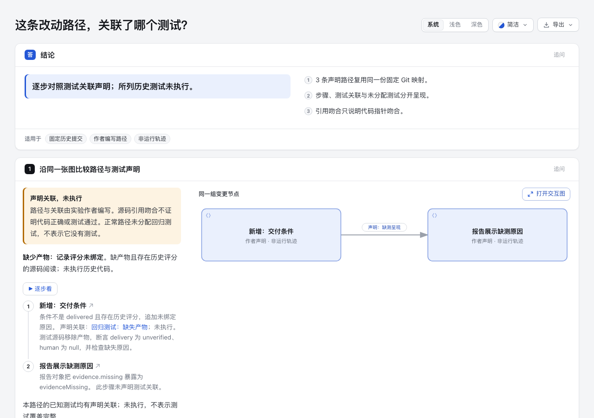

# Task flow → test association · 独立实验

[实际阅读页](final/review.html) 把同一张变更地图编成明确路径：每一步关联哪个测试、哪些步骤未声明关联、哪个已知测试没有分配到本路径。点击关联测试可以跳到原始源码摘录；步骤沿用现有原生图节点身份。

**历史测试未执行。路径和测试关联是实验作者声明，不是运行轨迹或测试覆盖结论。** 初版没有执行 task-view、历史项目代码、测试、构建或安装脚本。后续第 45 批仅运行固定 task-view 前端，未运行其 CLI 校验器；见文末对照证据。

## 与已有能力的区别

`codex/lab-task-review-map` 的固定 `dcedd53856b82d3e403a9651dca0e15840496942` 已提供 why、真实 diff、Git 范围核对、未解释 hunk 和通用节点步骤列表。本实验不重复它的 Git adapter，也不导入它的完整实验目录。

这里只增加一个小 sidecar 投影：`flows.json` 中的 `path` 引用既有节点；`testLinks` 通过显式测试/步骤 ID 关联；`knownTests` 是本固定映射中的已知测试清单，不代表扫描了仓库全部测试。所有引用和摘录来自同一份原字节 `input/mapping.json`，不建立第二套代码事实。

- 缺产物路径：`guard → report`；回归测试只关联 `guard`。源码中移除产物并断言没有人工评分、缺失原因仍保留。测试只检查报告文件存在，未据此声明测试覆盖 `report` 的缺失字段展示。
- 已交付路径：同样两个节点，阅读 `delivered` 分支；没有声明测试关联。已知回归测试列为本路径未分配，不等于该分支没有测试。
- 人为遗漏对照：保留相同路径和 Git 映射，移除测试关联声明。明确标记合成对照，既不改变源码，也不捏造缺陷。

正常/缺产物条件来自固定 head 的 `comparison.mjs:137–139`；`report` 摘录来自 `score-report.mjs:55`。这里只声明两处改动的阅读顺序，不声称前者直接调用后者或真实运行经过该路径。

## 来源与复用边界

灵感项目确认为 [gtindo/task-view](https://github.com/gtindo/task-view/tree/f27b8bef63ec336b8e3487e90ccd484a2fa7a235)，不是同名项目管理软件。2026-10-26 实查时 main 仍为此 SHA；它是 2026-10-23 才公开创建的个人工具，不能由此推断维护成熟。README 表示不接收 issues/PR。

[上游模型](https://github.com/gtindo/task-view/blob/f27b8bef63ec336b8e3487e90ccd484a2fa7a235/internal/review/types.go) 的 `Flow.path/tests` 与 `Edge.kind=tests` 把有序路径及关联测试分开。此处借鉴该用户任务，独立实现投影；不复制上游源码、UI、截图、图标或 vendor 库。

上游顶层 [MIT](https://github.com/gtindo/task-view/blob/f27b8bef63ec336b8e3487e90ccd484a2fa7a235/LICENSE) 不代表所有依赖均为 MIT：[vendor/LICENSES.txt](https://github.com/gtindo/task-view/blob/f27b8bef63ec336b8e3487e90ccd484a2fa7a235/internal/render/assets/vendor/LICENSES.txt) 另列 ELK 的 EPL-2.0。本实验使用 Archify 现有渲染器，不带入 Cytoscape/ELK。当前本仓许可与引用边界见 [NOTICE.md](NOTICE.md)。

[输入来源回执](input/provenance.json) 记录原 commit/path/Git blob 与完整文件 SHA-256：`e04fea9bb1b29fce4926311c6101ad12d8d8d98efaa5eb2f0659a4828557b4cf`。原比较固定 `de004edf47228b6134fd3d29ef91cd5e010c867b → ed62bfefaf490e831259261fdc12f985267590fb`。

输入任意字节变化都会拒绝，不能冒用旧 `reference-matches`。这里复用原映射检查结果；没有重新独立验证历史 Git 引用。路径、关系与 why 仍是声明。引用吻合不证明语义正确、代码正确或测试通过。

## 复现

使用 Node 22.23.3；本次产品基线为 `e837dc4cb83042d2b6c596e039692e25ec62c2da`。仓库依赖按 `CONTRIBUTING.md` 准备，不安装任何 live Skill 或上游软件。

```sh
/opt/homebrew/opt/node@22/bin/node --test experiments/task-flow-tests/project.test.mjs
/opt/homebrew/opt/node@22/bin/node experiments/task-flow-tests/build.mjs experiments/task-flow-tests/fresh-output
/opt/homebrew/opt/node@22/bin/node archify/bin/archify.mjs visual-check \
  experiments/task-flow-tests/fresh-output/review.html \
  --out-dir /tmp/task-flow-tests-fresh-visual --summary --require-provenance
```

输出目录必须全新；已有目录/文件/软链均拒绝写入。构建器只调用现有 `finalize explainer`，写出 `flows.json` 快照、投影、Explainer JSON 和独立 HTML。每次原始 finalize/stdout/stderr/delivery 回执保存在 checkout 外的临时目录，命令输出其路径；本地 `*.delivery.json` 只供 provenance 检查且被 Git 忽略。公开 `build-evidence.json` 是脱敏阶段摘要，不是原始回执或复制文件的 current-provenance 证明。

## 实际证据与失败

- [9 个 focused tests](tests.tap)：输入改变/无效引用不能继承核对结果；未知节点、无声明方向、错误测试目标、重复身份、伪造测试 passed 字段被拒绝；单路径无关联不会继承“三条路径/缺产物已关联”标题；已有输出不被覆盖。它们运行的是本实验投影检查，不是历史测试。
- [最终 finalize](final/build-evidence.json)：validate/deliver/check 通过，0 诊断；Explainer 默认未请求 browser-check。未修改产品 CLI、schema、共享 Reader、依赖、安装包或检查规则。
- [最终实际浏览器与图片](final/captures/summary.json)：16 条 `explainer/browser-keyboard-traversal` 诊断仍保留，总体 `visual-check` 失败。它们针对 4 个页尾链接的 4 个主题/尺寸组合；不能由截图存在改称通过。原始完整回执保存在 checkout 外，公开摘要绑定 HTML hash。
- [首稿](draft-1/review.html) 与其 [截图/失败](draft-1/captures/summary.json) 原样保留。首次把正常路径放在前面，测试关联在首屏之外；修订把缺产物路径移到第一位，[第二稿](output/review.html) 与其图片独立保留。独立复核随后指出写死“三条路径/缺产物已关联”的摘要不适用于单路径输入；最终改为真实路径数和一般性结论，原第二稿不覆写。
- 重排 fixture 后，一个测试仍按数组位置修改“正常路径”，实际误改了缺产物路径，触发正确的非法关联拒绝。[失败 TAP](draft-1/reordered-fixture-test-failure.tap) 保留；测试改按 flow ID 选对象后通过，没有削弱校验。

协调 Agent 将单独核对实际浏览器点击和 Tab 行为。执行结果、机器检查、图片审阅与人类验收各自独立；本页未证明真实审阅节时或对任意仓库泛化。

## 成本判断

收益假设是读者能少做一步“测试属于哪个行为步骤”的脑内配对；尚未测量审阅时间。生产采用前需要真实使用者比较这一任务。

原始实现的维护范围只有固定输入、sidecar、一个 projector 和构建入口。没有 AST、Git 读取层、新 runtime、测试执行器或自动覆盖推断。Focused simplification 检查保留同一映射为事实来源、共享一份投影给页面；未找到值得新增抽象或复制产品能力的理由。后续前端对照包的额外成本单独记录，不属于该最小实现。



## Later comparison evidence

[Round 45: pinned task-view front-end fixture](upstream-frontend/README.md) adds
same-fact graph-scope observations, actual screenshots and reproducible pages.
It does not replace the original artifact or constitute a task-view CLI/Git/schema
validation run. No new PR was created for this follow-up.

[Round 64: native CLI comparison](upstream-cli/README.md) now runs the official
portable task-view 1.2.0 release on an explicitly authored public-schema
projection of the same historical mapping. After preserving and correcting the
first draft's `at` misuse, five references validate and the out-of-range control
fails. Native HTML and actual screenshots are archived; historical tests remain
unexecuted, and the original Archify artifact is unchanged. This does not
retroactively turn the earlier front-end fixture into a CLI-generated page.

[Round 65: prompted reading probe](reading-probe-round65/README.md) archives two
fresh-context readers and their evidence. Both answered the three boundary
questions; this small, ordered observation does not establish an Archify advantage.
