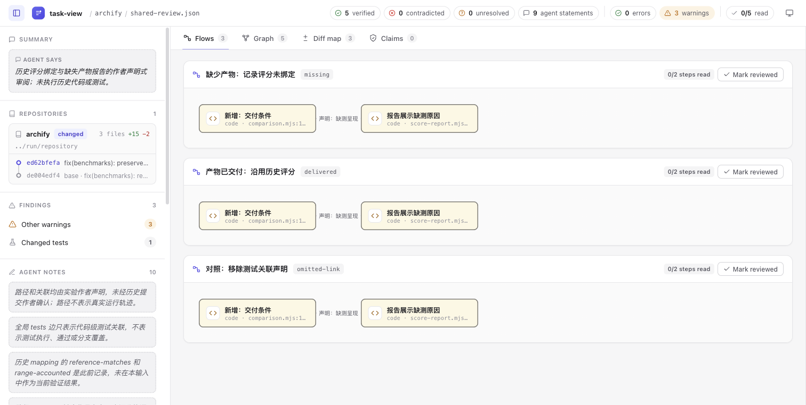
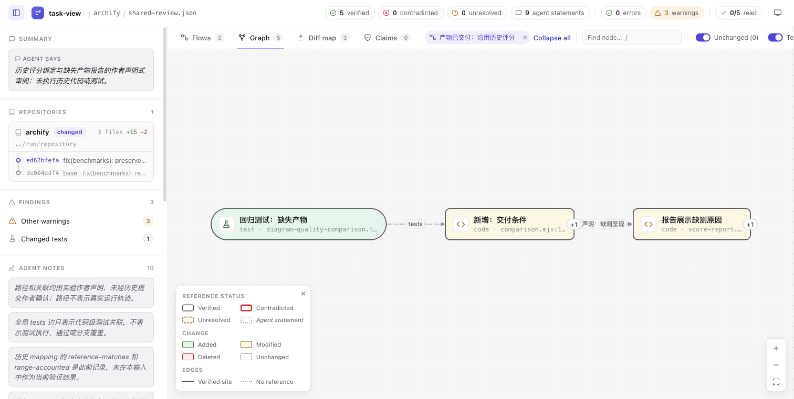
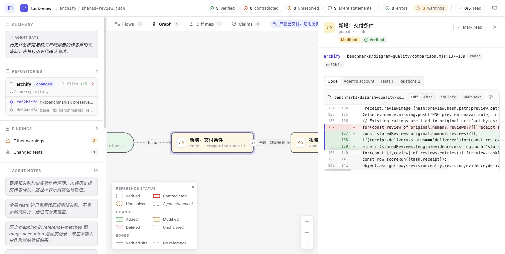

# task-view 原生 CLI：同一历史映射的公开格式验证

2026-10-29，第 64 批。补齐此前仅运行固定前端的边界：这次实际运行 task-view 1.2.0 的 `validate` 和 `open --no-browser`，读取隔离 Git checkout 的历史对象并生成原生页面。**最终正常输入 exit 0，越界引用对照 exit 1；没有执行历史测试。** 原 Archify projector、flows、mapping 和 final/review.html 均未改动。

## 原生结果与图片

[最终原生页面](native/final.html)保留上游自带 JS/CSS 与 UI，仅将机器路径替换为归档占位符；未添加页面包装或修改运行逻辑。截图来自替换路径之前的实际 CLI 输出，均为 1512×762 CSS 像素。原始／公开 HTML hash 见 [归档映射](evidence/archive-hashes.json)。

| 命令与输入 | 实际结果 |
| --- | --- |
| 最终 shared-review，validate | exit 0，valid=true；5 verified，0 contradicted，0 unresolved，9 agentStatements；3 条 no_language 警告 |
| 同输入，open --no-browser | exit 0，生成 2,287,814-byte 原始 HTML；stdout 写出路径，stderr 空 |
| 只把 guard 的范围改为 999999–999999 | exit 1；4 verified、1 unresolved；range_out_of_bounds 明确文件共 158 行，另有 1 条 unmentioned_hunk 和原 3 条语言警告 |

[完整结果](evidence/verification.json)、[正常 stdout](evidence/final-run/shared-review-validate.stdout)和[负例 stdout](evidence/final-run/shared-review-invalid-range-validate.stdout)保留原生分类。verified 指引用与对应 Git 事实，不能解释为代码正确、测试通过、路径覆盖或 why 被证明。



实际点击 Flows 的 delivered 标题，再点 Graph：当前图显示 guard、report 和 regression。侧栏仍保留“delivered 未声明步骤测试关联”的作者注记；图中的测试来自共享节点上的全局 tests 边。因此原生公开格式也呈现了第 45 批前端对照的这一范围，不说明 task-view 完全无法表达路径声明。





Inspector 的 guard 三行最终文本与旧 mapping 的 excerpt 逐字一致，核对来自[实际 DOM](evidence/browser-inspector-dom.json)。截图中的长行需要横向滚动，工具条右侧也有裁出；没有响应式或辅助技术验收。最初按文本点击图节点被 canvas 拦截，失败日志保留，随后按已查看截图坐标点击成功。首张 Inspector 图有 tooltip 遮挡，保留为 [原图](images/native-inspector-tooltip.png)，移开指针后另存最终图；四张图片均已打开检查。

## 输入、首稿失败与修正

现有 mapping / flows 不是 task-view 的 public review schema。本批[手写投影](authored-projection.md)保留 5 个节点、4 条边、3 条路径与原位置、why；测试关联标为 tests，其余边保留原中文声明，不伪造 calls。每路径测试说明保留在 notes；没有把旧 reference-matches 回填为原生结果，也没有声称无损导入内部字段。

历史比较固定 `de004edf47228b6134fd3d29ef91cd5e010c867b → ed62bfefaf490e831259261fdc12f985267590fb`。新建本地 shared clone，在末版 detached checkout；native 命令前后均 clean，不使用 WORKTREE，不执行其中代码或测试。

[首稿](inputs/initial/shared-review.json)给每个 ref 显式写了 at。原生 validate 返回两条 bad_at：base 是改变之前的状态，不在 commits 列表；显式 head at 也跳过 change 检查，出现三条 unmentioned_hunk。首稿、负例、失败 HTML 和所有输出均保留于 inputs/initial、native/initial.html 与 evidence/run。这是投影作者误用，不是上游缺陷。

[refs.go](sources/internal/engine/refs.go)的 resolveState / checkByType 与[上游说明](sources/docs/TASK_REVIEW.md)明确：不带 at 时，deleted 读取 initial，其他读取 final，并进行变更检查。最终每份输入只删除五个 at；节点、行号、why、边、路径及 notes 不变。没有扩大 commits 列表、删除问题节点或改变检查器来取得通过。最终仍保留三条语言识别警告，未额外修正。这组块级节点也没有按官方建议扩到完整声明粒度；CLI 通过不等于所有作者规范均满足。

## 版本、许可与复现

开工核对 336 个 Archify 远程 head，无新增方向；task-view main 仍为 `a3fa21767bfaeb3077fdda08bddb7249366caa93`。原 [Draft #1121](https://github.com/tt-a1i/archify/pull/1121)属于本实验，因此只推进原分支，不另开 PR。

四个源码依赖仍没有本地缓存。本批通过官方 [v1.2.0 release](https://github.com/gtindo/task-view/releases/tag/v1.2.0)取得 Darwin ARM64 便携二进制，在仓库外的实验目录直接运行，没有放入 PATH 或安装包／Skill。二进制 9,769,602 bytes，SHA-256 `4b4d5b7076db29c31ca70c6693ec88d7ed57b30f39a7e2e1c4b090413b6d9f1a`，与发布 API digest 及 SHA256SUMS 一致；[Go build info](evidence/binary-build-info.txt)报告 go1.26.3、vcs.revision=a3fa217、vcs.modified=false，运行 version 报 1.2.0。发行 tag 指向同一 commit，未签名；没有进行可复现构建或签名验证。二进制不随本分支分发。

8 份上游源码／说明逐字节保存，Git blob、长度与 SHA-256 见 [sources/provenance.json](sources/provenance.json)。Yvan Guekeng Tindo 的 [MIT](sources/LICENSE)与完整[第三方许可](evidence/THIRD_PARTY_LICENSES.txt)保留；生成 HTML 中的 Cytoscape／cytoscape-elk 属 MIT，ELK 属 EPL-2.0，其源码参照 [elkjs 0.11.0](https://github.com/kieler/elkjs/tree/0.11.0)。这些不重新归为 Archify Apache-2.0。Archify 历史摘录与 mapping 沿用 [原 NOTICE](../NOTICE.md)。

使用已有同摘要二进制、含历史对象的可信本地 Archify 仓库，以及一个不存在的输出目录：

```sh
python3 experiments/task-flow-tests/upstream-cli/reproduce.py \
  /absolute/path/task-view-darwin-arm64 /absolute/path/archify /tmp/task-view-native-new
```

脚本核对二进制摘要，创建隔离 checkout，仅替换模板的仓库路径，保存三个最终命令的 stdout/stderr/退出码及 HTML，并检查前后 clean。它不下载或安装依赖。这个参数化脚本只做语法检查；原样执行的 run-native.py / run-final.py 留在 evidence，机器路径替换后属于记录，不能直接当可移植脚本。复现脚本整体成功结束不等于负例 validate 成功，应读取每条退出码。

## 判断与限制

原生工具已经完成引用检查、diff、路径范围和 Inspector；当前证据支持保留既有小 sidecar 来表达“作者给这条路径的哪一步声明了哪个测试”，不支持新增通用 importer 或再造完整审查工具。完整格式投影需要处理 commit 状态、语言提示、关联范围及作者粒度，维护成本高于仅把节点画出来。

本批没有执行上游测试、历史 Archify 测试、当前产品套件、构建源码、完整 schema 矩阵或真人阅读比较。只有这一手写固定输入与一项越界对照，不能推及任意仓库或 reader 效率；未合并、发布、安装或新建 PR。Codex 完成研究、执行、图片检查和文档；Terra medium 完成投影及归档，不代表人类审阅。

归档检查：完整 staged whitespace 检查的 29 项均来自保留的原生 HTML／工具输出，原诊断见 evidence/whitespace.json；其余 staged 文件检查通过。独立 Sol medium 只读复核确认输入差分、发布与来源身份、原始结果和 DOM 一致，未重跑程序，不代表人类验收。
