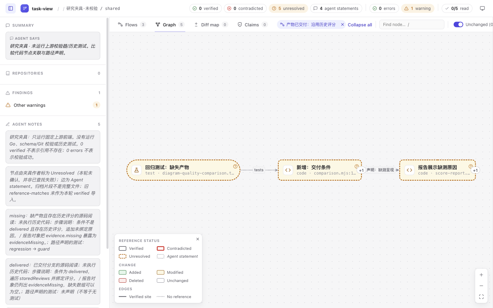
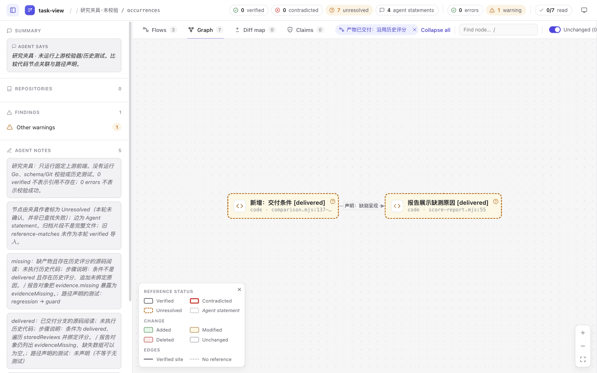

# 固定 task-view 原前端的交互对照

这是 **前端研究夹具**，不是 task-view CLI 生成物。复用 a3fa217 的原 JS、CSS、HTML 模板和三个浏览器库，仅手工投影已归档数据。没有运行 Go、Git/schema 校验或历史测试；所有状态都由夹具作者指定，不是上游检查结果。

本轮推进已有 codex/lab-task-flow-tests，不另开同义方向或 PR。Archify 原 projector、flows 和 final/review.html 未变。

## 观察结果

同一历史 mapping 与 sidecar 取自本实验既有 843c877b251baf89925f99e11594fc5630c1c165。映射本身有 regression → guard 的代码级声明，只有 missing 路径单独声明此测试。三条路径都使用 guard/report；omitted-link 是人为遗漏声明的合成对照。

实际通过 Flows 选择路径，再点击 Graph。每次等待公开 DOM 节点矩形连续稳定，拍摄 1440×900 原图并保存 DOM 文字、URL 和矩形；没有读取或修改应用内部图状态。

| 页面编码 | missing | delivered | omitted-link |
| --- | ---: | ---: | ---: |
| shared：原节点＋全局 tests 边 | 1 | 1 | 1 |
| legacy-only：去掉 tests 边，保留 flow.tests | 0 | 0 | 0 |
| occurrences：每路径独立步骤节点 | 1 | 0 | 0 |

数字是图中实际显示的测试节点数，不是测试执行或覆盖结果。对应图中节点总数分别为 3/3/3、2/2/2、3/2/2。顶部 Graph 5 或 Graph 7 是整个数据集大小，不是当前范围计数。

[九状态操作脚本](browser/07-matrix.mjs)、[最终运行结果](browser/10-matrix-final.log)及同名 JSON/PNG 保留；11 张最终图片已逐张查看。[Code](images/inspector-code.png) 的三行 DOM 文本与归档 guard 片段逐字相同；[Tests 1](images/inspector-tests.png) 显示 regression 及原测试路径。图片中源码横向超出视野，完整字节吻合由 [DOM 记录](browser/inspector-code.json)证明，不是截图完整显示了所有行宽。





## 数据投影边界

build.py 读取原 mapping.json / flows.json，保留标签、why、路径、片段、行范围和两版提交。代码节点标 code，已知测试标 test；base 节点标 deleted、head 节点标 modified，是夹具作者的显示选择，不是 AST/Git 自动分类。只有声明测试边映射为 tests；其余边保留原中文声明作为 kind，未伪装成运行调用。

shared 和 legacy-only 保留五个节点与三条 flow。occurrences 复制 guard/report 为六个路径专属节点，再加一个测试节点；它去掉旧节点与替换边，并改变节点身份，**不是原 mapping 的无损导入**。每条路径的完整文字与测试声明也放进 Agent notes，因此不能据此称原工具完全无法表达这些事实。

投影到内部 viewData，不是上游公开 review schema；repos、files 和 claims 留空，不能用本页判断仓库、diff 或声明校验。归档 reference-matches 不升级为本轮 verified。引用节点标 Unresolved，理由明确写为“本轮未运行校验”，不是已查找失败；由此产生的橙色状态、flow 的 issues 数和顶部 unresolved 数均是夹具标记。边仍为 Agent statement。额外一条 warning 由夹具作者添加，避免空 findings 自动显示“与 diff 一致”。

模板的样式和脚本改成同目录资源链接，app.js/CSS/vendor 字节不改；没有额外浏览器运行时 shim。库只用于本地网页，不安装 Go/npm 依赖或系统软件。页面需连同 source/ 使用，不是可单独搬走的 HTML 文件。

## 失败与修正

initial/ 保留首稿及数据；它们不作为最终验收图。包含：
- 初稿空 findings 导致 “The account matches the diff”；改为显式夹具 warning。
- 非日期 generated 值导致 Invalid Date；改为 fixture.json 中实际记录的夹具生成时间。
- 带 ref 的节点标 agent 触发“没有引用”文案；改为带明确未校验理由的 unresolved。
- excerpt.note 会替代整个代码表；移到页面说明，恢复原始片段。
- 初稿把非 tests 边临时标为 depends_on；最终恢复原中文声明，避免额外语义。
- 一次错误 CLI 文件参数调用、一次跨调用使用过期 snapshot ref、猜测 page.html 的 404，以及连接器无法读取较大的 ELK 文件。后者改用相同固定 raw URL 下载并校对 blob；没有换版本。

修正前的九状态截图和 JSON 在 initial/pre-reference-fix/；其中页面是当时的原始字节快照，嵌套归档后相对资源路径不再直接可用。需要检查旧版时，在临时副本把该 pages/ 放回本目录 pages/ 位置，不能覆盖当前有效页面。最终矩阵记录只绑定当前 pages/；源记录和图片哈希见 manifest.json。

## 复现与检查

使用已有 Python 3，从仓库根目录：

```sh
python3 experiments/task-flow-tests/upstream-frontend/build.py
python3 experiments/task-flow-tests/upstream-frontend/verify.py
python3 -m http.server 18745 --bind 127.0.0.1
```

打开 http://127.0.0.1:18745/experiments/task-flow-tests/upstream-frontend/pages/shared.html；另两页是 legacy-only.html 和 occurrences.html。先在 Flows 点击路径标题设定范围，再点 Graph；点击 guard 步骤查看 Code 和 Tests。页面标题和侧栏明确标注夹具身份。

browser/ 脚本记录本次 Ego 空间 3 与 p1，不能盲目复制该空间 ID 操作别人的浏览器；复现者应选择自己的页面并改输出目录。fixture.json 固定时间使重复构建可字节比较。verify.py 验证来源、生成物、9 条 DOM 结果、源码片段和图片清单；它不替代浏览器观察，也不运行上游校验器。按 test-value，本轮不重复无关产品 suite；原产物字节单独与父提交核对。

## 来源、成本与结论

10 份上游文件完整固定，Git blob/长度/SHA-256 与来源 URL 见 sources.json。task-view 作者 Yvan Guekeng Tindo 的 [MIT](source/LICENSE)保留；[vendor/LICENSES.txt](source/internal/render/assets/vendor/LICENSES.txt)分别保留 Cytoscape 3.33.1、cytoscape-elk 2.3.0 的 MIT 与 elkjs 0.11.0 的 EPL-2.0。ELK 对应源码项目：[elkjs 0.11.0](https://github.com/kieler/elkjs/tree/0.11.0)，远程 tag 核对为 37e798513db6e88b2e205b8239ed4e387d5f24d0。研究夹具不把这些来源重新归为 Archify 的 Apache-2.0。

全量 diff 空白检查报告原始日志的末尾空行及原 vendor 文件的空白；为保留原始字节没有清理。排除这两类归档后的作者文件检查通过。整个对照包约 7.4 MB（含失败稿和 23 张图片），属于研究留档成本，不是可无成本引入产品的功能。

本轮证明图范围确实采用节点级关联，且独立节点表示在这组前端数据下可保留路径区分；它不证明完整原生应用接受该输入，也不证明读者更快、代码正确、测试覆盖或无障碍合格。工具条右侧在 1440px 下被截出，Code 横向滚动、部分标题折行等实际限制保留，不声称响应式验收。

内部数据格式、引用状态与 UI 文案耦合，手写投影有明显维护成本。本次保留对照证据，不推广通用转换器，也不因为原生有 scoped graph 就宣布原 Archify 实验被替代。后续若值得继续，仍需要完整上游流水线与自然读者任务对照。
