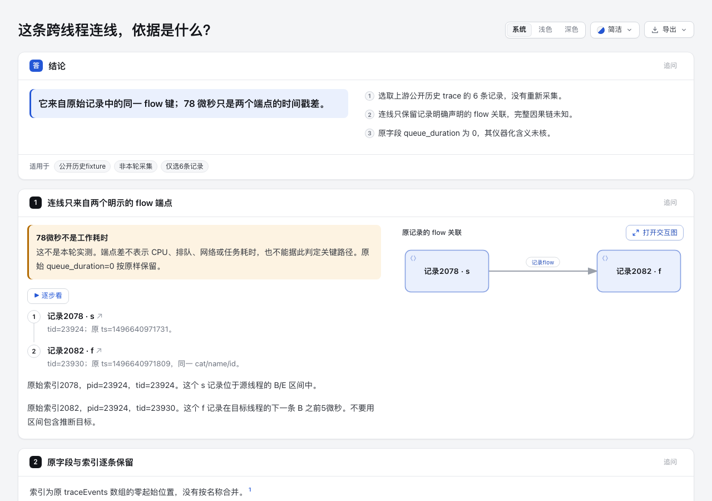

# Trace flow evidence · 明示关联与区间上下文

[实际解释页](final/review.html) 用六条固定原始记录回答：这条跨线程连线依据是什么？图只连接 `s@2078 → f@2082`，B/E 区间和六条完整 JSON 在同页供读者核对。**78微秒只是端点时间戳差；原始 `queue_duration=0` 原样保留，单位、舍入及仪器化含义未核。**

首屏明确标出上游公开历史 fixture、非本轮采集，以及这条记录关联不能证明完整因果链、CPU/排队/网络耗时或关键路径。没有执行上游、采集用户进程或重建业务运行。

## 固定原件与最小选择

- [Catapult原文件](https://github.com/catapult-project/catapult/blob/6fd8bbe723677254ff1130a1a416988b8b3e285e/tracing/test_data/flow.json)，固定 commit `6fd8bbe723677254ff1130a1a416988b8b3e285e`。
- [完整原字节](upstream/flow.json)：690902 bytes，SHA-256 `b17fa02df4a8584d230ad1014ef3578c2f141795681a8c682a644cf7eaf9d1f2`；5017条记录。原件 metadata 的版本为 `Chrome/30.0.1574.0`。本轮未复现其采集命令、机器环境或执行，不把发布原件等同于独立实测。
- [来源账目](source.json) 与 [精确选择](selection.json)：`traceEvents` 零起始索引2077、2078、2079、2082、2083、2084；每个 event 对象完整拷贝，不改原字段、顺序或 ts。新增外壳只有定位 index。其他5011条未投影，但完整原件保留。
- 原件阶段统计：s=866、f=886、B=1625、E=1622、M=18。不能据此给整份 trace 称“全部配对成功”。
- [完整原许可](upstream/LICENSE.catapult) 为 Catapult BSD-3-Clause 风格；[NOTICE](NOTICE.md) 说明原件与派生边界。没有复制 Catapult importer、Perfetto/Speedscope代码或依赖。

## 为什么这两个记录可以连

所选 legacy v1 的完整匹配键是 `(cat=task, name=MessageLoop::PostTask, id=0xafbe9607544ea9db)`。核对**完整原件所有 s/t/f** 后，只有原2078的s和2082的f匹配它。两条属于 pid23924，但 tid 分别23924、23930；没有按函数名合并节点，也不把raw ID当一次执行身份。

该规则来自固定 [Catapult v1 importer L2272–2350](https://github.com/catapult-project/catapult/blob/6fd8bbe723677254ff1130a1a416988b8b3e285e/tracing/tracing/extras/importer/trace_event_importer.html#L2272-L2350)。这是该固定 legacy输入的解释，不是所有 Chrome、Perfetto protobuf 或未来 trace 格式的统一 ID 规则。

`2077 B → 2079 E` 的源线程区间为20微秒，包含2078。`2083 B → 2084 E` 的目标区间为25微秒，2082的f在目标B之前5微秒。v1的 `task` 无bp情形按 [next-slice绑定](https://github.com/catapult-project/catapult/blob/6fd8bbe723677254ff1130a1a416988b8b3e285e/tracing/tracing/extras/importer/trace_event_importer.html#L2144-L2159) 处理，不能只找“包含f的区间”。本实验避免重建绑定：图的两个身份就是原记录2078和2082，而不是源/目标函数或slice。

算术 `1496640971809 − 1496640971731 = 78 us` 与20/25us区间、原queue字段是不同数据。未审计采集器的queue单位及算法，因此不解释0与78为什么不同，也不将任一值改成另一个。

## 相对已有实验的价值与成本

`lab-trace-waterfall@8e65f150` 已将X区间导入现有Waterfall，并明确排除async/flow。这里不重做时间条，而是把**明确记录的跨线程flow关联**和它的原始端点依据一起读。`lab-task-occurrences` 解释打印位置/任务身份；本实验的图节点直接是trace记录出现，既不做对象去重，也不推调度次序。

完整研究与 Perfetto/Speedscope 的取舍在 hub `docs/research/2026-10-26/scouts/async-trace-reading.md`。Perfetto native proto把flow与correlation分开；Speedscope的Chrome importer明确只处理B/E/X，不显示flow不是本轮认定的上游缺陷。本原件没有新版correlation字段，不能声称在同一份数据里实测了该对照。

维护范围是一个固定输入的原创核对/生成器与现有Archify能力。没有通用matcher、B/E parser、collector、protobuf/SQLengine、runtime/schema改动或新依赖。完整原件出现很多复用/缺失ID，本实验不靠最近时间或同名补边。若六行表已满足实际阅读任务，应保留内容例，不能由产图成功升级成产品需求；未测读者效率。

## 复现

产品基线固定为 `e837dc4cb83042d2b6c596e039692e25ec62c2da`，实际Node22.23.3。只需本仓现有依赖（`npm ci --ignore-scripts` 与 `npm --prefix archify ci --ignore-scripts`）；不安装live Skill或上游工具。

```sh
/opt/homebrew/opt/node@22/bin/node --test experiments/trace-flow-evidence/audit.test.mjs
/opt/homebrew/opt/node@22/bin/node experiments/trace-flow-evidence/build.mjs experiments/trace-flow-evidence/fresh-output
/opt/homebrew/opt/node@22/bin/node archify/bin/archify.mjs visual-check \
  experiments/trace-flow-evidence/fresh-output/review.html \
  --out-dir /tmp/trace-flow-fresh-visual --summary --require-provenance
```

输出目录必须全新，已有路径或symlink不会被覆盖。生成器先核完整原件摘要、精确选择、完整文件匹配键/方向，再生成Markdown、evidence和原生图嵌入的独立HTML。它只调用本仓现有finalize，不运行trace里的源码路径、命令或上游程序。

原始stdout/stderr/finalize/delivery回执在checkout外的临时目录，构建输出其位置；本地`*.delivery.json`用于provenance检查并被Git忽略。公开`build-evidence.json`是带产物hash的脱敏阶段摘要，不冒充原始receipt或复制文件的current-provenance。

## 实际检查与保留的限制

- [6项语义测试](tests.tap)通过，无跳过。保护完整输入/原字段不变、全文件键唯一性、跨线程方向、时间差与queue字段分开、错误端点和选择拒绝、已有输出保护。这些是本实验检查，不是上游测试或采集验证。
- [最终finalize](final/build-evidence.json) 的 validate/deliver/check 通过，0诊断；Explainer默认未请求browser-check。
- [首稿](draft-1/review.html)及[原阶段摘要](draft-1/build-evidence.json)保留。首稿有一条写作qualification warning，最终只把“关联不代表完整因果链”改成“只保留关联，完整因果链未知”，未删证据边界。
- 浏览器与实际图片单列于[首稿](draft-1/captures/summary.json)和[最终](final/captures/summary.json)。visual-check仍有keyboard-traversal诊断，整体失败；不因截图可读或静态gate通过而改成通过。原始全量receipt保留checkout外，摘要保留各条诊断及viewport。
- Agent已查看首稿首屏与最终1280px明暗首屏：原始来源/非本轮采集/端点差限定及两个记录可见。协调Agent另作实际浏览器点击/Tab检查，不用其观察覆盖自动失败；人类验收、真实阅读收益和完整trace因果仍未知。

Focused test-value与simplification检查：原件是唯一事实来源，派生页不再维护第二套slice图；测试按身份、方向、原字段和数据保护选取，未增加渲染器全矩阵或复制X importer。源码diff-check与原字节生成产物分别处理；生成HTML的既有模板空白不会为通过diff-check而改写。



## Coordinator browser observations · 2026-10-27

Root actually inspected [final light](root-review/final-light.png), [dark](root-review/final-dark.png), [step 2](root-review/step-2.png), [source footer](root-review/raw-source.png), [Tab focus](root-review/footer-tab.png) and [390px dark](root-review/mobile-dark.png) screenshots. The fixed-source and gap-only limits remain visible in the first viewport. Start → Next reaches 2/2 and highlights record 2082; End exits; the source citation reaches its footer anchor.

From a fresh page, actual Tab input without focus injection reaches the two source links at steps 31–32 and Archify at step 33; step 34 returns BODY. The [raw sequence](root-review/tab-traversal.json) and [artifact/image hashes](root-review/README.json) preserve this observation separately from the **12 failed keyboard diagnostics**. Desktop CSS viewport is 1440×900; mobile is 390×844 with document width 390. The mobile diagram remains a small preview with an open-diagram notice. This is bounded agent UI evidence, not human accessibility, comprehension or speed acceptance.
